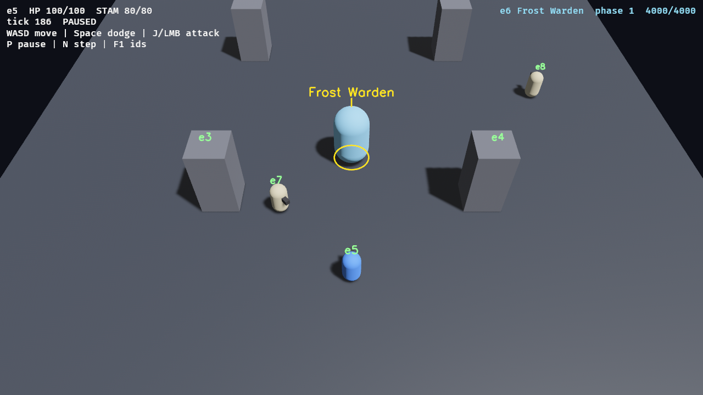

# Shards: игровой движок с ИИ-интеграцией (Rust + Bevy 0.20)

Shards — набор крейтов, на котором отдельный репозиторий собирает игру, не трогая код движка. Игра зависит от
одного крейта, `shards`, и получает детерминированный тик, физику и контроллер персонажа, ввод и камеру, бой на
данных, базу контента, уровни из Blender, сгенерированные регионы, навигацию и врагов-NPC и слой ИИ. Механизмы лежат в движке, содержание (оружие, враги, числа, сюжет) — в игре; в
коде движка нет имён из конкретной игры. Цель — движок под «Осколки Предела»: ТЗ в [docs/engine-tz.md](docs/engine-tz.md),
сверка с ним (что сделано, что впереди) в [docs/engine-progress.md](docs/engine-progress.md).

Движок сделан так, чтобы игру можно было делать вместе с внешними агентами-кодерами: Claude Code, Codex и им
подобными. ИИ не разглядывает пиксели. Движок и так знает всё, что есть в кадре, поэтому он **описывает мир
структурированным текстом** и даёт **типизированный API действий**. Одинаковый seed и одинаковые входы дают
одинаковую игру, поэтому любой сеанс записывается реплеем и проверяет новую сборку.

**Внутри движка LLM нет**: ни встроенного агента, ни локальной модели, ни API-ключей, ни вызовов к моделям. Игра —
среда. Агент запускает её, смотрит и действует из терминала через CLI `shards` (JSON-RPC методы `ai/*` поверх Bevy
Remote Protocol на 127.0.0.1), без MCP-прослоек. Тем же CLI пользуются человек, скрипты и CI. Инструкции для
агентов — в [AGENTS.md](AGENTS.md), своя игра по шагам — ниже и в [template/README.md](template/README.md),
версии и подключение по тегу — в [CHANGELOG.md](CHANGELOG.md).



## Содержание

1. [Быстрый старт](#быстрый-старт)
2. [Как сделать игру на Shards: по шагам](#как-сделать-игру-на-shards-по-шагам)
3. [Архитектура](#архитектура): [крейты](#крейты) · [порядок тика](#порядок-тика) · [граница движка и игры](#граница-движка-и-игры)
4. [Ядро (E1)](#ядро-e1)
5. [Контент (E4)](#контент-e4)
6. [Движение (E2)](#движение-e2)
7. [Действия и бой (E3)](#действия-и-бой-e3)
8. [Уровни из Blender (E4.2)](#уровни-из-blender-e42)
9. [Мир и генерация (E5)](#мир-и-генерация-e5)
10. [Навигация и NPC (E6)](#навигация-и-npc-e6)
11. [Слой ИИ](#слой-ии): [что видит ИИ](#что-видит-ии) · [инструменты](#инструменты) · [время и детерминизм](#время-и-детерминизм) · [задел под сеть](#задел-под-сеть-фаза-c) · [транспорты и CLI](#транспорты-и-cli) · [скриншоты](#скриншоты) · [агенты](#агенты)
12. [Сценарии (E11)](#сценарии-e11)
13. [Инварианты (E11)](#инварианты-e11)
14. [Время тика (E11)](#время-тика-e11)
15. [Меню и консоль разработчика (E11)](#меню-и-консоль-разработчика-e11)
16. [Реплеи](#реплеи)
17. [Снапшоты (E11.4)](#снапшоты-e114)
18. [Сохранения (E8.1–5)](#сохранения-e815)
19. [Настройки (E8.6)](#настройки-e86)
20. [Интерфейс (E9)](#интерфейс-e9)
21. [Локализация (E9.4)](#локализация-e94)
22. [Звук (E9.5)](#звук-e95)
23. [Стилизованные материалы (E10.1)](#стилизованные-материалы-e101)
24. [Растительность и мелкие объекты (E10.2)](#растительность-и-мелкие-объекты-e102)
25. [Эффекты и декали (E10.3)](#эффекты-и-декали-e103)
26. [Сборка для игроков и Windows (E10.6)](#сборка-для-игроков-и-windows-e106)
27. [Отчёт о падении (E10.7)](#отчёт-о-падении-e107)
28. [Песочница](#песочница)
29. [Тесты и CI](#тесты-и-ci)
30. [Что дальше](#что-дальше)
31. [Соглашения и сборка](#соглашения-и-сборка)

## Быстрый старт

```bash
# 1. Системные пакеты (один раз; нужен sudo):
sudo apt install pkg-config libasound2-dev libudev-dev
# (+ libwayland-dev libxkbcommon-dev, если нужен нативный Wayland: --features wayland)

# 2. Игра без окна, на паузе: время идёт только по `step`. Свободный порт и файл с его номером:
cargo sandbox --headless --paused --port 0 --port-file /tmp/shards.port &
export SHARDS_PORT_FILE=/tmp/shards.port

# 3. Из того же или другого терминала:
cargo shards wait                          # ready: tick 0 · pid 4242 · seed 42 · port 40817
cargo shards observe                       # срез мира текстом + журнал с прошлого раза
cargo shards tools                         # что можно сделать (--json: со схемами аргументов)
cargo shards act attack target=e6 repeat=true
cargo shards step --until journal:winds    # в ответе CHANGES и JOURNAL
cargo shards content check                 # ok: 123 definitions in 35 files
cargo shards act regen region=wilds seed=42   # сгенерированный регион к югу от арены; игрок у его ворот
cargo shards act nav_path to='{"x": 24, "z": 140}'   # маршрут к логову по навсетке: path 94.5m, 4 turns: 33.9m SE → …
cargo shards worldgen --region wilds --seeds 1..1000 --report   # проверка генератора на тысяче зёрен
cargo shards scenario crates/sandbox/scenarios/*.scenario
cargo shards save-replay                   # сессия с тика 0 → replays/tick<T>.json
cargo shards save-snapshot                 # состояние на этом тике → snapshots/tick<T>.json (load-snapshot — назад)
kill 4242                                  # pid из `wait`; не kill -9: игра удалит токен и файл порта

# 4. Окно с игрой и снимок с метками eN (нужен дисплей и GPU; без окна — --offscreen, см. «Скриншоты»):
cargo sandbox
cargo shards shot
cargo sandbox --offscreen --paused --port 0 --port-file /tmp/o.port &   # без окна: картинка на GPU
SHARDS_PORT_FILE=/tmp/o.port cargo shards wait && SHARDS_PORT_FILE=/tmp/o.port cargo shards shot

# 5. Реплей: seed и частота тиков берутся из файла.
cargo sandbox --replay replays/tick332.json
cargo sandbox --replay tests/replays/combat_prototype.json --verify
# replay finished at tick 2307: identical to the recording (39 checks) [2307 ticks in 3.46s]
xvfb-run -a cargo sandbox --replay tests/replays/combat_prototype.json --verify --windowed   # то же в окне

# 6. Контент без игры: читает и проверяет все файлы (в том числе файлы уровней тайлов и запечённую навигацию), код 0 или 1.
cargo sandbox --check-content
# ok: 123 definitions in 35 files

# 7. Мир без игры: генератор на тысяче зёрен (код 0, если прошли все) и запекание навигации тайлов.
cargo sandbox --worldgen-report wilds --seeds 1..1000
# ok: worldgen wilds v1, seeds 1..1000: 1000/1000 passed (42 after a retry), 0 fell back, 0 failed, 0 panicked [1000 seeds in 0.31s, 0.3 ms/seed]
cargo sandbox --bake-nav               # baked 9 tiles into nav/ (после правки тайла; без правок файлы не меняются)
```

`cargo sandbox` — это `cargo run -p sandbox --`, `cargo shards` — `cargo run -q -p shards_cli --` (алиасы в
`.cargo/config.toml`); все флаги после `--` уходят в `shards::run` или в CLI. Если запустить собранный бинарник
напрямую (`target/debug/sandbox`), игра ищет `assets/` рядом с исполняемым файлом: укажите `BEVY_ASSET_ROOT=$PWD/crates/sandbox`
(абсолютный путь: относительный не принимает наблюдатель за файлами).

**Rust** ставится через rustup, он добавляет `~/.cargo/bin` в PATH; версия берётся из `rust-toolchain.toml`. В уже
открытых терминалах выполните `source ~/.cargo/env` или откройте новый.

**Пока нет sudo**, сборка работает через локальный обходной путь. В `~/.local/share/rustengine-sysdeps/` распакованы
`pkgconf`, `libasound2-dev` и `libudev-dev`, а также лежит shim `pkg-config`. Перед любой командой `cargo
build/test/run` выполните `source ~/.local/share/rustengine-sysdeps/env.sh`. Нужен он потому, что `bevy_remote` тянет
цепочку `bevy_dev_tools` → `bevy_audio` → `alsa-sys`, а `alsa-sys` ищет `alsa.pc` через pkg-config. После `apt install`
обходной путь не нужен.

Управление в окне — карта ввода движка (`InputMap::standard`, переназначается инструментом `rebind`): WASD или
стрелки — ходить, мышь — камера, Space — прыжок, Shift — спринт, F — планер (держать), Ctrl — перекат, ЛКМ — лёгкий
удар (комбо), ПКМ — тяжёлый, Q — блок (держать), C — фляга, Tab — захват цели, E — «взаимодействие»; геймпад тоже.
Клавиши разработчика в песочнице: P — пауза, N или `.` — один тик на паузе, F1 — оверлей с id, F2 — оверлей боя
(движка), F3 — коллайдеры, F4 — вылечить и воскресить, F12 — снимок с метками в `shots/`. Клавиатура человека и
инструменты агента пишут в один и тот же `Intent`, и нажатия идут через тот же буфер ввода: удар или перекат, который
не удалось начать за время буфера, виден в журнале как `rejected`.

## Как сделать игру на Shards: по шагам

Игра — отдельный репозиторий с одной зависимостью, `shards`. Стартовая точка — [`template/`](template/README.md):
минимальная игра (герой, враг, арена, числа в контенте, свой инструмент, сценарий, реплей, тесты). Ниже шаги по
порядку; каждый проверен на копии шаблона (переименование, `cargo test`, запуск без окна, `shards scenario`, перезапись
реплея). Подробности каждого шага, таблицы файлов и заглушки на будущие модули — в [template/README.md](template/README.md).

1. **Скопируйте шаблон и переименуйте пакет.**
   ```bash
   cp -r template ~/games/pit && cd ~/games/pit && git init
   grep -rIl my_game . | grep -v Cargo.lock | xargs sed -i 's/my_game/pit/g'   # пакет `pit` и папка настроек `SettingsAppId::new("pit")`; Cargo.lock правится сам
   ```
2. **Подключите движок по тегу или коммиту.** В `Cargo.toml` вместо пути (`../crates/shards`) — git-зависимость;
   версии и теги описаны в [CHANGELOG.md](CHANGELOG.md). Шаблон использует мир, NPC и навсетку, поэтому нужен движок
   фазы B (будущий `0.3.0`), тег `v0.2.0` (фаза A) не подойдёт. Пока мейнтейнер не поставил тег, закрепите коммит:
   ```toml
   [dependencies]
   shards = { git = "https://github.com/larelgit/airustcargo", rev = "<хэш>", default-features = false }
   ```
   После выпуска `v0.3.0` замените `rev = "<хэш>"` на `tag = "v0.3.0"`. Сборка не меняется, пока вы сами не поменяете
   `rev` или `tag`. `default-features = false` нужен, чтобы
   features (`render`, `remote`, `hot_reload`, `audio`, `gamepad`, …) включала игра в своём `[features]`. Других
   зависимостей нет: Bevy, serde и schemars приходят через `shards` (`shards::prelude::*`, `shards::serde`,
   `shards::schemars`). CLI ставится той же версии: `cargo install shards_cli --git … --rev <хэш>` (после выпуска — `--tag v0.3.0`).
3. **`main` — одна строка.** `shards::run` читает командную строку (`--headless --seed --port --port-file --no-remote
   --paused --hz --replay --verify --windowed --check-every --check-detail --tick-budget-ms --frame-budget-ms --check-content
   --worldgen-report --seeds --bake-nav --smoke --perf`), ловит `kill` и закрытый терминал:
   ```rust
   fn main() -> std::process::ExitCode {
       shards::run(pit::build_app)
   }
   ```
4. **`build_app` собирает движок и игру.** `EnginePlugins::new(config)` — весь движок из одного `EngineConfig`
   (`config` уже заполнен командной строкой), поверх него плагины игры. Всё, что только для окна (меши, свет,
   камера), — отдельный плагин под feature `render`.
   ```rust
   pub fn build_app(config: &EngineConfig) -> App {
       let mut app = App::new();
       app.add_plugins(EnginePlugins::new(EngineConfig { title: "My game".into(), ..config.clone() }))
           .add_plugins(GamePlugin);
       if !config.headless && !config.testing {
           app.add_plugins(visuals::VisualsPlugin);
       }
       app
   }
   ```
   Для тестов — `shards::testing::test_app(|config| config.seed = 7, |app| { app.add_plugins(GamePlugin); })`: без
   окна, загруженная, на паузе на тике 0.
5. **Мир создавайте в `OnEnter(EngineState::InGame)`, не в `Startup`.** Пока контент не загружен, `LoadingGate` не
   пускает ни одного тика, поэтому загрузка не сдвигает тики; сущности спавнятся в одном и том же порядке, и `AiId`
   с `ColliderId` одинаковы в каждом запуске.
   ```rust
   app.add_systems(OnEnter(EngineState::InGame), spawn_arena);
   ```
6. **Числа и определения — файлы контента** `assets/content/**/*.<вид>.ron`, они меняются на лету. Своя структура с
   `ContentDef` и `app.add_content::<T>()` — свой вид (уровень, оружие, враг); `require_content` называет id, на которые
   опирается код. Проверка без игры: `cargo run -- --check-content`. Подробнее — «Контент (E4)».
7. **Персонаж — префаб.** Компоненты по именам: `CharacterController` (числа движения — id в `*.locomotion.ron`),
   `Fighter` (мувсет), `Health`, `Stamina`, `Poise`, `Team`; `PlayerId` и `LocalPlayer` — тот, кем управляет клавиатура и
   камера; `AiPlayer` — тело агента по умолчанию. Врага получают расширением (`extends: "grunt"`).
8. **Движение, ввод и камера** уже в движке. Клавиши — `InputMap::standard` или свой `*.input_map.ron` (id `default`),
   игрок переназначает их инструментом `rebind`; камера — `commands.spawn((Camera3d::default(), AiCamera,
   ThirdPersonCamera::default()))` в плагине для окна. Настройки игрока (клавиши, графика, звук, доступность) движок
   хранит сам; имя их папки задайте `app.insert_resource(SettingsAppId::new("pit"))` (иначе `shards-<заголовок окна>`;
   в шаблоне оно записано как `my_game` и переименовывается шагом 1 вместе с пакетом, у каждой игры своё),
   см. «Настройки (E8.6)». `InputSettings` нужен только игре, у которой уже был старый `input.ron`.
9. **Боец с мувсетом — файлы.** `*.action.ron` (фазы, окна ударов, неуязвимость, отмены, смещение, стоимость),
   `*.moveset.ron` (какой ввод какое действие запускает, `stagger` и `death`), `*.combat_tuning.ron` (id `default`).
   Мозг врага — своя система в `SimSet::Think`, которая пишет приказ в `Intent` (`Order::Attack`): идти, смотреть и
   бить будет движок по тем же правилам, что у игрока (выносливость, замах, откат).
10. **Свой инструмент и своё условие для агента** (`src/ai.rs`): структура аргументов с doc-комментариями и система
    `In<Call<Args>> -> ToolResult`.
    ```rust
    app.add_ai_tool("taunt", Scope::Player, taunt)           // действие: журнал, CHANGES, реплей
       .add_ai_condition("arena_cleared", arena_cleared);    // `step --until named:arena_cleared`
    ```
11. **Сценарии и эталонные реплеи.** `scenarios/*.scenario` — команды `shards`, ожидания и инварианты; тот же файл идёт
    против живой игры (`shards scenario`) и в `cargo test`. Удачный сеанс сохраняют как эталон:
    ```bash
    shards save-replay replays/smoke.json            # из запущенной игры (или из теста записи)
    cargo test --test game record_reference_replays -- --ignored   # перезапись эталона шаблона: tests/replays/smoke.json
    cargo run -- --replay tests/replays/smoke.json --verify
    # replay finished at tick 258: identical to the recording (5 checks) [258 ticks in 0.05s]
    ```
12. **Тесты.** Один бинарник `tests/game`: сценарии на свежей игре, детерминизм (тот же seed — тот же журнал, `step
    300` равен 5 × `step 60`), реплеи, контент, регион, манифест (единственная зависимость — `shards`). Шаблон проходит 23
    теста за секунды.
13. **CI.** `cargo test --locked`, `cargo run --locked -- --check-content` (читает и файлы уровней тайлов, и запечённую
    навигацию), `--worldgen-report REGION --seeds 1..1000`, `--verify` каждого файла из `tests/replays/` (рабочий `ci.yml` —
    в «CI игры» шаблона и в `.github/workflows/ci.yml` движка).
14. **Новая версия движка.** Поменяйте `tag`, выполните `cargo update -p shards`, прочитайте раздел «Изменено» в
    `CHANGELOG.md`, прогоните тесты и реплеи; реплеи, записанные на старой версии, после изменения геймплея могут
    разойтись — тогда их записывают заново. Снапшоты другой минорной версии движка не грузятся (`force` пропускает проверку).
15. **Регион.** Тайлы с сокетами на краях (`*.tile.ron`), правила сокетов (`*.socket_rules.ron`), точки интереса
    (`*.poi.ron`) и сам регион (`*.region.ron`: размер, фиксированные клетки, точки, проверки, запасная карта `tile_map`,
    `origin`, `active_radius`): формат и все поля — в «Мир и генерация (E5)». Кода не нужно. Проверка без игры:
    ```bash
    cargo run -- --check-content                          # битый сокет, тайл или точка называют файл и поле
    cargo run -- --worldgen-report valley --seeds 1..1000   # код 0, если прошли все зёрна
    ```
    В игре регион появляется по `shards act regen region=valley seed=42` (экран загрузки, игрок у ворот), а
    `app.start_region("valley")` в плагине игры строит его, пока игра грузится. Меняете результат генератора — поднимите
    `version` региона.
16. **Враг-NPC.** Префаб бойца с компонентами `Npc` (поведение, восприятие, план атак) и `Home` (поводок), а поведение, зрение,
    план атак и директор жетонов — файлы `*.behavior.ron`, `*.perception.ron`, `*.attack_plan.ron`, `*.director.ron` в
    `assets/content/npc/`; точка интереса с `prefab` ставит его в лагерь региона. Свои условия и состояния поведения —
    `app.add_npc_condition(..)` и `app.add_npc_state(..)`. Пока нет навсетки, NPC ходят по локальной сетке; чтобы они ходили по
    навсетке региона, запеките тайлы (`cargo run -- --bake-nav`) и положите `assets/nav/` в репозиторий, а определение `nav`
    (`*.nav.ron`) заставит `--check-content` называть устаревший файл. Подробно — «Навигация и NPC (E6)».
17. **Уровень из Blender.** Объекты с custom properties, экспорт glTF с Custom Properties, файл в `assets/`, определение `level`
    (`*.level.ron`: файл и обязательные маркеры) или тайл с `geometry: Level(path: "tiles/ruin.gltf")`: «Уровни из Blender
    (E4.2)».
18. **Как выглядят меши.** Цвет и свет им дают виды: файл `assets/content/*.look.ron`, префаб тела с `"Look": ("hero")`, меши, которые
    игра делает сама, — один белый материал и `Look::new("stone")`. Меняется только картинка (feature `render`, окно или
    `--offscreen`), правка файла видна сразу; `shards act looks` перечисляет виды и что каждый рисует. Подробнее — «Стилизованные
    материалы (E10.1)».
19. **Эффекты.** Искры, пыль, вспышки — файл `assets/content/*.effect.ron`, а какое событие боя что играет — таблица
    `*.fx.ron` (`damaged`, `blocked`, `died`, …); свой момент игра играет `commands.trigger(PlayEffect::new(..))`. Телеграфы атак
    на земле — декали движка без настройки. Только картинка; `shards act effects` перечисляет эффекты и пулы. Подробнее —
    «Эффекты и декали (E10.3)».

Правила, которые держат игру детерминированной (геймплей в `FixedUpdate` внутри `SimSet`, случайность только через
`SimRng`, порядок по `AiId`, управление только через `Intent`, `replay_input`/`replay_ignore`/`add_replay_check`), — в
разделе «Детерминизм: правила игры» [template/README.md](template/README.md). Мир добавляет своё: генерация — чистая функция
(seed, версия, контент) на `DetRng`, а не `SimRng`; регион меняют инструментами и `RegionLoading`, не руками; новое состояние
мира входит в снапшот (`add_snapshot_resource`, `add_snapshot_rebuild`, `add_snapshot_check`).

## Архитектура

```text
            игра (отдельный репозиторий)  ·  песочница (crates/sandbox) — тоже игра на `shards`
                               │ зависит только от
                               ▼
                     shards (зонтик: EnginePlugins, EngineConfig, run, testing, prelude, TileLevelsPlugin)
                               │
          ┌────────────────────┼─────────────────────┐
     shards_npc           shards_world           shards_level
     враги, навсетка      регионы, генератор,    уровни из Blender
                          активные зоны
          └────────────────────┼─────────────────────┘
        ┌────────────┬─────────┴──────┬──────────────┐
   shards_action  shards_motion  shards_content  shards_core
   бой на данных  физика, ввод,  база контента,   конфиг, состояния,
                  камера         префабы          Intent, шлюз загрузки
        └────────────┴─────────┬──────┴──────────────┘
                               │ подключён ко всем модулям
                            ai_core  ──►  CLI `shards`  ◄── агенты · CI · человек
                               │
           parry3d, gltf, ron, … — только внутри модулей, наружу не торчат
```

`shards_world` и `shards_level` друг друга не знают (их соединяет `shards::TileLevelsPlugin`); `shards_npc` стоит над обоими:
берёт у мира граф тайлов, активные зоны и событие «регион загружен», у уровней — файлы тайлов для запекания. `shards_dev`
(меню и консоль разработчика) не знает ни одного модуля: свои пункты меню модули регистрируют в `ai_core` (`add_dev_entry`),
а он вызывает их инструменты по имени. `shards_look` (как рисуются меши) знает только `ai_core`, ядро и контент: к префабам он
подходит проверкой, которую добавляет к виду `prefab` (`add_content_check`), а геймплея не касается. `shards_scatter`
(растительность) стоит над миром и видами: рассыпает экземпляры по тайлам региона `shards_world`, ищет под ними землю физикой
`shards_motion` и красит их видами `shards_look`. `shards_fx` (эффекты) знает `ai_core`, ядро, контент, движение и бой: события
боя и зоны атак он читает, а мир не меняет.

### Крейты

| крейт | что это |
|---|---|
| `crates/shards` | **единственная зависимость игры.** `EnginePlugins`, `EngineConfig`, `run` (стандартный `main`: ещё `--worldgen-report` и `--bake-nav`), `testing` (тестовые приложения), `TileLevelsPlugin` (уровни как тайлы), `coop` (сеть и сохранения вместе: персонаж едет с игроком, мир хранит хост), `prelude`, реэкспорт `bevy`, `serde`, `schemars`, `serde_json` и модулей (`shards::world`, `shards::npc`, …) |
| `crates/shards_core` | ядро (E1): `EngineConfig`, состояния, шлюз загрузки, `Intent`, `PlayerId`/`LocalPlayer`/`NetRole`, реестр модулей |
| `crates/shards_content` | контент (E4): `ContentDef`, база, загрузка и горячая перезагрузка, префабы, инструменты контента, `check_dir` |
| `crates/shards_motion` | движение (E2): физика на parry3d, контроллер, карта ввода, камера, инструменты и запросы движения |
| `crates/shards_action` | бой (E3): действия, мувсеты, машина, попадания, ресурсы, статусы, телеграфы, анимационный мост, оверлеи |
| `crates/shards_level` | уровни из Blender (E4.2): glTF с custom properties → коллайдеры, датчики, маркеры, префабы, компоненты; вид `level`, инструменты |
| `crates/shards_world` | мир (E5): тайлы, регионы и подземелья в контенте, генератор с решателем сокетов и проверками, манифест, пакетные отчёты, загрузка и смена региона, активные зоны, стриминг картинки |
| `crates/shards_net` | сеть и кооператив (E7). Канальный слой (E7.2) без Bevy: транспорты `Transport` (в памяти — `MemoryHub`, детерминированный; UDP для LAN), имитация задержки и потерь (`LinkConditions`, `--net-sim`), `Link` — надёжные и ненадёжные сообщения, блобы, сжатие, подтверждения, RTT и статистика. Поверх него на Bevy — сессия кооператива (`NetPlugin`: хост, клиент, репликация, инструменты `net_*`) и стенд «хост + клиенты» в одном процессе (`Stand`) |
| `crates/shards_save` | сохранения (E8.1–5): секции и реестр, слоты, конверт `shards-save/1`, миграции, атомарная запись с тремя копиями и восстановлением, `save_now` и автосохранение, инструменты `save_*` и `load_game`; секции движка (`region`, `position`, `vitals`) регистрирует зонтик |
| `crates/shards_npc` | враги (E6): автомат поведения, восприятие, режиссёр боя (жетоны), планировщик атак, навсетка по тайлам (`nav`: запекание, сшивка, маршруты), агенты и поводок |
| `crates/shards_settings` | настройки игрока (E8.6): группы графики, звука, управления и доступности на настройках Bevy (`bevy_settings`), `settings.toml`, инструменты `settings`/`settings_set`, окно по настройкам графики |
| `crates/shards_ui` | интерфейс (E9): экраны и темы в контенте (`screen`, `theme`), стек экранов, фокус и навигация, источники значений и действия кнопок, инструменты `ui_*`, раздел `UI` в `observe`; с feature `render` — рисование на Bevy UI с подписями AccessKit |
| `crates/shards_locale` | локализация (E9.4): языки в контенте (`locale`), тексты на Fluent (`assets/locale/<язык>/*.ftl`) с параметрами и формами множественного числа, запасной язык, настройка `locale.language` и смена языка на лету, инструменты `locale` и `text`, горячая перезагрузка файлов |
| `crates/shards_audio` | звук (E9.5): звуки, музыка и микшер в контенте (`sound`, `music`, `audio`), шины с громкостью из настроек, голоса с приоритетом и лимитом, пространственные звуки, музыка в слоях по условиям игры, звуки телеграфов и событий, инструменты `audio`, `sound_play`, `music_set`, строка `MUSIC` в `observe`; с feature `audio` зонтика — воспроизведение через Bevy audio |
| `crates/shards_look` | вид мешей (E10.1): виды в контенте (`look`, `*.look.ron`) — цвет, свет полосами (`Toon`), `Matte`, `Unlit`, `Lit`, плоские грани, контур одной ширины в пикселях, свечение, материалы glTF; компонент `Look`, материал и шейдеры на WESL, инструменты `looks` и `look_outlines`, поле `looks` в `ai/status`, два пункта меню разработчика; с feature `render` — стилизация мешей (окно или `--offscreen`) |
| `crates/shards_scatter` | растительность и мелкие объекты (E10.2): вид контента `scatter` (`*.scatter.ron`) — что рассыпать по тайлам каких регионов, как густо, на какой земле, какими видами, какие меши вблизи и вдали; раскладка по зерну региона (одинаковая в каждом запуске), меши-примитивы (пучок травы, конус, камень, коробка) или glTF, уровни детализации через `VisibilityRange`, настройка `graphics.foliage`, инструменты `scatter` и `scatter_set`, поле `scatter` в `ai/status`, два пункта меню разработчика; с feature `render` — экземпляры под тайлами (окно или `--offscreen`) |
| `crates/shards_fx` | эффекты (E10.3): эффекты в контенте (`effect`, `*.effect.ron`) и таблица событий (`fx`, `*.fx.ron`) — частицы из пулов (`max_live` мешей на эффект, один меш и один материал, цвет в `MeshTag`), квадраты к камере, кубики и осколки, свечение, полёт по формуле на часах симуляции; `PlayEffect`, эффекты событий боя и меток клипов; декали телеграфов (`ForwardDecal` с материалом зоны на WESL: круг, сектор, прямоугольник, «стадион», заливка растёт к удару), `DepthPrepass` камерам `AiCamera`; инструменты `effects`, `effect_play`, `telegraph_decals`, поле `fx` в `ai/status`, два пункта меню разработчика; с feature `render` — рисование (окно или `--offscreen`) |
| `crates/shards_dev` | меню и консоль разработчика (E11): пункты модулей (`add_dev_entry`) и игры (вид контента `devmenu`), консоль строк `tool key=value`, инструменты `dev_menu` и `console`; с feature `render` — панели в окне (F10 и `` ` ``), Tab дописывает имена из схем, контекст ввода `dev` |
| `crates/ai_core` | слой ИИ, не зависит от конкретной игры: id, срез мира, журнал, инструменты, время, реплеи, транспорт |
| `crates/shards_script` | без Bevy: формат сценариев, их запуск, разбор условий `--until`, долгая игра агентов (`soak`) и их случайные входы; общий для `shards` и тестов |
| `crates/shards_cli` | бинарник `shards`, тонкий клиент к `ai/*` |
| `crates/sandbox` | тестовая арена движка, собранная только на `shards`, как игра (см. «Песочница») |
| `template/` | минимальная игра для копирования: отдельный workspace с единственной зависимостью `shards` |

Модули `ai_core`:

| модуль | ответственность |
|---|---|
| `id` | `AiId` (`e42`): стабильный монотонный id, никогда не переиспользуется; надгробия для удалённых. Id назначает только движок: `set` и BRP `world.mutate_components` его не меняют, а новая вставка перенумеровывает сущность (надгробие `renumbered to e99`) |
| `describe` | только явно зарегистрированные компоненты видны ИИ, у каждого короткий describe; подсказки под строкой `YOU` (`register_ai_advice`) |
| `observe` | текстовый срез: YOU / ALERT / SEEN (по угрозе) / NOT IN VIEW / LANDMARKS / разделы модулей (`register_ai_observe_section`: `UI`, `MUSIC`) / SINCE, видимость от глаз субъекта; `inspect`, `nearby`, диффы |
| `spatial` | позиции относительно игрока («8.4m NE»), line of sight (подменяемо: движение ставит лучи по физике, `AiOccluder` тоже работает) |
| `journal` | кольцевой буфер игровых событий (observers) плюс перехват `warn!`/`error!` из tracing: строка получает тик, на котором записана, и попадает в журнал после каждого тика; не больше 64 строк на тик. Строки вида `local` (`[local] music: …`) показывает только эта машина: хост их клиентам не шлёт |
| `tools` | реестр: args-struct + Bevy-система, JSON Schema (schemars), scope, `catch_unwind` |
| `builtin` | встроенные инструменты: observe, inspect, step, set/get через reflection, … |
| `sim` | тик, пауза, синхронный `step` по FixedMain, стоп-условия, остановка игры (`Halt`) на упавшей системе и нарушенном инварианте, `SimGate` (удержание тиков на время загрузки) |
| `invariants` | правила, которые проверяются после каждого тика: игровые (`add_ai_invariant`) и сессионные (`assert_add`); нарушение останавливает игру, как упавшая система |
| `replay` | запись входов и action-вызовов с тика 0, проигрывание, хэши состояния, отчёт о расхождении |
| `perf` | реальное время каждого тика против бюджета: строка `ticks:` в ответе `step`, записи `perf` в журнале, поле `perf` в `ai/status`; ни в хэше, ни в реплее |
| `rng` | детерминированный RNG: счётчик по (seed, tick, AiId, salt) |
| `scenario` | запуск файлов сценариев в процессе через `call_tool` (`run_file`, `run_str`) |
| `dev` | пункты меню разработчика (`DevMenu`, `add_dev_entry`: строка, строка в консоль или строка по состоянию мира) и разбор строки консоли `tool key=value …` в вызов инструмента |
| `session` | агенты: имя, scope (Player/Dev), «тело», курсор журнала |
| `status` | поля `ai/status`; модули добавляют свои через `add_ai_status` |
| `failures` | паника системы геймплея останавливает игру, а не убивает её: очередь сбоев, краш-реплеи |
| `snapshot` | снапшоты: состояние симуляции в любой тик в файл и обратно, реплей со снапшота (см. «Снапшоты») |
| `paths` | файлы пишутся только в `replays/`, `shots/` и `snapshots/` игры |
| `remote` | методы `ai/*` для BRP (feature `remote`) |
| `highlight` | гизмо-подсветка и оверлей id поверх сцены (feature `render`) |
| `shot` | снимок окна (или картинки игры без окна, `--offscreen`) с метками `eN` и легендой в пикселях картинки (feature `render`) |

### Порядок тика

Весь геймплей идёт в `FixedUpdate`, в одном из `SimSet`; системы модулей лежат в своих наборах, так что система игры
встаёт «до» или «после» них (`.before(ActionSystems::Hits)`) и порядок остаётся полным:

```text
FixedFirst       ai_core: тик +1, применить события реплея и вызовы между тиками
FixedUpdate
  PhysicsSystems::Sync            коллайдеры, сдвинутые между тиками (`teleport`, `set`)
  SimSet::Input    WorldSystems::Zones           ActiveZone / Dormant вокруг игроков (до приказов)
                   CoreSystems::FollowOrders     Order::MoveTo → Intent
                   ActionSystems::Orders         Order::Attack → Intent (после FollowOrders)
                   NpcSystems::Sense             кто активен; зрение, слух, память (после Orders и Zones)
                   NpcSystems::Decide            автомат поведения: переход, хук состояния
                   NpcSystems::Direct            жетоны атаки, роли ждущих
                   NpcSystems::Plan              планировщик: выбрать атаку, подойти, нажать
                   NpcSystems::Navigate          маршруты по навсетке, следование, уклонение, поводок
                   NpcSystems::Drive             что решил NPC → Intent
  SimSet::Think    мозги игры: решают, что делать, и пишут в Intent (видят NpcBrain и могут её дополнить)
  SimSet::Act      MotionSystems::Intent         Intent → LocomotionInput
                   ActionSystems::Machine        буфер ввода, запуск и ход действий (смещение, i-frames, блок)
                   ActionSystems::Effects        лечение, выносливость, статусы, эффекты игры
  SimSet::Move     ControllerSystems::Move       контроллер — единственный, кто двигает тела
  PhysicsSystems::SyncAfterMove                  новые позиции тел для попаданий
  SimSet::Resolve  ActionSystems::Hits           окна ударов × хёртбоксы → конвейер урона → события
                   ActionSystems::Fighters       спринт, восстановление, перезарядки, конец действий
                   ActionSystems::Statuses       накопление и срок статусов
                   ActionSystems::Deaths         боец с 0 здоровья умирает
  SimSet::Cleanup  CoreSystems::ClearPresses     нажатия, которые никто не взял, сбрасываются
FixedLast        ai_core: проверки реплея (хэш мира), записать входы, журнал, очередь сбоев
```

Между тиками (`PreUpdate`) клавиатура, мышь и геймпад пишут в `Intent`; камера работает в `PostUpdate` и ничего в
симуляции не читает. Смена региона и навсетка — не часть тика: `regen` и `region_load` — инструменты-действия, они идут между
тиками и внутри одного вызова делают весь переход `InGame → RegionLoading → InGame` (старый регион уходит, новый строится,
навсетка сшивается), так что ни один тик не видит полурегион и тик не сдвигается. Картинка тайлов (`stream`) идёт в `Update`.

Тест `gameplay_systems_have_a_total_order` ловит системы без явного порядка у песочницы, движка с движением и боевого модуля.

### Граница движка и игры

- Движок даёт механизмы и инструменты: детерминированный тик, физику, контроллер, систему действий, базу контента,
  слой ИИ. Игра даёт содержание и числа: оружие, атаки, врагов, боссов, тайлы, сюжет, баланс, внешний вид.
- Проверка: если механизм пригодится второй игре с другим сюжетом — он в движке; если это конкретное «что» — в игре.
- Игра зависит только от `shards` и не меняет код движка: свои плагины она добавляет поверх `EnginePlugins`. Это
  проверяет тест шаблона (`manifest.rs`).
- Модуль движка подключается одной строкой в `EnginePlugins` и называет себя в `ai/status`
  (`add_engine_module(name, version)`).
- Сторонний крейт выбирают только после проверки, поддерживает ли он Bevy 0.20 и жив ли проект; версию закрепляют, а сам
  крейт прячут за API движка. Так он заменяется, а Bevy обновляется без правок игры.

## Ядро (E1)

Крейты `shards` и `shards_core`. Всё, что нужно запустить игру: конфиг, состояния, шлюз загрузки, `Intent`.

**`EngineConfig`.** Одно значение собирает движок: `EnginePlugins::new(config)`. `shards::run` заполняет его командной
строкой, тесты берут `shards::testing::config()`.

| поле | что |
|---|---|
| `title`, `window` | заголовок и размер окна (1280×720) |
| `version` | версия игры для отчётов о падении (`None`; шаблон и песочница ставят `env!("CARGO_PKG_VERSION")`) |
| `headless` | без окна, GPU и звука: CI, серверы, параллельные прогоны |
| `offscreen` | без окна, но с GPU: камеры рисуют в картинку размера `window`, её снимает `shot` (`--offscreen`, см. «Скриншоты»). Это не `headless`: игра добавляет свой вид (`draws()`), а настройки игрока, как без окна, не читаются |
| `seed` | seed мира (42 по умолчанию): тот же seed и те же входы дают ту же игру |
| `port` | порт BRP для `shards` (`None` — без сервера) |
| `paused` | старт на паузе; тики идут по `shards step` |
| `tick_hz` | тиков в секунду (60) |
| `crash_replays` | сбой геймплея сохраняет `replays/crash-tick<N>.json` и отчёт о падении в `crashes/`, нарушенный инвариант — `replays/invariant-<name>-tick<N>.json` (см. «Отчёт о падении») |
| `check_every`, `check_detail` | тиков между проверками реплея (60, `--check-every`) и что проверка хранит, чтобы назвать разошедшееся: `components`, `entities` или `none` (`--check-detail`); оба пишутся в файл реплея |
| `tick_budget` | тик дольше этого — «сверх бюджета» (`--tick-budget-ms`); `None` — длительность самого тика |
| `frame_budget` | кадр дольше этого — «сверх бюджета» (`--frame-budget-ms`; поле `frames` в `ai/status`); `None` — 1/60 с. Кадры есть только у игры, которая рисует |
| `report_perf` | строка `ticks:` под ответом `step` и записи `perf` в журнале; в `shards::testing::config()` выключено |
| `after_loading` | куда идёт `Loading` после загрузки (`InGame`; `MainMenu` для игры с меню) |
| `hot_reload` | применять файлы контента по мере правки (нужна cargo feature `hot_reload`; в тестах и `--verify` выключено) |
| `asset_dir` | папка ассетов; контент в `<asset_dir>/content/`. Относительно папки игры (`CARGO_MANIFEST_DIR` под cargo, иначе рядом с исполняемым файлом); `BEVY_ASSET_ROOT` перекрывает |
| `testing` | тестовое приложение: без окна, логгера, Ctrl+C и цикла; его ведут через `app.update()` и инструменты |
| `embedded` | игра рядом с другой в том же процессе (клиенты стенда): как `testing`, но со своим портом BRP, а её логи идут в её журнал (`testing::embedded_config(port)`) |
| `net` | `NetLaunch`: `Off`, `Host { port }` (`--host`, 7777 = `DEFAULT_NET_PORT`), `Join { addr }`, `Stand { clients, udp }` |
| `player_name`, `net_sim` | имя игрока для других (`--name`); условия сети для своих линков (`--net-sim latency=150,loss=0.02`) |
| `save_dir`, `character_slot`, `world_slot` | папка сохранений (`saves`); слоты персонажа и мира (`--character`, `--world`) |
| `settings` | `SettingsStore`: `Default` (папка настроек платформы), `Dir(путь)` (`--settings-dir`), `Off` (`--no-settings`, тесты) |
| `exit_with_host` | клиент выходит, когда сессия кончилась, а не возвращается в меню: с кодом 0, если её завершил хост, 1 — отказ, кик, потеря хоста, мир не принят; 2 — сессию не открыть (адрес, который не разобрать; у `--host` занятый порт). Хост (`--host`) по `net_end` не выходит |

**Окно и без окна — те же плагины.** Режим без окна — `EnginePlugins` без окна, GPU и звука: `WindowPlugin` без
окна, нет winit, `RenderPlugin` без бэкенда (плагины рендера остаются зарегистрированными), цикл на 60 Гц вместо цикла
событий. Работают трансформы, ассеты, сцены, состояния и физика, поэтому геймплей одинаковый. Это проверяет `--verify
--windowed`: реплей в окне даёт тот же отчёт, что без окна. Режим `--offscreen` — середина: плагины окна без самого окна
(нет winit, цикл как без окна), но рендер и гизмо работают на GPU, а камеры, нацеленные на главное окно, рисуют в картинку
(см. «Скриншоты»). Свой вид (меши, свет, камеры) игра добавляет, когда `config.draws()` — есть окно или `--offscreen`;
системы, которые только показывают (HUD, оверлеи, сглаживание чужих тел у клиента), идут с условием
`ai_core::display::drawn`. Cargo features у `shards`, `sandbox` и шаблона: `render`
(окно, 3D, UI, клавиатура и мышь; без неё игра собирается только для `--headless`), `remote` (методы `ai/*`),
`hot_reload` (по умолчанию все три), `audio` (звук через устройство вывода; песочница и шаблон включают его по умолчанию,
см. «Звук»), `gamepad`, `wayland`, `dynamic`, `trace_tracy`; у `shards` и шаблона ещё `dist` — сборка для игроков (см. «Сборка для игроков и Windows»).

**`shards::run`** — стандартный `main`. Флаги: `--headless | --offscreen --seed N --port N|0 --port-file F --no-remote --paused --hz N
--replay FILE --verify [--windowed] --check-every N --check-detail components|entities|none --tick-budget-ms MS --frame-budget-ms MS
--check-content --worldgen-report REGION [--seeds S] --bake-nav [TILES] --smoke TICKS --perf ID`; для фазы C:
`--host [PORT] | --join ADDR | --stand N [--stand-udp]` (взаимоисключающие, `--stand` только с `--headless`), `--name`,
`--net-sim SPEC`, `--save-dir DIR`, `--settings-dir DIR | --no-settings`, `--character SLOT`, `--world SLOT` (слот —
1–32 символа `a-z0-9_-`), `--exit-with-host`. `--host`, `--join` и `--stand` начинают сессию (раздел «Сессия
кооператива»); `--stand-udp` вместо стенда в одном процессе запускает хост по UDP и N клиентов дочерними процессами (только
в реальном времени: с `--paused` выход с кодом 2), опечатка в `--net-sim` — тоже код 2 (`latency=15O` не запускает игру без
задержки). Занятый порт —
выход с кодом 3 до того, как собрано хоть что-то. `--check-every` и `--check-detail` задают запись реплея, поэтому с `--replay`
не сочетаются. `--tick-budget-ms` — число миллисекунд, которое помещается в `Duration` и не меньше 1 нс; `inf`, `1e30` и `1e-10`
дают ошибку командной строки (код 2), а не панику. `--verify` выходит с кодом 0 (совпало, ничего не нарушено), 1 (разошлось,
упала система геймплея или нарушен инвариант) или 2 (реплей или его снапшот не читаются); `--check-content`, `--worldgen-report` (все зёрна прошли) и `--bake-nav`
(все тайлы запеклись) — 0 или 1. Эти три режима ничего не запускают (`--bake-nav` грузит игру без окна, но не делает ни тика).
`kill` и закрытый терминал завершают игру через `AppExit`: токен и файл порта удаляются.
Паника, которая уносит игру, оставляет отчёт `crashes/crash-…json` и код выхода 101 (см. «Отчёт о падении»).
`--offscreen` не сочетается с `--headless`, `--stand`, `--verify` и проверками (`--check-content`, `--worldgen-report`,
`--bake-nav`, `--smoke`); без GPU он выходит с кодом 2 и советом, без фичи `render` — тоже. С `--perf` (автотест
производительности, см. «Время кадра и автотест производительности») он сочетается: тогда автотест меряет и кадры.

**Состояния** (`EngineState`, Bevy States): `Loading` → `InGame` (или `MainMenu`, если так задал `after_loading`),
`RegionLoading` — экран загрузки региона: через него идёт `regen` (см. «Мир и генерация»). Внутри `InGame` — `PauseState::{Running, Paused}`: игровая пауза,
в одиночной игре она останавливает и симуляцию; `shards pause` и `--paused` — инструмент разработчика и `PauseState` не
трогают. Игра вешает свои системы на `OnEnter`/`OnExit` этих состояний; переходы пишутся в журнал (`state Loading ->
InGame`).

**Шлюз загрузки.** Модули регистрируют, чего ждать (`app.require_loaded("content", check)`; контент регистрирует свои
файлы). Пока что-то не готово, `ai_core::SimGate` не пускает ни одного тика, ни в реальном времени, ни через `step`
(он отвечает `the game is still loading (content: 2 files left); wait with \`shards wait\``), поэтому загрузка не
сдвигает тики: тик 1 всегда идёт на одном и том же мире. `shards wait` ждёт конца загрузки.

**`Intent`** — единственный вход персонажа: клавиатура, геймпад, инструменты агента, мозги врагов, (позже) сеть и
реплей пишут в один компонент между тиками, а геймплей его читает.

| поле | что |
|---|---|
| `move_dir` | куда идти по земле, длина ≤ 1 (до 0.5 — шаг, 1 — бег) |
| `aim`, `target` | куда смотреть; цель захвата |
| `held` | кнопки, зажатые сейчас: `sprint`, `block`, `glide`, … |
| `pressed` | нажатия с прошлого тика (`Press { input, dir }`); их берёт геймплей, остальные сбрасываются в конце тика |
| `orders` | приказы на много тиков: `Order::MoveTo { target, within }`, `Order::Attack { target, input, repeat }` |

Имена ввода движка — в `shards::core::input_names` (`jump`, `sprint`, `glide`, `dodge`, `light`, `heavy`, `block`,
`parry`, `technique.N`, `use_item`, `interact`, `lock_on`); игра добавляет свои. `Intent` — вход реплея
(`replay_input::<Intent>()` движок делает сам): записываются изменения между тиками. `PlayerId` и `LocalPlayer`
отмечают игроков, `NetRole` (`Single` по умолчанию) — задел под сеть.

**Задел под сеть (фаза C).** Всё это в одиночной игре ничего не меняет.

- Клиент не симулирует: каждый `SimSet` идёт с `run_if(simulates)` (`NetRole::simulates()` — всё, кроме `Client`).
  На клиенте из `FixedUpdate` идут только наборы предсказания `NetSet::PredictInput` → `NetSet::Predict` →
  `NetSet::PredictEnd` (`run_if(predicts)`, только для своего тела с маркером `Predicted`; см. «Сессия кооператива →
  Предсказание и сглаживание») и системы вне `SimSet` и `NetSet`. Список последних — тест песочницы `net_seams`: сейчас
  это `sync_physics` дважды.
- `app.add_exit_hook(name, fn(&mut World))`: хуки выхода идут один раз, по порядку регистрации, когда записан
  `AppExit` (система в `Last`) или пришёл сигнал (`shards::run`).
- `SeedLock`: `hold_seed(world, reason)` держит шлюз загрузки под `seed`, `adopt_seed(world, seed)` пишет seed в
  `EngineConfig`, `SimSeed` и `SimConfig` и отпускает. Стартовый регион ждёт `seed_ready` и строится по `SimSeed`.
- Смена региона заканчивается событием `WorldRebuilt { reason: "region <id>" }` (как и загрузка снапшота).
- `player_body(world, n)` — тело с `PlayerId(n)`; через него агент, привязанный к игроку, находит своё тело.

**`ai/status`** показывает версию и модули: `engine: {version: "0.2.0", modules: [core, content, settings, motion, action, level,
world, npc, net, save, coop, locale, ui, audio, look, scatter, fx, dev], state: "InGame", pause: "Running"}` и `loading: []`, пока
ничего не грузится; с регионом в мире ещё поле `world`.

## Контент (E4)

Числа и определения игры лежат в файлах, не в коде: атаки, префабы, числа движения, уровень. Файлы правятся на лету.

**Виды и файлы.** Вид — Rust-структура с `ContentDef` (`KIND = "attack"`), зарегистрированная в `app.add_content::<T>()`.
Определения лежат в `<assets>/content/**/*.<вид>.ron`, в каждом файле одна карта «стабильный id → определение»:

```ron
// assets/content/combat/attacks.attack.ron
{
    "sword": (windup: 0.15, recover: 0.25, damage: 25.0),
    "claw": (windup: 0.45, recover: 0.6, damage: 8.0),
}
```

- Id — непустая строка без пробелов и управляющих символов; уникален внутри вида по всем файлам.
- Движок регистрирует свои виды: `prefab`, `locomotion`, `action`, `moveset`, `status`, `combat_tuning`, `animset`,
  `input_map`, уровни `level`, мир `tile`, `socket_rules`, `poi`, `region`, `tile_map`, `room`, `dungeon`, враги `behavior`,
  `perception`, `director`, `attack_plan`, `npc_tuning` и `nav`, вид мешей `look` (см. «Стилизованные материалы (E10.1)»),
  растительность `scatter` (см. «Растительность и мелкие объекты (E10.2)»), эффекты `effect` и `fx` (см. «Эффекты и декали
  (E10.3)»). Игра добавляет свои: у песочницы `layout`, у шаблона `arena`.
  `content_list` (инструмент) показывает виды и число определений.
- `#[serde(deny_unknown_fields)]` на структуре превращает опечатку в ошибку со строкой; без него опечатка в необязательном
  поле молча оставит значение по умолчанию.
- `require_content::<T>(&["yard"], "pit")` называет id, которые использует код: без него в контенте будет ошибка,
  а правка, которая его удаляет, откажет.

**Загрузка и проверка.** Папка `content` грузится через asset server, пока шлюз загрузки держит симуляцию; затем каждый
файл разбирается, и вся база проверяется целиком: схема, повторные id, ссылки между определениями (`refs.require::<ActionDef>(id,
"поле")`). Ошибки называют файл, строку, определение и поле, а при опечатке и ближайший id. Определения, которые
разобрались, работают всё равно. Настоящие сообщения (три опечатки в копии контента песочницы):

```text
$ BEVY_ASSET_ROOT=/tmp/broken target/debug/sandbox --check-content
content/characters/bodies.locomotion.ron:12:9: locomotion `player`: Unexpected field named `walk_spead` in `CharacterParams`, expected one of `radius`, `height`, `walk_speed`, … or `turn_speed_deg` instead
content/combat/fighters.moveset.ron: moveset `player`: inputs.light -> unknown action `light_one` (did you mean `light_1`?)
content/characters/characters.prefab.ron: prefab `skeleton`: unknown component `Helth` (did you mean `Health`?)
3 content errors in /tmp/broken/assets
```

Повторный id называет оба файла (`content/b.attack.ron: attack `sword`: already defined in content/a.attack.ron`), файл с
неверным видом — ближайший зарегистрированный (`no content kind `atack` (did you mean `attack`?); registered: …`). Файл,
который не разобрался, не даёт в базу ни одного определения, поэтому следом идут ошибки ссылок из других файлов:
причина — первая строка.

**Читать контент** в системах — `Content<T>` (`attacks.get("sword")`), вне систем — `ContentDb::get::<T>(id)`. Геймплей
контент не пишет.

**Горячая перезагрузка** (`hot_reload`, включена по умолчанию): правка, создание и удаление файла проверяются вместе
со всей базой. Чистая правка применяется инструментом `content_apply`, поэтому она записывается в реплей на своём тике и
проигрывание повторяет её; в журнале — `content reloaded: combat/player.action.ron (1 definition changed)`. Сломанная
правка остаётся в журнале ошибкой с файлом и строкой, прежняя версия действует:

```text
#7 2 [error] content: content/combat/player.action.ron:15:77: action `light_1`: Unexpected field named `dmage` in `HitDef`, expected one of `span`, `shape`, `at`, `damage`, … ; kept the previous version
```

Хэш базы входит в проверки реплея: запись, сделанная с другими числами, расходится на ближайшей проверке (так и надо,
эталоны записывают заново). Чем применяется на лету: числа движения и боя действуют со следующего тика; уровень и префабы
читаются при создании сущностей (новые сущности, например после `spawn_prefab`, видят правку, а уже созданные — нет).

**Префабы** — сущности в данных. Компоненты по коротким именам или полным путям, значения читаются через
reflection, как в сценах Bevy; каждый компонент должен иметь `#[derive(Reflect)]` и `#[reflect(Component)]`. Поля, которые
покрывает `Default` (с `#[reflect(Default)]`), можно не писать. `extends` начинает с другого префаба и заменяет компоненты целиком;
циклы — ошибка проверки.

```ron
// content/characters/monsters.prefab.ron
{
    "skeleton": (components: {
        "Name": "Skeleton", "AiKind": ("Skeleton"),
        "CharacterController": (params: "skeleton"), "Fighter": (moveset: "skeleton"),
        "Health": (current: 40.0, max: 40.0),
    }),
    "skeleton_captain": (extends: "skeleton", components: {"Health": (current: 90.0, max: 90.0)}),
}
```

В коде — `spawn_prefab(world, "skeleton", transform, None)`, у агента — инструмент `spawn_prefab`.

**Инструменты.** Игрок: `content_list`, `content_get`; разработчик: `content_check` (перечитывает все файлы с диска и
проверяет, ничего не применяя), `content_reload` (перечитать и применить, как горячая перезагрузка), `content_apply`
(применить определения из JSON; их записывает и проигрывает реплей), `spawn_prefab`:

```text
$ shards act content_list
content: 123 definitions in 35 files
  action  23
  animset  0
  attack_plan  3
  audio  1
  behavior  2
  bounds  1
  combat_tuning  1
  devmenu  4
  director  2
  dungeon  0
  effect  5
  fx  1
  input_map  0
  layout  3
  level  1
  locale  2
  locomotion  3
  look  15
  moveset  4
  music  1
  nav  1
  net  0
  npc_tuning  0
  perception  3
  perf  1
  poi  4
  prefab  7
  region  1
  room  0
  save  0
  scatter  3
  screen  3
  socket_rules  1
  sound  16
  status  0
  theme  1
  tile  9
  tile_map  1
$ shards act spawn_prefab id=skeleton x=5 z=5
spawned e15 skeleton at (5.0, 5.0)
CHANGES
  + e15 Skeleton  hp 40/40  poise 20/20  8.6m NE
```

**`--check-content` и `shards content check`.** Первый читает файлы без игры (для CI: код 0 или 1; отсутствующая папка
`content` — тоже ошибка, чтобы проверка не прошла впустую), второй спрашивает запущенную игру: `ok: 76 definitions in 26
files`. Модули добавляют к проверке своё: файлы уровней, названные определениями `level` (каждый узел, компонент и
обязательный маркер), файлы уровней, из которых построены тайлы (должны лежать в папке ассетов), и запечённая навигация
тайлов (с определением `nav` устаревший или отсутствующий файл — ошибка с командой `--bake-nav`).

Маркеры-сокеты файла уровня сверяются с сокетами тайла в его RON: каждый маркер `socket` стоит на крае тайла (в пределах
десятой доли его размера), в той части края, где у `sockets` его вид (и высота, если маркер её называет), при размере каждого
региона, который берёт тайл: ``geometry: tiles/gate.gltf: socket marker `road` (node `Road.E`) is on the east edge, where
sockets.e has `grass` ``. Маркеры необязательны. Проверку, которой нужны два вида сразу, модуль добавляет к виду
`add_content_check::<T>` (её запускает каждая проверка контента после `validate` вида); эту ставит `TileLevelsPlugin`
зонтика, единственный, кто знает и тайлы мира, и файлы уровней.

Чего в контенте пока нет: сцен BSN вместо RON (когда у Bevy появится загрузчик `.bsn`). Уровни из Blender — отдельный
раздел ниже.

## Движение (E2)

Крейт `shards_motion`: физика, контроллер персонажа, карта ввода, камера и инструменты движения. Состояние в describe
(`ground 3.6m/s`, `air ↑3.1m/s`, `water`, `glide ↓2.0m/s`, `mantle 40%`), события в журнале (`e5 climbs a 1.3m
ledge`, `e5 air → water`, `e5 reached goal`).

**Физика.** Кинематическая: ничего не симулирует силами, а отвечает на вопросы «что пересекает этот луч, где
остановится эта капсула, что лежит в этом объёме».

- `Collider` (форма: коробка, шар, капсула, цилиндр, конус; смещение; слои), `Body` (`Static` | `Kinematic`),
  `Volume` (датчик: вода, восходящий поток, именованный триггер) и события `VolumeEntered`/`VolumeExited`.
- Слои — битовая маска: `WORLD`, `CHARACTER`, `HURTBOX`, `HITBOX`, `VOLUME`, `PROJECTILE`; биты 16..32 — слои игры
  (`LayerMask::game(n)`).
- Запросы — `PhysicsWorld::{raycast, shapecast, overlaps, volumes_at}` и системный параметр `SpatialQuery`; работают из
  систем и из `&World` (инструменты ИИ). Попадание при старте внутри формы даёт расстояние 0.
- Детерминизм: каждый коллайдер получает `ColliderId` по порядку создания и никогда не переиспользует его; весь перебор и
  результаты идут по нему, а не по `Entity` (окно добавляет сущности рендера и сдвигает индексы `Entity`); при равенстве
  расстояний побеждает меньший id. Позиции читаются из `Transform`, а не из `GlobalTransform` (внутри фиксированного
  тика он не пересчитывается): коллайдеры кладите на сущности верхнего уровня. `Transform::scale` игнорируется: размер в
  `Shape`.
- Широкая фаза — линейный перебор с предфильтром по AABB (O(n) на запрос); BVH встанет за тем же API, когда миры вырастут.

**Почему parry3d, а не avian3d.** ТЗ называло кандидатом avian3d и требовало проверить поддержку Bevy 0.20, прежде чем брать
сторонний крейт. Проверка по индексу crates.io (13–14 октября 2026): avian3d 0.7.0 требует Bevy 0.19, а Bevy закреплён
на 0.20.0 (то же у bevy_enhanced_input 0.26.0 и lightyear 0.30.1). Для кинематического контроллера нужны запросы
столкновений, а не динамика, поэтому взят `parry3d =0.31.1` (геометрия dimforge, не зависит от Bevy; на ней стоит и avian).
Он закреплён, живёт внутри `shards_motion` и в публичный API не торчит: API говорит на glam (`Vec3`, `Quat`) и на своём
`Shape`. Вернуться к avian3d можно, когда он выйдет под Bevy 0.20, не трогая игру. По той же проверке карта ввода своя, а
не `bevy_enhanced_input`.

**Контроллер.** `CharacterController { params: "id" }` — капсула, которую двигает только он (действия вроде переката
отдают смещение ему же, и стена останавливает выпад). Режимы: земля (ходьба, бег, спринт, склоны до `max_slope_deg`,
ступеньки до `step_height`, прилипание вниз по лестнице), воздух (гравитация, управление в воздухе, прыжок с «койот-
временем» и буфером), планер (медленное падение, восходящие потоки), вода (плавание по поверхности, выход через
мелководье или прыжок), перелезание на уступ до `mantle_height` по заранее проверенному пути. Персонажи не мешают друг
другу при проходе: после движения всех, по порядку id, капсулы раздвигаются. Падение с высоты — событие `Landed {
fall_height }`, плюс `Jumped`, `Mantled`, `ModeChanged`. Позиция `Transform` — это ступни; запись в неё снаружи
(`teleport`, респаун) ставит персонажа заново, без скорости и падения.

**Параметры — контент.** Вид `locomotion`, карта id → числа; пропущенные поля берут значения по умолчанию, опечатка —
ошибка со строкой. Читаются каждый тик, поэтому правка файла меняет следующий шаг.

```ron
// assets/content/characters.locomotion.ron
{ "hero": (radius: 0.4, height: 1.8, walk_speed: 2.0, run_speed: 5.5, sprint_speed: 8.0, jump_height: 1.3) }
```

Остальные поля (`acceleration`, `deceleration`, `snap_distance`, `gravity`, `coyote_time`, `jump_buffer`, `air_control`,
`terminal_speed`, `mantle_height`, `mantle_time`, `swim_depth`, `float_depth`, `swim_speed`, `glide_fall_speed`,
`glide_speed`, `glide_accel`, `turn_speed_deg`) описаны в `shards_motion::CharacterParams`.

**Ввод.** Карта действий превращает клавиатуру, мышь и геймпад в `Intent` для сущности с `LocalPlayer`. Читается между
тиками (`PreUpdate`); `Intent` трогается, только когда что-то изменилось (реплей записывает каждое изменение).

- `InputMap { contexts }`: контекст (`gameplay`, `menu`, свои) → действия → привязки. Привязка: `Key`, `Mouse`,
  `GamepadButton`, `GamepadAxis` (мёртвая зона, масштаб), `KeyAxis`, `Keys2D` (WASD как 2D-ось), `Stick`, `MouseMotion`.
  Режим действия: `Press` (одно нажатие), `Hold` (пока зажато), `Toggle` (нажатие включает до следующего: «удержание или
  нажатие» для доступности). `directional: true` — нажатие несёт направление, куда идёт игрок (перекат туда, куда
  направлен стик). Слот 0 — основная привязка, слот 1 и дальше — запасные.
- Стек контекстов `InputContexts`: стреляет только верхний; `menu` блокирует `gameplay`, пока его не снимут.
- Умолчания — из контента (`*.input_map.ron`, id `default`, горячая перезагрузка) или встроенный
  `InputMap::standard`:
  ```ron
  // assets/content/controls.input_map.ron
  { "default": (contexts: [
      (name: "gameplay", actions: [
          (action: "move", bindings: [Keys2D(up: KeyW, down: KeyS, left: KeyA, right: KeyD), Stick(stick: Left)]),
          (action: "jump", bindings: [Key(Space), GamepadButton(South)]),
          (action: "sprint", bindings: [Key(ShiftLeft)], mode: Hold),
          (action: "dodge", bindings: [Key(ControlLeft)], directional: true),
      ]),
  ]) }
  ```
- Переназначение: `rebind` (разработчик) кладёт привязку в слот действия, меняет режим (`mode`) или снимает слот (`unbind`).
  Привязка, которую уже использует другое действие, отклоняется с именем этого действия, если не дать `force`:
  ```text
  $ shards act rebind action=jump binding='Key(KeyE)'
  error: Key(KeyE) is already bound to `interact` in `gameplay`; rebind `interact` first, or force it to take the input over
  $ shards act rebind action=interact binding='Key(KeyG)'
  ok: gameplay/interact: slot 0 = Key(KeyG)
  $ shards act rebind action=jump binding='Key(KeyE)'
  ok: gameplay/jump: slot 0 = Key(KeyE)
  $ shards act rebind action=sprint mode=Toggle
  ok: gameplay/sprint: mode toggle
  ```
- Сохранение: изменения игрока — настройки группы `controls` (`ControlSettings`), их сохраняют настройки Bevy в
  `settings.toml`, см. «Настройки (E8.6)». В файле только то, что отличается от умолчаний (`"gameplay.jump" =
  ["Key(KeyJ)", "GamepadButton(South)"]`, режим в `hold_or_toggle`), поэтому новые умолчания доходят и до старых файлов.
  `rebind` и любая правка `InputMap` пишут разницу в настройки (через секунду на диск), а `settings_set` и перечитанные
  умолчания собирают карту заново; при этом контексты и действия, которые игра добавила в карту сама, остаются
  (карта пересобирается только из изменившихся клавиш и режимов, не из умолчаний целиком).
  `settings_set` для `controls` проверяет то же, что `rebind`: действие и контекст должны существовать (ошибка называет
  похожие и список), вход не должен читать другое действие контекста (`force=true` у `rebind`, инструмента разработчика,
  отдаёт его силой; для `settings_set` сначала освободите вход: отказ называет вызов) и возврат записи к умолчанию не должен
  занять вход, который читает другое действие. Действия и контексты, добавленные игрой, он учитывает, но настройками они
  не бывают; контекст с точкой в имени — ошибка контента (`context.action` по точке не разобрать). `rebind` и
  `input_bindings` сразу после `settings_set` (без кадра между вызовами) видят его результат. Запись файла, которая не читается или не подходит (чужое действие, опечатка в
  клавише, неизвестный режим), не мешает остальным: каждая названа в журнале, остальные применяются, а при следующем
  сохранении запись остаётся в файле как есть, игрок не теряет написанное. Совпадение входов в файле журнал называет.
  Старый файл `input.ron` (`<папка настроек пользователя>/<игра>/input.ron`) переносится один раз, и только если игра
  об этом попросила: `app.insert_resource(InputSettings::for_game("my_game"))` (`app_name` — папка старой игры,
  `config_dir` подменяет папку пользователя в тестах). Так игра без этой строки не берёт чужой общий
  `~/.config/shards/input.ron`, а перенос идёт только в окне, где настройки лежат в папке платформы (не при
  `--settings-dir`, не в тестах и не в безоконном запуске). Если в настройках ещё нет управления и файл читается, его
  содержимое попадает в `controls.bindings`, и только после того, как `settings.toml` записан и содержит их, файл
  переименовывается в `input.ron.imported`; в журнале `settings: imported the controls from …`. Файл, который не
  читается или не удалось записать, остаётся как есть, в журнале предупреждение. Явный `InputSettings.file` читается
  всегда и никогда не переименовывается без записи настроек.
- `accessibility.hold_to_toggle` превращает удерживаемые действия (`sprint`, `block`, `glide`) в переключатели: нажатие
  удерживает, следующее отпускает. Карта при этом не меняется (режим в ней прежний, `input_bindings` говорит об этом).
- `input_bindings` показывает, что чем управляется:
  ```text
  $ shards act input_bindings
  gameplay (active)
    move         Keys2D(up:KeyW,down:KeyS,left:KeyA,right:KeyD) · Keys2D(up:ArrowUp,…) · Stick(stick:Left,deadzone:0.15,scale:1.0)
    jump         Key(Space) · GamepadButton(South)
    sprint       [hold] Key(ShiftLeft) · GamepadButton(LeftThumb)
    …
  other contexts: menu (input_bindings context=NAME)
  ```
- Настоящий геймпад — feature `gamepad` (gilrs, нужен libudev). Без неё сущности `Gamepad` работают, если их создаёт игра
  или тест.

**Камера** (`ThirdPersonCamera`, только с окном; математика без окна). Орбита мышью и правым стиком; столкновение со
стенами (луч от головы к желаемой позиции подтягивает камеру); захват цели: клавиша `lock_on` выбирает цель ближе всего к
центру кадра в конусе и радиусе `CameraSettings::{lock_cone_deg, lock_range}`, сдвиг взгляда в сторону переключает на
соседа, цель выходит из радиуса, умирает или теряет `LockOnTarget` — захват снимается; помощь прицеливания, тряска
(`AddTrauma`; её сила, поле зрения, чувствительность и инверсия оси Y берутся из настроек игрока, см. «Настройки (E8.6)»). Выбранная цель пишется в `Intent.target` между тиками (это вход, его
записывает реплей), но чужую цель камера никогда не снимает. **Камера — только представление:** геймплей и `observe`
её не читают (`observe` видит глазами субъекта), поэтому окно с камерой играет ту же игру, что и без окна.

**Предупреждения об атаках за кадром** (E2.6): `threat_indicators(world, viewer, forward)` из модуля боя даёт по зонам атак
направление для индикатора; маркеры на краю экрана рисует `shards_action::render::hud` (см. «Действия и бой»).

**Инструменты движения** (игрок, только через `Intent`):

| инструмент | что делает |
|---|---|
| `move_to` | идти к сущности или точке `{x, z}`; `within`, `queue`; `path=true` ведёт по маршруту `path_to` |
| `move`, `stop` | пройти N метров по компасу (N = −Z, E = +X); остановиться |
| `jump`, `sprint`, `glide` | прыжок (из воды — на берег); спринт и планер как включённое состояние (`on=false` снимает) |
| `clearance` | запрос: как далеко в восемь сторон и что остановит |
| `path_to` | запрос: маршрут по тому, что можно пройти, проплыть и перелезть |
| `input_bindings` (игрок), `rebind` (разработчик) | управление; `rebind` пишет в настройки `controls` |
| `physics_overlay` (разработчик, окно) | коллайдеры и объёмы |

Ошибки учат (`jump` в воде у берега: `ok: jumping out of the water onto the ledge 0.4m ahead (+1.3m)`; далеко от берега:
`the ledge is 2.1m ahead (+1.3m), out of reach from the water: swim within … and jump, or keep swimming into it`).

```text
$ shards act clearance                       # игрок в начале полосы препятствий (x = 40)
N wall 3.6m · NE wall 5.1m · E ledge 11.6m (+1.3m) · SE wall 5.1m · S wall 3.6m · SW wall 5.1m · W free 15.0m · NW wall 5.1m
$ shards act path_to target=e12              # e12 — ориентир «Cliff»
{
  "distance": 44.5,
  "path": "path 44.5m, 6 turns: 11.5m E → 0.5m E (mantle 1.3m) → 4.0m E → 9.5m E (swim) → 0.5m E (mantle 1.3m) → 18.5m E",
  "turns": 6,
  "waypoints": [
    {"mode": "walk", "x": 51.5, "y": 2.0, "z": 0.0},
    {"mode": "mantle", "x": 52.0, "y": 3.3, "z": 0.0},
    {"mode": "walk", "x": 56.0, "y": 3.3, "z": 0.0},
    {"mode": "swim", "x": 65.5, "y": 2.0, "z": 0.0},
    {"mode": "mantle", "x": 66.0, "y": 3.3, "z": 0.0},
    {"mode": "walk", "x": 84.5, "y": 8.0, "z": 0.0}
  ]
}
```

- `clearance` в каждом из восьми направлений называет, что остановит: `free` (в пределах 15 м), `wall`, `cliff` (с глубиной
  обрыва), `water` (достаточно глубокая, чтобы плыть), `ledge` (уступ, который можно перелезть, и на сколько он выше).
  `around=ID` меряет от другой сущности. Идёт тем же способом, что контроллер, и работает без окна. В загруженном регионе
  каждое направление ещё проходит навсетка (шаги по земле и спуски, у плавающего тела и вода); если она кончается больше
  чем на метр раньше, чем отвечает физика, направление `closed`: `E closed 4.0m (the navmesh goes no further)` — край
  тайла, чьи сокеты не сходятся, или вырезанное сейчас место. За краем региона навсетка ничего не знает, там отвечает физика.
- `path_to` спрашивает того же планировщика маршрутов, что `move_to path=true`, и называет его в поле `provider`. В
  загруженном регионе отвечает навсетка (`"provider": "navmesh"`; длина не ограничена, если не задан `max`; её отказ —
  `navmesh: …`), в остальных местах — локальный сеточный A* (`"provider": "local grid"`): клетка 0.5 м, поиск в
  ограниченной области вокруг начала и цели (`max` — предел в метрах, по умолчанию 80; больше — ошибка с подсказкой
  `raise max, or go in stages`). Сетка ходит по тому, что умеет контроллер: идти, плыть (дороже вдвое), перелезать
  (дороже), спускаться до безопасной высоты, прыгать в воду сверху. Результат один и тот же на любой машине (целые
  стоимости, порядок по индексу).
- `shards act move_to target=e12 path=true` проходит именно этот маршрут; одна и та же функция `plan_path` отвечает за
  сетку и инструменту, и тестам. Маршрут по навсетке вместе с тайлами, через которые он идёт, показывает и `nav_path`
  (см. «Навигация и NPC»).

## Действия и бой (E3)

Крейт `shards_action`. Атака, блок, парирование, перекат и фляга — одно и то же: **действие**, временная шкала из контента
(`*.action.ron`). Одна машина действий на бойца (`Fighter`) ведёт игрока, врагов и боссов; **мувсет** (`*.moveset.ron`)
говорит, какой ввод какое действие запускает, плюс слоты `stagger`, `hit` и `death`.

**Форматы.** Все числа боя — файлы, подхватываются на лету. Один пример на все виды (он проходит `--check-content`):

```ron
// content/combat/hero.action.ron — действия: id → шкала
{
    "light_1": (
        net_id: 1,                                         // уникальный id действия «на проводе» (для сети)
        phases: [("windup", 0.2), ("active", 0.1), ("recovery", 0.3)],
        cost: (stamina: 10),
        hits: [(span: Phase("active"), shape: Cone(range: 2.0, angle: 100), damage: 20, poise: 15, status: [("bleed", 30)])],
        cancels: [(span: Secs(0.3, 0.55), into: [Combo("light", "light_2"), Input("dodge")])],
        displacement: [(0.0, 0.0), (0.3, 0.5)],            // (время, метры вперёд) — выпад
        anim: "light_1",
    ),
    "roll": (net_id: 3, phases: [("roll", 0.4)], cost: (stamina: 25), iframes: [Secs(0.0, 0.18)],
             displacement: [(0.35, 4.0)], steer: Move),
    "block": (net_id: 4, phases: [("raise", 0.1), ("hold", 0.3), ("lower", 0.1)],
              hold: (input: "block", span: Phase("hold")), move_speed: 0.4,
              guard: (span: Phases("raise", "hold"), perfect: Phase("raise"), damage_mult: 0.1)),
    "drink": (net_id: 5, phases: [("drink", 1.0)], cost: (charge: "flask"), effects: [(at: 0.6, effect: Heal(40))]),
    "slam": (net_id: 6, phases: [("windup", 0.9), ("active", 0.1), ("recovery", 0.7)], cost: (cooldown: 5.0),
             hits: [(span: Phase("active"), shape: Circle(radius: 3.0), damage: 22, poise: 40)],
             hyper_armor: [Phases("windup", "active")], telegraph: (symbol: "⚠", sound: "slam")),
}
// content/combat/hero.moveset.ron — какой ввод какое действие запускает
{ "hero": (inputs: {"light": "light_1", "dodge": "roll", "block": "block", "use_item.flask": "drink"},
           stagger: "stagger", death: "death") }
// content/combat/statuses.status.ron — статусы: порог, спад, срок, имя хука игры
{ "bleed": (threshold: 100, decay_per_s: 10, duration: 3, effect: "bleed") }
// content/combat/tuning.combat_tuning.ron — числа всей боевой системы (id `default`)
{ "default": (input_buffer: 0.15, max_statuses: 3, sprint_stamina_per_s: 10, lock_on_range: 20) }
```

- Окна — это `Span`: фаза (`Phase("active")`), от фазы до фазы (`Phases("raise", "hold")`) или секунды (`Secs(0.3, 0.45)`).
  На шкале бывают: окна удара (форма: `Sphere`, `Capsule`, `Cone`, `Box`, `Circle`, `Line` — линия по земле; урон, урон
  стойкости, накопление статуса, флаги `Unblockable`/`GuardBreak`/`NoParry`, теги для хуков игры), неуязвимость
  (`iframes`), блок и идеальный блок (`guard`), гиперброня (`hyper_armor`), отмены (комбо — цепочка переходов `Combo`,
  `Input`, `Any`), удержание (`hold`: блок держится, пока зажат ввод), эффекты по времени (`Heal`, `RestoreStamina`,
  `Status`, `Custom` — хук игры), телеграф (`telegraph`).
- Тик, в котором действие кончается, ещё его часть: окна удара и защиты его видят. Окно защиты, которое начинается до
  промежутка удержания и кончается внутри него, валидация отвергает: оно открывалось бы на каждом круге.
- Смещение (`displacement`) действие отдаёт контроллеру через `LocomotionInput::external`: двигает тело только
  контроллер, поэтому выпад останавливается о стену.
- Анимация и звук — только имена: `anim: "light_1"` (клип) и `telegraph.sound` (звук из `*.sound.ron`: модуль звука играет
  его там, куда придётся удар, см. «Звук»).

**Машина.** Нажатие из `Intent` ждёт в буфере ввода `CombatTuning::input_buffer` (0.15 с по умолчанию), пока его действие
не станет возможным; окна отмены дают перебить действие другим (комбо); удержанное действие зацикливается (поднятый
блок). Одно правило `can_start` отвечает и машине, и инструментам: `ok: light_1`, `ok: queued, light starts in 0.10s`,
`not enough stamina: 20/40 (ready in 1.5s)`, `busy: windup light_1 0.17s (ready in 0.27s, when a cancel window opens)`.
Нажатие, чьё время вышло, попадает в журнал: `e5 light rejected: busy (active light_1 0.10s)`.

**Попадания** ищутся в `SimSet::Resolve` после движения: формы ударов пересекаются с хёртбоксами (коллайдеры со слоем
`HURTBOX`; его получает коллайдер `Fighter`), атакующие и цели по порядку `AiId`, одна цель — один раз за действие (и за
группу `group`). Конвейер урона: бессмертие (`god`) → неуязвимость (`Evaded`) → парирование (`Parried`, атакующий
шатается) / блок (`Blocked`, стоит выносливости) / пробитие защиты (`GuardBroken`) → броня → хуки игры
(`add_damage_hook`, по порядку регистрации) → здоровье, статусы, стойкость (пробитие — `stagger`) → смерть. События:
`Damaged`, `Staggered`, `Died`, `Healed`, `ActionStarted`, `ActionRejected`.

**Ресурсы бойца** — компоненты: `Health`; `Stamina` (восстанавливается после задержки; спринт её тратит, а выжатый
досуха не включается, пока кнопку не отпустят); `Poise` (восстанавливается после задержки; 0 — пробитие, вынужденное
`stagger`-действие); `Armor`; `Team` (бьют только чужих); `Charges` (расходуемое по имени: фляга); `Cooldowns`; `Dead`.

**Статусы** — каркас без конкретных эффектов: накопление от ударов (`status: [("bleed", 30)]`) с затуханием и
множителями сопротивления (`StatusResist`), при пороге статус включается на `duration`, число одновременных ограничено
(`max_statuses`). Горение, холод или кровотечение — хуки игры: `add_status_effect(name, on_apply, on_tick, on_expire)`.
Эффекты действий `Custom(name)` — `add_action_effect`.

**Телеграфы и зоны.** Враг предупреждает заранее: событие `Telegraph` (символ и звуковая метка), `hit_zones(world)` для
декалей и ИИ (каждая зона ещё не отыгранного или идущего окна удара, там, где атакующий будет к моменту удара),
`threat_indicators(world, viewer, forward)` — направление для предупреждений за кадром. «Выйти из зоны» считается по следу
зоны на земле (шар — как круг, конус — как сектор): путь по одному из 8 румбов, округлённый вверх, чтобы, сделав ровно
так, из зоны выйти.

**Сторона окна** (feature `render`; без окна те же системы собираются и ничего не рисуют):

- **Анимация** (`anim`, `render::bridge`). Вид `animset` — библиотека клипов из glTF: какой клип показывает какое состояние
  движения и какое действие, смешивание, метки по времени (`cues` → `AnimationCue`, только для эффектов и звука, геймплей
  от них не зависит). **Геймплей ведёт, анимация догоняет:** клип действия подматывается на его прогресс (время геймплея в
  масштабе длины клипа), клипы движения зацикливаются со скоростью по скорости тела. Один `AnimationGraph` на набор,
  общий для всех `Animated` персонажей; персонажи с тем же скелетом (одинаковые имена узлов) делят клипы. Модель — дочерняя
  сущность персонажа (`WorldAssetRoot`). Один `AnimationPlayer` на персонажа: слоёв (верх/низ тела) нет.
  ```ron
  // content/anim/humanoid.animset.ron
  { "humanoid": (
      source: "models/humanoid.glb",
      clips: {
          "idle": (), "walk": (), "run": (speed: 1.0), "fall": (name: "Armature|Falling"),
          "swing_1": (name: "Armature|Slash1", cues: [(at: 0.28, cue: "swoosh")]),
          "roll": (blend: 0.04), "hit": (), "die": (),
      },
      locomotion: {"idle": "idle", "walk": "walk", "run": "run", "air": "fall", "stagger": "hit", "dead": "die"},
      actions: {"light_1": "swing_1", "roll": "roll"},
      blend: 0.2, action_blend: 0.06,
      speeds: (walk: 2.0, run: 5.0, sprint: 8.0),
  ) }
  ```
- **Телеграфы на земле** (`render::overlay`) рисуются всегда (не только в оверлее): контур зоны, штриховка, кольцо,
  которое заполняется по мере удара, и **символ** из контента как табличка на камеру, чтобы опасность читалась без цвета.
  Предупреждения врагов — тёплого цвета, союзников — холодного; рисуется всё, что направлено на локального игрока. Символ шире
  ASCII (`⚠`) требует шрифта (`ThreatHud::font`), без него подставляется ASCII. Со штатными плагинами штриховку и кольцо рисует
  декаль на земле (модуль эффектов, «Эффекты и декали (E10.3)»; `TelegraphStyle::decals`), а гизмо — контур и символ;
  `telegraph_decals on=false` возвращает всё гизмо.
- **Оверлей боя** (`combat_overlay`, F2 в окне): хитбоксы открытых окон (красный), хёртбоксы (зелёный), дуги защиты
  (синий, идеальная ярче), i-frames контуром, каждая зона с оставшимся временем.
- **Маркеры за кадром** (`render::hud`): стрелка и символ на краю экрана в сторону атаки, которая вот-вот ударит там, где
  камера не смотрит; растёт и мигает чаще по мере удара. Для `LocalPlayer`.

**Что видит ИИ.** В describe: `windup slam 0.78s (zone circle 4.5m) hyper-armor`, `stam 75/100`, `poise broken 0.8s`,
`bleed 60%`, `queued light 0.13s`, `roll roll 0.33s i-frames`; под строкой `YOU` — подсказка
`ALERT in hit zone of e6 shockwave (lands in 0.50s): move 1.3m E to leave it`; в журнале `e2 winds up slam (0.80s) ⚠
circle 4.5m`, `e1 -> e2 heavy -45 (hp 55)`, `e1 blocked e2 swipe: -2 hp, -15 stamina (hp 98)`, `e2 staggered (parried)`.

**Инструменты** (игрок, только через `Intent`): `light_attack`, `heavy_attack`, `block on=…`, `parry`, `dodge dir=…|away_from=…`,
`use_technique slot=1`, `use_item item=flask`, `lock_on target=…|off=true`, `attack target=… input=… repeat=true`;
разработчика: `god`, `heal`, `stagger`, `combat_overlay`. Однократные инструменты отвечают по `can_start`:

```text
$ shards act dodge
ok: roll (W)
$ shards act heavy_attack
ok: queued, heavy starts in 0.10s
$ shards act parry
error: your moveset `player` has no `parry`; it has: block, dodge, heavy, light, use_item, use_item.flask
```

Отказы по ресурсам и времени называют причину и срок: `not enough stamina: 10/20 (ready in 0.2s)`, `busy: windup heavy
0.50s (ready in 0.90s, when a cancel window opens)`; на ошибку делают `step` на названное время и повторяют.

## Уровни из Blender (E4.2)

Крейт `shards_level`. Художник собирает уровень в Blender, вешает на объекты *Custom Properties* и экспортирует glTF;
движок превращает файл в сущности: коллайдеры и датчики для физики, маркеры (точки появления, сокеты, связи навигации,
триггеры, лагеря, ориентиры), префабы из базы контента и любые компоненты игры по имени. С `render` тот же файл ещё и
рисуется. Движок читает только JSON файла (дерево узлов, преобразования, имена, `extras`, границы мешей): ни картинок, ни
буферов он не грузит, поэтому уровень собирается и проверяется без окна.

```text
Blender (.blend) ── экспорт glTF ──► tiles/ruin.gltf ──► LevelAsset ──► spawn_level ──► сущности
  объекты + custom properties        узлы + extras        (без GPU)       верхнего уровня, в мировых
                                                                           координатах: Collider, Volume,
                                                                           LevelMarker, префабы, компоненты
```

**Как сделать уровень в Blender.**

1. Моделируйте в метрах. Экспортёр Blender сам переводит Z-up в +Y-up. Имена объектов любые: ошибки называют узел путём по
   иерархии (`Ruin/Column`).
2. Выберите объект, *Object Properties → Custom Properties*, кнопка `+`: имя и значение. Текст, числа и списки чисел
   экспортируются. Свойства читаются с **объектов**, не с мешей.
3. *File → Export → glTF 2.0*. В разделе *Include* отметьте **Custom Properties**: без этого все свойства теряются.
   *Transform → +Y Up* оставьте. Подходят `.gltf`, `.glb` и вариант со встроенными данными.
4. Положите файл в папку ассетов игры (`assets/tiles/ruin.gltf`), назовите его в контенте (вид `level`, ниже) и выполните
   `shards content check`.

**Свойства узла** бывают двух видов: свойства уровня (слова в нижнем регистре, их читает движок) и компоненты (имена
компонентов игры в `CamelCase`).

| свойство | значение | что делает |
|---|---|---|
| `marker` | `spawn`, `socket`, `navlink`, `trigger`, `interactable`, `camp`, `landmark`, `custom:<имя>` | узел — маркер этого вида (`LevelMarker`) |
| `name` | текст | имя маркера (`start`); без него — имя узла |
| `socket` | текст | сокращение для `marker = socket`: значение — тип сокета (`road`) |
| `to` | текст | у `navlink`: имя узла, где связь кончается |
| `collider` | `box`, `sphere`, `capsule`, `cylinder`, `cone`, `auto` | твёрдый `Collider`; `auto` — коробка по мешу |
| `size`, `radius`, `height`, `offset` | числа и списки | размеры и центр формы; без них берутся границы меша |
| `layers`, `collides_with` | `world`, `character`, `volume`, `game0`…`game15` (имя или список) | слои коллайдера |
| `volume` | `water`, `updraft`, `trigger` | датчик `Volume` формы `collider` (по умолчанию `auto`); `accel` и `max_speed` — у потока |
| `prefab` | текст | заспавнить в узле префаб из контента; свойства-компоненты правят его поля |

Любой другой ключ — **компонент**: короткое имя (`Health`) или полный путь типа, значение — JSON в том виде, как его
показывают `inspect` и `get`:

```text
Health  = {"current": 40.0, "max": 40.0}
Faction = "bandits"
Locked  = true                           (компонент без полей)
```

Панель Blender делает только текст, числа и списки, поэтому объект JSON вводят текстом: текст, в котором лежит объект или
список JSON, читается как он. Компонент должен быть зарегистрирован для reflection (`#[derive(Reflect)]`,
`#[reflect(Component)]`), как для префабов. У узла с `prefab` свойства-компоненты сливаются с префабом по полям
(`Health = {"current": 10}` оставляет `max` префаба). Узел без этих свойств (группа, меш без `collider`) ничего не порождает,
меш остаётся только картинкой. Ключи с `_` игнорируются.

**Маркеры движка** (`marker`). Игра находит их обычным запросом `Query<(&LevelMarker, &Transform)>`.

| `marker` | сущность | что видит ИИ |
|---|---|---|
| `spawn` | `LevelMarker` | `SpawnPoint "start"` |
| `socket` | `LevelMarker` с именем-типом сокета | нет |
| `navlink` | `LevelMarker`, у него `to` — мировая позиция конца | нет |
| `trigger` | `LevelMarker`, датчик-`Volume` и его коллайдер | `Trigger "goal"` |
| `interactable` | `LevelMarker` | `Interactable "door"` |
| `camp` | `LevelMarker` | `Camp "bandits"` |
| `landmark` | `LevelMarker`, `AiLandmark`, `AiKind` по имени маркера | в строке LANDMARKS |
| `custom:<имя>` | `LevelMarker` | нет (нужен `AiKind` — добавьте компонентом) |

Узлы файла `crates/sandbox/assets/tiles/ruin.gltf` (руина 16 × 16 м; в репозитории его пишет тест
`crates/sandbox/tests/sandbox/tiles.rs` вместо экспортёра Blender, настоящий экспорт мы не пробовали): пол `Ground` и стены `Wall.North`, `Wall.West`, `Rubble`, `Column` с `collider = auto`; `Camp`
(`marker = camp`, `name = ruin_camp`), `Arch` (`marker = landmark`, `name = Ruin`) и четыре `Edge.N/E/S/W` с `socket = grass`.

**Файл в контенте.** Вид `level` (`LevelDef`): путь файла, обязательные маркеры, место по умолчанию.

```ron
// content/region/ruin.level.ron
{
    "ruin": (
        file: "tiles/ruin.gltf",
        required_markers: [(kind: "camp", name: "ruin_camp"), (kind: "socket", name: "grass", min: 4), (kind: "landmark")],
        at: (0.0, 0.0, 0.0),
    ),
}
```

`shards content check`, `--check-content` и каждая перезагрузка контента читают сам файл: нет файла или он не читается,
узел называет несуществующий компонент или такое значение, которое компонент не принимает, неизвестный префаб, `navlink` без
конца, нет обязательного маркера. Каждая ошибка называет файл контента, уровень, узел и свойство. Настоящий вывод (в копии
контента песочницы опечатка в `Helth` и переименован маркер `ruin_camp`):

```text
$ BEVY_ASSET_ROOT=/tmp/broken target/debug/sandbox --check-content
content/region/ruin.level.ron: level `ruin`: node `Ruin/Column`: unknown component `Helth` (did you mean `Health`?)
content/region/ruin.level.ron: level `ruin`: required marker missing: `camp` named `ruin_camp` in `tiles/ruin.gltf` (found 0, need 1); add the custom property marker = "camp" and name = "ruin_camp" to an object in Blender
…
```

Шлюз загрузки держит симуляцию, пока файлы не загружены (`LevelLibrary`).

**Инструменты.** Игрок: `level_info`; разработчик: `spawn_level`, `level_reload`.

```text
$ shards act level_info id=ruin
level ruin: tiles/ruin.gltf, at (0.0, 0.0)
13 nodes, 6 markers
  camp "ruin_camp" at (-2.0, 2.0)  Camp
  landmark "Ruin" at (1.0, 1.0)  Arch
  socket "grass" at (0.0, -8.0)  Edge.N
  …
checks: ok
$ shards act spawn_level id=ruin x=60 z=-40
spawned level `ruin` as instance 1 at (60.0, -40.0): 11 entities (5 solids, 0 volumes, 6 markers)
  camp "ruin_camp" at (58.0, -38.0)
  …
```

**Что получается при спавне.** Сущности по узлам в порядке файла, все **верхнего уровня, с мировым `Transform`** (физика читает
`Transform`, а внутри тика он не пересчитывается). Масштаб узла уходит в размеры коллайдеров, у сущности масштаб 1. У каждой
сущности есть `FromLevel` (уровень, номер экземпляра, путь узла). Если у какого-то узла есть проблема, не спавнится ничего.
Один файл можно поставить несколько раз (каждый раз новый экземпляр). `despawn_level` и `reload_level` работают с
экземпляром.

**Горячая перезагрузка.** Изменённый на диске файл asset server перечитывает сам, а экземпляры заменяются через
`level_reload` (он в журнале и в реплее, как любое действие). Файл с проблемами оставляет экземпляры, как они были.
Сущности, которые игра успела изменить, возвращаются такими, как их описывает файл.

**Уровни как тайлы регионов.** Тайл с `geometry: Level(path: "tiles/ruin.gltf")` строится из файла (см. «Мир и генерация»).
Крейты `shards_level` и `shards_world` друг друга не знают, их соединяет зонтик: `shards::TileLevelsPlugin` (входит в
`EnginePlugins`) просит все файлы тайлов, пока игра грузится, и спавнит их на тайл.

- Файл лежит в системе координат тайла: начало — центр тайла, −Z на север, +Y вверх, метр есть метр (тайлу 16 м — пол
  16 × 16 м). Поворот тайла поворачивает файл на четверти оборота по часовой.
- Узлы становятся сущностями как в любом уровне, но с метками региона (`TileId`, `RegionPart`): они уходят вместе с регионом
  и получают одни и те же `AiId` и `ColliderId` в каждом запуске. Узлы-маркеры (`marker`, `socket`) ещё и `Marker` тайла,
  как маркеры из inline-геометрии.
- **Решатель читает сокеты из RON тайла, а не из файла**: генерация — чистая функция seed, версии и контента, она работает
  без ассетов (`--worldgen-report`). Узлы `socket` и слоты в файле ставятся в мире для игры (стыки, декор на краях), назад
  решатель их не читает. Проверки, что маркеры-сокеты файла совпадают с сокетами тайла в RON, нет (в `shards_content` нет
  связи между видами).
- Сломанный изнутри файл тайла (узлы, компоненты, префабы) попадает в журнал ошибкой с именами тайлов, как только
  загрузится, а смена региона, которая его использует, отказывает, пока ничего не тронуто. `content check` не читает узлы
  файлов тайлов, если файл не назван ещё и определением `level` (как `ruin.level.ron` песочницы), но отсутствующий файл или
  путь за пределами папки ассетов проваливает проверку, называя тайл.
- Перезагруженный файл тайла получает метки региона внутри перезагрузки: реплей идёт без кадров, и метка на кадр позже
  разошлась бы с записью.

**Детерминизм.** Спавн — чистая функция файла и места, в фиксированном порядке, поэтому `AiId` и `ColliderId` одинаковы в
каждом запуске. `spawn_level` и `level_reload` — действия, реплей записывает их. Проверка реплея `level` хэширует, где поставлен
каждый уровень, и дайджест его файла: реплей, записанный на другой версии файла, расходится на первой проверке (после
правки уровня эталоны записывают заново). Пока не стоит ни один уровень, проверка ничего не добавляет в хэш
(`add_optional_replay_check`): у игры без уровней хэши прежние, и хэш не помнит уровней, которые были и ушли (снапшот, снятый
до первого уровня, грузится точно и после региона с тайлами-уровнями). Снапшот проверяет те же поставленные уровни
(`levels`) и хранит счётчик номеров экземпляров (`LevelCounter`).

## Мир и генерация (E5)

Крейт `shards_world`. Регион — сетка макротайлов с сокетами на краях (или подземелье из комнат, стыкующихся дверь в дверь).
Генератор собирает его из зерна, проверяет, при неудаче повторяет и в конце берёт запасную карту. Результат —
**манифест**: данные, из которых мир строится заново без генератора. Регион меняется через экран загрузки, а ИИ врагов
работает только в активных зонах вокруг игроков.

Набор тайлов, правила сокетов и пороги проверок — контент игры; порядок шагов, решатель, повторы и отчёт — движок.

```text
seed ─► Points ─► Roads ─► Cells ─► Fill (решатель сокетов) ─► Secondary ─► Decorate ─► Checks ─► манифест
  точки    дороги   клетки    тайлы с поворотами     ещё точки       декор      правила
              любой шаг или проверка не прошли ─► следующая попытка ─► … ─► запасная карта (tile_map)
```

### Форматы контента

Семь видов: `tile`, `socket_rules`, `poi`, `region`, `tile_map`, `room`, `dungeon`. Все проверяются вместе с базой, ошибки
называют файл, поле и ближайший id. Настоящие файлы песочницы — `crates/sandbox/assets/content/region/`.

**Тайл** (`*.tile.ron`): края с сокетами, повороты, вес, слоты для точек интереса, геометрия.

```ron
// content/region/wilds.tile.ron — тайл 16 м; система координат тайла: центр в начале, север −Z, до поворота
{
    "road_bend": (
        sockets: (n: "grass road grass", e: "grass road grass", s: "grass", w: "grass"),
        rotations: [0, 90, 180, 270],            // на сколько градусов по часовой генератор может его повернуть
        weight: 2.0,                             // относительная частота; повороты делят её
        slots: [(at: (-3.0, 0.0, 3.0), accepts: ["camp", "shrine"])],      // куда может встать точка интереса
        geometry: Inline([Box(min: (-8.0, -1.0, -8.0), max: (8.0, 0.0, 8.0))]),
    ),
    "ruin": (                                    // геометрия из файла Blender (см. «Уровни из Blender»)
        sockets: (n: "grass", e: "grass", s: "grass", w: "grass"),
        rotations: [0, 90, 180, 270], max_count: 4,
        slots: [(at: (-2.0, 0.0, 2.0), accepts: ["camp"])],
        geometry: Level(path: "tiles/ruin.gltf"),
    ),
}
```

Остальные поля `TileDef`: `min_count` и `max_count` (сколько таких тайлов в регионе), `tags` (для наборов `#forest` и
лимитов), `pois` (точки, которые у тайла есть всегда: `(poi: "spawn", at: (0, 0, 0))`), `links` (какие стороны соединены
внутри тайла: `[[N, S], [E, W]]` — речной брод без моста; по умолчанию любая со всеми), `slope` (класс уклона, 0 — плоско),
`decor` (префабы для оформления, по одному на тайл), `visual` (id для картинки в окне). Геометрия (`TileGeometry`): `None`,
`Inline([...])` или `Level(path: …)`. Куски inline-геометрии — `Box`, `Solid` (форма любого вида), `Volume` (вода, поток,
триггер), `Marker` (именованная точка для игры и модулей), `Prefab`; они спавнятся в порядке списка.

**Сокеты.** Край тайла — текст из сокетов по часовой вокруг тайла: на северном краю с запада на восток, на восточном с севера
на юг и так далее. Порядок по часовой переживает поворот, а соседи читают общий край в разные стороны, поэтому край
совпадает с развёрнутым краем соседа. Край из одного слова — весь край; `"grass road grass"` — дорога в средней трети;
`road@1` — сокет на уровне высоты 1. Что с чем стыкуется — вид `socket_rules`:

```ron
// content/region/wilds.socket_rules.ron
{
    "default": (
        kinds: ["grass", "road"],        // каждый вид сокета, который встречается в тайлах (опечатка в тайле — ошибка)
        passable: ["grass", "road"],     // через них можно пройти (проверка достижимости, навсетка)
        roads: ["road"],                 // эти — дороги (план дорог, проверка «дорога никуда»)
    ),
}
```

Также `pairs` (какие разные виды стыкуются, симметрично), `forbid` (не стыкуются ни с чем: запечатанные стороны, граница
региона), `any_height` (виды, которым высота безразлична: склон обрыва) и `height_tolerance` (на сколько уровней высоты
могут различаться стыкуемые сокеты).

**Точка интереса** (`*.poi.ron`): как её называет ИИ и что в ней стоит.

```ron
{
    "spawn": (label: Some("Spawn")),
    "camp":  (label: Some("Camp"), prefab: Some("camp_skeleton")),    // лагерь спавнит скелета при сборке региона
}
```

**Регион** (`*.region.ron`).

```ron
// content/region/wilds.region.ron
{
    "wilds": (
        size: (8, 8),                      // клеток: восток × юг
        tile_size: 16.0,                   // метров
        version: 1,                        // версия генератора, см. ниже
        origin: (-64.0, 48.0),             // где северо-западный угол в мире (x, z); по умолчанию (0, 0)
        fixed: [(at: (1, 1), tile: "gate", rot: 0), (at: (5, 5), tile: "hall", rot: 0)],
        pois: [(poi: "spawn", cells: [(1, 1)]), (poi: "den", cells: [(5, 5)]), (poi: "shrine"), (poi: "camp", count: 2)],
        checks: (isolated_roads: false, distances: [(a: "spawn", b: "camp", min: 40.0), (a: "den", b: "camp", min: 40.0)]),
        fallback: "wilds_safe",            // tile_map на случай, когда ни одна попытка не прошла
        active_radius: 40.0,               // NPC дальше этого от всех игроков спят
        edge_wall: 4.0,                    // невидимая стена по краю, метров над землёй; без поля край открыт
    ),
}
```

Остальное: `rules` (id `socket_rules`, по умолчанию `default`), `tiles` (id и `#теги`; пусто — все тайлы), `border` (сокет, который
обязан стоять на каждом краю границы), `limits` (счётчик тайлов по id или `#тегу`: `(of: "#forest", min: 4, max: 20)`),
`roads: true` (связать обязательные точки дорогами, остовным деревом), `secondary` (точки, которые ставятся в свободные
слоты после тайлов, сколько поместится), `attempts` (8 попыток по умолчанию), `backtracks` (2000 откатов решателя на
попытку), `spawn` (точка, где появляются игроки; по умолчанию `spawn`). `checks` — правила, которым регион обязан
соответствовать:

| правило | что проверяет |
|---|---|
| `reachable` (по умолчанию да) | из точки появления можно дойти до каждой точки интереса по проходимым сокетам и `links` тайлов |
| `max_slope` | ни один тайл не круче |
| `distances` | каждая `a` не ближе `min` к каждой `b`; у каждой `a` есть `b` не дальше `max` |
| `isolated_roads` (по умолчанию да) | каждая дорога ведёт к точке интереса |
| `custom` | имена проверок игры (`add_worldgen_check`) |

Всегда проверяется и то, что точка появления есть. Каждая неудача называет правило и клетки (`check reachable`, `check
distance`).

**Запасная карта** (`*.tile_map.ron`): регион руками, ряды клеток с севера: `tile` или `tile:90` в клетке.

```ron
{ "wilds_safe": (rows: ["grass grass grass …", "grass gate grass …", "…"],
                 pois: [(poi: "spawn", at: (1, 1)), (poi: "den", at: (5, 5)), (poi: "camp", at: (6, 2))]) }
```

Проверки читают манифест и контент, поэтому судят запасную карту и сохранённый манифест так же. Запасная карта, не
прошедшая проверки, всё равно берётся, замечание уходит в `remarks`.

**Что ловит `content check`.** Неизвестный сокет, тайл, префаб и точка, регион, чьи обязательные точки некуда поставить,
точка появления, которой нигде нет, размер запасной карты не по региону. Настоящий вывод (в копии контента песочницы
опечатки в сокете, точке и запасной карте):

```text
$ BEVY_ASSET_ROOT=/tmp/broken target/debug/sandbox --check-content
content/region/wilds.region.ron: region `wilds`: tile `road_t` uses socket kind `gras`, which rules `default` does not list (did you mean `grass`?)
content/region/wilds.region.ron: region `wilds`: pois[4].poi -> unknown poi `tower`
content/region/wilds.region.ron: region `wilds`: fallback -> unknown tile_map `wilds_safe2` (did you mean `wilds_safe`?)
3 content errors in /tmp/broken/assets
```

### Генератор, решатель, проверки

Генератор — конвейер именованных шагов по стадиям `Points → Roads → Cells → Fill → Secondary → Decorate → Checks`. Движок
ставит по шагу на стадию (`engine.points`, `engine.roads`, …), так что игра, у которой есть только данные, работает без кода.
Игра добавляет свой шаг после шагов движка или заменяет стадию целиком, и свои проверки по имени:

```rust
app.add_plugins(EnginePlugins::new(config))
    .start_region("wilds")                                  // генерируется с seed мира, пока игра грузится
    .add_worldgen_step(Stage::Decorate, "flowers", flowers)  // после шагов движка на этой стадии
    .replace_worldgen_stage(Stage::Roads, "my_roads", my_roads)
    .add_worldgen_check("river_crossings", crossings);       // имя — в checks.custom региона

fn flowers(ctx: &mut GenContext) -> Result<(), String> {
    let mut rng = ctx.rng();                // поток шага: ключ (seed, версия, попытка, шаг), не SimRng
    // ... ctx.pois, ctx.roads, ctx.decor, ctx.filled ...
    Err("flowers: no meadow tile".into())   // «причина: подробности»; причина группирует отказы в отчёте
}
```

**Решатель сокетов** заполняет сетку повёрнутыми тайлами, края которых стыкуются (в духе WFC). Каждая клетка начинает с
вариантами (тайл × разрешённый поворот), которые оставили предыдущие шаги. Распространение ограничений убирает у соседей то,
что не стыкуется с оставшимся (AC-3 по сигнатурам краёв), лимиты чисел убирают тайл отовсюду, когда счёт достиг максимума.
Следующей решается клетка с наименьшим числом вариантов (при равенстве меньший индекс по строкам), вариант берётся по весу
из `DetRng`; противоречие откатывает последнее решение и запрещает его, не больше `backtracks` раз за попытку. Решают только
целые числа (веса в тысячных, порядок по числу вариантов), поэтому одно зерно даёт одни и те же тайлы на любой платформе. Все
изменения доменов пишутся в журнал отката, а не копируются: решение стоит памяти по тому, что изменило, и сетка 64 × 64 с
откатами укладывается в 8 МиБ.

**Детерминизм.** Генерация — чистая функция зерна, версии генератора региона, номера попытки и контента. Случайные потоки шагов
берутся из `GenContext::rng()` (`DetRng`, ключ из этих четырёх чисел и имени шага), не из `SimRng` и никогда не зависят от
порядка `HashMap`. Поле `version` региона входит в каждый ключ: новая версия даёт старым зёрнам новые миры, а уже сохранённые
манифесты остаются как были. **Меняете результат генератора — поднимите `version`.**

**Попытки и запасная карта.** Попытка не прошла (шаг вернул `Err`, решатель не нашёл тайл, не прошла проверка) — следующая, с
новым ключом, до `attempts`. Если ни одна не прошла — берётся `fallback`; без него смена региона отказывает и называет
причины всех попыток. Первая строка журнала говорит, как вышло: `region generated: wilds seed 42 v1 (attempt 1, 64 tiles,
5 POIs)`; у запасной карты в манифесте `attempt: 0`.

### Манифест

`RegionManifest` — регион как данные, они хранятся вечно (в сохранении их будет держать E8): зерно, версия генератора,
сработавшая попытка (0 — запасная карта), каждый тайл с поворотом, точки интереса с позициями, дороги или двери между ними и
хэш контента, из которого регион сделан. Загрузка манифеста **не запускает генератор**, поэтому обновление игры, меняющее
генератор, не перестраивает старые миры.

Каноническая запись (`to_canonical`, формат `shards-region/1`) побайтно стабильна: ключи по алфавиту, числа не больше чем с
тремя знаками, один тайл в строке. Одно зерно, версия и контент дают одни и те же байты, `RegionManifest::hash` — FNV-1a
по ним. Позиции поворачиваются точными перестановками, а не синусами. Настоящий манифест `wilds` с зерном 42 (88 строк):

```json
{
  "attempt": 1,
  "content_hash": "37778bd5b35f5e91",
  "format": "shards-region/1",
  "layout": "grid",
  "links": [],
  "origin": [-64, 48],
  "pois": [
    {"cell": [1, 1], "id": "spawn.0", "poi": "spawn", "pos": [-40, 0, 72]},
    {"cell": [5, 5], "id": "den.0", "poi": "den", "pos": [24, 0, 140]},
    …
  ],
  "region": "wilds",
  "seed": 42,
  "size": [8, 8],
  "spawn": "spawn.0",
  "tile_size": 16,
  "tiles": [
    {"at": [0, 0], "rot": 0, "tile": "grass"},
    {"at": [3, 0], "rot": 0, "tile": "pillars"},
    {"at": [4, 0], "rot": 90, "tile": "ruin"},
    …
  ],
  "version": 1
}
```

(`origin` не пишется, когда он `(0, 0)`: манифесты регионов в начале мира остались такими же по байтам и хэшам.) Хэш виден в
`region_info` (`"manifest_hash": "7bbfdc3b62623fbc"` для этого региона) и в `ai/status` → `world`; сценарий `region` сравнивает
его с эталоном.

### Подземелья

Подземелье — комнаты, стыкующиеся дверь в дверь. Вид `room`: размер в клетках, двери на границе его футпринта, повороты, вес,
точки и слоты, геометрия. Вид `dungeon`: вход, цель, наборы комнат, ручные комнаты и длина пути.

```ron
// crates/shards_world/tests/world/assets/content/dungeon/crypt.dungeon.ron
{ "crypt": (version: 1, cell_size: 8.0, entrance: "entry", goal: "throne", rooms: ["#crypt"],
            fixed: ["vault"],            // ручная комната: фиксированный узел главного пути
            path: (3, 6),                // комнат между входом и целью, ручные в их числе
            branches: (1, 3),            // лишних комнат в стороне от пути
            max_size: (14, 14), secondary: [(poi: "chest", count: 2)],
            checks: (distances: [(a: "spawn", b: "boss", min: 16.0)])) }
// …crypt.room.ron
{ "vault": (size: (2, 1), doors: [(at: (0, 0), side: W), (at: (1, 0), side: E)],
            pois: [(poi: "vault", at: (0.0, 0.0, 0.0))], slots: [(at: (4.0, 0.0, 0.0), accepts: ["chest"])],
            geometry: Inline([Box(min: (-8.0, -1.0, -4.0), max: (8.0, 0.0, 4.0))])), … }
```

Главный путь кладётся первым: вход, `path` комнат (ручные среди них, в случайных местах), цель; каждая следующая комната входит
в дверь, обращённую к свободной двери предыдущей. Путь ищется поиском в глубину с ограниченным откатом, поэтому подземелье,
которое получилось, всегда проходимо от входа к цели. Потом на свободные двери вешаются ветки. Все розыгрыши — из `DetRng` с
ключом из зерна, версии, попытки и стадии, как у сеточных регионов. Подземелье строится так же, как регион (`regen
region=crypt`), его манифест имеет `layout: rooms`, а связи — `door`. Ручная комната, которую нельзя положить посреди пути
(у неё меньше двух дверей), — ошибка контента; нижняя граница `path` поднимается до числа ручных комнат.

### Пакетная проверка: `shards worldgen`, `--worldgen-report`

Регион генерируется для многих зёрен без окна, ничего не строя. Первая строка начинается с `ok:` (все прошли) или `failed:`,
дальше причины неудачных попыток с примерами зёрен, расстояния между точками (мин / медиана / макс) и паники генератора с
номером зерна.

```text
$ cargo sandbox --worldgen-report wilds --seeds 1..1000
ok: worldgen wilds v1, seeds 1..1000: 1000/1000 passed (42 after a retry), 0 fell back, 0 failed, 0 panicked [1000 seeds in 0.31s, 0.3 ms/seed]
failed attempts (43):
  43× check distance (e.g. seeds 19, 25, 71)
distances between points (m, min / median / max):
  camp–camp  9.5 / 66.0 / 155.7
  camp–den  40.0 / 65.2 / 93.8
  camp–shrine  9.5 / 68.7 / 154.8
  camp–spawn  41.0 / 78.1 / 140.0
  den–shrine  9.5 / 55.7 / 118.9
  den–spawn  93.4 / 93.4 / 93.4
  shrine–spawn  12.0 / 70.3 / 140.0
```

Код выхода: 0, если прошли все зёрна, иначе 1 (нет такого региона — тоже 1, с подсказкой `unknown region `wild` (did you mean
`wilds`?)`). Зёрна: `1..1000` (оба конца включены), `7`, `1,5,10..20`; не больше миллиона. Тот же отчёт даёт запущенная игра:
`shards worldgen --region wilds --seeds 1..1000 --report` (инструмент `worldgen_report`). Подземелье проверяется так же
(`--worldgen-report crypt`): тысяча зёрен проходит за 0.17 с. CI гоняет этот отчёт для песочницы и шаблона.

### Загрузка региона

Инструменты (разработчик; действия, реплей записывает и повторяет их в тот же тик):

- `regen region=ID seed=N` — сгенерировать регион (или подземелье) и перейти в него; без аргументов — следующее зерно текущего
  региона;
- `region_load manifest=…` — построить регион из манифеста, как он был (из `region_info manifest=true`), ничего не генерируя;
- `goto_tile x y [id]` — телепорт в центр тайла на землю (пол выше плоскости тайла тоже, не внутрь него);
- запросы: `region_info` (игрок: что за регион, точки, хэш манифеста; `manifest=true` — весь манифест) и
  `worldgen_report`; с окном ещё `world_overlay` (границы тайлов, сокеты, точки, дороги).

```text
$ shards act regen region=wilds seed=42
ok: wilds seed 42 v1 (attempt 1, 64 tiles, 5 POIs, 199 entities), spawn at (-40.0, 72.0)
CHANGES
  ~ e5 Player: moved 72.1m SW
  + e23 Spawn "spawn.0"  72.1m SW
  + e24 Den "den.0"  130.2m S
  + e25 Skeleton "Den Guard"  hp 40/40  poise 20/20  130.2m S
  …
JOURNAL
  0 region generated: wilds seed 42 v1 (attempt 1, 64 tiles, 5 POIs)
  0 region loaded: wilds seed 42 v1 (64 tiles, 199 entities, players at (-40.0, 72.0))
  0 navmesh: wilds seed 42 v1 (64 tiles, 65012 nodes, 7168 links across edges, 0 navlinks)
```

Манифест из `region_info manifest=true` возвращает регион таким, каким он был, ничего не генерируя (хэш тот же):

```text
$ shards act regen region=wilds seed=7                 # другой регион…
$ shards act region_load manifest='{"attempt": 1, "content_hash": "37778bd5b35f5e91", "format": "shards-region/1", …}'
ok: wilds seed 42 v1 loaded from its manifest (64 tiles, 199 entities)
$ shards act region_info | grep manifest_hash
  "manifest_hash": "7bbfdc3b62623fbc",
```

Что происходит внутри вызова (`change_region`): все тайлы, префабы и файлы уровней проверяются **до** того, как что-то
тронуто (опечатка в префабе оставляет старый регион, а не мир без региона); состояние идёт `InGame → RegionLoading → InGame`
(экран загрузки: тики не идут, `OnExit(InGame)` и `OnEnter(InGame)` для этой поездки не выполняются, игроки остаются);
сущности старого региона уходят (`region unloaded: …`); новый строится тайл за тайлом по строкам (комнаты — по северо-западной
клетке), куски геометрии каждого тайла в порядке файла, потом точки интереса (сущность-ориентир с `AiKind` по метке точки и
префаб точки: лагерь спавнит скелета); игроки переносятся на точку появления; модули, подписавшиеся на `on_region_loaded`
(навсетка), достраивают свои данные. Все сущности — верхнего уровня, с мировым `Transform`, с `TileId` и `RegionPart`, так что
тот же манифест даёт те же `AiId` и `ColliderId` в каждом запуске, с окном и без него. Если какой-то другой модуль ещё
что-то грузит (файл уровня), шлюз загрузки держит тики, пока всё не готово: смена региона не сдвигает ни одного тика.

**Стартовый регион.** `start_region("wilds")` в плагине игры генерирует регион с seed мира, пока игра грузится, и строит его
до `OnEnter(InGame)`: его `AiId` идут первыми. Игра без этого начинает без региона. Песочница так не делает: её «дебри» вызываются
`regen`.

**Регион рядом с другими местами.** Поле `origin` ставит северо-западный угол региона где угодно в мире (центры клеток, точки,
навсетка считаются от него): песочница держит дебри к югу от арены и полосы препятствий, а не вместо них. В `region_info`
у такого региона есть `north_west_corner`, в `observe` — `TILE outside …`, когда игрок вне его.

**Край региона.** `edge_wall: H` ставит вокруг региона невидимую стену: верх на H м над землёй (y = 0), низ на
100 м ниже, толщина 1 м наружу от края. Так никто не уйдёт, не уклонится и не будет отброшен за край мира. Стена
строится вместе с регионом и уходит с ним: четыре коробки `region edge` без `AiId` с меткой `RegionEdge` (игра, которая
рисует каждый коллайдер, пропускает их: так делает шаблон); их `ColliderId` идут после тайлов и точек, так что у тех номера
прежние. Тайлов и точек ни одного зерна она не меняет; меняется `content_hash`
манифеста (в него входит определение региона), а с ним и хэш. Без поля край открыт: для региона, который стоит вплотную
к сделанному руками месту, или у которого крайние тайлы сами стены и обрывы. В `region_info` у стены есть строка `edge: walled, 4m high`. Дебри
песочницы и долина шаблона стоят со стеной в 4 м: первый `shards soak` увёл тело клиента за западный край дебрей.

### Активные зоны и стриминг

Каждый тик в `SimSet::Input` (до выполнения приказов) каждый персонаж, который не игрок (у него есть `Intent`, нет
`PlayerId` и `AiPlayer`), получает `ActiveZone` в пределах радиуса от какого-нибудь игрока и `Dormant` дальше. Чтобы персонаж
на границе не мигал, активный засыпает только на `active_margin` (8 м) дальше. Радиус: `active_radius` региона, иначе
`WorldSettings::active_radius`, иначе 96 м; без региона и без настройки зон нет, и всё работает. Мозги NPC и навигация
пропускают `Dormant`; он виден в `observe` (`dormant`). Когда игрок в дебрях, монстры арены спят:

```text
  ~ e6 Boss "Frost Warden": +dormant
  ~ e7 Skeleton: +dormant
```

**Стриминг.** Геометрия региона для игры создаётся вся при загрузке региона. Картинка (окно или `--offscreen`) ещё показывает тайлы: картинку
тайла игра делает сама (`set_tile_visual_spawner`, по LOD), а движок создаёт и убирает её по расстоянию до ближайшего игрока
(`WorldSettings::visual_lods`, по умолчанию 96 и 256 м; дальше последней границы убрано). Это только картинка: без неё
(`--headless`) ничего не стримится, на тики это не влияет. Подгрузки геометрии тайлов для физики по расстоянию нет (весь регион в памяти).
Растительность (E10.2) рассыпается по тайлам один раз, когда регион построен, и уходит вместе с тайлом; как далеко её видно,
решают её уровни детализации, а не стриминг.

### Регион глазами ИИ

```text
$ shards observe
YOU  e5 Player  hp 100/100  stam 100/100  poise 60/60  flask 3/3  god mode  at (-40.0, 72.0) facing N
TILE (1, 1) gate rot 0 · wilds seed 42 v1
POI  e23 spawn.0 0.0m here · e26 shrine.0 70.3m SE · e29 camp.1 84.0m S
```

`TILE` — тайл под субъектом (`TILE outside wilds seed 42 v1 (8×8 tiles of 16m from (-64, 48))`, если он вне региона),
`POI` — три ближайшие точки с направлением и расстоянием. `ai/status` получает поле `world` (регион, зерно, версия, число
тайлов, хэши манифеста и контента). Условие `step --until named:near_poi` останавливает шаг, когда игрок в пределах 3 м от
точки интереса (регистрируется с первым регионом).

## Навигация и NPC (E6)

Крейт `shards_npc`: враги, которых игра описывает данными, и навигация, по которой они ходят. Языковой модели тут нет:
поведение — таблицы в контенте и обычный код. NPC управляет телом через `Intent`, так же, как игрок и как агент
(`Order::Attack`), поэтому бьёт и ходит по правилам игрока (выносливость, замах, откат).

- **Поведение**: автомат состояний из контента (`behavior`); логика состояний и условий — именованные функции движка или игры.
- **Восприятие**: зрение лучами через физику, слух, память о последнем месте цели.
- **Режиссёр боя** (`director`): жетоны атаки по числу игроков, бюджет столкновения, разрешённые сочетания, роли ждущих.
- **Планировщик атак** (`attack_plan`): веса, окна дистанции, откаты, запреты последовательностей; для врагов и боссов.
- **Навсетка**: тайлы запекаются заранее, при загрузке региона сшиваются, маршруты по графу тайлов.
- **Агенты навигации**: следование по маршруту, уклонение, поводок вокруг дома.

NPC — боец (`Fighter`) с компонентом `Npc` (и необязательными `Home`, `Patrol`); остальное приходит с ним через `#[require]`.
В префабе это одна строка, кода игры не нужно (`crates/sandbox/assets/content/region/camps.prefab.ron`):

```ron
"Npc": (behavior: "skeleton", perception: "guard", plan: Some("skeleton"), director: ""),
"Home": (pos: None, leash: 12.0),          // pos: None — там, где NPC стоит на первом тике
```

### Поведение

Каждый тик активный NPC (в порядке `AiId`) сначала пробует переходы своего состояния по порядку: берётся первый, у которого
все условия выполнены (не больше одного за тик), потом хук состояния говорит, чего NPC хочет сейчас: куда идти, куда смотреть,
нужен ли жетон, бить ли, что нажать. Условия и состояния только читают мир, поэтому порядок обхода NPC ничего не меняет.

```ron
// content/npc/monsters.behavior.ron
{
    "skeleton": (
        initial: "idle",
        states: {
            "idle": (transitions: [(to: "fight", when: ["target_known", ("target_in_leash", {"margin": 2.0})])]),
            "fight": (kind: "attack", transitions: [
                (to: "home", when: [("!target_in_leash", {"margin": 2.0})]),    // «!» — отрицание
                (to: "home", when: ["target_lost"]),
            ]),
            "home": (kind: "return_home", params: {"heal": 10.0}, transitions: [
                (to: "fight", when: ["target_known", "target_in_leash"]),
                (to: "idle", when: ["at_home"]),
            ]),
        },
    ),
}
```

Состояние: `kind` (хук; по умолчанию имя самого состояния), `params` (параметры входа), `duration: (мин, макс)` (таймер на
входе из `SimRng`; условие `timer_done`) и `transitions`. Условие — `"имя"` или `("имя", {"параметр": число})`. Опечатка в
состоянии перехода — ошибка контента с подсказкой; неизвестное условие или хук называется в журнале один раз и никогда не
выполняется.

| хук (`kind`) | что делает | параметры |
|---|---|---|
| `idle` | стоит | `face_target` |
| `hold` | стоит лицом к цели в поводке | |
| `patrol` | обходит точки `Patrol` по кругу | `speed`, `within`, `wait` |
| `chase` | бежит к цели, не выходя из поводка | `speed`, `within` |
| `return_home` | идёт домой и лечится | `speed`, `within`, `heal` (здоровья в секунду) |
| `wait_token` | ждёт жетон в роли режиссёра | `speed` |
| `attack` | с жетоном планировщик выбирает атаку, подходит и нажимает; без жетона просит его и ждёт в роли | `speed` |
| `flee` | убегает от цели | `speed`, `distance` |
| `investigate` | идёт на звук или запомненную точку | `speed`, `within` |

Условия движка: `target_known`, `target_seen`, `target_heard`, `target_lost`, `target_within {meters}`, `target_in_leash
{margin}`, `beyond_leash {margin}`, `at_home {within}`, `arrived`, `has_token`, `attack_done`, `resting`, `busy`, `timer_done`,
`in_state {secs}`, `health_below {fraction}`, `heard_noise`, `chance {p}` (из `SimRng`).

**Своё в игре**: функции с именем, на которое ссылается контент; игровая функция с именем движка заменяет его.

```rust
app.add_npc_condition("low_morale", |c, p| c.health_fraction() < p.num("below", 0.3))     // fn(&NpcCtx, &Params) -> bool
   .add_npc_state("rally", |c, p, out| {                                                   // fn(&NpcCtx, &Params, &mut NpcOutput)
       out.goal = c.home;                      // идти домой; маршрут, уклонение и поводок сделает навигация
       out.within = 2.0;
       out.speed = p.num("speed", 1.0);
   });
```

`NpcCtx` даёт NPC, его цель (`target`: расстояние, видна ли), поводок, жетон, план, мир на чтение и `rng(salt)` из `SimRng`.

### Восприятие

Параметры — вид `perception`: `sight_range`, `fov_deg`, `eye_height`, `near`, `line_of_sight`, `hearing`, `memory`.

```ron
// content/npc/monsters.perception.ron
{
    "skeleton": (sight_range: 18.0, fov_deg: 360.0, near: 3.0, hearing: 1.0, memory: 6.0),
    "guard":    (sight_range: 14.0, fov_deg: 360.0, line_of_sight: false, memory: 3.0),    // знает свой зал: колонны не прячут
}
```

Зрение: враждебный боец (`Team`) в пределах `sight_range`, в поле зрения (или ближе `near` при любом повороте) и с чистым лучом
от глаз до тела через слой `WORLD`. Слух: `Noise { position, radius, source, origin }` (игра запускает их сама; движок делает шум на
каждое попадание и на каждый спринт) доходит до NPC в пределах `radius × hearing` от `position` и ждёт в его `Perceived`.
Кто не видит источник, узнаёт его место из `origin` (где источник стоит; `None` — в `position`): шум попадания звучит там,
где попали, а нападающего отмечает там, где он стоит. Память:
замеченное остаётся известным `memory` секунд на последнем месте. Цель (фокус) держится за уже известным, пока другой не
окажется намного ближе. Что NPC знает, лежит в его компонентах (`Perceived`) и входит в хэш реплея и снапшот целиком.

### Режиссёр боя и жетоны

```ron
// content/npc/monsters.director.ron
{
    "default": (tokens: {1: 2, 2: 3, 3: 4},                  // жетонов атаки по числу живых игроков
                waiting: [(role: Circle, distance: 3.5, orbit: 1.2), (role: Strafe, distance: 3.0, period: 1.5), (role: Hold, distance: 5.0)],
                patience: 3.0),
    "boss": (tokens: {1: 1}, waiting: [(role: Hold, distance: 2.6)]),           // босс дерётся один
}
```

Атаку начинает только NPC с жетоном, и держит его, пока атака не кончится. Жетонов у режиссёра столько, сколько сказано для
числа живых игроков (больше игроков, чем в таблице, — последняя запись; меньше — первая). Просящих обслуживают по порядку
ожидания, потом по `AiId`. Жетон возвращается, когда атака кончилась, когда его не использовали `patience` секунд (`unused`), когда
держатель умер, уснул (`dormant`), забыл цель (`target gone`), вышел из боя (`left the fight`) или оказался под приказом агента
(`under orders`). Когда живых игроков стало меньше, жетоны сверх нового предела возвращаются сразу, сначала самые новые
(`limit lowered`), кроме тех, чья атака уже идёт: она доходит до конца с жетоном. Атака — действие, которое начал нажатый
вход, а не принудительное (оглушение, вздрагивание, смерть); есть ли у него удары, значения не имеет: каст со снарядом из
эффекта тоже атака и держит жетон до конца, а планировщик помнит её (откат, запреты последовательностей, счётчик).
Цель, которую NPC забыл (она вышла из его восприятия), для режиссёра и планировщика исчезла: планировщик нажимает только на
цель, которую NPC чувствует сейчас. NPC под приказом агента (`move_to`, `attack` инструментом) выпадает из боя: жетонов и мест
ожидания не берёт, ничего не нажимает и отпускает то, что держал.

Без жетона NPC ждёт в **роли** вокруг цели: ждущие получают места по очереди, место `n` берёт роль `n % число ролей` из
`waiting` (`Circle` — ходит по кругу, `Strafe` — шагает вбок, меняя сторону каждые `period` секунд, `Hold` — держится на
расстоянии). Ещё: `budget` — сколько опасности (`cost` атак) может быть в полёте на одну цель; `allowed` — какие пары тегов
могут бить цель одновременно (`("light", "heavy")`, `"*"` — любой тег); их проверяет планировщик при нажатии. У режиссёра нет
своего состояния: всё в компонентах NPC (`AttackToken`, `NpcPlan`), реплей и снапшот несут его целиком.

```text
$ shards scenario crates/sandbox/scenarios/npc_director.scenario   # три скелета на одного игрока
  123 e7 idle → fight e5
  123 e8 idle → fight e5
  123 e14 idle → fight e5
  123 e7 takes an attack token on e5 (1/2)
  123 e8 takes an attack token on e5 (2/2)
  209 e7 -> e5 claw -0 (hp 100, god mode)
  209 e8 -> e5 claw -0 (hp 100, god mode)
  252 e7 returns its attack token after light (0/2)
  252 e8 returns its attack token after light (0/2)
  252 e14 takes an attack token on e5 (1/2)
```

### План атак

Вид `attack_plan` — из чего NPC выбирает следующую атаку. Тот же планировщик у скелета и у босса.

```ron
// content/npc/monsters.attack_plan.ron
{
    "skeleton": (options: [(input: "light", tags: ["light"])], rest: (1.4, 1.9)),
    "warden":   (auto: true, in_range_only: true,                       // любая атака мувсета, что достаёт до цели сейчас
                 bans: [(after: ["zone"], then: ["zone"], within: 1)],  // никогда две «зоны» подряд
                 rest: (1.2, 1.8)),
}
```

Вариант (`AttackOption`): `input` мувсета или `action`, `name`, `weight`, окно дистанции `min`/`max` (по умолчанию достаёт
действие, умноженное на `cover`), `cooldown`, `tags`, `cost` (доля бюджета цели). Планировщик оставляет варианты, которые можно
выбрать (не в откате, не запрещены предыдущими атаками, `can_start` машины действий говорит «сейчас или по ожиданию», влезают
в бюджет и разрешённые сочетания), берёт по весам тот, окно которого держит дистанцию (иначе из всех, если не `in_range_only`)
потоком `SimRng`, подходит в его окно и нажимает вход. Пауза `rest` отсчитывается, пока NPC не занят никаким действием (оглушение
после парирования отдыхом не считается; откаты идут всегда).

### Поводок, дом и зоны

`Home { pos, leash }`: где NPC дома и как далеко он может уйти (метры). Цели NPC держатся внутри поводка (с запасом 0.5 м на
тело); условия `target_in_leash`, `beyond_leash`, `at_home` дают поведению повернуть домой. Скелеты песочницы на арене — 30 м,
страж — 26 м, лагерные скелеты дебрей — 12 м, страж логова — 10 м. NPC в `Dormant` (дальше активного радиуса от всех игроков,
см. «Мир и генерация») не думает и не ходит и просыпается в тот тик, когда игрок подошёл. Условия `step --until`:
`named:npc_attacking` (чья-то атака идёт), `named:npcs_calm` (ни у кого нет цели), `named:npc_beyond_leash` (активный NPC дальше
поводка на метр: шаг, который должен держать NPC в зоне, на нём не должен останавливаться), `named:npc_detour` (NPC идёт
по маршруту из нескольких участков, потому что цель не на виду), `named:npc_engaged` (активный NPC с целью в состоянии вида
`chase`, `attack` или `wait_token`: дерётся; спокойный NPC, который кого-то видит, — нет), `named:npc_near` (живой игрок ближе
полутора дальностей зрения активного NPC: его вот-вот заметят). Последние два слушает музыка (см. «Звук»).

### Навсетка

Каждый тайл (и комната подземелья) **запекается** заранее в сетку проходимых клеток. Геометрия тайла спавнится одна в
пустом мире тем же спавнером, что и регион, и опрашивается теми же зондом земли и правилом шага движения (`step_onto`), что
использует `path_to` и контроллер. Поэтому навсетка, локальный планировщик и контроллер согласны, что можно пройти, перелезть,
спрыгнуть и проплыть. Узел — клетка на одном уровне пола (этажи — разные узлы), связи — ходьба, плавание, перелезание, спуск к
восьми соседям и прыжки через две клетки у подножия уступа.

```text
$ cargo sandbox --bake-nav               # все тайлы, которые используют регионы (или --bake-nav grass,ruin; в игре: tool nav_bake)
baked 9 tiles into nav/
  gate: gate.navtile.ron (1000 nodes, 3 areas, 4 portals)
  grass: grass.navtile.ron (1024 nodes, 1 area, 4 portals)
  hall: hall.navtile.ron (972 nodes, 2 areas, 4 portals)
  pillars: pillars.navtile.ron (944 nodes, 5 areas, 4 portals)
  ruin: ruin.navtile.ron (992 nodes, 4 areas, 4 portals)
  …
```

Запеканка загружает игру без окна и без тиков, пишет файлы `assets/nav/<тайл>.navtile.ron` (комнаты — `.navroom.ron`) и
завершается кодом 0 (все запеклись) или 1 (нельзя запечь или нет такого тайла: `no tile or room `grss` to bake (did you
mean `grass`?)`). Файл — заголовок RON с числами, которые читает человек, и хэш того, из чего он запечён, вокруг
упакованной сетки в base64. Тот же тайл — те же байты: повторный `--bake-nav` ничего не меняет в git.

Настройки — вид `nav` (id `default`):

```ron
// content/region/wilds.nav.ron
{ "default": (cell: 0.5, agent: Some("skeleton"), safe_drop: 2.0) }
```

`cell` — ребро клетки в метрах (ребро тайла должно делиться на неё), `agent` — id `locomotion` тела, под которое пекутся
тайлы (радиус, рост, высота ступеньки, склон, перелезание), `safe_drop` — глубже этого спуск считается обрывом, `dir` — папка
файлов (`nav`), `check_bakes` — проверять ли файлы контентом. **С определением `nav` отсутствующий или устаревший файл — ошибка
контента**, и `shards content check` / `--check-content` называют его:

```text
content/region/wilds.nav.ron: nav `default`: the bake of tile `grass` (nav/grass.navtile.ron) is stale: the tile, its prefabs or level file, or the nav settings changed since it was baked; bake it again with `--bake-nav grass`
```

Хэш файла берёт формат и версию запеканки, определение тайла, префабы его геометрии с теми, что они расширяют (в том числе
префабы узлов файла уровня), байты файла уровня, размер тайла и настройки с телом. Тайл без свежего файла при загрузке региона
всё равно запекается на месте, а в журнале предупреждение с именами:

```text
  0 [warn] navmesh: 5 tiles baked while loading (stale: grass, road_bend, road_end, road_straight, road_t); bake them with `--bake-nav all` (or the nav_bake tool)
```

**Версия запеканки.** `BAKE_VERSION` в `shards_npc::nav::tile` входит в хэш каждого файла. Если вы меняете то, чем запекается
тайл (сэмплирование, зонд земли или правило шага в `shards_motion`), поднимите её: все файлы станут устаревшими, и контент
назовёт каждый. Файлы лежат в репозитории игры.

**Регион собирает навсетку при загрузке** (`NavRegion`, строится внутри вызова, который его грузит, так что ни один тик не видит
регион без неё):

1. по тайлу манифеста берётся его файл (если свежий) или запекается на месте;
2. каждый поставленный тайл — экземпляр запеканки, повёрнутый вместе с тайлом;
3. **вырезание**: твёрдые тела, которых запеканка не видела (декор, реквизит, коллайдеры, появившиеся потом), выключают узлы, где
   тело больше не помещается. Узел выключен, если сейчас стоит такое тело, и это чистая функция тел, стоящих сейчас: навсетка не
   зависит от порядка, в котором они появлялись и уходили; изменения замечаются каждый тик, и связи у краёв решаются заново;
4. **сшивка** по каждому краю, который сокеты оставили открытым (граф региона из `shards_world`): граничный узел получает
   то же движение, которое сделал бы локальный планировщик, в узел соседнего тайла, в том числе прыжки через две клетки (подъём
   или спуск), когда уступ лежит прямо на краю тайла; край с непроходимым сокетом закрыт, какой бы ни была геометрия;
5. **navlink** — маркеры уровня `navlink` с `to` становятся односторонними связями (спуск любой глубины, подъём в пределах
   высоты перелезания тела, шаг в соседнюю клетку); те, что не по силам телу, не используются, а `nav_info` и журнал говорят
   почему (прыжка у тел нет);
6. **граф тайлов**: порталы (на сторону и область каждого тайла), стоимости между ними внутри тайла, связи между тайлами.

Маршрут (`NavRegion::path`): A* по графу тайлов, потом A* по сетке тайлов коридора, потом «натягивание нити» с проверкой по
сетке и телесным ощупыванием физики. Стоимости целые, ничья — меньший id: тот же регион даёт тот же маршрут, и NPC в реплее
идут одинаково. Маршруты не требуют окна. Навсетка рассчитана на одно тело (`agent`): ходок, которому движения этого тела не
под силу (шире или выше, ступенька ниже, перелезает или плавает хуже; `NavRegion::serves`), планирует по локальной сетке,
поэтому `move_to path=true` не ведёт его через перелезание, которое он не сделает (`nav_path from=<он>` планирует так же, по его
собственному телу, а не по телу по умолчанию). Страж песочницы шире скелета и ходит так.
Навсетка, которую не удалось построить, не пробуется заново каждый тик, а только когда сменился регион или контент.

**Запросы и инструменты.**

| инструмент | что делает |
|---|---|
| `nav_path` (игрок, запрос) | маршрут, который выбрал бы NPC, в формате `path_to` плюс тайлы, через которые он идёт (`"provider": "navmesh"`) |
| `nav_info` (разработчик, запрос) | навсетка региона: тайлы, узлы, связи, вырезанное, navlink и какие тайлы запеклись при загрузке |
| `nav_bake` (разработчик, `control`) | то же, что `--bake-nav`: один тайл, несколько или все |
| `nav_overlay` (разработчик, окно) | рисует клетки (зелёные; вода синяя, вырезанное красное), связи через края, navlink, маршруты NPC и границы тайлов |
| `npc_overlay` (разработчик, запрос; окно — F7) | что на уме у каждого NPC рядом с игроками: строкой в ответе и метками в окне (см. «Оверлей NPC») |
| `npc_state` (игрок, запрос) | всё об уме NPC: состояние, цель, жетон, план, маршрут, поводок |
| `npc_set_state` (разработчик) | принудительно перевести NPC в состояние его поведения (в журнале `(npc_set_state)`) |
| `move_to path=true`, `path_to` | маршрут навсетки в регионе, а вне региона по локальной сетке; `path_to` называет его `provider` |
| `clearance` | в регионе направление, где кончается навсетка, — `closed` (см. «Движение») |

```text
$ shards act nav_path from='{"x": 24, "z": 140}' to=e5          # от логова стража к игроку за колоннами
{
  "distance": 16.8,
  "path": "path 16.8m, 3 turns: 6.2m E → 3.5m N → 7.2m NW",
  "provider": "navmesh",
  "tiles": ["(5, 5)"],
  …
}
$ shards act nav_info
{ "agent": {"height": 1.8, "radius": 0.4}, "baked_while_loading": [], "from_files": ["gate", "grass", "hall", …],
  "region": "wilds seed 42 v1", "summary": "64 tiles, 65012 nodes, 7168 links across edges, 0 navlinks", … }
```

Инструменты движения спрашивают навсетку через планировщика маршрутов движения (`RoutePlanner`, его ставит `shards_npc`):
`move_to path=true` и `path_to` получают от него маршрут (в регионе и для тела, которое навсетка обслуживает; иначе — локальная
сетка в 0.5 м), а `clearance` — докуда в каждую сторону доходит навсетка (`reach`). Снапшот навсетку не сохраняет: после
загрузки снапшота она строится заново для региона и тел, которые снапшот вернул.

### Агенты навигации

Откуда NPC берёт маршрут — `NavPaths` (подмена: `fn(&World, from, to, radius) -> waypoints`): по умолчанию навсетка внутри
загруженного региона и локальная сетка в остальных местах. Цель на виду (`plain_sight`: на навсетке прямая линия шагов по
земле, никогда не через обрыв, уступ или вырезанное; вне региона широкий бросок по слою `WORLD` над землёй без дыр и глубоких
спусков) маршрута не требует. Для другой маршрут строится заново, когда цель сдвинулась или каждые `repath` секунд, поэтому
запросов мало, как бы много NPC ни бежало. Нет маршрута — NPC стоит на месте до следующего плана и никогда не идёт напрямик
(`npc_state` → `nav.no_route`). Уклонение: каждый смотрит на `avoid_time` секунд вперёд, куда идут другие, и сворачивает от
точки наибольшего сближения (вправо, если встреча лоб в лоб), плюс расталкивание вплотную. Числа (`hit_noise`, `sprint_noise`,
`avoid_time`, `avoid_margin`, `repath`, `waypoint_reach`) — вид `npc_tuning`, id `default`.

### NPC глазами ИИ

В `observe` у NPC строка состояния (`chase e5 · token · leash 12/20m`, `attack e5 · circle`, `idle (dormant)`), в журнале —
переходы и жетоны:

```text
  2 e25 idle → fight e5
  2 e25 takes an attack token on e5 (1/2)
  183 e25 returns its attack token unused: unused (0/2)
  332 e25 -> e5 claw -0 (hp 100, god mode)
```

`npc_state` целиком (фрагмент): `"state": "fight"`, `"target": "e5"`, `"token": {"attack": "light", "started": true, …}`, `"plan":
{"history": ["light"], "rest": 0.0, …}`, `"nav": {"arrived": true, "direct": true, "waypoints": 0, "no_route": false}`, `"home":
{"at": "(24.0, 140.0)", "distance": 8.51, "leash": 10.0}`.

### Оверлей NPC

`npc_overlay` (разработчик; в окне — F7, `NpcOverlay::key`) показывает, что на уме у каждого NPC ближе 40 м к игроку, по
порядку id. Ответ инструмента — строка на NPC: состояние и цель, жетон или роль в ожидании, поводок, кого видит и слышит, где
потерял цель, шум, маршрут:

```text
$ shards act npc_overlay
npc overlay on
e25 skeleton: fight e5 · token · leash 0/10m · sees e5 10.0m N · detour, 3 waypoints left
e26 skeleton: idle · leash 2/10m · lost e5 4.0s ago at (31.0, 120.5)
```

В окне то же рисуют гизмо: строка над NPC, линия к цели (красная, пока у него жетон атаки), конус зрения и круг близости
(жёлтые, пока он кого-то видит), крестики там, где он последний раз знал цель, последний шум и круг поводка вокруг дома
(красный, когда NPC за ним). `npc_overlay on=false` выключает. Оверлей ничего не меняет в мире.

### Ограничения

- Навсетка запекается под одно тело; другим планирует локальная сетка (это дольше и с ограничением по области поиска).
- У тел нет прыжка и лестниц: `navlink` годится для спуска, подъёма в пределах перелезания и шага.
- Геометрия, которая появляется позже запеканки, вырезается, а не запекается: вырезание умеет только выключать клетки.
  Ступеньку, которой не было в запеканке, навсетка не узнает, пока тайл не запечён заново.
- Правка тайла, файла уровня, префаба его геометрии, тела `agent` или настроек `nav` требует `--bake-nav`; без него контент
  называет устаревший файл, а игра запекает его при загрузке региона.
- Уклонение между NPC простое: упреждающий поворот и расталкивание, без согласованного планирования.

## Слой ИИ

Крейт `ai_core`: всё, чем агент смотрит на игру и действует в ней. Он не зависит от конкретной игры.

### Что видит ИИ

```text
tick 207 (3.45s) | paused | speed 1x | seed 42 | you e5
YOU  e5 Player  hp 100/100  stam 100/100  poise 60/60  flask 3/3  at (0.0, 12.0) facing N
ALERT in hit zone of e6 shockwave (lands in 0.50s): move 1.3m E to leave it
SEEN (by threat)
  e6 Boss "Frost Warden"  hp 600/600  poise 140/140  windup shockwave 0.50s (zone line 9m×1.6m)  phase 1  7.4m N
  e7 Skeleton  ground 3.6m/s  hp 40/40  poise 20/20  4.5m NW
  e8 Skeleton  hp 40/40  poise 20/20  18.4m NE
LANDMARKS  e3 Pillar 8.6m NW · e4 Pillar 8.6m NE · e1 Pillar 20.2m N · e2 Pillar 20.2m N
SINCE seq 2
  0 [agent] dev: step {"until":[{"journal":"winds"}]}
  207 e6 winds up shockwave (0.50s) ≈ line 9m×1.6m
```

- Видимость считается только от субъекта («YOU»): луч от его глаз (`pos + EYE_HEIGHT`) к цели в радиусе
  `AiPerception::radius` (40 м). Луч идёт по физике (слой `WORLD`, коллайдеры) и по `AiOccluder`; если сущность за
  колонной, к ней приписывается `occluded`. Камера окна на это не влияет: с окном и без вывод одинаков, даже пока
  следящая камера догоняет игрока после большого `step`, а после `possess` агент смотрит глазами своего тела.
- NOT IN VIEW — необязательный конус обзора: `AiPerception { fov_deg: Some(120.0), .. }`. Всё, что вне конуса вокруг
  `facing` субъекта, попадает туда. По умолчанию (`None`) обзор круговой и этого раздела нет.
- `scr(x,y)` — отдельная пометка: если в окне есть `AiCamera` и сущность в её кадре, к строке дописывается место на экране,
  например `e8 Skeleton  hp 40/40  6.3m NE  occluded  scr(905,342)`. На SEEN, `occluded` и NOT IN VIEW она не влияет.
  Легенда `shot` по-прежнему считается от камеры: она описывает картинку.
- SEEN отсортирован по угрозе: `AiImportance` по убыванию, потом расстояние.
- ALERT — подсказки модулей для субъекта (`register_ai_advice`): сейчас «ты в зоне удара, выйди на N м».
- SINCE показывает только новые записи журнала. У каждого агента свой курсор.
- Компас: N = −Z, E = +X.

Как игра описывает себя для ИИ:

```rust
app.register_ai_component::<Health>(|h| format!("hp {:.0}/{:.0}", h.current, h.max))
   .register_ai_describer("orders", |e| /* фрагмент из нескольких компонентов */)
   .journal_event::<Damaged>(|e, w| Some(format!("{} -> {} -{:.0}", label(w, e.source), label(w, e.target), e.amount)))
   .add_ai_tool("move_to", Scope::Player, move_to)   // действие: журнал + список изменений
   .add_ai_query("threats", Scope::Player, threats)  // чтение: без журнала
   .add_ai_condition("boss_phase_2", |w| /* ... */)
   .add_ai_status("my_field", |w| /* serde_json::Value в ai/status */)
   .add_ai_invariant("health_in_range", |w| /* Some(текст), если нарушено */)  // см. «Инварианты»
   .replay_input::<Intent>()                        // вход для реплеев (см. «Реплеи»)
   .replay_ignore::<Sparkle>()                      // косметика: не входит в проверки реплея
   .add_replay_check("weather", |w| /* u64 */);     // данные вне AiVisible-сущностей
```

Маркеры сущностей: `AiKind("Boss")`, `AiImportance(10.0)`, `AiLandmark`, `AiOccluder`, `AiPlayer`.

### Инструменты

Инструмент — это структура аргументов (serde + schemars) и обычная Bevy-система `In<Call<Args>> -> ToolResult`. Схема
и сигнатура генерируются автоматически (`shards tools`, `--json` — со схемами; описание берётся из doc-комментариев).

| scope | инструменты |
|---|---|
| **Player** (играет честно, только через `Intent`) | observe, inspect, nearby, line_of_sight, journal, tools, highlight, overlay, content_list, content_get; движение: move_to (`path=true`), move, stop, jump, sprint, glide, clearance, path_to, input_bindings; бой: light_attack, heavy_attack, block, parry, dodge, use_item, use_technique, lock_on, attack; мир: region_info, level_info, nav_path, npc_state; настройки: settings, settings_set (как меню настроек у человека); звук: audio |
| **Dev** (всё, включая время) | + pause, resume, speed, step, possess, teleport, despawn, get, set (reflection), spawn_prefab, heal, god, stagger, content_check, content_reload, content_apply, rebind, physics_overlay, combat_overlay, shot, replay_save, snapshot_save, snapshot_load, crash_report, quit, assert_add, assert_list, assert_remove, assert_reset; мир: regen, region_load, goto_tile, worldgen_report, world_overlay, spawn_level, level_reload, npc_set_state, nav_bake, nav_info, nav_overlay, npc_overlay; звук: sound_play, music_set; вид мешей: looks, look_outlines; растительность: scatter, scatter_set; эффекты: effects, effect_play, telegraph_decals; меню и консоль разработчика: dev_menu, console |

Игра добавляет свои (в шаблоне `taunt` и условия `arena_cleared`, `foe_near`, `in_fight`, в песочнице условия `boss_phase_2`,
`boss_dead`, `player_dead`, `three_attacking`). Модули добавляют условия для `step --until named:…`: `near_poi` (мир, появляется
с первым регионом), `npc_attacking`, `npcs_calm`, `npc_beyond_leash`, `npc_detour`, `npc_engaged`, `npc_near` (NPC). У каждого
инструмента есть вид (`kind` в `shards tools`):

- `query` только читает мир: без записи в журнал и без диффа;
- `action` меняет мир: пишет в журнал, возвращает `CHANGES` и попадает в реплей;
- `control` управляет временем или сессией (pause, resume, speed, step, possess, content_reload, rebind, settings_set,
  snapshot_save, snapshot_load, nav_bake, sound_play, music_set): журнал и дифф
  как у action, но в реплей не попадает. Он меняет, *когда* что-то происходит, а не *что*.
  Исключение — правила (`assert_add`, `assert_remove`, `assert_reset`): мир они не меняют, но
  решают, где игра остановится, поэтому реплей записывает их отдельными событиями.

- **Действие возвращает изменения.** Каждый action-инструмент сравнивает срез мира до и после вызова и возвращает
  `CHANGES` и `JOURNAL`. Агенту не нужен второй `observe`, чтобы узнать, что произошло.
- **Ошибки подсказывают, как исправить вызов:**
  ``bad arguments for teleport: missing field `x`. Expected: teleport(id: integer|string, x: number, y?: number, z: number)``,
  `e57 no longer exists (Skeleton despawned at tick 812); live: …`,
  `e7 no longer exists (Skeleton renumbered to e99 at tick 40)`,
  ``unknown component `Mana`; this entity has: ActionState, Body, CharacterController, …``,
  `AiId is managed by the engine; despawn and spawn instead`,
  ``unknown tool `fly`; available: attack, block, clearance, …``.
- **Инструменты боя объясняют отказ.** Нажатие ждёт в буфере ввода, пока действие не станет возможным, а `Intent` остаётся
  чистым входом. Инструмент сразу проверяет то же правило, что и машина действий (`can_start`): можно сейчас — `ok: roll
  (W)`; станет можно в пределах буфера — `ok: queued, heavy starts in 0.10s`; иначе ошибка с причиной и временем, а
  `Intent` не меняется: `not enough stamina: 10/20 (ready in 0.2s)`, `busy: windup heavy 0.50s (ready in 0.90s, when a
  cancel window opens)`. Что чем отменяется, решает контент. Вход, записанный мимо инструментов (клавиатура), у которого
  вышло время, попадает в журнал: `e5 dodge rejected: stamina 7/20`.
- **Паника в инструменте не роняет игру.** Агент получает ошибку, запись уходит в журнал, инструмент перерегистрируется
  при следующем вызове. Расписания тиков при этом на месте; если паника всё-таки унесла их (игра отключила перехват,
  `catch_system_panics: false`), ответ так и говорит: `the game lost its FixedMain, FixedUpdate schedules`. Команда,
  которую поставил инструмент и которая упала, записывается как ошибка инструмента (`tool orphan: command … failed`): это
  не сбой геймплея, игра не встаёт на паузу.

### Время и детерминизм

- Весь геймплей идёт в `FixedUpdate`, по умолчанию 60 Гц, в жёстком порядке `SimSet::Input → Think → Act → Move →
  Resolve → Cleanup` (внутри — наборы модулей, см. «Порядок тика»).
- `SimRng` — счётчиковый RNG по ключу (seed, tick, AiId, salt). Результат не зависит от порядка систем и от того, сколько
  раз кто-то «крутил» генератор.
- `step` синхронно прогоняет `FixedMain` ровно N тиков, игра при этом стоит на паузе. Есть стоп-условия: `journal:TEXT`,
  `gone:ID`, `shows:ID:TEXT`, `near:A:B:M`, `field:ID:Comp.path<N`, `named:NAME`, `warning`, `error` (первая запись журнала
  этого уровня, в том числе `warn!`/`error!` игры). Лимиты: до 216 000 тиков и 20 с реального времени за вызов.
- **Логи внутри `step`.** `warn!`/`error!` попадают в журнал с тиком, на котором записаны, сразу после этого тика, а не в
  конце шага. Поэтому `step --until journal:TEXT` останавливается на тике предупреждения. За тик в журнал идёт не больше
  64 строк, остальные сводятся в одну: `70 [warn] 36 log lines dropped (limit 64 per tick)`. Предупреждение, которое
  вызвал action, приходит в его же `JOURNAL`.
- **Сбой геймплея останавливает игру, а не убивает её.** В Bevy 0.20 паника системы уходит в `FallbackErrorHandler`, а
  тот по умолчанию паникует снова. Эта паника уносит из мира `FixedMain` и `FixedUpdate`: каждый следующий `step` падал
  бы с `cannot run a tick here`, а в реальном времени тики молча переставали бы идти. `AiCorePlugin` ставит свой
  обработчик (`catch_system_panics`, по умолчанию `true`). Он пишет ошибку в лог и в очередь сбоев, а очередь разбирается
  после каждого тика:
  - `step` останавливается на тике сбоя и отвечает `stopped: gameplay system <name> panicked at tick 50: <msg>; crash
    replay: replays/crash-tick50.json`, в журнале — `system <name> panicked at tick 50: <msg>`;
  - в реальном времени игра встаёт на паузу (`[sim] paused: system <name> panicked at tick 50`), следующие тики этого
    кадра не идут;
  - сессия сохраняется в `replays/crash-tick<N>.json` (по одному файлу на упавшую систему). Воспроизвести сбой:
    `cargo sandbox --replay replays/crash-tick50.json` (или `--headless --paused` и `shards step`), игра упадёт на том же
    тике. `--verify` выходит с кодом 1, пока система падает;
  - рядом ложится отчёт о падении `crashes/crash-<время>-tick<N>.json`: место и стек паники, игра, машина, журнал, лог и тот
    же реплей (см. «Отчёт о падении»);
  - следующий `step` идёт дальше: расписания на месте.
- Так же останавливает игру нарушенный инвариант: `stopped: invariant <name> violated at tick N` (см. «Инварианты»).
- `AiCorePlugin` включает ambiguity detection для `FixedUpdate`: две системы, которые трогают одни данные без явного
  порядка, дают warning, и он попадает в журнал. Тест `gameplay_systems_have_a_total_order` превращает это в ошибку, а
  контрольный тест проверяет, что сама проверка ловит такую систему.
- Тесты подтверждают: один seed и одни вызовы дают побитово одинаковый мир и журнал; `step 300` даёт то же, что 5 × `step
  60` с `observe` и кадрами рендера между ними.
- Реплей одинаков с окном и без: `--verify --windowed` проигрывает его в окне (рендер, камера, карта ввода, визуал игры
  работают) и даёт тот же отчёт, что и `--verify` без окна. Рендер-сущности не сдвигают ни `AiId`, ни `ColliderId`, ни
  порядок геймплея.
- **Одни и те же биты на всех ОС одной архитектуры процессора (E10.6): на x86_64 это Windows, Linux и Steam Deck.**
  `sin`, `cos`, `atan2`, `exp`, `powf` и остальные трансцендентные функции из std зовут математическую библиотеку платформы,
  а у MSVC, glibc и macOS последние биты `f32` разные: реплей, записанный на одной ОС, расходился на другой, а в кооперативе
  клиент на Windows и хост на Linux (или Steam Deck, Proton) ловили бы рассинхрон. Поэтому трансцендентная математика идёт
  через чистую Rust-библиотеку `libm`, одну на все ОС, везде, где её считает симуляция: в Bevy, glam, simba (математика
  parry) и в коде движка:
  - в `[workspace.dependencies]` у Bevy включена feature `libm` (она включает её у `bevy_math`, а тот у glam: `Quat`,
    `Vec2::to_angle`, `Quat::from_axis_angle`, кривые, цвета). У `parry3d` — feature `indexmap` (карты, по которым parry
    идёт, — `IndexMap` в порядке вставки), а прямая зависимость `glamx` (`=0.3.1`, только в `shards_motion`, в коде её не
    зовут) нужна ради одной feature, `libm`: с ней glamx и `simba` (`libm_force`) берут математику из `libm`. Это всё, что
    делает `enhanced-determinism` у parry3d, кроме `scalar-math` у glam (см. ниже). Шаблон получает это через `shards` и в
    своём `Cargo.toml` не пишет;
  - SIMD у glam остаётся включённым: его код SSE2 на Windows и Linux x86_64 — одни и те же инструкции, а простые операции
    (`+`, `*`, `/`, `sqrt`) IEEE 754 округляет одинаково на любой ОС; расходятся между C-рантаймами только трансцендентные
    функции, а они из `libm`. Оговорка: сборка с `-C target-cpu=native` или `-C target-feature=+fma` меняет код glam и даёт
    другие биты: под `target_feature = "fma"` его код SSE2 сливает умножение и сложение в одну инструкцию с одним
    округлением (`_mm_fmadd_ps`) в произведении `Quat`, `Quat::slerp`, `Vec3A::cross`, `Vec3A::slerp`, `lerp_monotonic` и
    `mul_add` у `Vec3A` и `Vec4`; `cargo build` и `shards package` так не собирают;
  - glam без SIMD (`scalar-math`) движок не собирает. Эту feature включает `enhanced-determinism` у parry3d, а feature,
    которую попросил один крейт, включена во всей сборке. У скалярного glam `Vec4` и `Mat4` теряют выравнивание в 16 байт,
    а Bevy 0.20 считает размер буферов мешей для GPU по раскладке Rust (`size_of::<MeshUniform>()`): буфер перестаёт
    совпадать со структурой шейдера, 168 байт против 176, wgpu отвечает `Binding size 168 of Buffer with '' label is less
    than minimum 176`, и рендер встаёт (так падал GPU-тест `shards_fx`; когда в буфере больше одного меша, wgpu молчит, но
    буфер всё равно короче, чем ждёт шейдер). Сборку без окна это не трогает, но у реплея и кооператива все сборки игры
    должны считать одинаково, поэтому `crates/shards/src/lib.rs` проверяет при компиляции `align_of::<Vec4>() == 16` и
    `align_of::<Mat4>() == 16` и падает с объяснением, в том числе у игры, которая включит `scalar-math` своей зависимостью;
  - код движка и игры зовёт `bevy::math::ops` (в прелюдии Bevy и `shards::prelude` она называется `ops`): `ops::sin(x)`,
    `ops::atan2(y, x)`, `ops::exp(x)`, `ops::powf(x, y)`, `ops::sin_cos(x)`; вместо `x.powi(2)` — `FloatPow::squared`
    (`bevy::math::FloatPow`). Точные операции (`sqrt`, `abs`, `floor`, `round`, `mul_add`, `rem_euclid`, `to_radians`) остаются
    методами. `ops` есть только для `f32`: `f64` приводят к `f32` (так сделана подсветка `highlight` в `ai_core`). Правило
    одно для всего кода на Rust, и для того, что только рисует (частицы и декали `shards_fx`, растительность `shards_scatter`,
    HUD): так его не надо делить на «симуляцию» и «картинку». Шейдеры WESL — не Rust, их правило не касается;
  - правило держит `clippy.toml` (в корне репозитория и в `template/`, отдельный файл: clippy берёт ближайший и не
    склеивает): `disallowed-methods` называет `f32::sin`, `f32::exp`, `f32::powf`, `f32::powi` и остальные методы std (и их
    `f64`-версии) с подсказкой, какой вызов `ops` взять; `cargo clippy --workspace --all-targets -- -D warnings` падает на
    прямом вызове, в том числе в тестах и примерах;
  - тест `ai_core::determinism` держит несколько результатов `ops` побитово (`f32::to_bits`): `libm` написана на Rust, поэтому
    они одинаковы на каждой ОС, и платформенная математика, вернувшаяся при смене features, ломает тест, а не реплеи.
  **Между ОС проверено прогоном (E10.6): Windows и Linux на x86_64 записывают одни и те же байты.** Девять эталонных
  реплеев (семь из песочницы: `obstacle_course`, `combat_prototype`, `npc_director`, `npc_navmesh`, `region`, `snapshot`, `saves`;
  два из шаблона: `smoke`, `valley`) записаны на каждой ОС (`record_reference_replays`), и файлы совпали побайтово. Потом каждая ОС
  проверила записи другой (`every_reference_replay_verifies_headless` у движка, `reference_replays_still_match` у шаблона):
  расхождений нет. Обе ОС шли с коммита `e635768` (запись на Linux сделана на `5d1dbfe`: код симуляции тот же, коммиты между ними
  меняют только подсветку, которая лишь рисует, и документы). Windows — Windows 11 (`x86_64-pc-windows-msvc`), Linux — Ubuntu
  24.04 (glibc 2.39) под WSL1 (`x86_64-unknown-linux-gnu`); Rust 1.99.0 с обеих сторон. WSL1 запускает настоящие бинарники ELF
  на той же машине, виртуальной машины нет, **процессор с обеих сторон один и тот же**: прогон проверяет разницу ОС, библиотеки C
  и сборки, а не разных процессоров x86_64. **Не проверено:** другие процессоры x86_64, macOS, ARM, железо Steam Deck. Поэтому
  **эталонные реплеи можно записывать и на Windows, и на Linux x86_64** (`record_reference_replays`, `record-replays.yml`).
  Реплеи, записанные до E10.6 (с математикой glibc), расходятся на любой ОС, пока их не запишут заново.
  **Между архитектурами не обещано** (x86_64 ↔ ARM, например Mac на Apple Silicon): там у glam другой SIMD-код (NEON), он
  сливает умножение и сложение (`vfmaq_f32`) в произведении `Quat`, `Vec3A::cross` и `lerp_monotonic`, где SSE2 округляет
  дважды, и биты могут разойтись. Дал бы это `enhanced-determinism` у parry3d (glam без SIMD на любой архитектуре), но его
  `scalar-math` несовместим с рендером Bevy 0.20 (см. выше), поэтому детерминизм между архитектурами ждёт другого решения.
  Не охвачено: зависимости вне симуляции (звук, раскладка интерфейса, рендер), которые могут звать математику платформы сами:
  на состояние игры они не влияют; крейты Bevy в симуляции (`bevy_transform`, `bevy_time`, `bevy_input`, `bevy_ecs`, `bevy_math`)
  прямых вызовов не делают.

### Задел под сеть (фаза C)

Точки опоры для `shards_net` и сохранений; в одиночной игре они ничего не меняют, реплеи и их хэши прежние.

- **Несколько игр в одном процессе** (`ai_core::process`). У каждого приложения свой `AppToken`; `process::activate`
  делает его активным (это делают `First`, `call_tool`, `sim::step`, `sim::run_tick`, `failures::collect`). Строки лога
  идут в журнал активной игры (`journal::register_capture` для игры без своего `LogPlugin`), паника системы — в её
  очередь сбоев. Игры одного процесса обновляются по очереди, не параллельно.
- **Правила репликации** (`ai_core::net_rules`): реплицируется то, что хэширует реплей (`state_hash`), минус
  `net_ignore::<C>()`; ресурсы — снапшотные минус `net_ignore_resource::<R>()`; `net_predicted::<C>()` — что клиент
  предсказывает для своего тела. `replicated_components(world, e)` и `rules_hash(world)` (для проверки протокола).
  Движок исключает `AiPlayer`, `LocalPlayer`, `Predicted` и `ColliderIds`.
- **Кодек состояния** (`ai_core::state`), общий со снапшотами: `encode_entity`, `encode_replicated`,
  `encode_resources`, `apply_changes(world, &StateChanges)` (недостающие id создаются по порядку, значения пишутся
  дважды, удаления, despawn с пометкой надгробия: `e7 is out of view since tick 180`).
- **Снапшоты и id:** `sim::set_tick`, `snapshot::restore_releasing(world, &snap, gate)` (грузит под удержанным
  `SimGate`; отказ возвращает мир, как и у `restore`), `AiIndex::set_local_base(base)` (свои id клиента — со второго счётчика, id хоста их не сдвигают).
- **Реплей и журнал:** `replay::set_recording(world, false)` (клиент не пишет реплей; `replay_save` говорит почему),
  `replay::restart_from_current`, `journal::set_local_events(world, false)` (события пишет хост),
  `journal::push_remote(world, host_tick, kind, text)` — строка хоста, которую видят `journal`, `observe` и
  `--until journal:`.
- **Маршруты инструментов:** `ToolSpec.net` — `Local`, `Host` (по умолчанию у Dev-действий) или `HostOnly`
  (`snapshot_save`, `snapshot_load`, `replay_save`; у клиента по UDP ещё `pause`, `resume`, `speed`). С
  `AiTools::set_forwarder` вызовы `Host` уходят хосту, `HostOnly` получают отказ с причиной; без форвардера всё как
  раньше. `app.net_route(name, route)` меняет маршрут, `AiTools::set_route` — уже после сборки приложения.
- **Агент, привязанный к игроку:** `ai/session {player: N}` и `possess player=N`; тело ищется заново на каждом вызове,
  так что переживает респаун.
- **Отложенный шаг:** с `StepRoute::Deferred` инструменты `step`, `pause`, `resume`, `speed` ставят запрос в очередь и
  отвечают `{"pending": id}`; драйвер стенда выполняет его между кадрами, а `step_poll {id}` (BRP `ai/step_poll`)
  возвращает отчёт ровно как у обычного `step`. Тики драйвер гоняет через `sim::step`, поэтому отложенный шаг встаёт на
  упавшей системе и нарушенном инварианте так же, как обычный, и его отчёт называет остановку (`halted`). Законченный
  запрос инструмент `step_poll` отдаёт целиком (изменения, журнал, `halted`), поэтому и `shards act step_poll id=N` выходит
  с кодом 3, если шаг встал на сбое или нарушении. Запросы одного участника (`step` и `pause`/`resume`/`speed`) стоят в
  одной очереди и выполняются в порядке вызовов: `step`, а за ним `resume` в одном кадре оставляют стенд идущим (раньше
  драйвер выполнял часы раньше шагов и оставлял его на паузе). Запросы разных участников порядка между собой не имеют.
- **Правила на клиенте:** инварианты (`InvariantSystems`) идут только там, где идёт симуляция (`shards_core::simulates`):
  мир клиента следует за хостом, и правила игры проверяет хост. Все четыре инструмента `assert_*` — `NetRoute::HostOnly`:
  клиент с форвардером отказывает и пишет, что правила проверяются на хосте (`the rules are checked on the host: call it
  there`). Хосту их не пересылают: хост ограничивает вызовы гостя областью игрока (`guest_scope`), а это Dev-инструменты,
  так что хост отказал бы, а вызов клиента ответил бы `ok`. `assert_list` к тому же запрос, а запрос хосту не уходит.

### Сессия кооператива (E7, `shards_net`)

Хост ведёт мир, клиенты присылают ввод и получают состояние. Один код для одиночной игры, хоста и клиента: роль задаёт
флаг запуска, в одиночной игре `NetPlugin` ничего не делает.

```bash
cargo sandbox --headless --paused --host 0 --port 0 --port-file /tmp/h.port &   # хост на свободном UDP-порту
SHARDS_PORT_FILE=/tmp/h.port cargo shards wait     # ready: … · role host · … · udp 0.0.0.0:53122
cargo sandbox --headless --join 127.0.0.1:53122 --name ann --port 0 --port-file /tmp/c.port &
cargo sandbox --headless --paused --stand 2 --net-sim latency=150,loss=0.02 --port 0 --port-file /tmp/s.port &
```

- **Подключение:** `Hello` (версии протокола и движка, игра, хэш контента, `rules_hash`, частота тика) → `Accept` →
  `Ready` → тело игрока (`player_join`, хук игры `join_policy` может сказать «подожди») → `Welcome` со снапшотом мира.
  Несовпадение — `Refused` с тем, что поправить: `content differs: host 0x… you 0x…; run the same build and content`,
  `start with --hz 60`, `the session is full (2 players)`. Имя игрока — 1–32 символа без управляющих, персонаж (его
  несёт `Hello`, см. «Сохранения → Кооператив») — не больше 64 КБ: `Hello` с самым большим персонажем, именем в 32 знака
  и токеном в 64 (тест `the_largest_character_a_host_takes_joins_under_the_pre_play_cap_and_one_byte_more_is_refused`)
  входит в предел до входа в игру, на один байт больше — отказ `the character is over 64 KB`. Сообщение больше, чем шлёт честный клиент, хост не разбирает: до входа в игру — больше 80 КБ (отказ с
  пределом), у игрока — больше 1 МБ (строка в журнале). Текст пира (имя, причина `Bye`, ошибка разбора с его словами)
  попадает в журнал хоста и гостей обрезанным и в одну строку, отказы — не чаще строки в секунду. За один опрос хост
  разбирает у пира не больше 2 × 80 КБ, пока тот не играет (`JOINING_POLL_BYTES`), и 4 × 1 МБ у игрока
  (`PLAYER_POLL_BYTES`); остальное отбрасывается нечитанным (`net: p1 sent over N KB in one tick: the rest was dropped
  unread`, одна строка в секунду на всех, счёт — `unread` в `net_status`), как и всё, что пир прислал после того, как его
  отпустили (отказ, кик). Пиры, которые ещё не играют, делят между собой 4 × 80 КБ за опрос (`SHARED_JOINING_POLL_BYTES`):
  кому не хватает целого сообщения, того в этот опрос не читают (его сообщения ждут в его канале, который держит ограниченное
  и потом тормозит отправителя; `skipped` в `net_status`), а следующий опрос начинают с того, кого пропустили, так что честный входящий не
  голодает. Без пропущенных опрашивают по порядку `PeerId`: в стенде это порядок создания, а по UDP — порядок хэша адреса, поэтому
  номера игроков, чьи `Hello` пришли в один тик, по UDP не следуют порядку прихода. Первое сообщение чужака — не `Hello` (и
  не `Bye`) — отказ `a join starts with a hello`; то, что не разбирается, — отказ `your first message does not decode (…)`: так
  отвечают и на `Hello` другой сборки, у которого изменился состав полей, и текст называет обе причины. Пиров, которые не играют
  (входят, отказаны, ушли), хост держит не больше `2 × max_players + 4` (`max_strangers`); новый вытесняет, по порядку:
  отказанного, который ушёл раньше других; самого старого, не сказавшего `Hello`, кроме не более чем `max_players` самых старых из
  тех, у кого ещё может лежать первое сообщение, то есть непрочитанное в канале или блоб, идущий по частям с номера 0 (канал уже
  подтвердил это и повторно не пришлёт; их берегут от создания не дольше `NEW_PEER_GRACE_MS`, 5 с, как бы пир ни слал дальше);
  сообщение с пропуском впереди (номер 1 без номера 0) первым быть не может, его не берегут; наконец ушедшего раньше других, даже
  допущенного (он теряет то, что не дошло из его прощания, пока таблица полна; хост пишет `forgot pN (gone) …`, а пир, которого
  отключили между тиками, идёт последним). Мест игроков и берегущихся вместе не больше `2 × max_players`, а таблица держит
  `2 × max_players + 4`, поэтому вытеснить всегда есть кого. Известный предел: тот, у кого много настоящих адресов и кто не
  перестаёт слать, может задержать, а то и сорвать вход игрока, чей `Hello` идёт по частям (под защиту он попадает, только если
  он среди `max_players` самых старых из тех, у кого может лежать первое сообщение) или пришёл одной датаграммой в тот же тик,
  что и пачка таких датаграмм перед ним; без рукопожатия, которое не держит состояния на стороне хоста, это не закрыть.
  Пир, который не идёт дальше в этапе входа (нет `Hello`, строит мир) дольше `6 × timeout_secs` (минута по умолчанию,
  `HANDSHAKE_TIMEOUTS`), отпускается с `Refused` (`joining did not go on in 60 s`), сколько бы подтверждений он ни слал;
  того, кого держит игра (`join_policy` отвечает «не сейчас»), срок не касается. Ушедший пир забывается, когда 10 секунд подряд
  не подтверждает ничего из отправленного ему (`Link::reliable_acked` не растёт): тот, кто не подтверждает последнее сообщение,
  но шлёт подтверждения-пустышки, уходит через 10 секунд, а медленный, но подтверждающий (кик за мегабайтами мира в пути)
  получает свой `Bye`; потолок — 5 минут. `net_kick` принимает `player` или `peer` (номер из
  `net_status`): так уходит и тот, кто не сказал `Hello` и номера игрока не имеет.
- **Возвращение:** при первом входе хост выдаёт случайный токен (32 шестнадцатеричных знака, не из имени и не из pid,
  разный у всех слотов); клиент хранит его в `<save-dir>/net/<имя>@<адрес>.token`. Перезапущенный клиент с тем же
  токеном получает свой слот и своё тело, пока хост держит их (`rejoin_grace_secs`). Стенд хранит токены в памяти.
  Токен, чей слот занял другой игрок (слот ушедшего свободен, когда его тело кончилось), хост хранит среди ушедших (64
  последних): вернувшийся с ним получает свободный слот и тот же токен, а с ним и то, что хост помнит о его персонаже.
  Токен остаётся один на игрока: ни второй игре с тем же токеном (она занимает слот, а ушедших не касается), ни
  перезапуску хоста (память хоста пуста, клиент получает новый токен) это не мешает.
  Две игры с одним `--name` и одной папкой сохранений делят токен: вторая занимает слот, первую хост отпускает с `Bye`
  (`another game joined with your token; give each game its own --name or --save-dir`), персонаж уходит той, что
  ушла. Так же уходит и старое соединение перезапущенного клиента, пока хост не заметил его тайм-аут. Его уход не
  освобождает слот: тот уже за второй игрой, даже если она ждёт `join_policy` дольше, чем ждёт тело.
- **Ввод:** клиент шлёт кадры `Intent` с номером тика (с избытком, `input_redundancy`), хост применяет кадр на его тике
  к телу этого игрока (тело ищется заново каждый тик, так что ввод доходит и до тела после респауна). Пределы кадра и
  пакета (`inputs::check`: 64 кадра, 8 нажатий, 16 удерживаемых, 16 приказов) — превышение отбрасывается со строкой в
  журнале; пакет больше 512 КБ не разбирается, из пакетов, пришедших за тик, разбирается последний (в нём повторены все
  неподтверждённые кадры); от незнакомого пира ненадёжные пакеты даже не разбираются. Приказ (`move_to`, `stop`) идёт вместе с
  удерживаемым состоянием, поэтому `stop` на клиенте останавливает тело на хосте; очередь приказов клиента не
  откатывается старым состоянием хоста, пока хост не применил его кадр. Часы клиента по UDP не идут назад. Клиент,
  который ушёл от последнего состояния хоста дальше чем на опережение плюс 30 тиков (`STARVE_AHEAD`: хост на паузе или
  завис), стоит и ждёт; ему хватает одного состояния, дошедшего до него (оно применится на следующем тике). Ввод, который
  приходит больше чем на 30 тиков раньше нужного (устаревший отчёт после остановки хоста), идёт вдвое медленнее, пока запас
  не вернётся; больше чем на 30 тиков позже — прыжок вперёд, к последнему состоянию хоста плюс опережение, и только
  вперёд. Кадры на тики, которые клиент прошёл бы заново, хост уже получил: повторный кадр того же тика он отбросил бы как
  дубликат вместе с нажатиями, которые клиент забрал из `Intent`, а старый кадр применил бы после новых.
- **Состояние:** дельты по правилам репликации в зоне интереса вокруг игроков (`interest_radius`) плюс то, на что
  ссылаются её сущности (до 64 ссылок; сами сущности зоны отправляются всегда). Вид, ссылки которого упёрлись в предел,
  у клиента неполон, поэтому, пока это так, его хэш не сверяется (иначе мир заново шёл бы каждые 5 секунд); журнал хоста
  один раз называет игрока: `net: p1's view names over 64 entities beyond it`. Когда предел перестаёт срабатывать
  (сущности, на которые упирались ссылки, оказались в виде), клиент получает мир заново один раз (`view complete`): ссылки,
  которые он прочёл как ничто, в дельтах не меняются, а хэш начал бы сверяться уже по ним. Память вида (то, что остаётся в
  нём по гистерезису радиуса интереса) мир заново не стирает: предел снят с учётом этой памяти, без неё он упал бы на вид
  снова и мир уходил бы каждые 4 тика. И не чаще раза в 5 секунд (`DESYNC_RESYNC_COOLDOWN_SECS`): если игрок стоит там,
  где предел то появляется, то исчезает, до конца паузы вид считается ограниченным (хэш не сверяется), а мир уходит,
  когда она кончилась. Значение, которое не читается обратно
  (NaN и бесконечность: в JSON их нет), остаётся на хосте, и журнал хоста один раз называет его: `net: Home of e6 is not
  sent to clients (does not read back: …)`. Кэш кодирования забывает удалённые сущности, имя ссылки
  (`e12`) не переживает её цель.
- **Мир заново** (`Rebase`): после снапшота или смены региона на хосте, по `net_resync` и по рассинхрону. Перед ним хост
  сверяет игроков с новым миром: тело получает тот, у кого его нет, тело ушедшего ждёт его, а игрок, которого хост
  добавил сам (`player_join` без пира: кооператив на одной машине), остаётся как есть, какой бы номер ни держал до него
  гость. Чьё тело, говорит сам мир, а не история слотов: тела, которые сессия дала пирам, помечены `NetSeat` (метка входит
  в снапшот), и тела гостей из снапшота, загруженного в новый процесс хоста, уходят и освобождают номера. Если канал
  сейчас не принимает мир (по числу сообщений или по байтам), отправка ждёт, мир не снимается каждый тик заново, и
  эпоха не сдвигается. Пока тики хоста идут подряд (`net_resync`, рассинхрон, смена региона), ввод в пути не
  теряется, часы клиента не идут назад, а то, что хост у тела сбросил (смена региона останавливает игроков), клиент
  отправит снова, если клавиша всё ещё зажата. Снапшот, который двигает тик, начинает ввод заново, и отчёты о
  рассинхроне считаются с его тика; так и тогда, когда его мир ждёт места в канале, пока новые тики уже идут.
  Скачок тика хост замечает до того, как примет игроков этого же кадра: принятый в нём получает мир уже после скачка, и
  его следующий мир заново не начинает ввод заново, пока тики идут подряд.
  Мир больше 16 МБ (`max_blob_bytes` канала) не отправляет никакой канал: игрок получает `Bye`, хост один раз пишет в
  журнал `net: the world is 17.0 MB, over the 16 MB a link carries: p1 cannot be given it and is sent away`, мир не
  снимается и не кодируется заново каждый тик (на «нет места» в очереди по-прежнему ждут).
  События `net_event`, которые клиент получил, но ещё не показал, с новым миром отбрасываются: канал упорядочен, хост шлёт
  события раньше мира, который их заменяет, поэтому все ожидающие события — старого мира и называют его сущности (после
  снапшота более раннего тика те же id достаются другим). События нового мира приходят после него.
- **Рассинхрон:** хэш каждые `desync_every` тиков; отчёт клиента засчитывается, только если хост действительно отправлял
  этот хэш этому клиенту, один раз на тик, и мир заново — не чаще раза в 5 секунд. Условие `net_desync` срабатывает и
  у клиента, и у хоста. `net_status` клиента называет, сколько раз его копия расходилась с хостом (`desyncs`), и последний
  раз (`last_desync`: тик хоста, свой тик, первое отличие).
- **Вызовы гостя:** хост выполняет только то, что клиент пересылает (`NetRoute::Host`), с областью не выше
  `guest_scope`, всегда от тела этого игрока (чужой `subject` — отказ: другие сущности называют аргументами
  инструмента), не больше 16 вызовов за тик и 8 агентов на игрока. Мир, который перестроил вызов гостя (`regen` или
  `region_load` при `guest_scope: Dev`), уходит всем клиентам заново, как после вызова самого хоста: событие
  `WorldRebuilt` ждёт в ресурсе `PendingRebuild` (хоста в этот момент в мире нет, он внутри своих задач), а дельты
  состояния не идут игроку, пока ему не отправлен новый мир (в тике перестройки, и дальше, пока мир ждёт места в канале или
  не снялся): они положили бы клиенту ресурсы нового мира (запись региона) без его сущностей, и мир, дошедший потом, нашёл
  бы регион уже построенным и отказал по `static_colliders`.
- **Время у хоста:** по UDP `pause`, `resume` и `speed` на клиенте отказывают (`the host owns time; call it on the
  host`, маршрут `HostOnly` ставится, когда клиент открывает UDP-сокет); в стенде они идут на общие часы стенда.
- **Конец:** `net_end` или выход хоста (Ctrl+C, `kill`) сперва сохраняют мир и персонажа хоста (хук `on_session_end`,
  один раз; у зонтика это `shards::coop`), потом отправляют клиентам их персонажей (`CharacterSave`) и `SessionEnd`,
  который называет слот мира: `net: session ended by host (the host quit), world saved: slot1`. Каждое сохранение идёт
  один раз: персонаж клиента уходит с `SessionEnd`, а не ещё и уходом игрока. Игроки уходят из мира хоста (тело ждёт, как у вышедшего,
  второго персонажа нет), тем, кто ещё входит или ждёт `join_policy`, — `Refused` (`the session has ended (…)`), новых
  пиров хост не заводит. Выход клиента — `Bye`, его тело ждёт возвращения; персонаж уходит тому соединению, которое
  вышло (кик, тайм-аут, `Bye`, вытеснение тем же токеном). Закончившийся клиент подтверждает то, что хост ещё шлёт, и
  через 3 секунды тишины хоста замолкает совсем; хост и сам не заводит пира по датаграмме без сообщений (одни
  подтверждения). С `--exit-with-host` клиент выходит: 0 — сессию завершил хост, 1 — отказ, кик, потеря хоста, мир не
  принят; 2 — сессию не открыть (адрес не разобрать; у `--host` порт занят). Хост по `net_end` не выходит. Сообщения, которые канал пира не принял
  (слишком много неподтверждённого), считаются и называются строкой в секунду на игрока. Кик, персонаж и конец сессии,
  которые канал не принял, называются сразу, а не счётчиком: уходящего игрока к проверке канала уже не будет
  (`net: p1: the end of the session not sent: reliable queue is full …`).
- **Персонажи и мир** (E8, `shards::coop`): персонаж лежит у игрока и входит в игру с ним (`Hello`), прогресс идёт назад к
  нему от хоста (`CharacterSave`), мир хранит и пишет только хост. Подробно — «Сохранения → Кооператив».
- **Контент во время сессии** не синхронизируется. Хэш контента сверяется при входе; если потом файл контента правят
  (горячая перезагрузка), мир заново, который хост шлёт после этого (смена региона, рассинхрон), клиент с другим
  контентом не берёт (`net: cannot take the host's world: …`) и выходит из сессии. Контент правят между сессиями.
- **Инструменты и условия:** `net_status` (роль, игроки, RTT, потери, условия канала; у хоста, как и в `ai/status`
  (`net.udp`) и строке `shards wait`, — адрес, на который заходят клиенты), `net_sim` (`latency=150,loss=0.02`, `none`), `net_kick`, `net_resync`, `net_end`, `net_overlay` (оверлей сети, F6 в окне); условия `step --until`:
  `net_desync`, `net_joined`, `net_left`, `net_disconnected` (клиент, у которого сессия кончилась, в том числе кик и
  отказ).
- **Стенд** (`--stand N`, только с `--headless`): хост и N клиентов в одном процессе на сети в памяти, у каждого свой
  BRP-порт и файл порта (`F`, `F.c1`, …). Время общее: `step` у любого участника гонит всех, `pause`, `resume` и `speed`
  (не меньше 0; бесконечность, например `x=1e39`, — отказ, стенд не трогается) видны в `ai/status` каждого, ответ `speed`
  называет новую скорость. Стенд кончается только с хостом: клиент, которого выгнали
  (`--exit-with-host`), выходит из сессии, остальные играют дальше. Ctrl+C завершает сессию как выход хоста и ждёт
  (по времени сети), пока клиенты получат конец сессии; хуки выхода каждого участника пишут в его журнал. Настройки игрока (`--settings-dir`, `--no-settings`) у стенда —
  настройки хоста, клиенты стенда своих не хранят.
- **Стенд по UDP** (`--stand N --stand-udp`, только с `--headless`, только в реальном времени): процесс — хост на свободном
  UDP-порту (как `--host 0`), а клиенты — дочерние процессы той же игры: `--join 127.0.0.1:ПОРТ --headless --port 0
  --port-file F.cK --name cK --no-settings --exit-with-host --save-dir <save-dir>/stand-cK` с теми же `--seed`, `--hz`,
  `--net-sim` и `--tick-budget-ms`. UDP-игры нельзя шагнуть вместе, поэтому агент «шагает» такой стенд ожиданием (`shards
  step 120` у хоста гонит 120 тиков подряд, клиенты идут следом), а `--paused` отвергается с этой причиной. Клиенты уходят
  вместе с хостом (конец сессии, потом SIGTERM тем, кто остался; на Linux ещё PDEATHSIG). Стенд останавливается кодом
  выхода клиента и строкой с его именем, если клиент не запустился или вышел раньше, чем записал файл порта
  (`error: stand: client c2 exited with code 2 before it was ready …`), вышел, так и не войдя в сессию (хост его не
  пустил, до или после `Hello`: сессия полна, тело не создалось, мир не отправился, вход не закончился за срок; или его
  кикнули, или он замолчал, пока входил; `… without being admitted to the host (refused, kicked or timed out while
  joining: is the session full?)`) или упал после входа (любой
  выход, кроме перечисленных ниже: `… while the stand ran: it crashed`). Ушедшим по своей воле считается выход с кодом 0
  или `128+сигнал` (129, 130, 143) и сам сигнал SIGHUP, SIGINT или SIGTERM (те, на которых игра выходит штатно): такой
  клиент, сказал ли он хосту «до свидания» или нет, попадает только в журнал хоста (`… while the stand ran`), и стенд идёт
  дальше. Так же в журнал идёт принятый клиент (получил тело), связь с которым закрыл сам хост (`net_kick`, таймаут
  тишины): он выходит с кодом 1 по `--exit-with-host` (`… after the host closed its link to it`). Кик или тишина, пока
  клиент ещё входит, этим не оправданы: он так и не вошёл, и стенд останавливается. Не в счёт: отказ (клиент, которого хост не принял, в
  сессию не входил, и связи, которую можно закрыть, у него не было), игра, которую вытеснила вторая с тем же токеном (она
  потеряна как участник), и прощание, которое отправил сам клиент. Клиент, который не смог принять мир хоста (`Bye`
  «cannot take the world») и вышел с кодом 1, останавливает стенд, как любой упавший. Кто закрыл связь, хост записывает в
  слот, как только она закрыта (`NetHost::link_closed_by_host`), а не разбирает текст причины; вошёл ли клиент, говорит
  `Slot::admitted` (он получил тело), а не то, что слот есть. Хуки выхода хоста (конец
  сессии для клиентов, сохранения, остальные дети) идут в той же системе, что остановила стенд; если стенд кончился
  раньше (сигнал в кадре, в котором закончилась загрузка), дети не стартуют вовсе. Дети стартуют не в
  `PostStartup`, а на первом кадре после загрузки контента, и только после проверки, что в сессии есть место для N клиентов
  (`max_players` в определении сети, по умолчанию 3: хост и два клиента): иначе стенд кончается кодом 2 и строкой `error:
  stand: --stand 3 needs room for 4 players, but the session allows 3 …`, а ни один процесс не запущен (`--stand 20` не
  запускает двадцать игр ради отказа). Перед запуском детей хост убирает файлы порта, которые оставил прежний стенд
  (`kill -9`): `F.c1` … `F.cN` и все `F.cK` подряд за ними, поэтому лишний файл не считается ни участником, ни клиентом,
  который уже стартовал.
- **Стенд из командной строки.** Все участники стенда видны как отдельные игры с отдельным токеном (`.shards/<порт>.token`):

  ```text
  $ cargo sandbox --stand 2 --headless --paused --port 0 --port-file F --net-sim latency=150,loss=0.02 &
  $ export SHARDS_PORT_FILE=F                           # участники ищутся по F, F.c1, F.c2; дальше --port-file не нужен
  $ cargo shards wait --peer all                        # строка на участника + проверка, что это одна сессия
  member=host role=host player=0 body=e5 port=44639 pid=31446 seed=42 tick=0
  member=c1 role=client player=1 body=e15 port=39311 pid=31446 seed=42 tick=14
  member=c2 role=client player=2 body=e16 port=44345 pid=31446 seed=42 tick=14
  stand: host + 2 clients · seed 42 · one session
  $ cargo shards --peer c1 observe                      # глазами клиента c1 (или SHARDS_PEER=c1); порт читается из F.c1
  tick 14 (0.23s) | paused | speed 1x | seed 42 | you e15
  YOU  e15 Player  hp 100/100  stam 100/100  poise 60/60  flask 3/3  at (2.0, 4.0) facing N
  NET connected as p1 (e15) on host host, rtt 300ms, host tick 0, 14 ticks ahead, desyncs 0, prediction error 0.00 m …
  …
  $ cargo shards step 420                               # step любого участника гонит всех
  $ cargo shards stand                                  # участники: роль, игрок, тело, порт, пинг, рассинхроны
  stand: host + 2 clients (in this process) · seed 42 · links latency=150,jitter=0,loss=0.02,dup=0
  MEMBER  ROLE    PLAYER  BODY  PORT   PING    DESYNCS  TICK
  host    host    0       e5    44639  -       0        420
  c1      client  1       e15   39311  300 ms  0        434
  c2      client  2       e16   44345  300 ms  0        434
  $ cargo shards stand stop                             # net_end у хоста, потом quit (сигнал — игре без него); ждёт, пока никто не отвечает
  session ended: stand stopped
  stand stopped: host pid 31446, c1 pid 31446, c2 pid 31446
  ```

  `--peer all` годится только для `wait` и `stand`. Токен у каждого участника свой, на любом пути (`observe`, `act`, `step`,
  `status`, `wait --peer c1`, `save-replay`, сценарий одной игры под `--peer c1`, а также `wait --peer all`, `stand` и
  сценарии стенда): токен хоста — `--token` (`SHARDS_TOKEN`), иначе `.shards/<порт>.token` от текущей папки вверх; токен
  клиента — `SHARDS_TOKEN_C1`, `SHARDS_TOKEN_C2`, иначе его `.shards/<порт>.token`, и только если нет ни того ни другого,
  уходит `--token` (так можно передать токен клиента явно). С `--port` (одна игра) `--peer` токен не выбирает: это токен
  `--token` или файл этой игры. Ответ `unauthorized` называет переменную, которую нужно задать. `wait --peer all` ждёт
  запуска сколько нужно, но останавливается сразу, когда ждать бессмысленно: хост или клиент уже отвечал и пропал (хост
  закончил стенд: `the host ended the stand: the game was there and is gone …`; файл порта хоста, который `wait` успел
  прочитать и который потом исчез, значит то же, даже если хост ни разу не ответил: `… the game's port file is gone …`;
  стенд, умерший до того, как `wait` прочитал `F`, как и прежде ждёт до `--timeout`, читать там нечего; к файлам клиентов
  это не относится, называет ли их `--peer c1` или сам файл (`--port-file F.c1` без `--peer`): хост UDP-стенда убирает
  оставленные прежним стендом сам), участник дважды подряд отвечает
  `unauthorized` или участники дважды подряд называют одно и то же несовпадение (первый участник не хост, чужой seed, два
  клиента с одним номером игрока). Не хватает клиента или хост ещё не перечислил игроков — это идущий запуск, он ждёт до
  `--timeout`. Размер стенда `wait`, `stand` и сценарий берут из `ai/status.net.stand.clients` хоста, а не из файлов порта
  (файл, оставшийся от прежнего стенда, участником не считается; без `net.stand` у хоста — клиенты с файлами подряд). Клиент, чей
  файл порта уже убран (он ушёл), `shards stand` показывает строкой `c2: cannot read the port file …`, `stand stop` называет
  его и всё равно останавливает остальных; код выхода в обоих случаях 1. У стенда `step`, `pause`, `resume` и `speed`
  отвечают `{"pending": id}`: `shards` опрашивает `ai/step_poll` каждые 20 мс (`--timeout`, по умолчанию 60 с) и печатает
  отчёт, как у обычного `step`. `session --player N` (BRP `ai/session player=N`) привязывает агента к телу игрока N.
- **Долгая игра: `shards soak`** (приёмка E7). Агенты с зерном играют за каждого участника стенда сразу. Каждый раунд
  каждый смотрит (`observe`) и делает один случайный вход игрока по тому, что видит (ходьба, удар, уворот, как у
  `fuzz`); мёртвое тело лечит хост (`heal`). Хост время от времени меняет регион (`--regen R --regen-minutes M`, у
  каждой смены своё зерно) и сохраняет всё (`--save-minutes M`): это два случая, когда клиенты получают мир или
  персонажа заново; смены и сохранения идут ровно по расписанию (каждые M минут от начала), шаг не перешагивает их срок.
  Потом весь стенд делает 1–30 тиков (`--max-ticks`) с `--until named:net_desync`. Первый
  рассинхрон, упавшая система или нарушенный инвариант останавливают прогон с кодом выхода 3; в конце — `net_status`
  каждого участника, и тот, кто на него не ответил, прогон тоже не проходит (`desyncs ?`, `FAIL … no net_status from c1`). С одной игрой (`--port`, без стенда) играет только она. Вывод приёмки: полчаса игрового времени,
  хост и два клиента, 150 мс в одну сторону и 2 % потерь:

  ```text
  $ cargo shards soak --seed 30 --minutes 30 --report-minutes 5 --regen wilds --regen-minutes 5 --save-minutes 3
  soak seed 30: 30:00 of game time on host, c1, c2 from tick 0
  tick 18000 (5:00 of game time): 1178 rounds, 3526 inputs, desyncs 0; host: p1 rtt 300 ms loss 1.2% resyncs 0 late inputs 0 · p2 …
  tick 18000: the host goes to wilds (seed 925482)
  …
  tick 90053: the host goes to wilds (seed 308905)
    host: 7003 inputs (1292 refused), revived 2, desyncs 0; host: p1 rtt 300 ms loss 1.6% resyncs 5 late inputs 0 · p2 rtt 300 ms loss 0.0% resyncs 5 late inputs 0
    c1: 7005 inputs (1163 refused), revived 0, desyncs 0; client Connected: rtt 301 ms, loss 3.2%, rebases 5, prediction error mean 0.06 m max 1.00 m, snaps 14
    c2: 6998 inputs (1193 refused), revived 7, desyncs 0; client Connected: rtt 301 ms, loss 3.2%, rebases 5, prediction error mean 0.04 m max 0.67 m, snaps 21
  PASS soak seed 30: ticks 0 → 108000 (30:00 of game time), 7005 rounds, 5 region changes, 9 saves
  ```

  `resyncs` и `rebases` здесь — пять смен региона, а не рассинхроны; отказы (`refused`) — часть игры: нет стамины,
  тело занято. На стенде в памяти полчаса игры идут несколько минут. На стенде по UDP (`--stand 2 --stand-udp`) игра идёт
  в реальном времени, но `step` прогоняет свои тики сразу, так что `soak` гонит хоста вперёд (в прогоне с зерном 31 — в
  2,7 раза): ввод клиентов чаще опаздывает, предсказание чаще сбрасывается, а рассинхронов всё равно нет. В `cargo test` то же делает `shards::script::soak::run` через
  `shards::testing::StandDriver` (`crates/sandbox/tests/sandbox/soak.rs`: две минуты, полчаса — под `#[ignore]`). CI
  играет три минуты на живом стенде при каждом пуше, полчаса — `soak.yml` раз в неделю. Первый же прогон нашёл, что
  тело могло уйти за край региона: теперь его держит стена по краю (`edge_wall`, «Форматы контента»).

#### Предсказание и сглаживание (C4)

Клиент двигает своё тело и начинает его действия сразу, не дожидаясь хоста; хост подтверждает или поправляет. Чужие
сущности в окне идут плавно, а не шагами по `send_every` тиков. В одиночной игре и на хосте ничего не меняется.

- **Своё тело.** Каждый тик клиента идут `NetSet::PredictInput` → `NetSet::Predict` → `NetSet::PredictEnd`, только для
  тела с `Predicted`. Это те же системы, что у хоста, с фильтром `With<Predicted>`: приказы (`follow_orders`, ход к цели
  `attack`), `intent_to_locomotion`, контроллер и машина действий. Тело видит те нажатия, которые клиент отправил на
  этот тик. Меняются только компоненты с `net_predicted` (`Transform`, `MotionState`, `LocomotionInput`, `Intent`,
  `GlideUntilLanded`); хэш рассинхрона их не сверяет, дельты хоста их не пишут.
- **Приказы.** Приказы ведут тело так же, как на хосте, но то, что они записали (`move_dir`, `aim`, `target`, очередь),
  после тика откатывается: приказы выполняет хост, а клиент отправляет только то, что поменял игрок. Приказ, который
  предсказание выполнило (точка пути пройдена), для него выполнен: следующие тики идут к следующей точке, без остановки
  на каждой. Когда хост закончил приказ, клиент берёт его очередь, а у законченной атаки — и её `aim` и `target`, если
  игрок их с тех пор не менял. После мира заново приказы, которые хост закончил или сбросил к своему тику, закончены и
  для предсказания.
- **Действия.** Инструменты боя (`dodge`, `light_attack`, `heavy_attack`, `block`, `parry`, `use_item`,
  `use_technique`, `attack`) отвечают по действию, которое показано на клиенте (`PredictedAction`): `ok: roll (E) ·
  predicted, host confirms`, а отказ приходит сразу и тот же, что в одиночной игре. Урон, смерть и попадания считает
  только хост. Действие, которое хост не начал, журнал называет: `net: predicted dodge not confirmed (stamina 10/20)`.
- **Поправка.** С каждым состоянием хоста клиент сравнивает ноги тела на тике хоста `T` с тем, что предсказал для `T`,
  за вычетом поправок, сделанных с тех пор. Ошибка меньше 2 см остаётся. Иначе тело каждый тик сдвигается на долю
  `correction_rate` (по умолчанию 0,15) от остатка, пока следующее сравнение не скажет, сколько осталось; доля не
  зависит от `send_every`. Рывок (тело встаёт на место хоста и берёт его состояние движения, строка в журнале) бывает,
  когда ошибка больше `snap_distance` (1,5 м), режим движения расходится 6 тиков, тело умерло, и на первом сравнении
  после мира заново или прыжка часов вперёд, если тело за это время сдвинулось: `net: e5 corrected by 1.2 m (snap: motion
  mode)`, `(snap: world taken)`, `(snap: clock skipped)`. Состояние хоста взято на тике `T`, а тело стоит на последнем
  тике клиента, поэтому оно идёт на столько же тиков позади меток хоста. Пока оно не догонит их, тело не трогают (только
  смерть), и приземление или конец подъёма не дают второго рывка.
- **Чужие сущности в окне.** Их игровой `Transform` — новейшее состояние хоста: его читают физика, `observe` и хэш. Окно
  показывает их чуть в прошлом, между двумя состояниями вокруг `тик хоста − (send_every + джиттер)`. Прыжок больше 4 м
  не сглаживается. Новая сущность (появилась или вернулась в зону интереса) сразу стоит на своём месте, а не вылетает
  из начала координат. Без окна ничего этого нет.
- **Цифры.** `net_overlay` (F6 в окне) показывает каналы (пинг, потери, кбит/с, запас часов), рассинхроны и
  предсказание: среднюю и наибольшую ошибку за 600 тиков, рывки, неподтверждённые действия. В `net_status` то же лежит
  в поле `prediction` (`error_mean_m`, `error_max_m`, `compared`, `blends`, `snaps`, `last_snap`, `actions`). Цифры
  ошибки начинаются заново с миром заново.

### Транспорты и CLI

**BRP `ai/*`.** JSON-RPC 2.0, `POST http://127.0.0.1:15702`:

| метод | params |
|---|---|
| `ai/act` | `{agent?, tool, args?}` |
| `ai/observe` | `{agent?, since_seq?}` |
| `ai/step` | `{agent?, ticks?, until?}` |
| `ai/journal` | `{agent?, since_seq?, last?}` |
| `ai/shot` | `{agent?, marks?, path?}` |
| `ai/tools` | `{agent?}` |
| `ai/session` | `{agent, scope?, subject?, clear_subject?}` |
| `ai/status` | — (в ответе `instance: {pid, seed, port, started_at}`: какая игра ответила; `engine`: версия, модули, состояние; `loading`: что ещё грузится; `perf`: время последних 600 тиков) |

Стандартные методы BRP (`world.query`, `world.get_components`, …) тоже доступны: `shards raw …`. BRP даёт полный доступ к
миру, поэтому сервер слушает только 127.0.0.1, включается feature `remote` и пускает только с токеном:

- при старте игра пишет случайный токен в `.shards/<port>.token` своей рабочей папки (права 0600) и удаляет файл при
  выходе: по Ctrl+C, `kill`, закрытию окна или терминала (если игра запущена не через `nohup`). После `kill -9` файл
  остаётся, следующая игра на этом порту его перепишет;
- каждый метод — `ai/*`, стандартные `world.*`, `registry.*`, `rpc.discover` и `+watch` — требует `params.token`. Без него
  или с чужим токеном ответ один: `unauthorized: run shards from the game folder or set SHARDS_TOKEN`;
- `shards` берёт токен из `SHARDS_TOKEN` (`--token`) или из `.shards/<port>.token`, поднимаясь от текущей папки вверх, и
  сам добавляет его к параметрам (у клиента стенда, `--peer c1`, свой: `SHARDS_TOKEN_C1`, иначе его файл; см. «Стенд из
  командной строки»). Своему клиенту передайте его явно:

```bash
TOKEN=$(cat .shards/15702.token)
curl -d '{"jsonrpc":"2.0","id":1,"method":"ai/status","params":{"token":"'$TOKEN'"}}' http://127.0.0.1:15702
```

Релизная сборка без BRP (и без наблюдателя за файлами):

```bash
cargo build --release -p sandbox --no-default-features --features render
cargo build --release -p sandbox --no-default-features --features remote   # только для --headless (сервер, генерация)
```

**CLI `shards`:** observe, step, act, scenario, shot, save-replay, save-snapshot, load-snapshot, assert, fuzz, tools, inspect, nearby,
journal, pause, resume, speed, status, session, content, worldgen, raw, wait. Аргументы `act` передаются JSON-объектом или парами `key=value`. Флаги
`--port`/`SHARDS_PORT`, `--port-file`/`SHARDS_PORT_FILE` (порт из файла игры; `--port` важнее), `--token`/`SHARDS_TOKEN`,
`--agent`/`SHARDS_AGENT`, `--json` (у `tools` — со схемами аргументов). `shards wait` ждёт, пока игра ответит и
загрузится (контент; пока идёт загрузка, `step` отвечает ошибкой), и печатает, кто ответил: `ready: tick 0 · pid 4242 ·
seed 1 · port 15711` (ту же строку игра печатает при старте, её же первой строкой выводит `shards status`). Он сразу
выходит с причиной (код 2), когда ждать бессмысленно: игра уже отвечала и пропала, дважды подряд ответила `unauthorized`,
файл порта хоста прочитан и исчез или командная строка не называет игру (`--peer c1 wait` без файла порта). `shards
content check` перечитывает файлы контента запущенной игры и выходит с кодом 1 при ошибках; без запущенной игры —
`--check-content`. `shards worldgen --region R --seeds 1..1000 --report` печатает пакетный отчёт генератора запущенной игры
(код 1, пока прошли не все зёрна); без игры — `--worldgen-report R --seeds …` самой игры.
Коды выхода — ниже.

**Параллельные headless-инстансы.** У каждого свой порт:

```bash
cargo sandbox --headless --paused --seed 1 --port 15711 &
cargo sandbox --headless --paused --seed 2 --port 15712 &
SHARDS_PORT=15711 cargo shards step 600 --until named:player_dead
```

- Занятый порт — ошибка: игра не запускается, пишет `port 15711 is busy (another game?). Pick another with --port` и
  выходит с кодом 3. Без этой проверки вторая игра работала бы без сервера, а `shards` молча управлял бы первой. Проверка
  доступна любой игре: `ai_core::remote::ensure_port_free(port)`.
- Чтобы не выбирать порты вручную, `--port 0` берёт свободный порт, а `--port-file F` записывает его номер в файл (при
  выходе по Ctrl+C, `kill` или закрытию окна файл удаляется). `shards` читает его через `--port-file F` или
  `SHARDS_PORT_FILE=F`:

```bash
cargo sandbox --headless --paused --seed 1 --port 0 --port-file /tmp/shards-a.port &
cargo sandbox --headless --paused --seed 2 --port 0 --port-file /tmp/shards-b.port &
SHARDS_PORT_FILE=/tmp/shards-a.port cargo shards wait   # ready: tick 0 · pid 4242 · seed 1 · port 40817
SHARDS_PORT_FILE=/tmp/shards-a.port cargo shards step 600 --until named:player_dead
```

**Внутри игры** та же точка входа, что за BRP, — `ai_core::call_tool(world, agent, tool, args)`. Её вызывают тесты,
реплеи и клавиши разработчика в окне.

**Коды выхода.** `shards`:

| код | значит |
|---|---|
| 0 | готово |
| 1 | инструмент отказал; ошибка говорит, почему и как исправить вызов (`content check` и `worldgen` — ещё и когда нашли ошибки) |
| 2 | сбой самого `shards`: игры нет на порту, нет токена, неверная командная строка |
| 3 | игра остановилась: `step` (или `fuzz`) встал на упавшей системе геймплея или нарушенном инварианте; ответ называет причину и реплей |

У `shards scenario` свои: 0 — все прошли, 1 — сценарий не прошёл, 2 — файл не читается или игра недоступна (см. «Сценарии»).

`cargo sandbox` (и любая игра на `shards::run`):

| код | значит |
|---|---|
| 0 | игра закрыта; с `--verify` — реплей совпал с записью, ничего не сломалось; `--check-content`, `--worldgen-report` — ошибок нет; `--smoke` — тики прошли; `--perf` — все бюджеты соблюдены (или отладочная сборка, которая не судит) |
| 1 | `--verify`: игра разошлась с записью, упала система геймплея или нарушен инвариант; `--check-content`, `--worldgen-report` — нашли ошибки; `--smoke` — не загрузилась, упала система или нарушен инвариант; `--perf` — бюджет превышен или игра не дошла до замера |
| 2 | реплей не читается или не подходит к игре; `--port-file` не записать; `--perf` — нет такого определения, с `--offscreen` нет GPU |
| 3 | порт занят (`port 15711 is busy (another game?)`) |
| 128 + N | остановлена сигналом N: 130 — Ctrl+C, 143 — `kill`, 129 — закрытый терминал (SIGHUP) |

**Пример сеанса (реальный вывод).** Под первой строкой ответа `step` — время его тиков (см. «Время тика»).

```text
$ shards step --until journal:winds
ran 208 ticks (0 → 208), stopped: journal: 208 e6 winds up shockwave (0.50s) ≈ line 9m×1.6m
ticks: avg 1.49 ms, max 3.89 ms (tick 120), budget 16.7 ms
CHANGES
  ~ e6 Boss "Frost Warden": +windup shockwave 0.50s (zone line 9m×1.6m); +fight e5 · token · leash 11/26m; moved 10.6m S
  …
JOURNAL
  2 e6 guard → fight e5
  2 e6 takes an attack token on e5 (1/1)
  208 e6 winds up shockwave (0.50s) ≈ line 9m×1.6m
$ shards act dodge
ok: roll (W)
$ shards step 40
ran 40 ticks (208 → 248)
ticks: avg 1.43 ms, max 3.20 ms (tick 242), budget 16.7 ms
CHANGES
  ~ e5 Player: stam 100/100 → stam 88/100; moved 4.0m W
  ~ e6 Boss "Frost Warden": windup shockwave 0.50s (zone line 9m×1.6m) → active shockwave 0.08s (zone line 9m×1.6m)
$ shards act attack target=e6 repeat=true
ok: attacking e6 with light until it dies
CHANGES
  ~ e5 Player: +order attack e6 (repeat)
$ shards step --until journal:light_2
ran 101 ticks (248 → 349), stopped: journal: 349 e5 -> e6 light_2 -22 (hp 558)
ticks: avg 1.28 ms, max 3.55 ms (tick 338), budget 16.7 ms
CHANGES
  ~ e5 Player: stam 88/100 → stam 84/100; +active light_2 0.10s (zone cone 2.2m 110°); moved 6.2m NE
  ~ e6 Boss "Frost Warden": hp 600/600 → hp 558/600; poise 140/140 → poise 114/140; fight e5 · token · leash 11/26m → fight e5 · hold · leash 11/26m; -active shockwave 0.08s (zone line 9m×1.6m)
  …
JOURNAL
  296 e8 idle → fight e5
  …
  331 e5 -> e6 light_1 -20 (hp 580)
  349 e5 -> e6 light_2 -22 (hp 558)
$ shards act heavy_attack
ok: queued, heavy starts in 0.10s
```

### Скриншоты

`shot` (scope Dev) снимает окно игры средствами самого Bevy, это не захват рабочего стола. Поэтому окно без фокуса, которое
композитор перерисовывает с задержкой, всё равно даёт текущий кадр. Игра без окна, но с GPU (`--offscreen`) снимается так
же, см. ниже.

```text
$ shards shot
saved /…/shots/tick90-1.png (1280x720, tick 90, marks on)
LEGEND (image pixels)
  e1 Pillar  px(496,182)
  e5 Player  px(640,387)
  e6 Boss "Frost Warden"  px(640,207)
  e7 Skeleton  px(349,260)  occluded
  …
```

- Оверлей с id включается на время снимка (кадр до съёмки, чтобы гизмо-линии успели дойти до GPU). Сам снимок ждёт, пока GPU
  докомпилирует пайплайны: сразу после старта меши и метки иначе пропускаются.
- Легенда считается в том кадре, который снимается. После `step` следящая камера ещё догоняет игрока, и координаты на момент
  запроса были бы неверны. Легенда пишется рядом с PNG как `<имя>.png.legend.json` (`path`, `width`, `height`, `tick`,
  `marks`, `legend`): такое имя не столкнётся с чужим `<имя>.json`.
- Снимки пишутся только внутрь `shots/` рабочей папки игры: `-o shots/boss.png` можно, абсолютный путь, `..` и выход через
  симлинк — нет (`path must be inside shots/, e.g. shots/boss.png`).
- Оба файла пишутся во временные и переименовываются, так что появившийся PNG уже целиком на диске. Старый снимок и его
  легенда с тем же именем удаляются при запросе, и только внутри `shots/`. В журнале появляется `screenshot saved: …`.
- Инструмент сразу возвращает пути, `shards shot` ждёт файл (`--timeout`, по умолчанию 10 с). Флаги: `--no-marks`, `-o PATH`.
  Без картинки (`--headless`) инструмент отвечает ошибкой с подсказкой: `observe`, окно или `--offscreen`.

**Без окна (E10.8).** `--offscreen` (`EngineConfig::offscreen`) — игра без окна, но с GPU: для CI и агентов на машине с
видеокартой, а с программным рендером и без неё. Окно не открывается и дисплей не нужен.

```bash
cargo sandbox --offscreen --paused --port 0 --port-file /tmp/g.port &
export SHARDS_PORT_FILE=/tmp/g.port
cargo shards wait && cargo shards step 30 && cargo shards shot -o shots/arena.png
```

- Вместо окна одна картинка размера `window` (1280×720) — ресурс `ai_core::display::Offscreen`. Камера, нацеленная на главное
  окно (так у камеры по умолчанию), перенацеливается на неё (`RenderTarget::Image`): при появлении и позже, когда система игры
  меняет её цель на окно (до того, как Bevy считает цели камер в `PostUpdate`). UI идёт в камеру, которая
  рисует последней (наибольший `order`), как в окне; если игра сама пометила камеру `IsDefaultUiCamera`, — в неё. HUD,
  оверлеи и панель меню разработчика (`dev_menu open=true`) рисуются, как в окне. В картинку смотрит только `shot`.
- Окна, которое ждало бы показа кадра, нет, поэтому каждый кадр ждёт, пока GPU его нарисует. Иначе медленный GPU
  получал бы кадры быстрее, чем рисует, и кончилась бы память (так падал программный рендер Windows, WARP). Ждёт не дольше
  30 с: GPU, который не дорисовал кадр за это время, завис, и игра выходит с кодом 1 (в журнале и логе — `offscreen: the GPU
  did not finish a frame in 30s: the game ends`), а не ждёт вечно и не копит кадры дальше.
- `ai/status` пишет, куда идёт картинка: `display` — `{"mode": "offscreen", "size": [1280, 720], "gpu": "NVIDIA GeForce RTX
  5080 (Vulkan, DiscreteGpu, driver NVIDIA 610.88)"}`; ещё бывают `window` и `headless` (без размера и GPU).
- Без GPU `--offscreen` выходит с кодом 2: `error: --offscreen draws on the GPU, and there is none: … Run with --headless (no
  pictures), or let a software renderer draw: WGPU_FORCE_FALLBACK_ADAPTER=1`. Программный рендер выбирает
  `WGPU_FORCE_FALLBACK_ADAPTER=1`: на Windows это WARP (`Microsoft Basic Render Driver`, проверено: та же картинка,
  только медленнее), на Linux — Mesa lavapipe (`mesa-vulkan-drivers`; здесь не проверялся).
- Игра без окна та же: геймплей, `observe` и реплей не зависят от того, куда идёт картинка. С `--offscreen`, как и с `--headless`,
  игра читает настройки игрока только из `--settings-dir`: картинка не зависит от машины.
- Тест `offscreen::an_offscreen_game_takes_shots_without_a_window` песочницы (`#[ignore]`: нужен GPU или программный рендер):
  `cargo test -p sandbox --test sandbox -- --ignored offscreen`.

С окном без дисплея снимки по-прежнему делаются через Xvfb и программный Vulkan
(`apt install xvfb mesa-vulkan-drivers libxkbcommon-x11-0`):

```bash
xvfb-run -a cargo sandbox --paused --port 0 --port-file /tmp/shards.port &
SHARDS_PORT_FILE=/tmp/shards.port cargo shards wait && cargo shards shot
# видимость не зависит от камеры: после шага с движением два observe подряд дают одинаковые
# SEEN и NOT IN VIEW, хотя камера ещё догоняет игрока (меняются только scr(x,y))
cargo shards act move dir=W meters=9 && cargo shards step 300
cargo shards observe; sleep 1; cargo shards observe
```

### Агенты

Агент — внешний агент-кодер (Claude Code, Codex, …) с терминалом. Ему не нужны ни SDK, ни определения инструментов: он
вызывает `shards` через bash и читает вывод как текст.

```bash
cargo sandbox --headless --paused &      # игра стоит, пока агент думает
cargo shards wait
cargo shards observe                     # что видно
cargo shards tools                       # что можно сделать (--json: со схемами аргументов)
cargo shards act attack target=e6 repeat=true
cargo shards step --until journal:winds  # в ответе CHANGES и JOURNAL
cargo shards shot                        # визуальный баг: PNG с метками и легенда (нужно окно или --offscreen)
```

- Время стоит, пока агент думает: на паузе тики идут только по `step`.
- По умолчанию у агента scope `Dev`. Чтобы проверить, как игра играется честно, переключите его в `Player` (`shards session
  --scope player`): тогда он ходит только через `Intent`, как человек.
- У каждого агента своё имя (`--agent`/`SHARDS_AGENT`), а с ним свой курсор журнала, scope и «тело». Агенты могут работать
  с одной игрой или каждый со своим headless-инстансом на своём порту.
- Найденный баг сохраняется реплеем (`shards save-replay`), его воспроизводит человек или CI.
- Гипотезу о баге проверяет правило: `shards assert add NAME COND`, затем `step` или
  `shards fuzz`. Игра остановится на тике нарушения и сама сохранит реплей (см. «Инварианты»).
- Движок не запускает модели и не ходит к их API. Всё, что нужно агенту, добавляется как инструмент
  или команда `shards`, а не как код, который думает за агента.

## Сценарии (E11)

Сценарий — текстовый файл: команды `shards`, ожидания и инварианты. Один и тот же файл идёт в `cargo test` без окна и против
запущенной игры (`shards scenario FILE...`). Смысл у него одинаковый: формат и все правила (что делает команда, как
проверяется ожидание, откуда считает `mark`) лежат в `shards_script`, а у двух запускателей только транспорт:
`ai_core::call_tool` и BRP `ai/*`.

```text
# Комментарий. Пустые строки пропускаются. Слова режутся как в shell: "…", '…' (JSON берите в одинарные).
seed 42                                    # необязательно, первой строкой: игра должна идти с этим seed
act attack target=e6 repeat=true           # вызвать инструмент (как `shards act`); ошибка вызова проваливает сценарий
act? teleport id=e5                        # то же, но ошибка допустима; её текст читает `expect result`
step 120                                   # N тиков (по умолчанию 1, а с --until 600)
step 900 --until near:e5:e6:3 -u journal:died   # условия те же, что у `shards step`
observe                                    # срез мира; его текст становится «последним результатом»
mark                                       # журнал для expect считается отсюда (иначе с начала сценария)
session --agent bot --scope player         # кто выполняет следующие команды; ещё --subject ID, --clear-subject

expect result contains "ok: attacking"     # текст результата последнего act/act?/step/observe; регистр важен
expect result !contains "error"
expect stopped "boss_phase_2"              # последний step остановило условие, в описании которого есть текст
expect journal "e6 phase 1->2"             # запись журнала с начала сценария или с `mark`
expect !journal "died"
expect field e5 Health.current > 0         # число через `get`; операции < <= > >= == !=
expect shows e6 "phase 2"                  # то, что `inspect` пишет о сущности над списком компонентов

invariant field e5 Health.current > 0      # любое ожидание; проверяется после каждого следующего act/act?/step
```

- **Кто что делает.** Команды идут от агента `scenario` со scope `dev` (`session --agent` переключает его; флаг `--agent` у
  `shards` на сценарии не действует). Ожидания и инварианты читают мир другим агентом, `scenario-check` со scope `dev`:
  сценарий может играть за агента со scope `player` и всё равно видеть всё, а проверки не двигают курсор журнала
  проверяемого агента. Записи журнала с вызовами агентов (`[agent] …`) в `expect journal` не попадают: `step --until
  journal:died` не найдёт сам себя.
- **Регистр.** `expect result` различает регистр, чтобы можно было проверить точный текст ошибки (`Expected: teleport(`).
  `journal`, `stopped` и `shows` не различают, как `--until journal:`/`shows:`.
- **Инварианты** проверяются после каждой следующей команды `act`, `act?` и `step`, а не между тиками одного `step`.
  Первое нарушение проваливает сценарий и называет команду, которая его вызвала: `invariant `field e5 Health.current > 0`
  (line 12) broke: e5 Health.current is 0, which is not > 0`. Длинный шаг режьте на части или сторожите условием: `step 600
  --until field:e5:Health.current<1`.
- **Оборванный шаг** проваливает сценарий, хотя вызов `step` успешен: упала система геймплея (`stopped: gameplay system …
  panicked`), нарушен инвариант (`stopped: invariant … violated`, см. «Инварианты») или тики не уложились в 20 с
  реального времени. Падение или нарушение, которого сценарий ждёт, разрешает `act? step …`.
- **`expect !journal`** (и такой же инвариант) проваливается, если часть записей с `mark` вытеснена из буфера журнала и не
  прочитана: среди них могла быть искомая. Ставьте `mark` чаще.
- **Ошибки разбора** называют строку: ``obstacle.scenario:12: unknown command `stpe`; expected act, act?, step, …``.
  Показываются сразу все плохие строки, и пока они есть, не запускается ничего.
- **Мир берётся как есть.** Сценарий не перезапускает игру. Чтобы файл шёл и на свежей игре, и после других, он сам
  приводит мир в порядок первыми командами (`heal`, `teleport`, `set`, `npc_set_state … calm`, `regen`): так сделаны все
  `crates/sandbox/scenarios/*.scenario`, они идут на свежей игре и после других, вперёд и назад (CI проверяет оба порядка).
- **Сценарий для стенда** (E7, E11.6) описывает хост и клиентов (`cargo sandbox --stand 2`). Первой строкой (до или после
  `seed`) идёт заголовок `stand clients=N [latency=MS] [jitter=MS] [loss=P] [dup=P]` (N — 1 или 2), любая команда может
  начинаться с участника, на котором она выполняется: `@host` (по умолчанию), `@c1`, `@c2`. Файлы со `stand` лежат в
  `crates/sandbox/scenarios/stand/`, а не рядом с остальными: одна игра их не выполнит (`this scenario needs a stand of
  host + 2 clients: run cargo sandbox --stand 2 …`), а `scenarios/*.scenario` идёт на одной игре.

  ```text
  stand clients=2 latency=150 loss=0.02     # связь 150 мс в одну сторону (300 мс туда и обратно), 2% потерь
  seed 42
  @host act heal id=e15                     # инструмент на хосте
  @c1 act move_to target='{"x":2,"z":4}'    # команда клиента c1 идёт хосту, как у игрока
  step 300                                  # общий: 300 тиков стенда, у кого бы ни вызвали
  @c2 step 100 --until journal:swing        # условие читает журнал c2
  @c2 expect field e15 Transform.translation.z < 6   # expect/invariant идут на том, кого назвали
  invariant !journal "desync"               # без участника — на каждом
  @c1 session --agent bot --player 1        # агент bot играет за тело игрока 1, только у c1
  mark                                      # без участника — у каждого свой журнал считается отсюда
  ```

  `expect result` и `expect stopped` читают последний ответ (последний `step`) на названном участнике, а без него — последний
  вообще; агент, который выполняет команды, свой у каждого участника (`session --agent X` без участника задаёт его всем,
  `@c1 session …` — только c1). Неизвестный участник — ошибка разбора (`@c3: this stand has clients c1, c2`). Живой стенд
  должен совпадать с заголовком: столько клиентов (иначе `this scenario needs a stand of host + 2 clients, but this one
  is host + 1 client`) и те же условия связи, что в `--net-sim` (иначе ошибка называет, с чем его запустить). В тесте файл
  идёт на стенде, построенном по заголовку: `shards::testing::run_stand_scenario(|app| { … }, путь)`; против живого —
  `SHARDS_PORT_FILE=F shards scenario crates/sandbox/scenarios/stand/*.scenario` (участники ищутся по `F`, `F.c1`, `F.c2`,
  а сколько клиентов в стенде, говорит хост, `ai/status.net.stand.clients`: файл порта от прежнего стенда участником не
  считается; `--peer` и `SHARDS_PEER` для такого файла не действуют, даже `all` или `c2`, которого нет: игру для
  одиночного сценария `shards` ищет только тогда, когда такой сценарий есть). Участник, который перестал отвечать, называется в
  отчёте: `c2: cannot reach the game at …`, а при проверке инварианта и с его строкой.

В тесте:

```rust
let mut app = sandbox::test_app(42);
let report = ai_core::scenario::run_file(app.world_mut(), "scenarios/boss_fight.scenario");
assert!(report.passed, "{report}");   // отчёт — построчный журнал и вердикт
```

Против игры (`--quiet` печатает только упавшие команды и вердикты, `--json` — отчёты в JSON):

```text
$ shards scenario --quiet crates/sandbox/scenarios/*.scenario
PASS crates/sandbox/scenarios/boss_fight.scenario (50 commands, 422 ticks)
PASS crates/sandbox/scenarios/combat_prototype.scenario (215 commands, 2214 ticks)
PASS crates/sandbox/scenarios/dodge.scenario (74 commands, 591 ticks)
PASS crates/sandbox/scenarios/errors.scenario (38 commands, 2 ticks)
PASS crates/sandbox/scenarios/locale.scenario (61 commands, 0 ticks)
PASS crates/sandbox/scenarios/npc_director.scenario (38 commands, 1923 ticks)
PASS crates/sandbox/scenarios/npc_navmesh.scenario (31 commands, 1271 ticks)
PASS crates/sandbox/scenarios/obstacle_course.scenario (86 commands, 1010 ticks)
PASS crates/sandbox/scenarios/region.scenario (40 commands, 353 ticks)
PASS crates/sandbox/scenarios/saves.scenario (76 commands, 157 ticks)
PASS crates/sandbox/scenarios/settings.scenario (76 commands, 0 ticks)
PASS crates/sandbox/scenarios/snapshot.scenario (51 commands, 365 ticks)
PASS crates/sandbox/scenarios/ui.scenario (74 commands, 0 ticks)
13 of 13 scenarios passed
```

Без `--quiet` каждая команда печатается строкой `ok  39 step 900 --until near:e5:e6:3.2 → ran 129 ticks (150 → 279),
stopped: e5 within 3.2m of e6`. Код выхода: 0 — все прошли, 1 — сценарий не прошёл (`FAIL file:line: сообщение`), 2 —
файл не читается или не разбирается, игра недоступна. Если игра пропала посреди файла, остальные файлы не запускаются.

## Инварианты (E11)

Инвариант — именованное правило, которое проверяется после каждого тика: и в `step`, и в реальном времени. Нарушенное
правило останавливает игру так же, как упавшая система:

- в журнале ошибка `invariant <name> violated at tick N: <текст>`;
- в реальном времени игра встаёт на паузу (`[sim] paused: invariant <name> violated at tick N`), следующие тики этого кадра
  не идут;
- сессия сохраняется в `replays/invariant-<name>-tick<N>.json`;
- `step` останавливается на этом тике и отвечает `stopped: invariant <name> violated at tick N (replay:
  replays/invariant-<name>-tick<N>.json)`, в ответе есть поле `halted`, а `shards` выходит с кодом 3. Отложенный шаг
  (`StepRoute::Deferred`) встаёт так же.

Правила игры задаёт код. Функция получает `&World` и возвращает текст нарушения или `None`:

```rust
app.add_ai_invariant("health_in_range", |w| /* Some("e6 Health.current = 700 outside 0..=600") */);
```

В песочнице их два: `health_in_range` (здоровье в `0..=max`) и `bodies_in_world` (каждый персонаж над миром: над ареной с
коридором, полосой препятствий или загруженным регионом, с запасом `margin`, и не ниже `fall_below`; числа — в
`world/world.bounds.ron`, площади — из построенных layout и манифеста региона). Площадь layout — не его общая коробка, а
прямоугольник каждой детали (`LayoutDef::footprint`: брусья, пандусы, объёмы): пустота рядом с коридором арены или с дорожкой
полосы в мир не входит, а регион остаётся одним прямоугольником: `e7 outside the world: x = 200.0, z = 0.0`,
`e7 fell out of the world: y = -80.0`. Ни один сценарий, тест и эталонный реплей песочницы их не нарушает. Паника внутри
правила тоже нарушение: `the rule itself panicked: …`.

Агент добавляет свои правила на время сессии (scope Dev), условием в синтаксисе `--until`. Реальный вывод:

```text
$ shards assert add hp 'field:6:Health.current<500'      # остановиться, когда у стража меньше 500 hp
added hp: the game halts when field:e6:Health.current<500
$ shards assert add calm error                            # … на первой записи [error] в журнале
added calm: the game halts when error
$ shards assert list
4 rules, checked after every tick
  health_in_range  game rule  armed
  bodies_in_world  game rule  armed
  hp  when field:e6:Health.current<500  armed
  calm  when error  armed
$ shards act attack target=e6 repeat=true
ok: attacking e6 with light until it dies
$ shards step 600                                          # код выхода 3
ran 230 ticks (0 → 230), stopped: invariant hp violated at tick 230 (replay: replays/invariant-hp-tick230.json)
ticks: avg 0.76 ms, max 3.55 ms (tick 108), budget 16.7 ms
…
JOURNAL
  …
  230 e5 -> e6 light_2 -22 (hp 486)
  230 [error] invariant hp violated at tick 230: e6 Health.current = 486
  230 [sim] invariant replay saved: replays/invariant-hp-tick230.json (play it with --replay to reproduce)
$ shards assert reset                                      # снова включить сработавшие правила
re-armed hp
$ shards assert remove bodies_in_world                     # код выхода 1
error: `bodies_in_world` is one of the game's invariants and stays; after it fires, `assert_reset` re-arms it
$ cargo sandbox --replay replays/invariant-hp-tick230.json --verify    # код выхода 1
invariant hp violated at tick 230: e6 Health.current = 486
replay finished at tick 230: identical to the recording (4 checks); 1 invariant violated [230 ticks in 0.46s]
```

- Тик, на котором упала система геймплея, правила пропускают: он недоделан, а игру уже остановил сбой. Пропуск относится
  только к тику, который только что прошёл: вернулись снапшотом и прошли тот же тик без сбоя — правила на нём проверяются.
- Сработавшее правило выключено до `assert_reset`, иначе оно срабатывало бы на каждом тике, пока мир не исправлен.
  `assert_reset` включает все сработавшие правила (игровые тоже), и проверка продолжается со следующего тика.
- `warning` и `error` срабатывают на запись журнала этого уровня, в том числе на `warn!`/`error!` игры. Запись о нарушении
  другого правила их не будит.
- Имя правила — до 64 букв, цифр, `_` и `-`: из него получается имя файла реплея. Правило игры нельзя ни удалить, ни
  заменить своим.
- `assert add/remove/reset` записываются в реплей (события `assert`) и повторяются на том же тике, поэтому реплей,
  сохранённый при нарушении, нарушает правило на том же тике. Сами правила не входят ни в хэш, ни в снапшот: загрузка
  снапшота (и проигрывание с него) оставляет правила сессии, включает сработавшие заново, а запись с этого тика начинается
  с событий `assert`, которые добавляют правила сессии, — так реплей со снапшота проверяет те же правила.
- `--verify` перечисляет нарушения, случившиеся при проигрывании, идёт до конца записи и выходит с кодом 1, если они были.
- Реплей пишется по одному на нарушение и только пока идёт запись (клиент сети его не пишет). Тестам он не нужен:
  `crash_replays: false` у `EngineConfig` выключает и его (или `AiInvariants.replays = false`).
- Правила проверяет тот, кто считает мир: на клиенте сети `InvariantSystems` не идёт (см. «Задел под сеть»).

**Фаззинг.** `shards fuzz --seed S --steps N` подаёт N случайных входов игрока (ходьба, удар, уворот; цели берутся из
`observe`; удар без цели — `light_attack`, с целью — `attack`), после каждого — `step` на 1–30 тиков (`--max-ticks`). Тот же seed против той же свежей игры даёт те же вызовы.
Если правило нарушилось, `fuzz` печатает ответ `step` и путь к реплею нарушения и выходит с кодом 3; если нет — сохраняет
сессию в `replays/fuzz-seed<S>.json`. Реальный вывод:

```text
$ shards fuzz --seed 1 --steps 50
fuzz seed 1: 50 inputs, nothing broke (ticks 0 → 857)
replay: /…/replays/fuzz-seed1.json
$ shards assert add low 'field:5:Health.current<50'       # в свежей игре
$ shards fuzz --seed 3 --steps 300                        # код выхода 3
fuzz seed 3: the game halted after 72 inputs (ticks 0 → 1053)
ran 16 ticks (1037 → 1053), stopped: invariant low violated at tick 1053 (replay: replays/invariant-low-tick1053.json)
…
replay: replays/invariant-low-tick1053.json
$ cargo sandbox --replay replays/invariant-low-tick1053.json --verify    # код выхода 1
invariant low violated at tick 1053: e5 Health.current = 42
replay finished at tick 1053: identical to the recording (18 checks); 1 invariant violated [1053 ticks in 1.50s]
```

## Время тика (E11)

Каждый прогон `FixedMain` (один тик) замеряется по реальным часам, и в `step`, и в обычной игре. Замер оборачивает
`run_fixed_main` своего приложения, поэтому в него входят все системы `FixedFirst` … `FixedLast`, игровые тоже, а несколько
игр в одном процессе меряют каждая своё. Последние 600 тиков (10 с при 60 Гц) хранит ресурс `AiPerf`. Ответ `step` получает
строку о своих тиках:

```text
$ shards step 600
ran 600 ticks (0 → 600)
ticks: avg 0.52 ms, max 2.60 ms (tick 540), budget 16.7 ms
```

- Бюджет по умолчанию — длительность тика: 16.7 мс при 60 Гц. Свой задаёт `--tick-budget-ms 5`, в своей игре —
  `EngineConfig { tick_budget: Some(Duration::from_millis(5)), .. }`. Тики дольше бюджета `step` считает в той же строке:
  `…, budget 5.0 ms, 3 over budget`.
- Тики над бюджетом попадают в журнал отдельным видом записей `perf`, не чаще раза в игровую секунду. Первая запись появляется
  сразу, следующие тики копятся и уходят одной записью, когда с прошлой пройдёт 60 тиков: `150 [perf] 12 ticks over budget,
  worst 31.4 ms at tick 150`. Так же и в реальном времени, где `step` нет.
- `ai/status` и `shards status` показывают поле `perf` за последние 600 тиков (`ticks` — сколько их набралось):
  `{"avg_ms": 0.522, "budget_ms": 16.667, "max_ms": 2.598, "over_budget": 0, "ticks": 600, "worst_tick": 540}`.
- Первый тик дольше остальных: на нём Bevy строит расписания.
- Замеры не входят ни в хэш состояния, ни в реплей, ни в снапшот: время у каждого прогона своё, а проигрывание сверяет игру.
- Тестовые приложения (`shards::testing::config`) не выводят строку `ticks:` и не пишут записи `perf` (`report_perf: false`
  у `EngineConfig`): сценарии сравнивают ответы и журналы целиком. Замер при этом идёт, и `status` его показывает. Тест,
  которому время нужно, включает вывод сам (`AiPerf::report`), как `crates/sandbox/tests/perf.rs` (отдельный бинарник: остальные тесты не сбивают ему часы).
- Отладочная сборка медленнее релизной. Точный бюджет проверяйте релизной: `cargo run -p sandbox --release -- --headless
  --paused --tick-budget-ms 5`, затем `shards step 600`.
- Где именно уходит время внутри тика, покажет профайлер [Tracy](https://github.com/wolfpld/tracy). Фича `trace_tracy`
  есть у `shards`, `sandbox` и шаблона: она включает одноимённую фичу Bevy, и каждая система — отдельная зона.
  Песочница с Tracy:

  ```text
  cargo run -p sandbox --release --features trace_tracy -- --headless --paused
  ```

  Игра из шаблона: `cargo run --release --features trace_tracy`. Пока игра запущена, откройте GUI Tracy и подключитесь
  к `127.0.0.1`. Версия GUI должна совпадать с клиентом, который тянет Bevy 0.20: в `Cargo.lock` это `tracy-client` 0.19.0
  и `tracy-client-sys` 0.30.0 с Tracy 0.14.1 (протокол 82), значит, нужен GUI 0.14.1. С `--paused` тики идут по
  `shards step`, и зоны появляются на них. Фича добавляет накладные расходы, поэтому бюджет (`ticks:`, `perf`) меряйте без неё.

## Время кадра и автотест производительности (E10)

Игра, которая рисует (окно или `--offscreen`), меряет и кадры (`shards::frames`). Кадр — это обновление основного мира
(`First` … `Last`: ввод, тики этого кадра, системы игры) и кадр мира рендера для него (расписание `Render`). Bevy ведёт их
рядом, в двух потоках, поэтому кадр стоит столько, сколько более медленный из двух. Не считаются извлечение между ними и
ожидание дисплея (образ swapchain при vsync); без окна каждый кадр ждёт, пока GPU его нарисует, и это ожидание считается.
Кадр, в котором вызов прогнал тики на паузе (`step`), игрок не видит: он не идёт в счёт.

`ai/status` и `shards status` показывают поле `frames` за последние 600 кадров (без окна и GPU — `null`):

```text
"frames": {"avg_ms": 2.33, "budget_ms": 16.667, "fps": 389.0, "frames": 600, "gpu_ms": 0.45, "main_ms": 1.26,
           "max_ms": 8.95, "over_budget": 0, "render_ms": 2.33, "triangles": 21421.0, "worst_frame": 3120}
```

- `budget_ms` — бюджет кадра: 1/60 с по умолчанию, свой — `--frame-budget-ms 8` или `EngineConfig::frame_budget`.
  `over_budget` — сколько из этих кадров дольше него, `worst_frame` — номер самого долгого.
- `fps` — кадров в секунду реального времени между первым и последним из них: в окне с vsync это частота дисплея, без окна —
  сколько успевает GPU (у игры, запущенной самой, цикл без окна идёт не чаще 60 раз в секунду).
- `main_ms` и `render_ms` — среднее основного мира и мира рендера. `gpu_ms` и `triangles` — время проходов на GPU и
  треугольники, дошедшие до растеризации (тени тоже), в среднем на кадр. Их дают диагностики рендера Bevy
  (`RenderDiagnosticsPlugin`: запросы timestamp и pipeline statistics, Vulkan и DX12), с опозданием на несколько кадров. GPU,
  который их не меряет, и сборка `dist` (в ней диагностик нет) дают `null`: WARP меряет время, но не треугольники.
- Поле `counts` есть всегда: `entities` — все сущности мира (с `AiId` — поле `entities` рядом), `meshes` — сущности с
  `Mesh3d`, `visible_meshes` — меши, которые рисует хоть какой-то вид (камера или карта теней света; направленный свет видит
  весь регион), `camera_meshes` — меши активных камер, у каждой свои: отрисовки картинки до того, как Bevy соберёт их в пакеты;
  `mesh_assets` — сколько среди рисуемых разных мешей (экземпляры одного меша с одним материалом Bevy рисует одним пакетом).
  Без окна ничего не рисуется, там 0.
- Кадры, как и тики, не входят ни в хэш, ни в реплей, ни в снапшот; в журнал они не пишутся.

**Автотест** — `--perf ID` у любой игры на `shards::run`. Сцену, прогрев, замер и бюджеты называет определение контента вида
`perf` (`content/**/*.perf.ron`, `shards::bench::PerfDef`). Эталонная сцена песочницы — регион 8×8 с 15 врагами из ТЗ и
растительностью (E10.2, `region/wilds.scatter.ron`):

```ron
// crates/sandbox/assets/content/perf/reference.perf.ron (сокращено)
{
    "reference": (
        region: Some((region: "wilds", seed: 42)),   // сгенерировать регион и перейти в него; загрузка — по времени
        setup: ["god", "goto_tile x=5 y=5", "teleport id=e5 x=24 z=138", "spawn_prefab id=camp_skeleton x=17 z=141", …],
        size: Some((1920, 1080)),                     // картинка --offscreen; по умолчанию — окно игры
        warmup: 120,                                  // тиков до замера (шейдеры, кэши); по умолчанию 120
        ticks: 600,                                   // тиков замера; по умолчанию 600
        budgets: (
            frame_ms: Some(16.7),        // кадр дольше — сверх бюджета (по умолчанию 1/60 с)
            frame_avg_ms: Some(10.0),    // средний кадр, не больше
            tick_avg_ms: Some(4.0),      // средний тик, не больше
            region_load_s: Some(15.0),   // генерация и загрузка региона, не дольше
            entities: Some(20000),
            visible_meshes: Some(2000),
            mesh_assets: Some(80),       // разных мешей среди рисуемых (сколько пакетов), не больше
        ),
    ),
}
```

Ещё бюджеты: `tick_ms` (тик дольше — сверх бюджета; по умолчанию длительность тика), `over_share` (доля тиков и кадров,
которым можно выйти за бюджет; 0.01), `gpu_avg_ms` и `triangles` (в среднем на кадр). Бюджет, которого нет, не проверяется;
тики (и кадры с `--offscreen`) держатся своего бюджета всегда. Строки `setup` — как у `shards act` и консоли, выполняются по
порядку от агента `perf`, каждая должна пройти; загрузку, которую строка начала, автотест дожидается. Определение проверяет
`--check-content`: регион, которого нет, пустая строка, бюджет не больше нуля, `tick_ms` и `frame_ms`, которых не удержать
длительностью (меньше 1 нс или слишком большие), больше 216000 тиков прогрева или замера (час при 60 Гц), доля вне 0…1,
`region_load_s` без региона.

```text
$ cargo run -p sandbox --release -- --perf reference --offscreen
perf reference: release build, offscreen 1920x1080 on NVIDIA GeForce RTX 5080 (Vulkan, DiscreteGpu, driver NVIDIA 610.88)
loaded in 0.10s, region wilds seed 42 in 0.03s of it
600 ticks in 10.00s: avg 0.52 ms, max 2.79 ms (tick 720); 3271 frames, 327.2 fps: avg 2.84 ms, max 4.47 ms (main 1.40, render 2.84, GPU 0.49 ms), 84899 triangles; 15836 entities, 14641 meshes, 1382 drawn (50 distinct), 1071 in cameras
ok    region load 0.03 s (at most 15.0 s)
ok    tick avg 0.52 ms (at most 4.00 ms)
ok    ticks over 16.7 ms: 0 of 600, 0.0% (at most 1.0%)
ok    frame avg 2.84 ms (at most 10.00 ms)
ok    frames over 16.7 ms: 0 of 3271, 0.0% (at most 1.0%)
ok    entities 15836 (at most 20000)
ok    visible meshes 1382 (at most 2000)
ok    distinct meshes drawn 50 (at most 80)
perf reference: all 8 budgets met
```

Это релизная сборка с растительностью (около 7200 экземпляров, 13 900 сущностей-мешей) и эффектами (E10.3): 327 кадров в
секунду в 1080p, ни одного кадра дольше 16.7 мс, GPU — 0.49 мс на кадр. Пулы частиц песочницы — 400 спрятанных мешей (`max_live`
её пяти эффектов) — входят в `entities` и `meshes`, но не в `drawn`: рисуются только живые частицы и декали телеграфов, пока на
земле есть зона атаки, а декалям камера рисует ещё проход глубины (`DepthPrepass`). Без эффектов, с одной растительностью, та же
сцена давала 379 кадров в секунду (15 407 сущностей, 1364 рисуемых меша из 48 разных, 52 481 треугольник), до растительности —
389 (1132 сущности, 217 рисуемых мешей). Замер — при 0–1 процессе `rustc` других веток на машине; повтор при 1–2 — 313.6 кадра
в секунду, худший кадр 7.98 мс, все 8 бюджетов. RTX 5080 — не «средний ПК» из ТЗ: на нём сцену не мерили, запас по среднему кадру —
почти шестикратный. Отладочная сборка меряет, но не судит: строки идут с `-` (с растительностью, до эффектов, — 342 кадра в
секунду).

- Без `--offscreen` автотест меряет только тики и гонит их как можно быстрее (прогрев и замер — по одному `step`); бюджеты
  кадров идут строками `-` («nothing is drawn headless»). С `--offscreen` игра идёт в реальном времени, 60 тиков в секунду, а
  кадры — так быстро, как рисует GPU, без vsync. Замер считает ровно свои кадры: кадры прогрева, дорисованные уже в замере, в
  него не входят, а последние кадры замера игра дожидается на паузе, не продвигая тиков. Время GPU кадрам не подписано: отчёт
  приходит на 1–8 кадров позже своего кадра, поэтому замер берёт отчёты, пришедшие с 8-го своего кадра по последний, — они
  наверняка о его кадрах, а не о прогреве и не о кадрах после замера. Тот же замер на WARP (`WGPU_FORCE_FALLBACK_ADAPTER=1`) — 0.9 кадра в секунду
  в 1080p, два бюджета кадра превышены, код 1.
- Код выхода: 0 — все бюджеты соблюдены; 1 — какой-то превышен или игра не дошла до конца замера (не загрузилась, строка
  `setup` не прошла, упала система геймплея, нарушен инвариант, тики не прошли и за вчетверо большее время плюс минуту); 2 — нет
  такого определения (с `did you mean`) или с `--offscreen` нет GPU.
- Отладочная сборка меряет, но не судит: строки идут с `-`, код 0, а последняя строка говорит, что бюджеты — для `--release`.
- Автотест ничего не пишет: ни настроек, ни реплеев, ни отчётов о падении; сервера `shards` у него нет. С `--host`, `--join`,
  `--stand` и другими проверками (`--smoke`, `--verify`, …) он не сочетается.
- Из теста: `shards::bench::play(&mut app, &def)` на тестовом приложении (без окна или с `offscreen`) возвращает `Measured`,
  `shards::bench::judge` — строку на бюджет (`crates/sandbox/tests/perf.rs`; замер с `offscreen` — под `#[ignore]`: нужен GPU).

## Меню и консоль разработчика (E11)

Крейт `shards_dev`. Всё, до чего разработчик дотягивается в окне, агент достаёт через `shards`, и наоборот: меню и консоль
вызывают те же инструменты через `call_tool`. В окне они зовут их от имени агента `console` (scope Dev), поэтому их вызовы
видны в журнале (`[agent] console: regen {"region":"wilds","seed":7}`) и попадают в реплей, как вызовы любого агента. Сами
`dev_menu` и `console` — запросы разработчика: в реплей идут только вызовы, которые они делают.

**Меню** (F10 в окне; инструмент `dev_menu`) — пункты по разделам. Свои пункты модули движка регистрируют для своих
инструментов (`add_dev_entry`): время (пауза, шаг, замедление, снапшоты, отчёт об ошибке), мир (регион и его зерно, проверка этого зерна
генератором и 200 таких регионов, коллайдеры, тайлы, виды мешей и их контуры, растительность, эффекты), бой (бессмертие, лечение, хитбоксы, декали телеграфов), ИИ (умы NPC, навсетка), сеть
(связи, имитация лага), сохранения (проверка). За ними — пункты игры из контента. Переключатель показывает строку своего
другого состояния (`npc_overlay on=false`, пока оверлей включён); пункт, которому нужно значение, в окне кладёт строку в
консоль дописать, а инструмент просит выполнить её со значениями; пункт, которому сейчас не на чем работать, говорит почему:

```text
$ shards act dev_menu
dev menu: 37 entries (F10 in a window); `dev_menu run=<id>` runs one, `console line=...` runs any line
time
  pause            Pause / resume                          resume
  step             One tick (while paused)                 step ticks=1
  slow             Slow motion x0.25                       speed x=0.25
  …
world
  region_check     Check this seed: rules, reachability    (not here: no region in the world: make one with `regen region=<id>`)
  goto_tile        Go to tile...                           goto_tile x= y= (finished in the console)
  …
combat
  god              Immortality on / off                    god on=true
  …
sandbox
  boss_phase_2     Warden, phase 2 (snapshot)              snapshot_load path=snapshots/boss_phase2.json
  wilds            The wilds, seed...                      regen region=wilds seed= (finished in the console)
$ shards act dev_menu run=god
e5 is invulnerable
$ shards act dev_menu run=goto_tile
error: `goto_tile` needs values: run `goto_tile x= y=` with them filled in (`console line=...`; in a window the menu puts it in the console)
```

В окне меню справа: стрелки и Enter или мышь (наведение выбирает, щелчок выполняет), колесо и стрелки прокручивают длинный
список, F10 или Escape закрывают. Ответ пункта остаётся в консоли.

**Консоль** (клавиша слева от 1, `` ` ``; инструмент `console`) — строка, как её принимает `shards act`: `god`,
`speed x=0.25`, `teleport id=e5 x=3 z=4`, `move_to target='{"x": 3, "z": 4}'` (JSON — в одинарных кавычках). Ответ — результат
и журнал вызова; ошибка говорит, как исправить строку. `help` — подсказка, `clear` очищает, `tools` перечисляет инструменты.
В окне: Tab дописывает имя инструмента, а после него имена аргументов из схемы (уже названные не предлагает, значения не
дописывает; если вариантов несколько, показывает их), стрелки вверх и вниз возвращают прежние строки, Escape закрывает.

```text
$ shards act console line="speed x=0.25"
speed 0.25x
  0 [sim] speed 0.25x
$ shards act console line="teleport id=e5 x"
error: expected key=value, got `x`
```

Пока консоль или меню открыты, сверху стоит контекст ввода `dev`: персонаж не слышит клавиш, набранное идёт в консоль
(клавиши оверлеев движка F2, F6 и F7 ждут, пока панель не закроется: `ai_core::dev::keys_free` — условие для таких систем;
`shards::dev::has_keyboard(world)` говорит игре, что клавиатура занята, и так песочница не включает свои F-клавиши). Клавиши
меняет ресурс `shards::dev::DevKeys` (feature `render`; `None` — без клавиши). `console open=true` и `dev_menu open=true` показывают панель в окне, как
клавиша (`false` — прячут): так их можно снять `shards shot`.

**Пункты игры** — вид контента `devmenu`: `run` — строка, которую пункт выполняет, `fill` — строка, которую он кладёт в консоль
дописать (что-то одно); `group` — раздел (по умолчанию `game`). Пункт игры с id пункта движка заменяет его. Битая строка — ошибка
контента: ``devmenu `quote`: run: unclosed `'` quote``.

```ron
// content/dev/sandbox.devmenu.ron
{
    "boss_phase_2": (group: "sandbox", label: "Warden, phase 2 (snapshot)", run: "snapshot_load path=snapshots/boss_phase2.json"),
    "wilds": (group: "sandbox", label: "The wilds, seed...", fill: "regen region=wilds seed="),
}
```

Модуль движка или игра в коде добавляют пункт `app.add_dev_entry(group, id, label, command)`, где `command` — `DevCommand::Run`
(строка), `DevCommand::Fill` (строка в консоль) или `DevCommand::Live(fn(&World, &Caller) -> Result<String, String>)`: строка
по состоянию мира (переключатель — `ai_core::dev::toggle_line`), `Err` — почему пункт сейчас ничего не делает. Пункты
сортируются по разделам в порядке регистрации, разделы игры идут после разделов движка.

## Реплеи

Запись идёт всегда, с тика 0, и почти ничего не стоит. В неё попадает:

- **входы**: компоненты, зарегистрированные через `replay_input` (`Intent` движок регистрирует сам, игра добавляет свои).
  Сохраняется каждое изменение, сделанное *между* тиками (клавиатура, сетевой клиент, инструмент агента), с тиком, к
  которому оно относится. Изменения, которые делают системы геймплея внутри тика, детерминированы и не хранятся.
  Компонент клонируется, только когда он изменился;
- **action-вызовы** (`teleport`, `set`, `spawn_prefab`, `attack`, `content_apply`, `regen`, `region_load`, `goto_tile`,
  `spawn_level`, `level_reload`, `npc_set_state`, …) вместе со scope и «телом» агента. Вызовы,
  сделанные изнутри другого инструмента, не пишутся: их повторит внешний вызов. `control`-инструменты (pause, step,
  possess, content_reload, rebind) не пишутся. Сырые правки через BRP (`world.insert_components`) идут мимо инструментов
  и тоже не пишутся. Правка контента на лету записывается как `content_apply` на своём тике;
- **правила**: `assert_add`, `assert_remove`, `assert_reset` с тиком, на котором их вызвали (см. «Инварианты»);
- **проверки**: хэш игровых данных каждые `check_every` тиков (60 по умолчанию) и в конце записи: для каждой сущности с
  `AiVisible` по порядку `AiId` — её id и все отражаемые игровые компоненты (сериализация через reflection, компоненты в
  порядке имени типа); плюс значения `add_replay_check` (хэш базы контента среди них). Рядом с хэшем лежит его разбивка,
  посчитанная в том же проходе: хэш каждого компонента каждой сущности и каждое значение `add_replay_check` под своим
  именем. По ней отчёт называет, что именно разошлось.

```bash
shards save-replay                          # или ai/act {"tool": "replay_save", "args": {"path": …}}
shards save-replay replays/boss-fight.json  # своё имя, но только внутри replays/
cargo sandbox --replay replays/tick332.json # окно, реальное время; seed и частота из файла
cargo sandbox --replay replays/tick332.json --headless --paused   # дальше шагами через shards step
cargo sandbox --replay tests/replays/obstacle_course.json --verify
# replay finished at tick 1010: identical to the recording (17 checks) [1010 ticks in 1.37s]
xvfb-run -a cargo sandbox --replay tests/replays/obstacle_course.json --verify --windowed  # в окне, по 60 тиков на кадр
# replay finished at tick 1010: identical to the recording (17 checks) [1010 ticks in 3.00s, 22 frames]
```

**Эталонные реплеи** лежат в `tests/replays/` (папка в git, в отличие от `replays/`): полоса препятствий, бой-прототип,
директор жетонов (`npc_director`), страж логова на навсетке (`npc_navmesh`), смена регионов (`region`), реплей со снапшота
(`snapshot`) и сохранения (`saves`), сыгранные их сценариями на свежей игре. Тест песочницы проверяет каждый файл самой игрой
(`sandbox --replay FILE --verify`), CI — ещё и в окне под Xvfb. Шаблон хранит свои в `template/tests/replays/` (`smoke`,
`valley`). Если геймплей или контент поменялся намеренно, запишите их заново: `cargo test -p sandbox --test sandbox -- --ignored record_reference_replays`
(для шаблона — `cargo test --test game record_reference_replays -- --ignored`).

- Игровые данные определяет то же правило, что и в `inspect`: всё, кроме типов `bevy_*` и внутренних маркеров `ai_core`,
  плюс `Transform` и `Name`. Поэтому компоненты, которые добавляет только окно (`Visibility`, `GlobalTransform`, меши), хэш не
  меняют, а `Entity` внутри компонента хэшируется как `AiId`. Подписи и describe-фрагменты — это текст для ИИ, в хэш они не
  входят: новая формулировка или новый describer не ломают старые реплеи.
- Состав хэша задаёт игра: `replay_ignore::<C>()` исключает компонент (косметика, кэши), `add_replay_check(name, fn(&World)
  -> u64)` добавляет данные вне `AiVisible`-сущностей (снаряды без id, ресурсы). Для состояния, которого может не быть, —
  `add_optional_replay_check(name, fn(&World) -> Option<u64>)`: пока функция возвращает `None`, хэш такой же, как без
  проверки (так модуль уровней хэширует `level`: игра без уровней хэширует как раньше, и хэш не зависит от того, были ли
  уровни прежде). Компонент, который не сериализуется, один раз попадает в журнал (`replay checks leave out …`) и дальше
  пропускается.
- `replay_save` пишет только внутрь `replays/` рабочей папки игры (вложенные папки можно). Абсолютный путь, `..` и симлинк,
  который ведёт наружу, — ошибка с подсказкой: `path must be inside replays/, e.g. replays/boss-fight.json`.
- Проигрывание требует свежего мира: тик 0, тот же seed и та же частота тиков. События применяются между тиками, ровно там,
  где они случились. Входы, которых нет в записи (человек жмёт клавиши во время просмотра), откатываются. Реплей, начатый
  до загрузки контента, создаёт мир из контента, с которым был записан.
- Каждая проверка сравнивается с записью. Отчёт называет первую проверку, на которой игра перестала совпадать, и что в ней
  разошлось: `DIVERGED at tick 60: e6 Boss: Health differs` (подробнее — в «Что разошлось»). После изменения кода это
  регрессия. `--verify` годится для CI: код выхода 0 — совпало и ничего не нарушено, 1 — разошлось, упала система геймплея
  или нарушен инвариант (нарушения перечислены выше вердикта), 2 — реплей не читается или не подходит к игре.
- В конце записи игра становится живой: реплей работает и как точка сохранения для ветвления. Любой action-вызов во время
  проигрывания перехватывает управление и завершает его (`replay interrupted at tick 130 of 332: dev took over
  (teleport)`).
- Во время проигрывания запись продолжается, поэтому ветка сохраняется одним реплеем.
- Состояние записи и проигрывания видно в `ai/status` (поле `replay`), итог пишется в журнал.
- Формат один: JSON `shards-replay/3` — `seed`, `tick_hz`, `check_every`, `check_detail`, необязательный `start`
  (снапшот, с которого реплей начинается), `end`, `events`, `checks`; хэши hex-строками. События — `call`, `input` и
  `assert` (правила). У проверки, кроме `tick` и `hash`, есть `parts`: `{"entities": {"e6": {"Health": "…", "Transform":
  "…"}}, "game": {"content": "…"}}`. Всё, что добавлено к формату, необязательно: файл `/3` без `check_every` и
  `check_detail` (так их писала сборка до разбивки) читается как проверки раз в 60 тиков без разбивки и проверяется по
  общему хэшу, а расхождение в нём называет только тик (`no details: the recording keeps hashes only (check detail none)`).
  Общий хэш считается так же, байт в байт, при любой подробности. Реплеи `shards-replay/2` (всегда с тика 0, без правил,
  интервала и разбивки) эта сборка тоже проигрывает и проверяет по общему хэшу (`no details: replay format 2`). Реплей
  `shards-replay/1` хэшировал текст и этой сборкой не проверяется: `play` отвечает `this replay was recorded by an older
  build (…); record it again`, а `--verify` выходит с кодом 2.
- Реплей начинается с тика 0 или со снапшота: см. «Снапшоты». Реплей со снапшота хранит ту же разбивку проверок.
- Эталонные реплеи (`tests/replays/` песочницы и шаблона) записаны с разбивкой по компонентам: упавший в CI `--verify`
  сразу называет сущность, компонент и значение. Файлы от этого крупнее: у песочницы 66–392 КБ, у шаблона 17–250 КБ.

### Что разошлось

Отчёт, журнал и вывод `--verify` называют сущности и компоненты первой разошедшейся проверки, а ниже — текущее значение
каждого такого компонента в живой игре, одной строкой. Реальный вывод: реплей записан с `--check-every 1`, потом в копиях
файла поменяли аргумент записанного вызова.

```bash
cargo sandbox --headless --paused --check-every 1 --port 0 --port-file /tmp/g.port &
cargo shards wait && cargo shards act set id=e6 component=Health path=current value=400
cargo shards act attack target=e6 repeat=true && cargo shards step 100
cargo shards act teleport id=e1 x=-19 z=-19 && cargo shards step 157
cargo shards save-replay replays/boss.json   # 257 ticks, 8 events, 258 checks, seed 42

# в копии файла set ставит здоровье 390 вместо 400
cargo sandbox --replay replays/boss-hp.json --verify
# replay finished at tick 257: DIVERGED at tick 1: e6 Boss: Health differs [257 ticks in 1.07s]
#   e6 now: Health { current: 390.0, max: 600.0 }

# в копии файла teleport ставит колонну на x=-18 вместо -19
cargo sandbox --replay replays/boss-pillar.json --verify
# replay finished at tick 257: DIVERGED at tick 101: e1 Pillar: Transform differs [257 ticks in 0.64s]
#   e1 now: Transform { translation: Vec3(-18.0, 0.0, -19.0), rotation: Quat(0.0, -0.0, -0.0, 1.0), scale: Vec3(1.0, 1.0, 1.0) }
```

- Что может быть в списке: `e6 Boss: Health, Transform differ` (разошлись компоненты, в том числе пропавшие или лишние),
  `e15 missing (Skeleton despawned at tick 40)` (сущность есть в записи, но не в игре; в скобках — что о её id знает индекс),
  `e27 extra (Skeleton)` (есть в игре, но не в записи), `replay check content differs` (значение `add_replay_check`). В
  списке не больше 10 сущностей, остальные — одной строкой `… and 7 more`.
- Значение — отладочный вывод reflection без путей модулей, не длиннее 240 символов. Объясняется только первое
  расхождение, следующие проверки расходятся уже из-за него.
- В журнал попадают ошибка `replay diverged at tick 60: e6 Boss: Health differs` и по записи `replay: e6 now: …` на каждое
  значение. В `ai/status` поле `replay.last_report` содержит то же.
- Частоту проверок задают при записи: `--check-every N` у игры или `check_every` у `EngineConfig` (по умолчанию 60). Она
  хранится в файле, и проигрывание проверяет на тех же тиках; `--check-every` вместе с `--replay` — ошибка. С частотой 60
  тик в отчёте — первая проверка после расхождения; чтобы найти точный тик, реплей пишут с `--check-every 1`.
- Реплей со снапшота расходится с тика старта, если игра не восстановила снапшот точно: сущности или хэш состояния не
  совпали (например, проверка реплея смотрит на состояние, которого нет в снапшоте). Заголовок несёт причину, первые три
  различия. Реальный вывод: в копии реплея, записанного после `load-snapshot`, поменяли последнюю цифру `start.state_hash`.

  ```text
  $ cargo sandbox --replay replays/from-snap-inexact.json --verify
  replay finished at tick 120: DIVERGED at tick 70: no details: the start does not restore exactly: the state hash is a66f75973b37da0f, the snapshot's a66f75973b37da0e: a replay check covers state that is not on an entity with an AiId [120 ticks in 0.07s]
  ```

  Полный текст с советом (`add_snapshot_resource`, `add_snapshot_rebuild`) — в журнале.
- Подробность: `--check-detail` или `check_detail` у `EngineConfig`. `components` (по умолчанию) — хэш каждого компонента,
  отчёт называет сущности, компоненты и значения; `entities` — хэш сущности целиком, отчёт называет сущности (`e6 Boss
  differs`); `none` — только общий хэш, отчёт называет тик (`no details: the recording keeps hashes only (check detail
  none)`). Общий хэш от подробности не зависит.
- Размер: реплей выше (арена, 14 сущностей, проверка на каждом тике) с `components` весит 2.2 МБ (около 8.6 КБ на тик; с
  частотой 60 — столько же на секунду игры), с `entities` — 183 КБ, с `none` — 19 КБ.

## Снапшоты (E11.4)

Снапшот — состояние симуляции на одном тике, в файле: можно сохранить в любой тик и вернуться к нему в этой игре или в
свежей, собранной так же. Дальше `step` идёт так, как шла бы исходная сессия.

```bash
shards save-snapshot snapshots/boss_phase2.json   # или act snapshot_save path=…; без пути: snapshots/tick<T>.json
shards load-snapshot snapshots/boss_phase2.json   # или act snapshot_load path=…; --force — даже если игра другая
```

«Перейти к фазе босса» — это снапшот, снятый в этой фазе и загруженный по имени: сценарий `snapshot.scenario` доводит стража
до второй фазы, снимает `snapshots/boss_phase2.json`, увозит игру куда угодно и одной командой `snapshot_load` возвращает бой во
вторую фазу (тест `go_to_boss_phase_two_is_a_snapshot_loaded_by_name` делает то же в процессе). Снятые снапшоты в репозиторий
не кладут (`snapshots/` в `.gitignore`), как и `replays/`.

**Что в снапшоте.** Каждый элемент состояния симуляции — одно из четырёх:

- **сохраняется**: все сущности с `AiId` под своим id и их отражаемые компоненты (игры и модулей движка, плюс `Transform` и
  `Name`; типы `bevy_*`, которые добавляет окно, не входят); ссылка на сущность внутри компонента пишется как `e12`
  (`AiId`) или `c7` (ключ модуля: коллайдер без id, `add_snapshot_entity_key`); тик; счётчик `AiId` и надгробия;
  ресурсы, которые модуль зарегистрировал `add_snapshot_resource::<R>()` (`ColliderIds`, `LevelCounter` — номера
  экземпляров уровней, `RegionBuild` — регион в мире, см. ниже);
- **пересобирается** после загрузки (`add_snapshot_rebuild`): кэши, выведенные из сохранённого, — `PhysicsWorld`,
  запомненные значения входов записи реплея, **навсетка региона** (`navmesh`: строится заново для региона и твёрдых тел,
  которые снапшот вернул; NPC игры, загруженной из снапшота, ходят теми же маршрутами, что в исходной);
- **проверяется** (`add_snapshot_check`): то, вокруг чего построен мир. Снапшот хранит хэши базы контента, коллайдеров без
  `AiId` (геометрия уровня) и размещённых уровней и не грузится там, где они другие: `content differs (snapshot …, this
  game …): the content files differ …`. `force=true` грузит всё равно;
- **не состояние**: настройки (инструменты, хуки, реестры), журнал, сессии агентов (они называют сущности по id), всё, что
  показывает только окно. Seed и частота тиков — в заголовке и должны совпасть (`start the game with --seed 7`);
  версия движка в заголовке тоже: другая минорная (`0.2` и `0.3`) — отказ (`force` пропускает), другой патч — только
  предупреждение. `ContentDb` не сохраняется: это файлы.

**Регион в снапшоте.** Мир строится вокруг региона, поэтому он идёт особым путём: `add_snapshot_prepare(name, covers, fn)`
запускает модуль **до** проверок (после seed, версии, контента и компонентов), чтобы он построил заново то, что делает из
сохранённого ресурса; проверки из `covers` (`static_colliders`, `levels`) идут после. Мир сохраняет `RegionBuild`: канонический
манифест региона, первый `ColliderId` и номер экземпляра уровня, с которыми он строился. При загрузке регион снапшота строится
заново, с теми же id, в игре, где другой регион или никакого; если снапшот снят без региона, регион в мире выгружается;
манифест, который контент не может построить, отказывает до любых изменений. Счётчики коллайдеров и экземпляров уровней
снапшот ставит свои сразу после этого: уровень, поставленный после загрузки, получает номер исходной сессии, и тайл региона
не займёт номер уровня, который поставил агент. Проверки из `covers` могут отказать, когда регион уже построен заново (агент
поставил `spawn_level` другие уровни): тогда загрузка возвращает мир, каким он был до неё (тот же регион, сущности под теми
же id, счётчики, ресурсы), строки попытки уходят из журнала (а старые строки, которые они вытеснили из полного
кольца, возвращаются), и одна строка говорит, что случилось:
`snapshot of tick 332 not loaded (this game is not the one the snapshot was taken in): the world is as it was before the load`.
Запись реплея идёт дальше, как будто загрузки не было. Настоящий вывод: снапшот, снятый в дебрях в
разгар боя стража логова, загружен в свежую игру на арене.

```text
$ shards save-snapshot snapshots/wilds_fight.json                  # игра 1: регион wilds, на 332-м тике страж бьёт игрока
saved /…/snapshots/wilds_fight.json: tick 332, 30 entities, 4 resources
$ shards load-snapshot snapshots/wilds_fight.json                  # игра 2: свежая, на арене, региона нет
loaded /…/snapshots/wilds_fight.json: tick 332, 30 entities, 4 resources; region: wilds seed 42 v1 built again from its manifest (199 entities); the recording now starts at tick 332
  332 [sim] snapshot loaded: …/snapshots/wilds_fight.json (tick 332, 30 entities, 4 resources; region: wilds seed 42 v1 built again from its manifest (199 entities))
$ shards step 120                                                  # то же, что в игре 1
ran 120 ticks (332 → 452)
  ~ e25 Skeleton "Den Guard": +ground 1.6m/s; fight e5 · token · leash 9/10m → fight e5 · circle · leash 7/10m; -active claw 0.10s (zone cone 1.8m 100°); moved 1.8m S
```

Состояние вне сущностей с `AiId`, которое не подпадает ни под одно из четырёх, — единственная ловушка. Поэтому загрузка
кончается проверкой: мир сохраняется снова и сравнивается с файлом, а `state_hash` (с `add_replay_check`-ами) — с хэшем
снапшота. Расхождение — ошибка с первыми местами: `the restored state differs from the snapshot in 1 place(s): …` с
советом, что зарегистрировать, а не продолжение, которое тихо пойдёт иначе. Мир при этом остаётся как был: `snapshot_load`
возвращает сущности, тик, счётчики и ресурсы (как при отказе после подготовки региона), запись реплея не
начинается заново, `WorldRebuilt` не приходит, журнал получает `snapshot of tick N not loaded (the restored state differs
from the snapshot in 1 place(s)): the world is as it was before the load` и ошибку с советом. Проигрывание реплея, чей старт
восстанавливается неточно, наоборот, идёт дальше и называет расхождение (`restore` отдаёт отчёт с `differences`,
`restore_exact` — тот же отказ с возвратом мира). Компонент или ресурс, который нельзя записать
(не отражается, не сериализуется, бесконечность в `f32`, не читается обратно), называется сразу при сохранении
(`snapshot leaves out: …`) и в файле (`left_out`).

**Загрузка** (`snapshot_load`, control-инструмент, Dev): все сущности с `AiId` заменяются сущностями снапшота под теми же
id, ставятся тик, счётчики и ресурсы, пересобираются кэши. Ошибка (другой seed, контент, неизвестный компонент) возвращается
до любых изменений. До них же проверяется, что игра прочтёт каждое значение файла: компонент и ресурс, который не читается,
id сущности `0` или `u32::MAX` и записанный руками `AiId` (ключ сущности ставит движок, типы `bevy_*` строятся заново) — отказ.
`force=true` пропускает только то, чего игра не знает, и такие служебные записи; значение, которое не читается, он не грузит; отказ после подготовки региона возвращает мир, каким он был (см. выше). Запись реплея после загрузки начинается с этого снапшота, всё записанное раньше отбрасывается
(`save-replay` до загрузки, если оно нужно). Загрузка во время проигрывания реплея заканчивает проигрывание.

**Реплей со снапшота** (`shards-replay/3`, поле `start`): `cargo sandbox --replay FILE --verify` загружает снапшот сразу после
загрузки игры, до первого тика, и дальше проигрывает события и сверяет проверки как обычно. Снапшот, который эта сборка
не принимает (другой контент или версия), — код выхода 2 с причиной. Ограничение: то, что произошло до снапшота и меняет
«то, вокруг чего построен мир» (правка контента, `spawn_level`), в такой реплей не входит; свежая игра должна быть уже
такой. Регион исключение: он идёт в снапшоте. Известная щель: при проигрывании реплея `content_apply`, который добавляет
файл уровня тайла, и `regen` в тот же тик не успевают загрузить файл.

**Доказательство** (`crates/sandbox/tests/sandbox/snapshots.rs`): сессия идёт до тика N, снапшот, дальше до тика M
(состояние A); свежая игра загружает снапшот, получает те же входы и идёт до M (состояние B). A и B — одно состояние до
байта (полный снапшот, `state_hash`), журнал от N до M одинаков. Проверено на середине переката, комбо, телеграфа, планирования (glide),
плавания, на 9 точках боя с Хранителем, при перемотке в той же игре и на реплее со снапшота (`--verify`); для мира — снимок
посреди обхода колонн по навсетке дебрей, загруженный в свежую арену (`a_snapshot_in_the_generated_region_goes_on_the_same_in_a_fresh_arena`),
уровни-тайлы, возвращающиеся под своими номерами, подземелье в игре с другим регионом, жетоны, планы, маршруты и восприятие NPC на десяти тиках боя и сгенерированный
регион с тремя NPC на навсетке и ящиками, вырезаемыми и возвращаемыми (`shards_npc/tests/npc/snapshot.rs`).
Почему не `DynamicWorld` Bevy: тот же слой reflection под ним, но сущности названы битами `Entity`, а не `AiId`; порядок
вставки компонентов зависит от архетипа, а `AiId` должен встать раньше хуков; файл не стабилен по байтам.
## Сохранения (E8.1–5)

Сохранение — прогресс игрока, наложенный на мир, который игра построила как обычно. Это не снапшот: снапшот (`snapshot_save`)
хранит точное состояние симуляции на одном тике и нужен разработчику, а сохранение — явные структуры, которые игра назвала
сама. Ничего, что не названо, в файл не попадает. Крейт `crates/shards_save`, модуль `save` (`ai/status`), в зонтике
`shards::save`.

Два вида: **персонаж** (прогресс каждого игрока, лежит у него) и **мир** (хоста). У каждого есть слоты (`slot1`, `ford-camp`:
`[a-z0-9_-]`, до 32 знаков, не пути).

```rust
app.save_component::<Bag>(SaveKind::Character, "bag", 1)        // компонент на теле игрока
   .save_component::<Opened>(SaveKind::World, "chests", 1)       // карта SaveKey -> компонент по сущностям с SaveKey
   .save_resource::<Calendar>("calendar", 1)
   .add_save_section::<Quests>()                                 // структура с capture / apply / missing
   .add_save_migration("bag", 1, |old| Ok(old))                  // JSON версии 1 -> версия 2
   .autosave_on::<CampRested>(SaveWhat::All);                    // пишется в конце тика
```

- **Секции.** `SaveSection`: `NAME`, `VERSION`, `KIND`, `capture`, `apply`, `missing`. Секции применяются в порядке
  регистрации. Неизвестная файлу секция получает `missing()`, неизвестная игре пропускается с предупреждением. Цепочка
  миграций с дырой (`add_save_migration` не хватает на шаг) роняет приложение при сборке с именем секции. Реестр —
  инструмент `save_registry`. Движок регистрирует свои: `region` (мир: регион, зерно, версия генератора, хэш манифеста; при
  применении регион строится заново и отказывает до любых изменений, если выходит другим; мир, сохранённый вне региона
  (на арене), при загрузке ничего не выгружает: текущий регион остаётся, пока его не заменит `regen` или `change_region`,
  — в отличие от снапшота, который заменяет мир целиком и регион выгружает), `position` (позиция и поворот тела; в
  другом регионе тело остаётся где стоит, журнал говорит почему) и `vitals` (здоровье, выносливость, заряды).
  Загруженное `vitals` возвращает к жизни тело, умершее после сохранения (`shards_action::revive`, как делает dev-`heal`,
  и событие `Healed`, чтобы игра отменила то, что сделал её `Died`); сохранение с нулевым здоровьем оставляет мёртвым
  (`check_deaths`).
- **Файл** `<save_dir>/<kind>/<slot>.save`: первая строка `shards-save/1 crc32=<hex> len=<байты>`, дальше канонический JSON
  (ключи по алфавиту) с `{kind, slot, label, game, engine, tick, sections: {имя: {version, data}}}`.
- **Запись** атомарна: `.tmp`, `sync_all`, ротация `.bak1`→`.bak2`→`.bak3`, `rename`, fsync папки. Трёх копий хватает на
  три предыдущих сохранения. Битый основной файл в копии не превращается: он уходит в `.damaged`.
- **Чтение.** Основной файл, а при любой порче (контрольная сумма, обрезан, не JSON, миграция не удалась) — первая хорошая
  копия; основной файл переписывается из неё, журнал: `save: world/slot1.save is damaged (checksum mismatch); restored from
  backup 1 (tick 50110)`. Все копии плохи — ошибка называет каждую, мир не тронут. Остаток `.tmp` (сбой при записи)
  убирается.
- **Сохранение из более новой версии — не порча.** Секция выше версии этой сборки или конверт `shards-save/2`
  (`Fault::Newer`) отказывает с ясной ошибкой `world/slot1 was saved by a newer version of the game (section inventory v7
  > v5); nothing was changed`: без перехода к старой копии (потерялся бы прогресс), без `.damaged`, без перезаписи.
  **Запись в такой слот тоже отказывает**, пока любая копия слота новее (`so this build does not overwrite it`): ротация
  не может ни переименовать новый файл, ни выдавить его через три сохранения. Выход: другой слот или новая версия игры.
  Выбрано это, а не «оставить как копию»: копию вытеснили бы три следующих сохранения. `save_list` показывает такой файл
  как `newer`.
- **Когда.** `save_now(world, SaveWhat, reason)` пишет сразу (награда, находка). `autosave_on::<E>(what)` и
  `SaveRequests::request` ставят запрос; он исполняется в `FixedLast` того же тика, после симуляции, с дебаунсом по виду
  (`*.save.ron`, `SaveDef { debounce_secs }`). **При выходе** (хук `add_exit_hook`) ожидающие запросы пишутся сразу, не
  глядя на дебаунс; `flush_saves(world)` — для собственного выхода игры. Сохранение никогда не меняет симуляцию (тест
  сравнивает хэш состояния с автосохранениями и без).
- **Реплей не пишет файлов.** Пока проигрывается реплей (`--replay`, `--verify`), на диск не идёт ничего: ни `save_now`
  из системы, ни инструмент игры, ни `save_game`, ни исправление основного файла при загрузке, ни `save_damage`. Ответ
  `save_now` — `Ok` с `written: false` (код игры видит то же, что в записи), журнал: `save: not written during replay
  playback (world/slot1, reward)`, инструменты отвечают ошибкой `save: not written during replay playback: …`. Реплей
  сверяет состояние, а не тексты ответов, так что расхождения это не даёт.

**Запуск.** `--save-dir DIR` — папка внутри папки игры (не абсолютный путь, без `..`, как `replays/`; иначе код 2),
`--world SLOT` и `--character SLOT` — текущие слоты, куда пишут `save_now` и автосохранения. Одиночная игра ещё и
**загружает** их до первого тика вызовом `load_game` (агент `launch`, в журнале `launch: load_game …`); запись реплея
начинается со снапшота этого состояния, так что `--verify` проходит без флагов. Слота нет — новая игра, строка в журнале
(`save: --world fresh: no world save in that slot yet, starting a new game`), первое сохранение создаёт его. Слот есть, но не
читается (все копии порчены, новее сборки) — `Error` в журнале, игра начинается как есть и ничего не перезаписывает.
Хост грузит их так же, до первого тика вызовами `load_game` (`shards::coop`; если он остановлен раньше, чем слоты
загружены, выход не пишет поверх них). Клиент не грузит ничего: мир принадлежит хосту, `--world` он игнорирует и говорит об
этом, а своего персонажа читает и приносит в `Hello` (см. ниже). Крючки для своего порядка:
`shards::save::load_launch_slot(world, kind, slot)` и `load_launch_slots(world)`.

**Кооператив (`shards::coop`, `CoopPlugin` в `EnginePlugins`).** Сеть (`shards_net`) и сохранения (`shards_save`) друг о друге
не знают; их сводит зонтик: заполняет `NetHooks` (`join_character`, `on_join_character`, `capture_character`,
`on_character_save`, `on_session_end`) и `SaveRouting` (`route`: куда идёт сохранение, `saved`: игра решила сохранить).

- *Мир — хоста.* Он пишется на хосте: `--world`, `save_game`, автосохранения и конец сессии. Клиент мир не пишет:
  `save_game what=world` отвечает `the host keeps the world; ask the host (ADDR)`, `load_game` — `HostOnly`
  (`runs on the host only`), а автосохранение, дошедшее до клиента событием, пропускается (`save: character autosave (camp)
  skipped on a client`). `load_game` мира на хосте заставляет его отправить клиентам мир заново (`WorldRebuilt`, журнал
  клиента `net: the host's world again (save w loaded)`).
- *Персонаж — игрока.* Клиент читает свой слот и кладёт его в `Hello`: `--character SLOT`, а без флага слот по имени игрока
  (`--name`: строчные `a-z0-9_-`, до 32 знаков, как `slot_from_name`; у `--stand` это `c1`…`cN`, хост стенда с
  `--character c1` отказывает), чтобы хост и клиент из одной папки не писали один файл; хост и одиночная игра по
  умолчанию играют `slot1`. Повреждённый файл восстанавливается из копии (журнал `restored from backup 1`), файл без
  хороших копий — вход новым игроком (`Error`), слота нет — новым игроком (`no character yet`). Хост применяет персонажа к
  новому телу внутри записанного `player_join` (персонаж в его аргументах, токена там нет), поэтому реплей хоста строит то
  же тело и проходит `--verify` в одиночной игре. Старая версия секции мигрирует. Чему хост не доверяет: секции, которых
  игра не сохраняет как персонажа (чужого вида, неизвестные), пропускаются с одной строкой; число, какого не бывает у тела
  (потолок ниже нуля, бесконечность, позиция в бесконечности, больше 64 зарядов), отвергает `apply` секции движка до любых
  изменений; паника секции игры ловится; нечитаемое — `save: p1 character could not be applied (…); starting fresh`, вход
  идёт с умолчаниями. Текст пира в журнале обрезан и в одну строку. Если `player_join` всё же упал, когда тело уже
  появилось (или сняло его с ожидания), оно возвращается ждать игрока (`NetLeft`, метка `NetSeat` остаётся), а не держит
  слот.
- *Прогресс идёт назад.* `save_now`, `autosave_on` (с `SaveWhat::Character`/`All`) и `save_game` по телу удалённого игрока
  снимают персонажа на хосте и отправляют `CharacterSave` его клиенту вместо записи в слот хоста; клиент пишет свой слот
  обычным хранилищем (атомарно, три копии): `save: character/c1 saved (camp, 1 KB, tick 51230)`, у хоста
  `save: character/p1 sent to p1's machine (camp, …)`. Сохранение собственного персонажа хоста по решению игры шлёт и всем
  гостям, даже если файл хоста записать не удалось (`so this build does not overwrite it`). Сохранение, которое игра делает
  внутри пересланного вызова гостя или присоединения (сессии тогда нет в мире), встаёт в очередь и уходит перед отправкой
  сессии; в слот хоста оно не пишется. Уход, кик и тайм-аут отправляют персонажа тому соединению, которое ушло; клиент по
  UDP при выходе ждёт до 300 мс последний `CharacterSave` (его причина `quit`).
- *Хост помнит игрока на сессию* (`SessionCharacters`, по токену): с чем игрок вошёл и последнее, что хост снял. Вернувшийся
  приносит файл; если хост его знает (присылал сам или применил при первом входе), побеждает новейшее у хоста: тело ждёт
  со своим состоянием, а если тела нет (кончился `rejoin_grace`), строится из запомненного, и игроку отправляется
  `CharacterSave` (`rejoined`), чтобы файл догнал. Файл, которого хост не знает (играли в другом мире), — собственный
  файл игрока: он применяется, и хост запоминает его. Тело, оставшееся от мира до загрузки снапшота, старше запомненного;
  та же логика выдаёт тело игроку после «мира заново».
- *Конец сессии.* Мир и персонаж хоста пишутся каждый своим вызовом (слот мира называется клиентам и когда персонаж хоста
  записать не удалось), и только если игра уже в игре и слоты, названные флагами, загружены. Дальше клиенты получают
  персонажей и `SessionEnd`; ничего не пишется и не отправляется дважды.
- *Что клиент пишет от хоста:* только секции, которые игра сохраняет как персонажа, не больше 64 КБ, не пустой набор, не
  новее сборки; причину сохранения обрезает. Не подошло — файл как был, `save: the host's character for you … ;
  character/c1 is as it was`.
- В тестах приложение получает папку сохранений, которую убирает вместе с собой (`shards::testing`), поэтому тесты не делят
  файлов.

**Инструменты.** `save_game what=world|character|all slot= label=` (control, не пишется в реплей; персонаж — Player,
мир — Dev), `load_game what= slot=` (Dev, action: применяет секции и перезапускает запись от загруженного состояния,
`replay::restart_from_current`, поэтому реплей после загрузки проходит `--verify`), `save_check what= slot=` (хэш
сохраняемого состояния и, со слотом, сравнение с файлом по секциям), `save_list` (слоты, подписи, тики, копии и их
здоровье), `save_registry`, `save_damage what= slot= how=flip|truncate|garbage copy=` (Dev: портит файл только внутри
`save_dir`, для проверки восстановления). Сценарий `crates/sandbox/scenarios/saves.scenario` проходит весь путь: сохранить,
потерять состояние, загрузить, испортить файл, получить восстановление из копии, испортить всё, умереть, загрузить снова;
эталонный реплей `tests/replays/saves.json` записан с него.

**Доказательство.** `crates/shards_save/tests/save/` — 1000 случайных состояний туда и обратно, матрица порчи, образцы
файлов версии 1 (`tests/samples/`, не переписываются), автосохранение и хэш состояния, `load_game` и `--verify`, запуск с
`--world`/`--character`, реплей, который сохраняет и ничего не пишет (байты и времена изменения слота не тронуты), выход,
новые сохранения, маршрутизация сохранений и слот клиента по имени; `crates/sandbox/tests/sandbox/saves.rs` — секции движка и оживление
мёртвого тела; `crates/sandbox/tests/sandbox/net_coop.rs` (34) — персонажи в кооперативе на стенде 150 мс / 2 % и по UDP:
вход с файлом и без, старая версия, поврежденный файл, недоверие к присланному, прогресс назад к игроку, уход и
возвращение (в пределах срока и после), потерянный последний `CharacterSave`, чужой токен, конец сессии, отказы клиента,
загрузка мира у хоста, самый большой персонаж, код выхода при конце сессии по UDP.

## Настройки (E8.6)

Что игрок выставляет в меню настроек: графика, звук, управление, доступность. Их хранит и сохраняет между запусками
собственный фреймворк настроек Bevy (`bevy::settings`, крейт `bevy-settings`, feature `bevy_settings`; в `Cargo.lock`
он добавляет только этот крейт), а модуль `shards_settings` даёт группы, применение и инструменты. В файле
`settings.toml` по таблице на группу:

```toml
# ~/.config/shards-my-game/settings.toml
[graphics]
fullscreen = false
vsync = true
resolution = "1920x1080"     # "auto" — как у игры
render_scale = 1.0           # 0.5…2: множитель масштаба окна
shadows = "high"             # off | low | medium | high
foliage = 1.0                # 0…1: сколько растительности и мелочи рассыпать (scatter)

[audio]                      # 0…1; master умножается на остальные
master = 1.0
music = 0.8
sfx = 1.0
voice = 1.0
ui = 1.0                     # звуки меню

[accessibility]
camera_shake = 0.3           # 0 — тряски нет совсем
motion_blur = 0.5            # 0…1
flashes = "reduced"          # full | reduced | off
text_scale = 1.0             # 0.5…3, для UI игры
fov_deg = 90.0               # 30…120
hold_to_toggle = false       # удерживаемые кнопки работают как переключатели

[controls]
mouse_sensitivity = 1.0      # 0.05…5
invert_y = false

[controls.bindings]          # только то, что игрок поменял
"gameplay.jump" = ["Key(KeyJ)", "GamepadButton(South)"]
[controls.hold_or_toggle]
"gameplay.block" = "toggle"  # press | hold | toggle
```

**Что применяется и где.** Каждый модуль применяет свои группы, вне симуляции (системы не в `SimSet`):

| группа | кто и как |
|---|---|
| `graphics` | `shards_settings::apply_graphics`: основное окно (полный экран, vsync, размер, масштаб `scale_factor_override`); окно меняется, когда меняются настройки, а не каждый кадр, поэтому размер, который игрок потянул мышью, не отнимают. Без окна значения только хранятся. `shadows` читает игра: `GraphicsSettings::shadow_quality()`; `foliage` читает `shards_scatter` (`GraphicsSettings::foliage_density()`): при 0.5 остаётся половина тех же экземпляров, без новых (см. «Растительность и мелкие объекты (E10.2)») |
| `audio` | `shards_audio`: громкость шин `music`, `sfx`, `voice`, `ui` с учётом `master` (`AudioSettings::volume("music")`), применяется к тому, что уже звучит (см. «Звук») |
| `controls` | `shards_motion`: `ControlSettings` ⇄ `InputMap` (см. «Ввод» в «Движении (E2)»); чувствительность и инверсия оси Y идут в `CameraSettings` |
| `accessibility` | `shards_motion`: поле зрения и сила тряски камеры, `MotionBlur` на камерах, у которых он есть (игра добавляет компонент, настройка задаёт силу, 0 выключает), `hold_to_toggle` в карте ввода; `shards_action`: `flashes` для мерцания телеграфов и маркеров за кадром (`reduced` — вдвое мельче и не чаще 2 раз в секунду, `off` — ровный свет, `draw::pulse_at`) |

Значения читаются с зажимом: в файле, правленном руками, может быть что угодно (`fov_deg = 400`, `flashes = "strobe"`),
движок использует значение в диапазоне и слово по умолчанию (`fov()`, `flash_level()`, `scale()`, …), а не падает.
Недостающие ключи берут умолчания, неизвестные игнорируются, ключ с неподходящим типом пропускается, число `nan`/`inf`
получает умолчание поля (в журнале строка). Файл, который не разбирается как TOML (опечатка при правке руками), не
пропадает: при старте он переименовывается в `settings.toml.bad` (занятое имя не перезаписывается: `.bad.1`, …), игра
берёт последнюю хорошую копию (`settings.toml.bak`, обновляется после каждой удачной записи: новая копия пишется рядом,
в `settings.toml.bak.new`, и становится `.bak` только целиком, так что на полном диске остаётся прежняя) или умолчания, а журнал
называет файл и причину. Пустой файл (в нём нет ничего, кроме пробелов) при живой копии — запись, которая не удалась
(диск полон, процесс убит на полпути): копия возвращается; если вернуть её не вышло, строка `Warn` называет оба файла,
копия остаётся на месте, а игра идёт на умолчаниях. Файл с текстом, но без настроек (все строки закомментированы), —
просьба об умолчаниях: он остаётся как есть, копия из него не возвращается, `.bak` не заменяется. Файл, которого нет, —
сброс: создаётся пустой, а старая копия уходит с ним. Ссылка на обычный файл
(`settings.toml` из репозитория dotfiles) читается через ссылку, как её читает Bevy; ссылка на устройство или папку не
читается и уходит в `.bad`. Таблица `controls` читается запись за записью: одна испорченная привязка не отнимает остальные.
Запись с неподходящим типом (`"gameplay.heavy" = 7`) в игру не попадает, а файл, каким он был, остаётся копией
`settings.toml.bad`; пока запись лежит в файле (без изменений в игре ничего не пишется), каждый запуск находит её снова,
и копий не прибавляется: одинаковый текст копией второй раз не становится.

**Где лежит файл и когда пишется.** Настройки читаются один раз, когда `shards::run` запускает хранилище (`shards_settings::install`)
**после** `build` игры: плагин Bevy сканирует реестр типов при добавлении, и к этому моменту все группы игры должны быть
зарегистрированы. Куда:

| запуск | что |
|---|---|
| окно, без флагов | папка настроек платформы (`$XDG_CONFIG_HOME` или `~/.config`, `~/Library/Preferences`, `%LocalAppData%`), подпапка `SettingsAppId`: игра задаёт её сама (`app.insert_resource(SettingsAppId::new("my-game"))`), иначе `shards-<заголовок окна>` |
| `--settings-dir DIR` | `DIR/settings.toml` (папка делается абсолютной от рабочей). Нужна папка настроек платформы (Bevy склеивает с ней путь): если её нет (нет `HOME` и `XDG_CONFIG_HOME`), запуск отвечает ошибкой и советом, а не обещает файл, которого не будет |
| `--no-settings` | ничего не читается и не пишется: умолчания |
| без окна (`--headless`) без `--settings-dir` | то же: проверка агента не читает и не меняет настройки игрока |
| тесты (`testing::test_app`), `--replay … --verify`, встроенные игры стенда | ничего: группы есть, с умолчаниями |

Пишется через секунду после последнего изменения (серия правок — одна запись) и при выходе (`kill`, Ctrl+C, закрытое окно:
крючок выхода `SaveSettingsSync::IfChanged`). Изменение группы, сделанное кодом игры (система меняет ресурс), замечает та же
система, что и `settings_set`: она пишет его в журнал и откладывает запись, ждать выхода не нужно. Прогон, в котором ничего
не менялось, ничего не пишет. Запись атомарная (временный файл и переименование), но без `fsync`: для настроек этого
достаточно, для сохранений (E8.1–5) нет. Bevy не сообщает, удалась ли запись (при ошибке он всё равно подставляет
временный файл), поэтому модуль смотрит на файл сам: если после записи он пуст или не разбирается (диск полон, квота),
на его место возвращается последняя хорошая копия, в журнал идёт `settings: writing … failed (…)`, и запись повторяется
до трёх раз с паузой в 3 секунды (не в том кадре, где файл исправлен: диск, который только что был полон, ещё полон);
потом строка `giving up`, а изменения остаются в памяти: следующее изменение пишет их заново, и выход пишет ещё раз,
пока удачной записи не было (`SaveSettingsSync::Always`: Bevy уже отметил, что менялось, и `IfChanged` ничего бы не нашёл).
При выходе файл просматривается дважды: первый просмотр возвращает копию и пробует записать ещё раз, второй, последний,
судит об этой попытке и ничего не пишет, так что после неудачной записи на полном диске остаётся хорошая копия, а не
пустой файл. Судит о записи только то, что хранилище попросило или запустило. Изменение файла, о котором никто не просил, —
правка
игрока в работающей игре: читаемая только обновляет копию, нечитаемая уходит в `settings.toml.bad` (строка `Warn`), на её
месте последняя хорошая копия, а настройки в памяти остаются; пустой или удалённый файл не трогается (редактор, который
сначала усекает файл, а потом пишет, не остаётся без своей записи).
При первом запуске создаётся пустой `settings.toml` (иначе Bevy пишет в журнал «файл не найден»).

**Инструменты** (scope Player: как меню настроек у человека):

```text
$ shards act settings group=accessibility
accessibility.camera_shake = 1
accessibility.motion_blur = 0.5
accessibility.flashes = "full"
accessibility.text_scale = 1
accessibility.fov_deg = 70
accessibility.hold_to_toggle = false
# kept in ~/.config/shards-sandbox/settings.toml; a change is written a second after the last one, and when the game exits
$ shards act settings_set group=accessibility key=camera_shake value=0.3
ok:
  accessibility.camera_shake 1 → 0.3
$ shards act settings_set group=accessibility key=flashes value=blink
error: accessibility.flashes `blink` is not one of full, reduced, off
$ shards act settings_set group=controls key=bindings.gameplay.jump value='["Key(KeyJ)"]'
$ shards act settings_set group=controls key=bindings.gameplay.jump reset=true      # записи таблицы нет «по умолчанию»: она уходит
$ shards act settings_set group=audio reset=true                                    # вся группа к умолчаниям игры
```

`settings {group?}` печатает строки `группа.ключ = значение` (записи таблиц — `группа.поле.запись`) и в последней строке говорит,
сохраняются ли изменения и куда. `settings_set group= key= value=` читает `value` по типу поля: булево (`true`, `on`,
`yes`, `1`), число (с границами типа: `300` для `u8` — «out of range (0 to 255)»), слово варианта enum, текст, список как JSON
(`["a","b"]`) или один элемент; число и `true` из CLI приходят числом и булевым и считаются своим текстом. Группа целиком
пересобирается по своему типу, проверяется правилами группы (диапазоны, слова) и только потом заменяет ресурс: отказ ничего
не меняет, а сообщение называет допустимое. Если группа в целом правила не проходит (в файле, правленном руками, два
испорченных значения), судят только то, что меняет этот вызов: умолчания с одним этим значением, поэтому третье значение
можно поправить, не исправляя остальные. Ключ с опечаткой подсказывает (`did you mean fov_deg`), и с `reset=true` тоже:
сброс несуществующего ключа не отвечает «ничего не изменилось». `reset=true` возвращает **умолчания игры**, то есть значения
ресурса группы на момент запуска хранилища, до файла (те, что игра вставила в `build`), а не `Default` типа; сброс ключа
записи таблицы убирает запись. Изменение пишется в
журнал (`settings: accessibility.camera_shake 1 → 0.3`; изменение группы даёт не больше 12 строк, остальное — `… and N more`),
это control-инструмент: **в реплей он не попадает.** `ai/status` получает поле `settings` (`store`, `groups`).

**Управление.** `rebind` меняет `InputMap`, а разницу с умолчаниями записывает в `controls.bindings` и
`controls.hold_or_toggle` (и откладывает запись). Правка `ControlSettings` (`settings_set`) или смена умолчаний в контенте
(горячая перезагрузка) собирает карту заново; привязка, которая не читается, отклоняется на `settings_set` с именем
ключа, а из файла пропускается с предупреждением в журнале (запись для действия, которого в этой версии нет, и привязка,
которая не читается, остаются в файле как их написал игрок и не мешают другим). `settings_set` для `controls` проверяет
то же, что `rebind`: неизвестное действие или контекст отклоняются, вход, который читает другое действие, тоже, и возврат
записи к умолчанию (`reset=true`, таблица без записи), если умолчание отдало бы действию вход, занятый другим. Судит он
карту, какой её соберёт игра, с тем, что игра добавила в неё сама: такое действие занимает вход, а запись для него не
настройка (`a control the game adds itself`: `rebind` меняет его до конца игры). Отказ называет путь для вызывающего:
освободить вход самим `settings_set` (`rebind … force=true` — путь разработчика); если вход держит управление, добавленное
игрой, `settings_set` его не сдвинет, и отказ говорит это и просит выбрать другой вход. Имя контекста с точкой (`ui.inventory`)
— ошибка контента: ключ `context.action` по точке не разобрать. Файл читается один раз при старте: правка руками в
работающей игре не подхватывается (и не принимается за неудачную запись, см. выше). `rebind` и `input_bindings` сразу
после `settings_set`, без кадра между вызовами (сценарий, тест), видят его результат: они берут карту, какой её делают
настройки, не дожидаясь кадра, и `rebind` не стирает настройку, до которой карта не успела дойти. Старый `input.ron` переносится один раз, если игра
попросила (`InputSettings::for_game`, см. «Движение»).

**Свои группы игры.**

```rust
use shards::prelude::*;

#[derive(Resource, Reflect, SettingsGroup, Default)]
#[reflect(Resource, SettingsGroup, Default)]
#[settings_group(group = "my_game")]
struct MyGameSettings { show_hints: bool, language: String, dismissed: Vec<String> }

fn check(s: &MyGameSettings) -> Result<(), String> {   // что `settings_set` не пропустит
    if s.language.len() < 16 { Ok(()) } else { Err("my_game.language is too long".into()) }
}

app.add_settings_group::<MyGameSettings>()                     // в build, до запуска хранилища
   .add_settings_check::<MyGameSettings>(check);              // `add_settings_world_check` — если нужен и мир (как у `controls`)
```

Группа — ресурс с `#[derive(SettingsGroup)]` и `#[reflect(Resource, SettingsGroup, Default)]`; `shards::prelude` даёт
`SettingsGroup`, `ReflectSettingsGroup` и алиас `bevy_settings`, которого ждёт derive. Умолчания игры — ресурс, вставленный до запуска
хранилища (`app.insert_resource(AccessibilitySettings { fov_deg: 90.0, ..default() })`): плагин Bevy накладывает файл поверх
него. Только то, что TOML держит без сюрпризов: `bool`, целые до 32 бит (и `i64`), `f32`/`f64`, `String`, enum, `Vec`, `BTreeMap<String, _>`.
Поле `u64` (значение выше `i64::MAX` роняет запись в TOML), карта с нестроковым ключом или группа без
`#[reflect(SettingsGroup)]` отклоняется при регистрации паникой с именем поля (`MyGroup.score: u64 is not TOML-safe …`).
Группа с `#[settings_group(file = "...")]` отклоняется так же: Bevy хранил бы её в отдельном файле, который движок не
создаёт, не проверяет, не копирует и не отслеживает, а `settings` назвал бы его `settings.toml`; уберите `file`.
Группы с одним именем таблицы склеиваются в одну таблицу. Регистрировать группу в `finish` плагина поздно.

**Не часть симуляции.** Настройки на каждой машине свои: не в снапшотах (`add_snapshot_resource` не вызывается), не
в реплеях и их хэше, не в реплицируемом наборе (`net_ignore_resource` для каждой группы). Движок не читает их в `SimSet`;
камера и мерцание — представление, `Intent` от клавиатуры пишется как раньше (реплей записывает `Intent`, а не настройки).
Эталонные реплеи после E8.6 не менялись.

Проверка: `crates/shards_settings/tests/settings/` (группы переживают перезапуск, ничего не меняли — ничего не пишут, выходной крючок,
секунда ожидания, пустой каталог и пустой файл (в том числе пустой при живой копии, не вернувшаяся копия и удалённый как сброс;
файл из одних комментариев остаётся как есть), не TOML (копия
`.bad`, одна на текст, возврат последней хорошей копии), ссылка на файл настроек, запись, которая не удалась и повторяется
с паузой, запись при выходе после `giving up`, неудавшаяся запись в кадре выхода (остаётся последняя хорошая копия), правка
файла руками в работающей игре (читаемая, нечитаемая, пустая,
удалённая), правленые руками значения, значения по типу и отказы, сброс к умолчаниям игры, изменения кода игры, свои
группы, группы, которые TOML не держит или хранит в своём файле, изоляция от снапшота, хэша и репликации), `shards_motion`
(`tests/motion/input.rs`: перенос `input.ron` только по просьбе игры и только в папке платформы, карта ⇄ настройки,
контексты, добавленные игрой, `settings_set` и `rebind` отказывают одинаково (в том числе на возврате записи к умолчанию и
для действий, добавленных игрой), `rebind` и `input_bindings` сразу после `settings_set`, имя контекста с точкой,
`hold_to_toggle`; `tests/motion/camera.rs`),
`crates/sandbox/tests/sandbox/settings.rs`, сценарий `crates/sandbox/scenarios/settings.scenario`.

## Интерфейс (E9)

HUD и меню игры — контент. Модуль `shards_ui` держит открытые экраны стеком, водит фокус, как геймпад, нажимает кнопки и
меняет значения, а агенту рассказывает обо всём этом текстом: меню проходится по дереву интерфейса, без картинки. С окном
(feature `render`) экраны рисуются на Bevy UI, с темой, размером текста игрока и подписями для экранных чтецов.

**Экран** — определение вида `screen` (`content/**/*.screen.ron`, горячая перезагрузка):

```ron
// content/ui/menus.screen.ron
{
    "pause": (
        pauses: true,                       // в одиночной игре — PauseState::Paused, пока открыт
        title: "Paused",
        widgets: [
            Button(id: "resume", label: "Resume", action: "close"),
            Button(id: "settings", label: "Settings", action: "open settings"),
            Button(id: "quit", label: "Quit", action: "open confirm_quit"),
        ],
    ),
    "settings": (
        title: "Settings",
        widgets: [
            Tabs(id: "tabs", children: [
                Panel(id: "display", title: "Display", children: [
                    Slider(id: "text_size", label: "Text size", min: 0.5, max: 3.0, step: 0.25, setting: "accessibility.text_scale"),
                    Choice(id: "flashes", label: "Flashes", options: ["full", "reduced", "off"], setting: "accessibility.flashes"),
                ]),
                Panel(id: "controls", title: "Controls", children: [
                    Toggle(id: "hold", label: "Hold to toggle", setting: "accessibility.hold_to_toggle"),
                ]),
            ]),
            Button(id: "back", label: "Back", action: "back"),
        ],
    ),
    "confirm_quit": (
        layer: Modal, closable: false, title: "Give up?",
        widgets: [Panel(layout: Row, children: [
            Button(id: "yes", label: "Yes", action: "give_up"),   // действие игры: add_ui_action
            Button(id: "no", label: "No", action: "close"),
        ])],
    ),
}
// content/ui/hud.screen.ron
{
    "hud": (
        layer: Hud, open_at_start: true, anchor: TopLeft,
        widgets: [
            Bar(id: "health", label: "HP", bind: "you.health", color: "health"),
            Bar(id: "stamina", label: "Stamina", bind: "you.stamina", color: "stamina"),
            Hint(text: "[Esc] Pause"),
            Compass(),
            Allies(id: "allies"),
        ],
    ),
}
```

| поле экрана | что |
|---|---|
| `layer` | `Hud` (ввода не берёт, лежит под меню), `Menu` (по умолчанию: берёт управление), `Modal` (поверх меню; пока открыт, ниже ничего не нажать) |
| `pauses` | в одиночной игре (`NetRole::Single`) открытый экран ставит `PauseState::Paused`, и симуляция стоит; закрытие возвращает игру, только если паузу поставило меню. В кооперативе мир идёт дальше. HUD паузы не ставит (ошибка контента) |
| `open_at_start` | открыть при входе в игру (`OnEnter(InGame)`): так открывается HUD |
| `closable` | `false` — `back` и `ui_close` экран не закрывают, только его кнопки (вопрос, на который надо ответить) |
| `title`, `anchor`, `layout` | заголовок; где на экране (`TopLeft` … `BottomRight`, по умолчанию `Center`); `Column` или `Row` |

**Виджеты.** Держат другие: `Panel` (заголовок, `layout`), `List`, `Grid` (`columns`), `Tabs` (страницы — `Panel`/`List`/`Grid`
с id; видна одна). Показывают: `Text` (свой текст или `bind`), `Hint` (подсказка; пустая не видна), `Bar` (`value`/`max` или
`bind`, `color` — имя цвета темы или `#rrggbb`), `Cooldown` (время до готовности), `Compass` (куда смотрит игрок и четыре
ближайшие точки интереса), `Allies` (рамки союзников: имя, здоровье, лежит ли), `Compare` (до → после по строкам: `damage 12 →
15 (+3)`). Берут ввод: `Button` (`action`), `Slider` (`min`, `max`, `step`), `Toggle`, `Choice` (`options`); у трёх последних
`setting: "группа.ключ"` — настройка игрока: виджет показывает её и меняет через `settings_set` (её проверки, запись в
`settings.toml`, журнал `settings: …`). Id виджета — `экран/id` (`pause/resume`); у виджета без id — вид и номер (`hud/hint1`).
Ошибки контента называют файл и виджет: повтор id, `open` несуществующего экрана, слайдер без диапазона, `setting` не вида
`группа.ключ`; правка, которая их вносит, отклоняется, и остаётся прежний экран.

**Действия кнопок:** `close` (закрыть свой экран), `back` (закрыть верхний), `open <экран>`, `quit` (`AppExit`), `tool <имя>
{json}` — инструмент от имени нажавшего агента и с его scope (кнопка не даёт игроку инструмент разработчика), одно слово —
действие игры:

```rust
app.add_ui_action("give_up", |world, press| {          // press: widget, screen, action, agent
    world.resource_mut::<Run>().over = true;
    Ok("you gave up".into())                            // текст ответа `ui_click`; Err — отказ
})
.add_ui_source("trophies", |world, _arg| {               // bind: "trophies"; "имя:арг" передаёт арг
    Some(UiValue::Text(format!("{} trophies", world.resource::<Trophies>().0)))
});
```

Источники движка (`shards`): `you.health`, `you.stamina`, `you.poise` (полоса), `you.charges:<заряд>`, `you.cooldown:<действие>`,
`you.heading` (компас), `allies`. «You» — тело, которым управляет эта машина (`LocalPlayer`), иначе то, за которое играет
агент (`AiPlayer`). Неизвестный источник пишет в журнал одно предупреждение, а виджет остаётся пустым.

**Тема** — определение вида `theme` с id `default` (без него — тема движка): цвета `text`, `dim_text`, `panel`, `backdrop`,
`button`, `button_hover`, `accent`, `focus` и именованные (`health`, `stamina`, `poise`, `mana`, свои), размеры шрифтов
(`font_size`, `title_size`, `hint_size`), `spacing`, `padding`, `radius`, `bar_width`, `bar_height`, `button_width`. Шрифты
умножаются на `accessibility.text_scale` игрока.

**Для агента.** Инструменты (scope Player — как меню у человека):

```text
$ shards act ui_open screen=pause
ok: opened pause (menu, pauses the game) · focus pause/resume
$ shards act ui_navigate dir=down
ok: focus pause/settings (button "Settings")
$ shards act ui_navigate dir=confirm
ok: pressed pause/settings: opened settings (menu) · focus settings/tabs
$ shards act ui_read
SCREENS  settings ◀ takes input · pause
settings "Settings" (menu)
  settings/tabs  tabs [display] controls ◀ focus
  settings/display  panel "Display"
    settings/text_size  slider "Text size" 1 (0.5..3 step 0.25) [accessibility.text_scale]
    settings/flashes  choice "Flashes" full (full|reduced|off) [accessibility.flashes]
  settings/controls  panel "Controls" (page not shown)
  settings/back  button "Back" → back
…
$ shards act ui_set id=settings/text_size value=1.6
ok: settings/text_size 1 → 1.5                    # к шагу слайдера; 9 → 3, к его краю
$ shards act ui_click id=settings/hold
error: settings/hold is on a page that is not shown …
$ shards act ui_navigate dir=back
ok: closed settings; pause is on top · focus pause/settings
```

`ui_read {screen?}` — дерево открытых экранов, верхний первым: id, вид, подпись, значение, привязка (`[группа.ключ]`, `← you.health`),
фокус. `ui_open screen=` и `ui_close {screen?}` открывают и закрывают; `ui_navigate dir=` ходит, как геймпад
(`up`/`down`/`next`/`prev` — фокус с переходом через край, в строке и сетке ещё `left`/`right`; `left`/`right` на слайдере,
переключателе, выборе и вкладках меняют значение; `confirm` нажимает, `back` закрывает); `ui_click id=` нажимает (кнопка
делает действие, переключатель и выбор идут дальше); `ui_set id= value=` ставит значение (число, `on`/`off`, вариант, страница
по id, заголовку или номеру). Ошибки говорят, как исправить вызов: ``no screen `setting` (did you mean `settings`?)``,
`pause/resume is under confirm_quit: answer or close that first`, ``settings/text_size is a slider: a number from 0.5 to 3, not `big` ``.
Пока открыто меню, `observe` печатает после `LANDMARKS` раздел `UI` (верхний экран, до 20 строк, и какими инструментами
действовать); HUD в `observe` не попадает. Журнал: `ui: opened pause`, `ui: pause/resume pressed (close)`, `ui: settings/text_size
1 → 1.25`, `ui: closed pause`; код слышит события `UiFocusMoved`, `UiPressed`, `UiChanged`, `UiScreenChanged` (их озвучивает
модуль звука). `ai/status` получает поле `ui` (`screens`; `input` — экран, который берёт ввод; `focus`).

**Человек.** Клавиша `pause` карты ввода (Escape, Start на геймпаде) открывает экран `pause`, если он есть в контенте. Пока
открыто меню, сверху стоит контекст ввода `menu` (персонаж ничего не слышит): `navigate` (стрелки, WASD, левый стик; зажатое
направление повторяется через 0,35 с и потом каждые 0,12 с), `confirm` (Enter, South) и `back` (Escape, East); их можно
переназначить (`rebind context=menu`, настройки `controls`). Мышь —
через picking Bevy: наведение подсвечивает, щелчок — `ui_click`. Всё это — вызовы `ui_*` от агента `input`, поэтому реплей
записывает их и нажимает те же кнопки на тех же тиках.

**Вне симуляции.** У виджетов нет `AiId` (меню не сдвигает id), экраны не входят ни в снапшот, ни в хэш реплея, хост их не
пересылает: у каждой машины свои. Инструменты, которые их меняют, — action, и реплей их повторяет; вызов, который делает
кнопка (`tool heal …`), в реплей отдельно не пишется: его делает тот же щелчок.

**Рисование** (feature `render`, только когда есть окно): узел Bevy UI на каждый виджет, рамка на экран (меню затемняет
игру, HUD не ловит мышь, модальное окно выше меню), значения меняются на месте, фокус — обводка и `InputFocus`. Каждому виджету —
узел AccessKit: роль (`Dialog`, `Button`, `Slider`, `ProgressIndicator`, …), подпись и значение, поэтому экранный чтец читает
меню. Текст рисуется шрифтом темы (`font: "fonts/FiraSans-Regular.ttf"`, файл в папке ассетов; проверка контента ищет его), без
него — шрифтом Bevy по умолчанию, в котором только латиница.

Проверка: `crates/shards_ui` (юнит-тесты разбора и навигации; `tests/ui/`: экраны, меню, клавиатура, рисование и подписи
доступности без GPU, реплей с нажатыми кнопками, правка экрана в работающей игре и отказ сломанной), сценарии
`crates/sandbox/scenarios/ui.scenario` и `template/scenarios/menus.scenario`.

## Локализация (E9.4)

Текст игры — файлы [Fluent](https://projectfluent.org), по папке на язык: `assets/locale/<язык>/*.ftl`. Какие языки есть,
говорит контент вида `locale` (`content/**/*.locale.ron`): id — тег языка (`en`, `ru`, `pt-BR`), `name` — название на самом
этом языке, `fallback` — язык, из которого берётся недостающее. Модуль `shards_locale` строит языки из контента и файлов, держит
язык, на котором играют, и переключает его на лету: открытые экраны тут же говорят всё заново.

```ron
// content/ui/languages.locale.ron
{
    "en": (name: "English"),
    "ru": (name: "Русский", fallback: "en"),
}
```

```ftl
# assets/locale/ru/menus.ftl
pause-resume = Продолжить
defeated = { $count ->
    [one] Повержен { $count } враг
    [few] Повержено { $count } врага
   *[many] Повержено { $count } врагов
}
leave = Покинуть { $place }?
place-arena = арену
```

**Только целые фразы.** Сообщение — фраза целиком, с параметрами; код не склеивает текст из кусков. Число выбирает форму
множественного числа по правилам языка (`1 враг`, `3 врага`, `5 врагов`; в английском `1 enemy`, `3 enemies`), а параметром
может быть другое сообщение того же языка: `leave` с `$place = place-arena` — «Покинуть арену?». Из кода:

```rust
use shards::prelude::*;                                    // Args, Locale

let text = shards::locale::text(world, "defeated", &Args::new().number("count", n));
let ask = shards::locale::text(world, "leave", &Args::new().message("place", "place-arena"));
```

**Контент называет сообщения** через `@`: `label: "@pause-resume"`, `title: "@settings-title"`, `text: "@hud-hint"`. Так
пишутся заголовки экранов и панелей, подписи, тексты, подсказки, строки `Compare` и подписи вариантов выбора — у `Choice`
теперь есть `labels` (по одной на вариант: `options: ["full", "reduced", "off"], labels: ["@flashes-full", …]`); `ui_set`
принимает и вариант, и его подпись. `@@` начинает текст с `@`. Источник игры (`add_ui_source`) отдаёт уже готовый текст:
шаблон форматирует `hud-trophies` с числом трофеев, и HUD пишет `1 trophy` или `5 трофеев`.

**Язык игрока** — настройка `locale.language` (группа `locale` в `settings.toml`), меняется как любая другая: в меню (`Choice`
с `setting: "locale.language"`) или `settings_set group=locale key=language value=ru`. Пустая — язык игры: первый по id без
`fallback`. Язык, которого у игры нет, отклоняется: ``` `de` is not a language of this game: en (English), ru (Русский)```.
Смена применяется до возврата вызова (событие `SettingsChanged` модуля настроек): журнал пишет `locale: language en → ru`,
модуль посылает `TextChanged`, и интерфейс переписывает подписи открытых экранов, не трогая значения, фокус и страницы.

**Чего нет.** Сообщение, которого нет в языке, берётся из `fallback`; нет и там — показывается его id. Каждый такой случай и
забытый параметр журнал называет один раз: `locale: ru has no message `settings-fov`; it is shown in en`, ``locale: en `leave`:
Unknown variable: $place``. Проверка контента (`--check-content`, `content_check`) разбирает файлы каждого языка и называет
ошибку файлом, строкой и столбцом (`locale/ru/menus.ftl:9:15: Expected a token starting with "="`), находит сообщение в двух
файлах одного языка, `fallback` по кругу, язык без файлов и `@id` экрана, которого нет ни в языке, ни в его запасных:
``screen `pause`: widget `resume` label names message `pause-resum`, which en and ru have not, nor their fallbacks (did you mean
`@pause-resume`?)``.

**Горячая перезагрузка.** С наблюдателем за файлами (`hot_reload`) правка `.ftl` применяется в течение секунды: `locale: text
reloaded (locale/ru/menus.ftl)`, экраны переписываются. Правку с ошибкой перезагрузка отклоняет так же, как контент: файл на
диске остаётся с ошибкой, а игра, пока его не исправят, говорит текстом, загруженным раньше; журнал один раз называет
место — `[error] locale: locale/ru/menus.ftl:2:14: Expected a token starting with "="; kept the previous version` (новый
файл ждёт: `left out until it parses`). Язык, чьи файлы сейчас не
читаются (редактор сохраняет файл) или не в UTF-8, остаётся с прежним текстом: `…: cannot read: …; ru keeps the text it had`.
Файл не в UTF-8 читается строго, а не с заменой символов: иначе он дал бы другой текст и другие id сообщений. Новый язык —
строка в `*.locale.ron` (её подхватывает перезагрузка контента) и папка файлов.

**Для агента.** `locale` — на каком языке играют, сколько сообщений у каждого языка и каких ему не хватает; `locale
language=ru` — все сообщения языка с текстом. `text id= args={json} language=?` — сообщение с параметрами, как его покажет
игра (число — число, `"@id"` — фраза, `"@@x"` — текст `@x`), и строки `#` о том, что пришлось взять из запасного языка:

```text
$ shards act locale
playing: en
en English: 34 messages
ru Русский → en: 33 messages; lacks 1: settings-fov
# switch: settings_set group=locale key=language value=<id>; `locale language=<id>` lists one language's text
$ shards act text id=defeated 'args={"count": 3}' language=ru
Повержено 3 врага
$ shards act text id=pause-resum
error: en has no message `pause-resum` (did you mean `pause-resume`?)
```

`ai/status` получает поле `locale` (`language`, `chain` — язык и его запасные, `languages`). Оба инструмента — query со scope
Player.

**Вне симуляции.** Язык — настройка этой машины: он не входит ни в снапшот, ни в хэш реплея, хост его не пересылает, и два
игрока кооператива читают игру на разных языках. Шлюз загрузки ждёт, пока языки построены, поэтому первый экран уже на языке
игрока.

**Шрифт.** Шрифт Bevy по умолчанию — только латиница, поэтому игра с кириллицей называет свой в теме (`font`). Песочница и
шаблон кладут Fira Sans (SIL Open Font License, `assets/fonts/FiraSans-OFL.txt`).

Проверка: `crates/shards_locale` (юнит-тесты: формы множественного числа, фраза во фразе, запасной язык, забытый параметр,
разбор файлов и ошибки с позицией; `tests/locale/`: смена языка в работающей игре и меню на новом языке, проверка контента,
горячая перезагрузка файла), сценарий `crates/sandbox/scenarios/locale.scenario`, в шаблоне — `template/scenarios/menus.scenario`
и `tests/game/screens.rs`.

## Звук (E9.5)

Как звучит игра, решает контент трёх видов, а модуль `shards_audio` решает, что звучит сейчас, откуда и насколько громко.
Решает он на часах симуляции, одинаково в окне и без окна, поэтому агент слышит игру через инструменты, а не через динамики.

```ron
// content/audio/arena.sound.ron: звуки (вид `sound`)
{
    "warden_slam": (files: ["sounds/warden_slam.wav"], priority: 220, spatial: (near: 4.0, far: 55.0)),
    "hit": (files: ["sounds/hit_1.wav", "sounds/hit_2.wav"], priority: 120, spatial: (near: 2.0, far: 30.0), max_instances: 4),
    "ui_press": (files: ["sounds/ui_press.wav"], bus: Ui, volume: 0.5),
}
// content/audio/arena.music.ron: музыка (вид `music`)
{
    "arena": (
        stems: [
            (file: "music/arena_pad.wav", layers: ["explore", "tension", "combat"]),
            (file: "music/arena_pulse.wav", layers: ["tension", "combat"]),
            (file: "music/arena_drums.wav", layers: ["combat"]),
        ],
        layers: [(name: "explore"), (name: "tension", when: "npc_near"), (name: "combat", when: "npc_engaged")],
        fade_in: 1.0, fade_out: 2.5, hold: 5.0,
    ),
}
// content/audio/mixer.audio.ron: микшер (вид `audio`, один на игру)
{ "mixer": (voices: 24, music: "arena", sounds: {"damaged": "hit", "ui_pressed": "ui_press"}) }
```

**Шины.** Каждый звук идёт по шине: `Music` (только музыка), `Sfx` (по умолчанию: удары, атаки, мир), `Ui` (меню), `Voice`
(речь). Громкость шины — настройка игрока `audio.<шина>`, умноженная на `audio.master` (группа `audio`; новая настройка
`audio.ui` — громкость меню). `settings_set group=audio key=sfx value=0.5` или слайдер меню применяется к тому, что уже звучит.

**Голоса.** Одновременно звучат не больше `voices` микшера (по умолчанию 24). Когда свободных голосов нет, новый звук забирает
голос самого слабого (ниже `priority`, потом тише, потом старше), если сам сильнее; иначе его не слышно. Звук с `max_instances`
забирает голос своего же самого старого. Звук со `spatial` слышен оттуда, где он случился: целиком ближе `near`, тише по
`(1 − t)²` до `far`, а дальше `far` даже не запускается; панорама — по тому, куда смотрит слушатель. Слушатель — тело, которым
играют на этой машине (тот же `viewer`, что у HUD), повёрнутое как камера (`AudioListener`: движок вешает его на камеру
третьего лица). Звук из нескольких файлов играет их по очереди.

**Откуда звуки.** Телеграф атаки (E3) называет свой звук (`telegraph: (…, sound: "warden_slam")`), и он звучит там, куда
придётся удар, от атакующего. Ключ анимации (`AnimationCue`) играет звук с тем же именем от тела, если такой звук есть. События
движка звучат звуками из `sounds` микшера: `damaged`, `blocked`, `parried`, `evaded`, `guard_broken`, `staggered`, `died`,
`healed` (от того, с кем это случилось) и `ui_moved`, `ui_pressed`, `ui_changed`, `ui_opened`, `ui_closed` (меню, везде
одинаково; HUD не звучит). Игра играет свои: `commands.trigger(PlaySound::new("coin", SoundAt::Entity(hero)))` или
`shards::audio::play(world, "coin", SoundAt::Point { position, source: None })`.

**Музыка в слоях.** Стемы трека — файлы одной длины: они стартуют вместе и идут по кругу, а слой включает свои. Слои идут от
спокойного к напряжённому; у каждого, кроме первого, условие `when` — имя условия, как у `step --until named:…` (`!имя` —
отрицание): движка (`npc_near` и `npc_engaged` модуля NPC) или игры (`add_ai_condition`). Звучит самый напряжённый слой, чьё
условие выполняется, иначе первый. Более напряжённый приходит сразу, более спокойный — когда его хотят `hold` секунд подряд,
так что передышка в бою не обрывает музыку. Стемы входят за `fade_in` и уходят за `fade_out`. Журнал пишет смены строкой
`[local] music: arena explore → tension`. `music_set track=boss` меняет трек (старый затихает), `track=none` — тишина,
`layer=combat` держит слой, что бы ни было в игре, `layer=auto` отпускает.

**Для агента.** `audio` (query, scope Player) — что слышит эта машина: трек, слой и сколько он длится, какой спокойный слой
ждёт своего `hold`, стемы с громкостью, шины, голоса (звук, источник, расстояние, громкость, приоритет, длина), последние
неуслышанные звуки с причиной и где слушатель:

```text
$ shards act audio
music arena: combat for 10.9s
  music/arena_pad.wav [arena] 1.00
  music/arena_pulse.wav [arena] 1.00
  music/arena_drums.wav [arena] 1.00
buses (with master): music 0.80 · sfx 1.00 · ui 1.00 · voice 1.00
voices 2/24 (started 29, dropped 1)
  #27 parry sfx e6 1.2m gain 1.00 prio 160 (0.80s)
  #29 warden_slash sfx e6 0.3m gain 1.00 prio 180 (0.32s)
  dropped whoosh at 10.3s: out of earshot: 32.5 m, heard to 20 m
listener e5 at (0.0, 0.0, -2.6)
$ shards act sound_play sound=parry at=e6
playing parry #27: sounds/parry.wav at 1.2 m, gain 1.00, 0.80s
$ shards act sound_play sound=parry at=e5 times=25
parry ×25: 24 playing, 1 not heard: all 24 voices play sounds as strong or stronger
$ shards act music_set layer=explore
arena keeps to explore until `music_set layer=auto`
```

`observe` пишет строку `MUSIC  arena: combat for 10.3s`, `ai/status` — поле `audio` (`track`, `layer`, `voices`, `limit`).
`sound_play` (`sound`, `at=eN` или `point=[x,y,z]`, `times` до 64) и `music_set` — инструменты Dev вида control. Ошибки
называют, что есть: ``no sound `warden_slom` (did you mean `warden_slam`?)``, ``arena has no layer `fight`; layers: explore,
tension, combat``.

**Часы.** Микшер и музыка работают в `FixedPostUpdate` после каждого тика (`AudioSystems::Mix`): `step` их двигает, пауза
останавливает. Звуки меню идут по реальному времени и слышны на паузе, а голоса эффектов на паузе замирают.

**Вне симуляции.** Звук — дело этой машины: условия и события только читаются, ничего из звука не входит в хэш реплея, строки
журнала о музыке — вида `local` (не игровые события, хост не пересылает их клиентам), и клиент кооператива слышит свою копию
боя. Состояние музыки (`Music`: трек, слой, сколько он длится, стемы) входит в снапшот, и загруженная сессия слышит то же;
голоса — нет.

**Воспроизведение.** Feature `audio` крейта `shards` (у песочницы и шаблона включена) играет решения микшера через Bevy audio:
WAV и Ogg Vorbis; на Linux нужен `libasound2-dev` (он уже в списке пакетов). Без устройства вывода ничего не звучит, а микшер
решает так же. Голос — синк своего файла с громкостью из микшера; пространственный стоит в метре от ушей с той стороны, откуда
звук.

**Проверка контента.** `--check-content` и `content_check` находят файл, которого нет или который не WAV и не Ogg Vorbis,
стемы разной длины (``stems loop together, so they need one length: `music/calm.wav` plays 2.00 s, `sounds/beep.wav` 0.50 s``),
слой без стемов, первый слой с `when` и следующий без него, слой стема, которого нет у трека (с подсказкой), звук на шине
`Music`, `far` ближе `near`, `max_instances: 0`, событие микшера, которого нет у движка (``no engine event `damagd` (did you
mean `damaged`?)``), второй микшер и атаку, чей телеграф называет звук, которого нет (``action `bite` warns with sound `boon`,
which no `*.sound.ron` defines (did you mean `boom`?)``). Условие слоя, которого игра не зарегистрировала, журнал называет
один раз, когда трек играет.

**Файлы песочницы и шаблона** синтезированы, записей в репозитории нет: `cargo run -p sandbox --example make_sounds` пишет их
заново (16-битный моно WAV, шум с зерном — те же байты при каждом запуске).

Проверка: `crates/shards_audio` (юнит-тесты: длина WAV и Ogg, затухание с расстоянием, шины по настройкам, голоса и их кража;
`tests/audio/`: лимит голосов и `max_instances`, расстояние и источник, часы симуляции, громкость игрока, события, телеграфы и
меню, инструменты, слои музыки и `hold`, `music_set`, строки `local`, снапшот, проверка контента), сценарий
`crates/sandbox/scenarios/audio.scenario`, в шаблоне — `tests/game/audio.rs` (музыка переходит в `combat`, когда герой подходит
к грунту).

## Стилизованные материалы (E10.1)

Как выглядит поверхность, решает контент вида `look` (`*.look.ron`), а модуль `shards_look` рисует по нему меши: свет полосами,
плоские грани, контур одной ширины в пикселях, собственное свечение. Игра даёт мешам один белый материал и имя вида; цвет и свет
приходят из вида. Это дело только картинки: геймплей про виды не знает.

```ron
// crates/sandbox/assets/content/look/sandbox.look.ron (сокращено)
{
    "low_poly": (flat: true, outline: Some((width: 2.0, color: "#0b0f1a"))),
    "player": (extends: "low_poly", color: Some("#408cff")),
    "stone": (color: Some("#61636e"), outline: Some((width: 1.5, color: "#16171c"))),
    "floor": (color: Some("#2b303b"), shading: Toon(bands: 2)),
    "dark": (color: Some("#1a1a1f"), shading: Matte),
    "marker": (color: Some("#ffd933"), shading: Unlit),
}
```

**Поля.** Все необязательны; поле, которого у вида нет, — ошибка со строкой (`deny_unknown_fields`).

- `extends: "low_poly"` — пресет: вид начинается с другого вида и меняет только те поля, что называет сам (цепочка любой длины;
  `materials` не наследуется). Так низкополигональный стиль задаётся один раз: `low_poly` — плоские грани и контур, а тела
  называют только свой цвет.
- `color: Some("#rrggbb")` — цвет (`#rgb`, `#rrggbb` или `#rrggbbaa`, sRGB); он умножается на текстуру и вершинные цвета меша.
  Прозрачность материала остаётся, если цвет её не задаёт (`#rrggbbaa`). Без `color` меш сохраняет свой цвет: материала игры или
  файла glTF.
- `shading` — как падает свет: `Toon(bands: 3)` (по умолчанию; от 2 до 8 полос), `Matte` (мягкий свет без блика), `Unlit` (цвет как
  есть, на солнце и в тени), `Lit(roughness: 0.4, metallic: 1.0)` (физический свет Bevy, оба числа от 0 до 1).
- `flat: true` — плоские грани: у каждого треугольника своя нормаль, грани low-poly на любом меше.
- `outline: Some((width: 2.0, color: "#000000"))` — контур вокруг силуэта; `width` в пикселях картинки (больше 0, не больше 16),
  по умолчанию 2 и чёрный.
- `glow: Some("#7fe0ff")` — собственный свет (лампы, глаза, кристаллы): виден при любом освещении и любой экспозиции камеры; у
  `Unlit` он прибавляется к цвету.
- `materials: ["Crystal", "Crystal.001"]` — материалы glTF (имена, как их показывает Blender), которые рисует этот вид, кроме
  материала с именем самого вида.

**Какие меши.** Вид меша берётся по порядку: `Look` на самом меше; `Look` на ближайшей сущности выше; имя материала glTF
(`GltfMaterialName`: вид, у которого оно в `materials`, или вид с таким же id), так что уровни и тайлы из Blender получают стиль без
кода. `Look(String)` — компонент: его несёт префаб (`"Look": ("stone")`) или ставит код (`Look::new("stone")`), и он стилизует меши
сущности и всех её потомков. Меш, которому вида не нашлось, остаётся с материалом игры (так в песочнице рисуются вода и триггеры).
Стилизуются меши с `MeshMaterial3d<StandardMaterial>`; вид берёт из этого материала всё, чего не задаёт сам: цвет (без `color`),
текстуры, вершинные цвета, прозрачность. `Look` с id, которого нет в контенте, ничего не меняет.

**Горячая перезагрузка.** Правка `*.look.ron` в работающей игре перекрашивает все меши в том же кадре; `Look`, который поставили,
сменили или сняли, — меши под ним; меш, которому игра дала свой материал или меш, стилизуется заново от них; материал или меш,
изменённые на месте (glTF перезагрузился, игра поправила материал через `Assets::get_mut`), — тоже. Меши, у которых материал или
меш ещё грузится (glTF), ждут и получают вид, когда загрузятся. Материал делается один на пару «вид, исходный материал»: тысяча
одинаковых камней — один материал.

**Свет полосами (`Toon`).** Солнце (каждый направленный свет, с тенями) освещает поверхность `bands` ступенями: 0, 1/(bands − 1),
…, 1. Любой свет — уже первая ступень, поэтому свет и тень делятся там, где свет кончается; край ступени сглажен на один пиксель.
Две полосы — классический двухтоновый cel. Окружающий свет (`GlobalAmbientLight`), лампы и прожекторы падают ровно, как диффузный
свет Bevy, без полос; ничего не блестит (шероховатость 1, металличность 0, отражение 0; так же у `Matte`). Экспозиция камеры
применяется к свету, но не к `glow`. Материалы `Toon` всегда рисуются прямым проходом (forward), даже если игра по умолчанию
рисует отложенно (deferred): иначе полос бы не было. Материал glTF без света (`KHR_materials_unlit`) вид освещает по своему
`shading`: светом его не рисует только `Unlit`.

**Контур.** Меш ещё раз, наизнанку: дочерняя сущность `OutlineHull` рисует только его задние грани, вершины сдвинуты на `width`
пикселей экрана вдоль нормали на экране, поэтому линия одной ширины вблизи и вдали. Нормали контура усреднены по точкам меша (позиции
ближе 0.1 мм — одна точка, каждая грань с весом своего угла): на рёбрах куба и у плоских граней нет щелей. Контур строится из
исходного меша, а не из плоской копии. У меша со скином контур получает тот же `SkinnedMesh` и гнётся вместе с ним. Контур не
бросает тени и не идёт в prepass; он только вокруг силуэта, рёбер внутри нет. Контур берёт у меша его `RenderLayers` (и следит
за ними), `NoFrustumCulling` и `VisibilityRange`. Без контура остаются: прозрачные материалы (`alpha_mode` не `Opaque`: стекло,
вырезанные карточки листвы — оболочка просвечивала бы или обвела всю карточку), меши с морф-таргетами (оболочка не следовала бы
за ними), меш, чьи данные ушли на GPU, и не список треугольников. Плоской копии тоже нет у меша с морф-таргетами.

**Только картинка.** Меши меняются с feature `render` зонтика, в окне или с `--offscreen`; без картинки (`--headless`) ничего не
стилизуется: системы видов идут, только когда есть картинка (`ai_core::display::drawn`). `Look` на теле из префаба — обычный
компонент префаба: он входит в реплей и снапшот и уходит клиентам кооператива (иначе клиент рисовал бы тела, которые хост
заспавнил после входа, без вида). Поэтому код, который ставит `Look` только для картинки, ставит его на меши-потомки без `AiId`,
а не на тела (так делают `visuals.rs` песочницы и шаблона). Контур — сущность без `AiId`. Определения видов входят в хэш
базы контента, как любой контент: новый вид или правка вида расходит старый реплей на проверке `content`, и эталоны записывают
заново.

**Для агента.** `looks` (Dev, query) — виды (цвет, свет, плоские грани, контур, свечение, материалы glTF) и сколько мешей каждый
рисует сейчас, затем меши без вида и те, что ждут свои файлы. `look_outlines on=false` (Dev, query; без аргумента — включить)
прячет контуры или возвращает: они остаются построенными, так что включать их снова бесплатно. Настройка — ресурс `LookSettings`,
не в реплее и не в снапшоте.

```text
$ shards act looks
15 looks · 49 meshes styled (36 outlined) · 2 without a look · outlines on
  bush       #2f7a3a · toon 3 bands · flat
  cel        toon 2 bands
  dark       #1a1a1f · matte · 5 meshes
  floor      #2b303b · toon 2 bands · extends cel · 2 meshes
  grass      #5fae45 · toon 2 bands
  grass_dry  #a7b04e · toon 2 bands
  low_poly   toon 3 bands · flat · outline 2px #0b0f1a
  marker     #ffd933 · unlit · 4 meshes
  player     #408cff · toon 3 bands · flat · outline 2px #0b1a33 · extends low_poly · 1 mesh
  rock       #8a867c · toon 3 bands · flat
  sand       #8c8061 · toon 2 bands · extends cel · 2 meshes
  skeleton   #d9d1b3 · toon 3 bands · flat · outline 2px #2a2418 · extends low_poly · 3 meshes
  stone      #61636e · toon 3 bands · outline 1.5px #16171c · 17 meshes
  wall       #454754 · toon 3 bands · outline 1.5px #16171c · 14 meshes
  warden     #8cd9ff · toon 3 bands · flat · outline 3px #0a2433 · extends low_poly · 1 mesh
$ shards act look_outlines on=false
outlines off: 36 drawn with an outline
```

Это арена песочницы. Виды растительности (`bush`, `grass`, `grass_dry`, `rock`) рисуют экземпляры `scatter` в регионе: после
`regen region=wilds seed=42` — `15 looks · 14035 meshes styled (146 outlined) · 22 without a look`. Строка вида — то, чем он рисует на деле: значения пресета, которые вид не поменял, уже в ней, а `extends` называет пресет.
Без картинки инструмент говорит, почему нечего считать: `15 looks · nothing is drawn headless: looks style meshes in a window or
with --offscreen`, и дальше те же строки видов без числа мешей. Меши, которые ещё ждут материал или меш, названы последней строкой
(`3 meshes wait for their material or mesh to load`).

`ai/status` — поле `looks`: `{"looks": 15, "outlined": 36, "outlines": true, "styled": 49}` (видов, мешей с контуром, контуры включены,
мешей в стиле видов). `inspect eN` показывает `Look` сущности. В меню разработчика (раздел `world`) два пункта: `looks` («Looks
and what they draw») и `look_outlines` («Outlines of the looks»; пока контуры видны, он выполняет `look_outlines on=false`).

**Проверка контента.** `--check-content` и `content_check` называют файл, вид и поле:

```text
content/look/sandbox.look.ron: look `stone`: shading: Toon has 2 to 8 bands, not 1
content/look/sandbox.look.ron: look `stone`: color: `red` is not a colour: `#rrggbb` or `#rrggbbaa`
content/look/sandbox.look.ron: look `wall`: outline: width is above 0 and at most 16 pixels, not 20
content/look/sandbox.look.ron: look `wall`: materials: `Rock` is drawn with look `stone` already; a material has one look
content/characters/characters.prefab.ron: prefab `skeleton`: Look -> unknown look `stoen` (did you mean `stone`?)
```

Ещё: `extends` на вид, которого нет (с `did you mean`), и цикл пресетов (`extends: a -> b -> a`), `Lit` с числом вне 0…1, пустое
имя в `materials`, имя материала, которое равно id другого вида (тот и так рисует материал с
таким именем). Имена материалов сверяются как написаны, с регистром. Проверка префабов видит `Look` в префабе, а не `Look::new` в
коде: вид с опечаткой в коде молча ничего не меняет, и его видно по строке `without a look` у `looks`.

**Как игра этим пользуется.** (1) Файл видов `assets/content/looks.look.ron`. (2) Тело — префаб с `"Look": ("hero")`: так у героя,
грунта и рейдера шаблона и у игрока, скелета, стража и колонны песочницы. (3) Меши, которые игра делает сама (тела по
коллайдерам, столбы-маркеры), получают один белый материал и `Look` на самом меше, не на теле (`visuals.rs` песочницы и шаблона).
Общий стиль — пресет: `low_poly` с плоскими гранями и контуром, и виды тел с `extends: "low_poly"` и своим цветом:

```rust
let white = materials.add(StandardMaterial::default());   // цвет и свет дадут виды
commands.entity(body).with_child((Mesh3d(mesh), MeshMaterial3d(white), Look::new("stone")));
```

Материалы из Blender называют именем вида (или перечисляют в `materials`). Полосы и тени даёт `DirectionalLight` с
`shadow_maps_enabled: true`, ровный свет — `GlobalAmbientLight`. Своё остаётся своим: меш без вида (стекло, вода) рисуется
материалом игры. Посмотреть: `cargo sandbox --offscreen --paused --port 0 --port-file F &`, `shards act looks`, `shards shot -o
shots/looks.png`; сравнить без контуров — `shards act look_outlines on=false`, снова `shot`.

**Чего нет.** Только `StandardMaterial`: меши с другим материалом вид не берёт. Контур — оболочка, не постобработка по глубине и
нормалям: рёбер внутри силуэта у него нет. Ширина контура одна на вид: от расстояния и размера меша она не зависит (вдали не
сузить). Проверено на GPU с `--offscreen` (песочница: полосы, плоские грани и контуры на картинке); в окне на дисплее глазами не
проверяли.
## Растительность и мелкие объекты (E10.2)

Траву, кусты и камни рассыпает по тайлам региона модуль `shards_scatter` по контенту вида `scatter` (`*.scatter.ron`). Что, где
и как густо, решает контент; где лежит каждый экземпляр — зерно региона, клетка тайла и id определения, поэтому раскладка
одна и та же в каждом запуске и на каждой машине. Это только картинка: экземпляры появляются, когда игра рисует (окно или
`--offscreen`), у них нет ни `AiId`, ни коллайдеров, и геймплей, реплей и снапшот о них не знают.

```ron
// crates/sandbox/assets/content/region/wilds.scatter.ron (сокращено)
{
    "grass": (
        density: 0.4, spacing: 0.35, scale: (0.7, 1.3), tilt: 12.0,
        looks: ["grass", "grass_dry"],
        fade: 3.0,
        lods: [
            (mesh: Blades(width: 0.09, height: 0.45, count: 6), until: 20.0),
            (mesh: Blades(width: 0.14, height: 0.4, count: 3), until: 40.0),
        ],
    ),
    "rocks": (
        density: 0.03, spacing: 1.5, scale: (0.5, 1.6), tilt: 20.0, clearance: 0.3,
        looks: ["rock"], shadows: true,
        lods: [(mesh: Rock(radius: 0.35, detail: 1, squash: 0.6), until: 60.0)],
    ),
}
```

**Поля.** Обязательны только `looks` и `lods`; поле, которого нет, — ошибка со строкой (`deny_unknown_fields`). В скобках —
значение по умолчанию.

- `tiles: ["grass", "#meadow"]` — тайлы и комнаты, по id или `#тегу`, на которых растёт (пусто — на всех).
- `regions: ["wilds"]` — регионы и подземелья (пусто — во всех).
- `density` — экземпляров на квадратный метр тайла, от 0 до 20 (0.5); это до настройки игрока `graphics.foliage`. Вместе с
  уровнями детализации — не больше 10 000 сущностей-мешей (экземпляры × уровни) на самом большом тайле или комнате, где
  определение растёт (`MAX_TILE_ENTITIES`); больше — ошибка контента.
- `spacing` — наименьшее расстояние между двумя экземплярами этого определения в тайле, м: 0 — любое, иначе не меньше 0.01 (0).
- `scale: (0.7, 1.3)` — размер экземпляра, множитель меша, равномерно между двумя ((1, 1)).
- `tilt` — наибольший наклон от вертикали в случайную сторону, от 0 до 60 градусов (0).
- `max_slope` — на земле круче стольких градусов не растёт (30).
- `height: (-0.5, 0.5)` — высоты земли относительно начала тайла, на которых экземпляр может стоять: по умолчанию пол тайла, а
  не верх колонны или стены. Луч вниз начинается чуть выше этой полосы; начался внутри твёрдого (стена выше полосы) — земли нет,
  поэтому внутри стен ничего не растёт.
- `clearance` — сколько места экземпляру нужно над землёй, м (0): шар такого радиуса, лежащий на земле (по её нормали, в 5 см
  над ней), не должен задевать твёрдое. К стене и колонне ближе экземпляр не встанет, а склон, на котором он стоит, места не
  отнимает: шар, поднятый прямо вверх, тонул бы в любом склоне круче ~20°.
- `looks` — виды (`*.look.ron`, E10.1): каждый экземпляр берёт один из них. Меши белые, цвет и свет дают виды. Вид с контуром
  (своим или от вида, который он расширяет, `extends`) — ошибка контента: контур — оболочка на каждый экземпляр и уровень
  детализации, а у растворяющегося уровня она не растворяется.
- `shadows` — экземпляры бросают тени (false: траве и камешкам тени не нужны).
- `fade` — сколько метров один уровень детализации растворяется в следующем, а последний в ничто (0 — сменяются сразу); меньше
  самого короткого уровня.
- `lods` — от 1 до 4 уровней детализации, ближний первым: `mesh` и `until` — до скольких метров от камеры он рисуется. Дальше
  последнего не рисуется ничего.

**Меши.** Примитив движка делается один раз и общий у всех определений, которые называют такой же:

- `Blades(width: 0.09, height: 0.45, count: 6)` — пучок травы: `count` (от 1 до 16) узких лезвий веером, у корня темнее
  (вершинные цвета), виден с обеих сторон;
- `Cone(radius: 0.6, height: 1.4, sides: 6)` — конус с гранями (от 3 до 32 сторон): ель, шип;
- `Rock(radius: 0.35, detail: 1, squash: 0.6)` — комковатый шар, низом чуть в земле: камень, а с лиственным видом — куст;
  `detail` от 0 до 3 (от 20 до 320 граней), `squash` — высота к ширине, от 0.1 до 2 (1);
- `Box(size: (1.0, 0.4, 1.0))` — ящик, плита;
- `Gltf("foliage/bush.glb#Mesh0/Primitive0")` — меш из файла glTF в папке ассетов; рисуется белым, цвет даёт вид.

Каждый стоит на своём начале координат, +Y вверх.

**Раскладка.** Для каждого тайла и определения `DetRng` с ключами «зерно региона, id региона, клетка тайла, id определения»
бросает точки в квадрат тайла: `density × площадь` точек, не больше вчетверо бросков, не ближе `spacing` друг к другу; у каждой
точки свои поворот, наклон, размер и вид. Потом каждая падает на землю лучом, а отсеиваются те, у которых нет земли в полосе
`height` (или луч начался внутри твёрдого), у которых земля круче `max_slope` и которые ближе `clearance` к твёрдому. На
тайл — не больше 10 000 сущностей-мешей определения: раскладка оставляет первые `10 000 / уровни` экземпляров того же списка и
пишет в журнал `` scatter `x`: N tiles would get … each keeps its first M `` (контент, который столько просит, — уже ошибка).
Настройка `graphics.foliage` (от 0 до 1) оставляет начало того же списка: при 0.5 — половина тех же экземпляров, ни одного
нового. Тайлы рассыпаются по порядку клеток, как только регион построен; тайл, который уходит (смена региона, `regen`), уносит
с собой свои экземпляры и счёт тех, что не нашли места. Правка `*.scatter.ron`, тегов тайла или комнаты (`tags` в `*.tile.ron`,
`*.room.ron`) или настройки рассыпает всё заново в том же кадре, правка вида только перекрашивает.

**Что земля и что твёрдое.** Только статичные коллайдеры мира: `Body::Static`, слой `WORLD`, не объёмы. То, что движется
(`Body::Kinematic`: платформы, лифты), не земля и не помеха: экземпляр остался бы там, где её уже нет. Луч и шар `clearance`
спрашивают не весь мир, а его часть вокруг тайла (`place::solids`, `PhysicsWorld::subset`: коллайдеры, чьи границы заходят в
столб тайла), так что лучи и шары не перебирают все коллайдеры региона: в диких землях 8×8 с зерном 42 (отладочная сборка)
броски, лучи и шары всех 64 тайлов занимают 4.2–4.8 мс против 6.6–7.0 мс по всему миру, остальное время раскладки (20–35 мс) —
создание и удаление сущностей. Геометрия региона (тайлы, их уровни и префабы)
строится до раскладки и всегда в ней; статичный коллайдер, который игра поставила сама, учтётся, когда тайл рассыпают: тайл
рассыпается один раз, поэтому ящик, поставленный позже, траву под собой не уберёт до следующей раскладки (настройка,
`scatter_set`, правка контента). Раскладка — функция зерна, контента и статичного мира в момент раскладки.

**Как рисуется.** Под корнем тайла (он получает `Visibility`) стоит сущность на пару «определение, вид» с `Look`, под ней по
сущности на экземпляр и уровень детализации: общий меш уровня, общий белый материал (вид делает из него один свой) и
`VisibilityRange` уровня. Одинаковые меши с одинаковым материалом Bevy рисует одним пакетом: в эталонной сцене рисуются 1382
меша (с частицами и декалями эффектов), а разных из них 50 (поле `mesh_assets` в `counts`). Дальше `until` последнего уровня
экземпляр не рисуется, а то, чего не видит камера, отсекает Bevy. Свет полосами (`Toon`) растворяет уровни тем же сглаживанием, что и
материал Bevy.

**Для агента.** `scatter` (Dev, query) показывает определения, сколько каждое рассыпало, сколько бросков не нашли места на тайлах,
которые есть сейчас, и почему, а последней строкой — сколько тайлов и экземпляров рассыпала последняя раскладка и за сколько
миллисекунд (в скобках — бросок точек, лучи и шары `clearance`, без создания сущностей; время настенное, от запуска к запуску
разное). `scatter_set on=false` (Dev, query; без аргумента — включить) убирает всё, `on=true` рассыпает заново. Переключатель —
ресурс `ScatterState`, не в реплее и не в снапшоте.

```text
$ shards act regen region=wilds seed=42
$ shards step 5
$ shards act scatter
3 scatters · 7182 instances (13864 mesh entities) on 64 tiles · foliage 1 · scatter on
  bushes  0.02/m² · spacing 3 m · 2 LODs to 80 m · looks bush · shadows · on grass, pillars, ruin, hall, road_bend, road_end · 203 on 45 tiles · 22 found no place (4 no ground in the band, 18 too close to a solid)
  grass   0.4/m² · spacing 0.35 m · 2 LODs to 40 m · looks grass, grass_dry · 6479 on 64 tiles · 49 found no place (49 no ground in the band)
  rocks   0.03/m² · spacing 1.5 m · 1 LOD to 60 m · looks rock · shadows · 500 on 64 tiles · 12 found no place (5 no ground in the band, 7 too close to a solid)
last pass: 64 tiles, 7182 instances in 20.5 ms (4.2 ms finding their ground)
$ shards act settings_set group=graphics key=foliage value=0.5
$ shards act scatter
3 scatters · 3609 instances (6971 mesh entities) on 64 tiles · foliage 0.5 · scatter on
…
$ shards act scatter_set on=false
scatter off: 0 instances on 0 tiles
```

Без картинки инструмент говорит, почему ничего нет: `3 scatters · nothing is strewn headless: scatter is drawn in a window or
with --offscreen`, и дальше те же строки определений; до первого региона — `no region is loaded: …`. `ai/status` — поле
`scatter`: `{"entities": 13864, "instances": 7182, "on": true, "scatters": 3, "tiles": 64}`. В меню разработчика (раздел
`world`) два пункта: `scatter_set` («Foliage and props (scatter)», переключатель) и `scatter` («Scatters and what they strew»).

**Проверка контента.** `--check-content` и `content_check` называют файл, определение и поле:

```text
content/region/wilds.scatter.ron: scatter `grass`: looks[1] -> unknown look `grass_dyr` (did you mean `grass_dry`?)
content/region/wilds.scatter.ron: scatter `grass`: tiles[0]: no tile or room `gras` (did you mean `grass`?)
content/region/wilds.scatter.ron: scatter `grass`: lods[1].until: 15 must be farther than 20 m, where the level before ends
content/region/wilds.scatter.ron: scatter `grass`: fade: 25 m is not shorter than the shortest level of detail (20 m)
content/region/wilds.scatter.ron: scatter `bushes`: lods[0].mesh: Gltf `foliage/bush.glb` names no mesh in the file; add `#Mesh0/Primitive0` (the first mesh's first primitive)
content/region/wilds.scatter.ron: scatter `bushes`: looks[0]: look `bush` has an outline: foliage looks are drawn without outlines (one hull per instance); give the scatter a look without `outline` (nor one it extends)
content/region/wilds.scatter.ron: scatter `grass`: spacing: meters, 0 (any) or 0.01 or more, not 0.001
content/region/wilds.scatter.ron: scatter `grass`: density: 20/m² on a tile of `wilds` (256 m²) with 2 levels of detail is 10240 mesh entities a tile, more than 10000; lower the density or the levels (each tile keeps its first 5000 instances)
```

Ещё: тег, которого нет ни у одного тайла, регион, которого нет, пустой `looks`, больше 4 уровней, числа вне своих пределов,
файл glTF, которого нет в папке ассетов. Определения входят в хэш базы контента, как любой контент: новое определение расходит
старый реплей на проверке `content`, и эталоны записывают заново.

**Как игра этим пользуется.** (1) Виды растительности без контура в `*.look.ron` (в песочнице `grass`, `grass_dry`, `bush`,
`rock`). (2) Файл `*.scatter.ron` с тайлами, плотностью и мешами: в песочнице `region/wilds.scatter.ron`, в шаблоне
`region/valley.scatter.ron` (трава на лугах, у ворот и колонн, камешки везде). Кода не нужно. Посмотреть: `cargo sandbox
--offscreen --paused --port 0 --port-file F &`, `shards act regen region=wilds seed=42`, `shards step 5`, `shards act scatter`,
`shards shot -o shots/scatter.png`.

**Чего нет.** Трава не колышется (ветра нет). Плотность задаётся тайлами и тегами, маски внутри тайла нет. Экземпляры не
мешают ходить: что должно мешать, ставится в тайл коллайдером или префабом. На экземпляр и уровень детализации — своя сущность,
пакеты собирает Bevy: в регионе 8×8 это около 14 000 сущностей. Эталонная сцена с растительностью в релизной сборке
(`--offscreen`, 1080p, RTX 5080) — 379 кадров в секунду, худший кадр 4.2 мс; на «среднем ПК» её не мерили. Меш `Gltf`
проверен только проверкой контента, на настоящем файле не рисовался. В окне на дисплее глазами не смотрели, только картинки
`--offscreen`.

## Эффекты и декали (E10.3)

Как выглядит эффект, решает контент вида `effect` (`*.effect.ron`), а какое событие движка его играет — таблица вида `fx`
(`*.fx.ron`, одна на игру). Модуль `shards_fx` играет частицы из пулов и рисует телеграфы атак (E3) декалями на земле. Это дело
только картинки: мир он не меняет, без картинки ничего не играет.

```ron
// crates/sandbox/assets/content/fx/sandbox.effect.ron (сокращено)
{
    "hit_spark": (count: 18, lifetime: (0.2, 0.4), speed: (3.0, 8.0), spread: 120.0, aim: Hit, lift: 35.0,
        gravity: -9.0, drag: 2.0, size: (0.2, 0.34), size_end: 0.3, color: "#fff2b3", color_end: "#ff6a1a00",
        glow: true, offset: (0.0, 1.1, 0.0), max_live: 128),
    "block_spark": (count: 10, shape: Shard, spin: 720.0, aim: Hit, gravity: -12.0, color: "#bfe6ff", max_live: 64),
    "death_dust": (count: 16, rate: 24.0, duration: 0.8, shape: Cube, size_end: 1.6, color: "#8c8061cc", max_live: 96),
}
// crates/sandbox/assets/content/fx/sandbox.fx.ron
{
    "sandbox": (effects: {"damaged": "hit_spark", "blocked": "block_spark", "parried": "parry_flash",
        "died": "death_dust", "healed": "heal_glow"}),
}
```

**Поля эффекта.** Все необязательны; поле, которого нет, — ошибка со строкой (`deny_unknown_fields`). Пары `(min, max)` — разброс:
у каждой частицы своё число из него.

- `count: 16` — частиц сразу; `rate: 30.0` и `duration: 0.5` — ещё столько в секунду, пока идёт `duration` (до 10 с). У эффекта
  с `rate` частицы рождаются там, где сущность сейчас: пыль идёт за телом.
- `lifetime: (0.4, 0.8)` — сколько живёт частица (с, до 30); `speed: (1.0, 3.0)` — начальная скорость (м/с); `spread: 60.0` —
  ширина конуса направлений (градусы, 360 — во все стороны); `aim` — ось конуса: `Up` (вверх, по умолчанию) или `Hit` (у события
  с нападающим — наружу из места удара, назад к нападающему); `lift: 25.0` — насколько ось `Hit` поднята над горизонталью.
- `gravity: -9.0` — ускорение по Y (м/с²); `drag: 2.0` — сопротивление (1/с: скорость тает как e^(−drag·t)).
- `size: (0.08, 0.12)` — размер при рождении (м); `size_end: 0.0` — доля размера к концу жизни (0 — исчезает, 1.6 — растёт).
- `color: "#ffffff"` и `color_end` — цвет при рождении и к концу (`#rrggbb` или `#rrggbbaa`, sRGB); без `color_end` — тот же цвет,
  прозрачный. `glow: true` — частица прибавляется к картинке (искры, вспышки), иначе ложится поверх (пыль).
- `shape` — `Quad` (мягкое пятно, повёрнутое к камере; по умолчанию), `Cube` или `Shard` (осколок): эти освещены сверху и
  кувыркаются со скоростью `spin: 360.0` (градусов в секунду, у каждой частицы своя доля).
- `offset: (0.0, 1.0, 0.0)` — откуда от ног сущности или от точки; `radius: 0.5` — частицы рождаются в шаре такого радиуса.
- `max_live: 64` — размер пула (до 4096): столько мешей эффект делает один раз, и больше живых частиц у него не бывает.

**Таблица `fx`.** `effects` — событие движка → эффект; `cues` — метка клипа (`AnimationCue`: `footstep`, `swoosh`) → эффект, у тела;
метка без записи играет эффект своего имени, если он есть. События: `damaged` (у того, кого ударили), `blocked`, `parried`, `evaded`,
`guard_broken` (у защитника), `staggered`, `died`, `healed` (у того, с кем случилось), `telegraph` (у нападающего). Событие с
нападающим играет эффект на стороне тела, обращённой к нему (у края коллайдера), и `aim: Hit` шлёт частицы оттуда назад к
нападающему; такой эффект играет в точке и за телом не идёт. Свой эффект игра играет событием
`commands.trigger(PlayEffect::new("coin_sparkle", EffectAt::Entity(chest)))` (`shards::fx::{PlayEffect, EffectAt}`) (или `EffectAt::Point`, `.toward(dir)` — ось для
`aim: Hit`) или функцией `shards::fx::play(world, …)`, которая отвечает, сколько частиц началось.

**Частицы.** Свои (у `bevy_hanabi` нет версии под Bevy 0.20), на процессоре. У каждого эффекта пул из `max_live` мешей: они
делаются, когда загрузился контент (и заново, когда эффект поменяли), и спрятаны, пока свободны; запуск берёт свободные, а когда
свободных нет — самые старые. Все частицы эффекта — один меш и один материал, цвет каждой — в её `MeshTag`, поэтому Bevy рисует их
пачками. Положение частицы — функция её возраста (полёт под гравитацией и сопротивлением решён формулой, а не шагами), на **часах
симуляции** (`Time<Fixed>` и его остаток): пауза замораживает искры, `step` двигает их на столько тиков, сколько прошло, в реальном
времени они летят вместе с тиками; снапшот, который вернул время назад, убирает частицы, родившиеся «позже». Пулы и частицы — сущности
без `AiId`: реплей, снапшот и кооператив их не видят; клиент кооператива играет эффекты событий, которые ему пересылает хост, сам.

**Декали телеграфов.** Предупреждение атаки на земле — декаль под ней (`ForwardDecal` Bevy с материалом зоны модуля, шейдер на WESL):
форма зоны в квадрате декали — круг, сектор конуса, прямоугольник бокса или линии, «стадион» капсулы. Зона бледная, с полосами
под 45° к осям мира, и светлеет к краю. Полосы сгущаются к удару (`hatch_far` → `hatch_near`, как штриховка гизмо) и сходятся к
точке, откуда растёт заливка: их отсчёт идёт от неё, а не от начала координат мира, поэтому мимо точки зоны проходит не больше
полос, чем помещается поперёк зоны, как далеко от начала мира она ни лежала бы. Копия зоны растёт от её середины (центра следа,
как кольцо гизмо), чем
ближе удар (`TelegraphStyle::horizon`, как у гизмо), с яркой кромкой, и в момент удара закрывает зону, мерцая (мерцание — по
настройке доступности `flashes`). Цвет — как у гизмо: тёплый у атаки врага, холодный у союзника. Декаль ложится на то, что под ней, и
бледнеет к 0.6 м от своей плоскости по высоте (земля, ноги тех, кто стоит в зоне, а не стены и тела). Пока декали включены, гизмо рисуют только
контур, символ и его ножку, а штриховку и растущее кольцо отдают декали (`TelegraphStyle::decals`). Декалям нужна глубина сцены:
каждая камера с `AiCamera` получает `DepthPrepass`, пока они включены (и теряет, когда их выключили, если его дал модуль; свой
prepass камеры остаётся), — это лишний проход глубины на кадр. `telegraph_decals on=false` возвращает заливку гизмо. Декали тоже из
пула: одна сущность на зону, лишние спрятаны.

**Для агента.** `effects` (Dev, query) — эффекты (что и сколько, цвета, жизнь, ось, гравитация, пул: живых/размер), таблица событий
и меток и декали на земле сейчас: чья атака, форма, размер, насколько выросла заливка. `effect_play effect=hit_spark at=e6` (или
`point=[4, 0, -2]`, `toward=[1, 0, 0]` для `aim: Hit`; Dev, control) играет эффект и отвечает, сколько частиц началось и сколько живых
в пуле. `telegraph_decals on=false` (Dev, query; без аргумента — включить) переключает декали; настройка — ресурс `FxSettings`, не в
реплее и не в снапшоте.

```text
$ shards act effects
5 effects · 36 particles alive in pools of 400 · telegraph decals on, on the ground: 2
  block_spark  10 shard #bfe6ff → #4d9fff00 · 0.3-0.5 s · aim hit · gravity -12 · pool 0/64
  death_dust   16 cube + 24/s for 0.8s #8c8061cc → #5c554400 · 0.8-1.4 s · gravity -0.6 · pool 0/96
  heal_glow    8 quad + 30/s for 0.6s glow #7dff9e → #2bd96b00 · 0.6-1 s · pool 0/48
  hit_spark    18 quad glow #fff2b3 → #ff6a1a00 · 0.2-0.4 s · aim hit · gravity -9 · pool 36/128
  parry_flash  24 quad glow #ffffff → #ffd24d00 · 0.12-0.22 s · pool 0/64
events: blocked → block_spark · damaged → hit_spark · died → death_dust · healed → heal_glow · parried → parry_flash
  decal e7 claw: sector 3.1×2.2 m, fill 0.82, hostile
  decal e8 claw: sector 3.1×2.2 m, fill 1.00, hostile
$ shards act effect_play effect=death_dust at=e7
played death_dust at e7 (-5.1, 0.0, 2.8): 16 particles (+20 as it goes on), 16/96 alive in its pool
$ shards act telegraph_decals on=false
telegraph decals off: the gizmos draw the fill
```

Без картинки `effects` говорит `5 effects · nothing is drawn headless: effects play in a window or with --offscreen · telegraph
decals on` и перечисляет эффекты с размером пула, а `effect_play` отказывает: `nothing is drawn headless: effects play in a window
or with --offscreen (effect `hit_spark` is known)`; события тогда ничего не играют. Эффект, которого нет в контенте, `effect_play`
называет с ближайшим (`no effect `hit_sprak` (did you mean `hit_spark`?)`), а `PlayEffect` пишет в журнал один раз
(`fx: PlayEffect: no effect …`). `ai/status` — поле `fx`: `{"effects": 5, "live": 36, "decals": 2, "telegraph_decals": true}`. В меню
разработчика пункт `effects` («Effects, their pools and decals», раздел `world`) и переключатель `telegraph_decals` («Telegraphs as
decals on the ground», раздел `combat`).

**Проверка контента.** `--check-content` и `content_check` называют файл, эффект и поле:

```text
content/fx/sandbox.effect.ron: effect `smoke`: one play starts 40 particles and max_live keeps 8: raise max_live to 40 at least, or a play takes back its own first particles
content/fx/sandbox.effect.ron: effect `smoke`: lifetime: (min, max) with min above 0 and at most max, not (0.8, 0.2)
content/fx/sandbox.effect.ron: effect `smoke`: color: `grey` is not a colour: `#rrggbb` or `#rrggbbaa`
content/fx/sandbox.fx.ron: fx `sandbox`: effects: no engine event `damged` (did you mean `damaged`?); events: damaged, blocked, …
content/fx/sandbox.fx.ron: fx `sandbox`: effects.damaged -> unknown effect `hit_sprak` (did you mean `hit_spark`?)
```

Ещё: эффект, который не запускает ни одной частицы (ни `count`, ни `rate` с `duration`), `spread` вне 0…360, `lift` вне −90…90,
отрицательные `drag`, `size_end`, `radius`, `max_live` вне 1…4096, вторая таблица `fx` в игре, пустое имя метки. Эффект с ошибкой
при первой загрузке всё равно играет (как любое определение, которое прочиталось), но в пределах, которые называет проверка: пул —
не больше 4096 мешей, за раз — не больше 1024 частиц, по `rate` — не больше 4096, жизнь частицы — не дольше 30 с. Опечатка вроде
`max_live: 4000000000` или `rate: 5e9` не повесит игру; проверка назовёт её (`one play starts 4294967295 particles …`).

**Как игра этим пользуется.** (1) Эффекты в `assets/content/*.effect.ron`, таблица — один `*.fx.ron`: у песочницы искры удара и
блока (осколки), вспышка парирования, пыль смерти (кубики) и свечение лечения, у шаблона — искры удара и блока и пыль смерти. (2)
Свои моменты — `PlayEffect` из кода игры или метки клипов в `cues`. (3) Посмотреть: `cargo sandbox --offscreen --paused --port 0
--port-file F &`, `shards act god`, `shards step 1800 --until "journal:winds up"`, `shards shot -o shots/fx.png` — на снимке декаль
под атакой и искры на ударе.

**Чего нет.** Частицы на процессоре: десятки тысяч живых одновременно им не по силам (пул эффекта — до 4096). Нет текстур и
анимированных спрайтов у частиц, следов (trail), столкновений с землёй, света от частиц, звука (звук — модуль звука). Декали — только
телеграфы: общего API пятен (кровь, следы) нет. Декаль проецируется сверху вниз в пределах 0.6 м: на крутом склоне её край бледнеет.
Проверено на GPU с `--offscreen` (тест `offscreen` в пикселях и снимки песочницы); в окне на дисплее глазами не проверяли.

## Сборка для игроков и Windows (E10.6)

`shards package` собирает игру для игроков и проверяет сборку так, как её запустит чужая машина. Запущенная игра не нужна.
Команду дают из папки игры; в workspace из нескольких пакетов — с `--package NAME`, откуда угодно — с `--manifest-path`:

```bash
cd my_game && shards package        # в репозитории движка: cargo shards package --manifest-path template/Cargo.toml
building my_game my_game (profile dist, feature dist, C runtime linked in, icon assets/icon.png)
    Finished `dist` profile [optimized] target(s) in 5m 59s
built: …\target\x86_64-pc-windows-msvc\dist\my_game.exe
package: …\my_game\dist\my_game-0.1.0-windows-x86_64 (program 123.6 MB, assets/ 52 files, 1.3 MB)
subsystem: windows (no console window)
imports: system DLLs only (kernel32.dll, oleaut32.dll, uiautomationcore.dll, user32.dll, …, dxgi.dll, ws2_32.dll)
check-content: ok: 71 definitions in 29 files
smoke: ok: loaded in 0.05s, 300 ticks in 0.07s
writes: nothing in its own folder
```

- **Профиль** `dist`, если workspace игры его задаёт, иначе `release` (`--profile` — свой). В шаблоне `dist` — это
  `release` с `lto = "thin"`; `panic` остаётся `unwind`, чтобы движок ловил упавшую систему геймплея.
- **Фича `dist`** игры, если она есть, вместо фич по умолчанию (`--no-default-features --features dist`). В шаблоне
  `dist = ["render", "audio", "gamepad", "shards/dist"]`: окно, звук и геймпады без сервера `shards` (`remote`) и горячей
  перезагрузки. `shards/dist` выключает клавиши разработчика: консоль и меню (`` ` ``, F10), оверлеи (F2, F6, F7). Инструменты
  остаются, но вызвать их некому.
- **Windows (MSVC).** C runtime вкомпилирован (`-C target-feature=+crt-static`; сборка идёт с `--target
  x86_64-pc-windows-msvc`, чтобы флаг не попал в build-скрипты), поэтому Visual C++ Redistributable ставить не нужно.
  `assets/icon.png` (квадратный PNG до 256×256) становится иконкой программы, которую показывают Проводник и ярлыки: `shards`
  сам пишет из неё ресурс `.res` и отдаёт его линкеру. Шаблон с `dist` собирается с `windows_subsystem = "windows"`, так что
  окно консоли рядом с игрой не открывается. Если игру запустили из терминала, `shards::run` пишет в него (`--check-content`,
  `--help`, ошибки).
- **Папка** `dist/<имя>-<версия>-<ОС>-<арх>/` рядом с `Cargo.toml` игры: программа и копия `assets/`. Их она заменяет,
  остальное в папке не трогает. Другое место задаёт `--out DIR`. Ссылку (symlink, junction) в `assets/` и саму `assets/`,
  если это ссылка, команда не копирует, а отказывает: в пакет попало бы то, на что она указывает.
- **Проверки** (`--no-check` их пропускает):
  - на Windows — таблица импорта программы: только DLL системы, без `vcruntime*` и `msvcp*` и без DLL, которой нет в `System32`;
    плюс подсистема программы;
  - копию папки кладут во временную папку и запускают с окружением как у игрока: только системные переменные, `PATH` — это
    `System32`, нет ни cargo, ни `BEVY_ASSET_ROOT`. Там `--check-content` и `--smoke 300` (`--smoke-ticks N`) должны выйти с
    кодом 0, а программа не должна ничего менять в своей папке (ни писать, ни удалять). Запуск дольше 5 минут прерывается вместе со всем, что
    программа запустила.

Коды выхода: 0 — собрано, и все проверки прошли; 1 — проверка не прошла (строка `FAILED …` говорит какая и что делать); 2 —
не собралось или игры такой нет.

**`--smoke TICKS`** есть у любой игры на `shards::run`. Игра загружается без окна и прогоняет TICKS тиков как можно быстрее.
Дальше либо `ok: loaded in 1.20s, 600 ticks in 0.84s` и код 0, либо сказано, что помешало (не загрузилась, упала система
геймплея, нарушен инвариант), и код 1. Ничего не пишет: ни настроек, ни краш-реплея. Так проверяют сборку без сервера `shards`,
к которой `shards wait` не подключится.

**Иконка окна.** Если в папке ассетов есть `icon.png`, движок ставит её окну: в заголовок, а на Windows ещё и на панель задач.
Без файла остаётся иконка платформы. Если файл не читается, в журнал идёт строка `warn`, и игра продолжает.

**Как остановить игру на Windows.** Сигналов, которыми `kill` останавливает игру на unix, у Windows нет. Поэтому есть инструмент
`quit` (scope Dev) и команда `shards quit`. Игра отвечает и через 0,2 с выходит через `AppExit`: работают хуки выхода (хост
завершает сессию, настройки записываются), токен и `--port-file` удаляются. `shards quit` ждёт, пока на порту игры никто не
отвечает и процесса с её pid больше нет (`--timeout`, 15 с), и печатает `the game (pid 4242) ended`. Ошибка или оборванный
ответ, пока игра выходит, доказательством не считаются: `shards` спрашивает снова. Процесс проверяет `kill(pid, 0)` на unix и
`tasklist` на Windows; где проверить нельзя, строка честнее: `the game (pid 4242) answers no more (whether its process is gone
cannot be checked here)`. Процесс, который жив после `--timeout`, — ошибка (код 2). Ни один запрос не ждёт дольше оставшегося времени:
игра, которая держит соединение и молчит, — та же ошибка, `still holds its port, but answers nothing`. На unix это работает так же.
- Клиент стенда в одном процессе (`--stand`) отказывает: его процесс кончается вместе с хостом (`shards quit` хоста или
  `shards stand stop`).
- `shards stand stop` тоже просит хост выйти через `quit`; игра без этого инструмента получает сигнал.
- Закрытое окно консоли, выход из системы и выключение (`CTRL_CLOSE_EVENT` и соседние) — то же, что SIGHUP: игра выходит через
  `AppExit` и успевает убрать за собой.
- Клиенты `--stand-udp` на Windows живут в своей группе процессов, и хост останавливает их `CTRL_BREAK`. Ушедшими сами считаются
  клиенты с кодами 0, 129 и 130. `CTRL_BREAK` доходит только до клиента, у которого с хостом общая консоль. Хост, запущенный без
  консоли, завершает процесс клиента принудительно и пишет об этом `warn`: файл порта и токен клиента остаются (файл порта
  уберёт следующий стенд).

Ещё для Windows: пути в ответах и файлах идут без префикса `\\?\` (`ai_core::paths`), а подключение `shards` к порту, где никто
не отвечает, обрывается через 0,5 с (Windows повторяет отказ на loopback около двух секунд).

**Ограничения.**
- Реплеи, снимки, снапшоты и сохранения игра пишет в рабочую папку, а при запуске из Проводника это папка игры. В
  `C:\Program Files` писать нельзя, поэтому пока ставьте игру туда, где запись разрешена. Папка данных игрока и облачные
  сохранения Steam появятся на этапе Steam (E10.5). Отчёт о падении, если в рабочую папку писать нельзя, уже идёт в папку игрока
  (см. «Отчёт о падении»).
- На настоящей чистой Windows (VM) сборку не запускали: проверка выше это лишь приближение.
- Детерминизм между Windows и Linux на x86_64 проверен прогоном, но на одной машине: `sin`, `exp`, `powf` и остальные идут через
  `libm` (в Bevy, glam, simba и `bevy::math::ops`), а не через системную математику, SIMD у glam остаётся, и `clippy.toml` не
  даёт вернуть прямые вызовы (см. «Время и детерминизм»). Девять эталонных реплеев, записанных на Windows 11 и на Ubuntu 24.04
  (glibc 2.39) под WSL1, совпали побайтово, и каждая ОС прошла `--verify` на записях другой. Процессор был один и тот же, поэтому
  другие процессоры x86_64 не проверены; не проверены и macOS, ARM, железо Steam Deck. Между архитектурами (x86_64 ↔ ARM, Apple
  Silicon) детерминизм не обещан: `enhanced-determinism` у parry3d дал бы его через glam без SIMD (`scalar-math`), но с ним Bevy
  0.20 перестаёт рисовать (`MeshUniform` 168 байт против 176 у шейдера), и `shards` такую сборку не собирает.

## Отчёт о падении (E10.7)

Когда игра падает, всё, что нужно для баг-репорта, ложится в один файл: что случилось, игра и машина, сессия и её реплей.
Реплея нет в отчёте о панике, которая унесла игру, и у игры, которая не записывает сессию (`no_replay` говорит почему).
Игрок присылает файл, разработчик проигрывает отчёт с реплеем как реплей (на отчёт без него `--replay` отвечает `… is a
crash report without a replay (<почему>)`):

```bash
cargo sandbox --replay crashes/crash-20261016-123456-tick50.json --headless --paused &   # та же сессия с тика 0
cargo sandbox --replay crashes/crash-20261016-123456-tick50.json --verify                # код 1, пока система падает
```

Файл — JSON с `format: "shards-crash/1"` (`ai_core::crash`):

| поле | что в нём |
|---|---|
| `what` | заголовок (`system game::combat::apply_hits panicked at tick 50`, `thread 'worker' panicked`, `bug report: …`), сообщение паники, место (`src/combat.rs:120:9`), поток, время и стек вызовов |
| `game` | `title` и `version` игры (`EngineConfig::title`, `EngineConfig::version`; шаблон и песочница ставят версию своего крейта), имя программы, версия движка, сборка `debug` или `release` |
| `system` | ОС с версией (`Windows 11 (10.0.22631)`, `Ubuntu 24.04.1 LTS (Linux 6.8.0-45-generic)`), архитектура, процессор, число потоков, память (всего и свободно, МиБ), видеокарта и драйвер (`none (no renderer: headless)` без рендера) |
| `session` | тик, seed, тиков в секунду |
| `status` | `ai/status` в момент отчёта: модули движка и их версии, время тика, сеть, звук, интерфейс |
| `journal`, `log` | последние 200 записей журнала и 200 строк лога (info и выше; лог берёт тот же слой, что несёт `warn!` в журнал) |
| `panics` | другие паники из восьми последних, которые видел обработчик, если их нет ни в одном записанном отчёте (отчёт, который не удалось записать, оставляет их следующему): пойманные кодом (ответ инструмента) и никем не пойманные; паника, о которой сам отчёт, второй раз здесь не появляется |
| `replay`, `replay_file` | реплей сессии с её начала и путь краш-реплея, записанного вместе с отчётом, от рабочей папки (`replays/crash-tick50.json`; нет, если его не удалось записать); `no_replay` — почему реплея нет |

Когда пишется отчёт:
- **Упала система геймплея** (система, наблюдатель, команда). Отчёт пишется вместе с краш-реплеем
  `replays/crash-tick<N>.json`, тоже по одному на упавшую систему, а журнал пишет `[sim] crash report saved:
  crashes/crash-…-tick50.json (send it with a bug report; --replay plays it)`. Если рабочая папка закрыта для записи,
  краш-реплея нет, а отчёт уходит в папку игрока (см. «Куда»); реплей сессии всё равно внутри отчёта. Если отчёт не
  записался нигде (`crash report not saved: …` в журнале), следующий сбой той же системы пробует снова.
- **Паника в другом потоке, которую никто не поймал** (поток рендера, задача). Отчёт пишется в следующем кадре, пока игра
  идёт; в журнале — `[error] thread 'worker' panicked: <msg>`, в stderr — путь к отчёту. Одно и то же место пишет один
  отчёт; если его не удалось записать, следующая паника там же пробует снова. Паника потока рендера Bevy завершает игру с
  кодом 1, но кадр с отчётом до этого успевает пройти.
- **Паника, которая унесла игру**: вне систем главного мира, например в рендере без отдельного потока или в коде окна.
  `shards::run` ловит её, пишет отчёт и выходит с кодом 101, как после любой паники Rust; в stderr — `error: the game
  crashed: <msg>; crash report: crashes/…`. Мир ушёл вместе с паникой, поэтому в отчёте нет реплея, `status` и журнала:
  игру, тик и seed обработчик паник запомнил в последнем кадре. Хуки выхода в этом случае не работают (хост не завершает
  сессию, настройки не пишутся), а токен BRP и `--port-file` удаляются.
- **По запросу**: инструмент `crash_report` (scope Dev; в меню разработчика — «Save a bug report…») пишет такой же отчёт,
  не останавливая игру. Его заголовок — `note`:

```bash
cargo shards act crash_report note="the boss fell through the floor"
saved crashes/crash-20261016-123456-tick30.json: tick 30, 120 log lines, 48 journal entries, a replay of 30 ticks and 4 events
```

**Куда.** В `crashes/` рабочей папки игры (рядом с `replays/`). Если туда писать нельзя, например игра стоит в
`C:\Program Files`, отчёт идёт в папку игрока: `%LOCALAPPDATA%\<программа>\crashes` на Windows, `~/Library/Logs/<программа>`
на macOS, `$XDG_STATE_HOME/<программа>/crashes` (или `~/.local/state/<программа>/crashes`) на Linux. Отчёт той же секунды не
перезаписывается: следующий получает имя с `-2`, `-3`.

**Кто что делает.** Обработчик паник (`ai_core::crash::install_panic_hook`) ставит `shards::run`. Он запоминает последние
восемь паник со стеком и сессией, в которой они случились, а потом печатает панику, как раньше; файлов он не пишет. Без него
(свой `main`, тесты) отчёт есть, но без места и стека паники. Файлы пишет игра с `crash_replays` (по умолчанию); тесты,
`--verify`, `--smoke`, `--check-content`, `--worldgen-report` и `--bake-nav` его выключают. Код, который ловит панику сам и
продолжает (ответ инструмента, нарушенное правило, зерно генератора, персонаж пира), зовёт `ai_core::crash::handled(&message)`:
о такой панике отдельного отчёта нет, её покажет в `panics` следующий отчёт. Если с тем же текстом паникуют сразу два
потока или две игры одного процесса, `handled` берёт панику своего потока, потом своей игры и только потом самую новую.

**Ограничения.**
- Падение не из паники отчёта не оставляет: нарушение доступа, ошибка драйвера, `abort`, переполнение стека, нехватка памяти
  обрывают процесс раньше, чем обработчик что-то узнаёт.
- Имена функций в стеке нужны символы. Отладочная сборка их имеет. Сборке для игроков (`dist`) они нужны из `.pdb` (Windows),
  а `shards package` его в пакет не кладёт (`target/…/dist/<игра>.pdb`, около 90 МБ у шаблона), и адресов, по которым стек
  можно было бы восстановить потом, отчёт не хранит.
- Окна с сообщением для игрока нет: путь к отчёту видно только в терминале и журнале.
- В отчёте есть пути машины игрока (программа, стек) и всё, что игра писала в лог.

## Песочница

Песочница (`crates/sandbox`) — тестовая арена движка, на которой проверяется каждый модуль. Она собрана только на
`shards`, как игра. Своего кода в ней немного: мир арены по контенту, фазы босса, останки, условия для `step`, визуал окна.
Монстры — NPC движка (`shards_npc`): их поведение, восприятие, директор жетонов и планы атак тоже контент. Три области:

- **арена** (с точки (0, 0)): игрок, три скелета и страж Frost Warden — бой-прототип;
- **полоса препятствий** от x = 40 (E2);
- **дебри** (`wilds`): сгенерированный регион 8 × 8 тайлов по 16 м к югу от арены, северо-западный угол в (−64, 48), то есть
  x −64..64, z 48..176 (южная стена арены на z 21.5). Игрок попадает туда по `regen region=wilds seed=42` (`shards act`), у ворот
  в клетке (1, 1). Девять тайлов: трава, четыре дороги, колонны, руина из файла Blender (`assets/tiles/ruin.gltf`), ворота и
  зал с колоннадой и логовом (ворота и зал расставлены регионом, не жребием). Точки интереса: ворота, логово со стражем,
  святилище, два лагеря скелетов. Тайлы запечены в `assets/nav/` (коммитятся), `ruin.level.ron` заставляет `content check`
  читать файл руины узел за узлом.

Всё, что числа и определения, — контент в `crates/sandbox/assets/content/` с горячей перезагрузкой:

| файл | что в нём |
|---|---|
| `world/arena.layout.ron` | арена 40×40 м: пол, стены, колонны, ворота на восток; кого и где спавнить |
| `world/course.layout.ron` | полоса препятствий от x = 40: ступени, уступ 1.3 м, бассейн 10 м, пандус на обрыв 18 м над каньоном, площадка цели через 32 м пропасти, восходящий поток посередине |
| `characters/characters.prefab.ron` | префабы `player`, `skeleton`, `skeleton_captain`, `frost_warden`, `pillar`; у тел и колонны `Look` — вид, которым их рисует окно |
| `look/sandbox.look.ron` | виды (E10.1): пресеты `low_poly` (плоские грани, контур) и `cel` (две полосы); `player`, `skeleton`, `warden` (`extends: "low_poly"`), `stone`, `wall` (контур), `floor`, `sand` (две полосы), `dark` (`Matte`), `marker` (`Unlit`); вид коробки арены — поле `look` в `*.layout.ron` (`Stone`, `Floor`, `Wall`, `Sand`), носы персонажей (`dark`) и столбы ориентиров (`marker`) ставит `visuals.rs` |
| `fx/sandbox.effect.ron`, `fx/sandbox.fx.ron` | эффекты (E10.3): `hit_spark` (искры удара, светятся, назад к нападающему), `block_spark` (осколки блока), `parry_flash` (вспышка парирования), `death_dust` (пыль смерти: кубики, ещё 0.8 с идёт за телом), `heal_glow` (свечение лечения); таблица — `damaged`, `blocked`, `parried`, `died`, `healed` |
| `characters/bodies.locomotion.ron` | как ходят игрок, скелет и страж |
| `combat/player.action.ron` | комбо `light_1`–`light_3`, `heavy`, перекат (i-frames 0.18 с), блок с идеальным блоком, фляга |
| `combat/warden.action.ron` | четыре атаки стража (`slash`, `slam`, `sweep`, `shockwave`), спокойные и в ярости |
| `combat/skeleton.action.ron`, `combat/fighters.moveset.ron`, `combat/tuning.combat_tuning.ron` | коготь скелета, мувсеты, буфер ввода |
| `npc/monsters.behavior.ron`, `monsters.perception.ron`, `monsters.director.ron`, `monsters.attack_plan.ron` | как монстры думают: автоматы `skeleton` и `warden` (с состоянием `calm`, из которого сценарии не выпускают монстра), зрение, директоры `default` (два жетона на одного игрока) и `boss` (страж бьёт один), планы атак стража |
| `region/wilds.*.ron` | дебри: тайлы, правила сокетов, точки интереса, регион, запасная карта, настройки навсетки |
| `region/wilds.scatter.ron` | растительность дебрей (E10.2): пучки травы двух видов на всех тайлах, кусты и камни; виды `grass`, `grass_dry`, `bush`, `rock` — в `look/sandbox.look.ron` |
| `region/camps.prefab.ron`, `region/ruin.level.ron` | лагерные скелеты (`Home` 12 м) и страж логова (10 м); файл руины и маркеры, обязательные в нём |
| `world/watch.layout.ron` | третий скелет арены (`e14`) |
| `world/world.bounds.ron` | границы мира для правила `bodies_in_world`: запас вокруг построенных layout и региона, высота, ниже которой тело выпало |
| `ui/menus.screen.ron` | меню на виджетах движка: `pause`, `settings` (все группы настроек и язык на вкладках), вопрос `confirm_quit`; HUD у песочницы свой, в коде окна (`visuals.rs`) |
| `ui/languages.locale.ron`, `ui/arena.theme.ron` | языки меню (английский и русский с запасным английским; тексты — `assets/locale/<язык>/menus.ftl`) и тема со шрифтом Fira Sans, в котором есть кириллица (`assets/fonts/`) |
| `dev/sandbox.devmenu.ron` | раздел `sandbox` меню разработчика: игрок к началу арены или полосы, вторая фаза стража из снапшота, дебри с зерном на выбор |
| `audio/arena.sound.ron`, `audio/arena.music.ron`, `audio/mixer.audio.ron` | звуки (атаки стража, удары, блок, парирование, смерть, лечение, меню), музыка арены в трёх слоях и микшер: 24 голоса, звуки событий движка; файлы — `assets/sounds/`, `assets/music/` (синтезированы `cargo run -p sandbox --example make_sounds`) |

`layout` — вид контента самой песочницы: коробки (`solids`), пандусы, объёмы (вода, поток, триггер), ориентиры для ИИ и
префабы для спавна. Слои спавнятся по порядку id, внутри — по порядку списков, так что `AiId` и `ColliderId` одинаковы в
каждом запуске: e1–e4 колонны, e5 игрок, e6 страж, e7–e8 скелеты, e9–e13 ориентиры полосы `Stairs`, `Ledge`, `Pool`,
`Cliff`, `Goal`, e14 третий скелет; регион (`regen`) добавляет свои сущности после них. Правка layout на лету перестраивает геометрию на следующем тике; ориентиры сохраняют id, персонажи остаются. Новый файл `*.layout.ron` на лету строится как при старте (с префабами), а удалённый убирает свою геометрию и ориентиры.

**Бой — прототип из GDD 39.** У игрока комбо из трёх лёгких ударов через окна отмены, тяжёлый удар с гипербронёй на
замахе, перекат, блок (держать; первые 0.15 с — идеальный блок, он и есть парирование: урона нет, атакующий шатается),
фляга (45 HP, 3 заряда). Выносливость тратят удары, перекат, блок и спринт; стойкость есть у всех. Страж — NPC: он охраняет
свой пост и дерётся с игроками в пределах поводка 26 м (скелеты арены — 30 м), без лечения при возврате. План атак
`warden` выбирает из атак мувсета те, что достают до цели (`SimRng`), и никогда не делает две «зоны» подряд (тег `zone` в
контенте); пауза после каждой — 1.2–1.8 с, в ярости 1.0–1.4 с, и она отсчитывается, пока страж ничего не делает (оглушение
после парирования отдыхом не считается). Предупреждение (`e6 winds up slam (0.50s) ⚠ circle 4m`) приходит ровно за 0.50 с до удара. С половины здоровья —
фаза 2: второй мувсет, короче замахи и отдых. Скелеты: один коготь, вздрагивают от ударов, их тела исчезают через 1.5 с;
тело стража остаётся (dev `heal` его поднимает).

**Правила (инварианты).** После каждого тика песочница проверяет `health_in_range` (здоровье в `0..=max`) и
`bodies_in_world` (каждый персонаж над деталями арены, коридора и полосы или над загруженным регионом, см. «Инварианты»). Ни один
сценарий, тест и эталонный реплей их не нарушает.

**Полоса препятствий (E2).** Прыжок (1.2 м) не перепрыгивает ничего: уступ 1.3 м берётся перелезанием, бассейн 10 м —
вплавь с выходом через `jump`, до площадки цели долетает только планер и только с подъёмом в потоке. Площадка —
триггер: `e5 reached goal`.

**Сценарии-эталоны** (`crates/sandbox/scenarios/`), агент со scope `player`; время двигает агент сценария:

- `obstacle_course.scenario` — `path_to` и `clearance`, ступени, уступ, бассейн, пандус, планер через поток, цель;
  инварианты: жив, ни разу не ниже старта;
- `combat_prototype.scenario` — страж побеждён за 11 раундов. Каждый раунд читается по предупреждению (`step --until
  "journal:e6 winds up"`), дальше перекат из зоны, блок, идеальный блок с тяжёлым ударом, обмен ударами под гипербронёй,
  фляга, комбо. Тест прогоняет его после шести разных пауз (другие атаки в другом порядке) — победа каждый раз;
- `boss_fight`, `dodge`, `errors` — переход в фазу 2, перекат против попадания, ошибки, которые учат;
- `npc_director.scenario` (E6) — три скелета на одного игрока в режиме бога, 30 с боя: условие песочницы `three_attacking`
  (трое бьют одновременно) не выполняется ни на одном тике, но каждый скелет получает свою очередь, жетоны ходят по кругу;
- `npc_navmesh.scenario` (E6) — в дебрях страж логова видит игрока сквозь колоннаду, обходит колонны по навсетке
  (`npc_detour`; `nav_path` игрока показывает те же 16.8 м вместо прямых 10, `path_to` игрока к логову тоже идёт по
  навсетке, а `npc_overlay` показывает строку стража: бой, поводок, обход), бьёт и никогда не выходит за поводок
  (`npc_beyond_leash`); когда игрок уходит на север, доходит до края зоны и возвращается к логову;
- `region.scenario` (E5) — `regen region=wilds seed=42` и хэш манифеста `7bbfdc3b62623fbc`, игрок у ворот, путь на два тайла
  вперёд и обратно по навсетке (`move_to path=true`, остановка на `near_poi`), другое зерно — другой манифест, то же зерно —
  тот же, до байта;
- `snapshot.scenario` (E11.4) — бой со стражем доводится до второй фазы, снимается снапшот, игра уезжает, пункт меню
  разработчика `boss_phase_2` (`snapshot_load` этого файла) возвращает бой, и его можно продолжить;
- `dev_menu.scenario` (E11) — меню и консоль разработчика: у каждого пункта списка GDD (32.8) есть пункт с живым инструментом,
  переключатель показывает строку другого состояния, пункты песочницы переносят игрока, пункт с пропуском просит значение,
  консоль отвечает на строку и учит на ошибках, в регионе пункт «Check this seed» гоняет генератор на его зерне;
- `settings.scenario` (E8.6) — `settings` и `settings_set`: значения по типу, отказы с допустимым, сброс, `rebind` как настройка
  `controls`; в начале и в конце все группы возвращаются к умолчаниям (идёт и с файлом настроек, и без);
- `ui.scenario` (E9) — меню проходится по дереву интерфейса: пауза, вкладки настроек, слайдер и выбор меняют настройки
  игрока, вопрос поверх меню, ошибки, которые учат; в начале и в конце меню закрыты, настройки по умолчанию;
- `locale.scenario` (E9.4) — `locale` и `text`: формы множественного числа по языку, фраза во фразе, подсказка к опечатке;
  вкладка «Language» меню переключает его на русский, пока оно открыто, недостающее в русском берётся из английского, язык,
  которого нет, отклоняется; в начале и в конце язык игры, меню закрыты;
- `audio.scenario` (E9.5) — музыка арены идёт за игрой: в каньоне вдали от монстров `explore`, у стража `tension`, страж дерётся —
  `combat` сразу, успокоился — `tension` через пять секунд; `music_set` держит слой и учит на ошибках; 25 звуков на 24 голоса,
  сильный звук забирает голос слабого, голоса освобождаются; звук дальше `far` не запускается; громкость игрока применяется к
  тому, что звучит; лечение и меню звучат звуками микшера;
- `looks.scenario` (E10.1) — без картинки `looks` говорит, что рисовать нечего, и перечисляет виды с пресетами (`extends`);
  `content_get` вида, `Look` тел в `inspect`, `look_outlines` и переключатель меню разработчика (в конце контуры включены),
  вид с ошибкой `content_apply` отклоняет;
- `scatter.scenario` (E10.2) — без картинки `scatter` говорит, что ничего не рассыпано, и перечисляет определения дебрей;
  `content_get` определения и вида, `graphics.foliage` в журнале и отказ вне 0…1, `scatter_set` и переключатель меню
  разработчика (в конце растительность включена и полная), определение с ошибками `content_apply` отклоняет;
- `effects.scenario` (E10.3) — без картинки `effects` говорит, что рисовать нечего, и перечисляет эффекты с пулами и таблицу
  событий; `content_get` эффекта и таблицы, `effect_play` без картинки и с опечаткой, `telegraph_decals` и переключатель меню
  разработчика (в конце декали включены), эффект и вторая таблица с ошибками `content_apply` отклоняет.

Сценарии начинают с `heal`/`teleport`/`set`/`npc_set_state … calm`, поэтому идут на свежей игре и после других, в любом порядке:
CI гоняет их вперёд и потом назад в одной игре. Сессии семи из них записаны как эталонные реплеи в `tests/replays/`
(`obstacle_course`, `combat_prototype`, `npc_director`, `npc_navmesh`, `region`, `snapshot`, `saves`; см. «Реплеи»).

## Тесты и CI

```bash
cargo test --workspace          # юнит-тесты, сценарии и эталонные реплеи; первая сборка Bevy долгая
cargo test -p sandbox --test sandbox          # песочница: сценарии, реплеи, контент, полоса, бой
cargo test --manifest-path template/Cargo.toml # шаблон отдельно: свой workspace и свой Cargo.lock
```

Число тестов по крейтам ведёт `docs/engine-progress.md`, «Тесты»; общего числа здесь нет: оно расходилось с таблицей
при каждой правке, а проверить его можно только полным прогоном. Часть тестов помечена `#[ignore]`: запись эталонных
реплеев, проверка окна под Xvfb, снимок без окна (нужен GPU), замеры сети и примеры в документации. У шаблона свой набор (`template/tests/game`,
отдельный workspace; один `#[ignore]`: запись его эталонов).

| крейт | что проверяют |
|---|---|
| `ai_core` | снапшоты (сохранение и загрузка, отказ для чужой игры, ссылки на сущности, реплей со снапшота без загрузки), id (перенумерация, занятый id), журнал, RNG, компас и LOS, схемы, шаги симуляции, пути снимков, реплеев и снапшотов (только `shots/`, `replays/`, `snapshots/`; абсолютные пути, `..`, симлинки), формат реплея и отчёт, запрет BRP-правки `AiId`, занятый порт, `instance` в `ai/status`, файл порта, токен у каждого метода BRP, запуск сценариев в процессе, инварианты (правило игры и сессии, срабатывание один раз, маршрут к хосту), время тика, части проверок реплея и отчёт о расхождении, побитовые результаты `ops` и glam на `libm` (`determinism`) |
| `shards_script` | без Bevy: условия и аргументы, слова как в shell, разбор каждой команды сценария и текст каждой ошибки, запуск на поддельной игре (ожидания, `mark`, инварианты, `session`, `seed`, потерянная игра, шаг, оборванный нарушенным инвариантом), условия `warning` и `error`; входы `fuzz` и `soak` из зерна, `soak` на поддельном стенде (смены региона и сохранения по расписанию, мёртвое тело лечит хост, остановка на рассинхроне, итог по участникам) |
| `shards_cli` | порт из `--port-file`, строка `ready`, токен по номеру порта; `shards scenario` против поддельной игры на localhost (коды выхода 0/1/2); код выхода по исходу `step` (3 — игра остановилась) |
| `shards_core` | загрузка не сдвигает тики, пауза, `after_loading`, нажатия живут один тик, `move_to`, `ai/status` называет модули |
| `shards_content` | определения и их файлы, повторы и ссылки называют файл и поле, `check_dir`, префабы (`extends`, переопределения), перезагрузка пишется в реплей и проигрывается, сломанная правка отклоняется, правка файла в работающей игре |
| `shards_motion` | физика (запросы, слои, порядок по `ColliderId`), контроллер (ступени, перелезание, плавание, планер, прыжок, стены), числа из контента, ввод (режимы, контексты, переназначение, сохранение), камера, `clearance` и `path_to`, инструменты, реплей и независимость от индексов `Entity` |
| `shards_action` | действия, буфер, отмены и комбо, `can_start`, попадания и конвейер урона (уклонение, блок, парирование, стойкость, гиперброня), статусы, зоны и подсказка «выйди», анимация (`select_clip`), геометрия телеграфов, инструменты и их ошибки, реплей боя |
| `shards_level` | glTF и узлы, свойства (`collider`, `volume`, `prefab`, компоненты по имени, текстовый JSON), маркеры и их ошибки, коллайдеры нужных размеров и слоёв, вид `level` и его проверка в `content check`, спавн (мировые позиции, порядок, id), горячая перезагрузка, реплей и хэш `level`, картинка уровня |
| `shards_world` | формат тайлов, регионов, комнат (ошибки называют файл и ближайший id); решатель, проверки (недоступность, уклон, расстояния, дорога никуда), сотни и тысяча зёрен, `worldgen_report` с одним зерном числом, манифест байт в байт, запасная карта, паника шага игры с номером зерна; подземелья; смена региона через `RegionLoading`, стартовый регион, `goto_tile`, реплей со сменами регионов, снапшот в регионе; тайлы из файлов уровней во всех четвертях оборота; маркеры-сокеты файла уровня против сокетов тайла; активные зоны; стена по краю региона (держит тело, открытый край его роняет; номера коллайдеров тайлов прежние, уходит с регионом) |
| `shards_npc` | автомат поведения и его ошибки, зрение/слух/память, жетоны директора (включая смену числа игроков и приказы агента), планировщик (запреты, бюджет, отдых), запекание и сшивка (в том числе ступени на краю тайла), вырезание в любом порядке, маршруты и обход колонн, `path_to` и `clearance` по навсетке (`provider`, `closed`), поводок, `npc_state`, `npc_overlay`, реплей и снапшот на десяти тиках боя и в сгенерированном регионе |
| `shards_save` | секции и реестр, конверт `shards-save/1` и контрольная сумма, атомарная запись, три копии и восстановление, матрица порчи, миграции, сохранения из более новой версии, слоты (в том числе слот клиента по имени), автосохранение, инструменты `save_*` и `load_game`, `SaveRouting` |
| `shards_dev` | у каждого пункта списка GDD 32.8 есть пункт меню с живым инструментом и порядок разделов, пункты и строки идут через те же инструменты (переключатели, пункты с пропуском, пункты без дела, пункты игры из контента), консоль отвечает и помнит строки, `open` показывает панели, клавиши оверлеев ждут, пока панель открыта, Tab дописывает имена инструментов и аргументов, битый пункт — ошибка контента |
| `shards_look` | вид меша: свой `Look`, предка, имя материала glTF; материал из исходного (цвет и прозрачность, свечение, `unlit`), пресеты `extends` и их ошибки, плоская копия и контур (слои, прозрачные материалы и морф-таргеты без контура), горячая перезагрузка и ассеты, изменённые на месте, без картинки ничего не стилизуется; картинка на GPU (`#[ignore]`): полосы и контур в пикселях |
| `shards_scatter` | раскладка: одно зерно — одни точки, `spacing`, `graphics.foliage` оставляет начало того же списка, земля, крутизна, полоса высот и `clearance`; проверка контента называет каждую ошибку; в игре без картинки ничего, на каждом тайле тестового региона, не на колонне, не в стене, одинаково в двух запусках; пакеты (два меша на тысячи сущностей), `VisibilityRange` уровней, тени; `graphics.foliage`, `scatter_set` и меню разработчика, правка контента и смена региона (без предупреждения B0004); картинка на GPU (`#[ignore]`): трава зелёная в пикселях, выключенная и дальше последнего уровня не рисуется |
| `shards_fx` | эффекты и таблица в контенте и их ошибки (пул меньше одного запуска, событие с опечаткой, вторая таблица), инструменты, меню и статус без картинки; пулы мешей из контента (один меш и материал на эффект), запуск, переполнение пула (старые уступают), часы симуляции (пауза замораживает, `step` двигает), `rate` и `duration`, эффекты событий (на стороне удара), меток и `PlayEffect`; декаль на зону (круг, сектор), заливка растёт к удару, цвет врага и союзника, гизмо отдают заливку, `DepthPrepass` камере и обратно; картинка на GPU (`#[ignore]`): декаль красит пол только в зоне, частицы светятся там, где играют |
| `shards_net` | `src/`: без Bevy — транспорты (хаб в памяти, UDP), имитация связи, канал (надёжные и последние сообщения, блобы, подтверждения, RTT, потери, тайм-ауты), формат датаграмм; сессия (пределы кадров ввода и самого большого честного пакета, удерживаемое после мира заново, правила репликации, ожидание места в канале по числу и байтам, `NetDef`, ушедшие токены). Сессия целиком — в тестах песочницы `net*.rs` |
| `shards` | сведение сети и сохранений (`coop`: что хост знает о персонаже игрока, как он едет текстом), секции движка (число, какого не бывает у тела), слот стенда, реплей со снапшота (`--verify`: тот же результат, код 2 для чужого снапшота), режим без окна — те же плагины и картинки нет (`display` и подсказка `shot`), `--offscreen` — плагины окна без окна (картинка для `shot`, в неё рисуют камеры, нацеленные на окно, и после смены цели), тестовое приложение, `testing::ok` на сбое геймплея, `testing::run_to` и `verify`, когда нарушенное правило совпало с началом загрузки, бюджет тика в командной строке, время кадра (`frames`: кадр — более медленный из двух миров, кадр с `step` не в счёт, отчёт GPU), автотест (`bench`: вердикты, проверка определения, `--perf` и его коды), `counts` без окна, анимационный мост на настоящей модели со скином |
| `sandbox` | в одном бинарнике `tests/sandbox`: снапшоты (`snapshots.rs`: состояние после загрузки то же, что в исходной сессии, на перекате, комбо, телеграфе, планировании, плавании, флаконе, боях NPC и в сгенерированном регионе), тайл руины (`tiles.rs`: файл из тестового генератора glTF совпадает с закоммиченным), сценарии (`scenario_files`: каждый файл на свежей игре, все подряд в одной игре, бой-прототип после шести разных пауз), эталонные реплеи, действия, контент, полоса препятствий, детерминизм, видимость, права scope, реплеи, `kill` и SIGHUP; инварианты (`invariants.rs`: правила песочницы и их границы, сессии, остановка в реальном времени, реплей нарушения, снапшот; `net_seams.rs`: клиент правил не проверяет); кооператив на стенде (`net.rs`, `net_guards.rs`, `net_lifecycle.rs`, `net_sync.rs`, `net_predict.rs`, `net_seams.rs`, `net_coop.rs`, из них 2 замера под `#[ignore]`: вход и уход, пределы и текст пира, мир заново, ввод, рассинхрон, конец сессии и коды выхода, часы стенда, UDP на loopback, предсказание клиента, персонажи и сохранения); долгая игра (`soak.rs`: две минуты хоста и двух клиентов на 150 мс и 2 % со сменой региона и сохранениями, полчаса — под `#[ignore]`); снимок без окна (`offscreen.rs`, `#[ignore]`: нужен GPU или программный рендер); отдельно `system_failures` (сбой геймплея, краш-реплей, отчёт о падении, паника в другом потоке, `crash_report`, возврат снапшотом после сбоя), `log_capture` (строки лога в `step`) и `perf` (время тика: бюджет, журнал, `ai/status`; автотест на эталонной сцене без окна, с `offscreen` — под `#[ignore]`): у них свои процессы |

Тесты шаблона (`template/tests/game`, 36 и один `#[ignore]`) собираются в одном бинарнике: сценарии (и сценарий стенда), детерминизм,
реплеи, контент, кооператив (хост и гость на 150 мс и 2 %: трофей гостя на каждой копии и в его файле, следующая игра с ним,
реплей хоста в одиночной игре), регион
(тысяча зёрен долины, манифест байт в байт, экран загрузки без окна, колонна руины, рейдер на навсетке), манифест (единственная
зависимость — `shards`).

**Окно против режима без окна.** Окну нужны дисплей и GPU, снимку без окна (`--offscreen`) — GPU или программный рендер,
поэтому в `cargo test` их нет (тест снимка без окна — под `#[ignore]`). Одинаковость окна и
режима без окна проверяют реплеи под Xvfb и программным Vulkan (`apt install xvfb mesa-vulkan-drivers
libxkbcommon-x11-0`):

```bash
for r in tests/replays/*.json; do xvfb-run -a cargo sandbox --replay $r --verify --windowed; done
# replay finished at tick 2307: identical to the recording (39 checks) [2307 ticks in 6.69s, 44 frames]
# replay finished at tick 1010: identical to the recording (17 checks) [1010 ticks in 3.00s, 22 frames]
# …и так для каждого файла: npc_director (1923 тика), npc_navmesh (1261), region (353), snapshot (369)
xvfb-run -a cargo test -p shards --test action_render -- --ignored --nocapture   # телеграфы, оверлей, маркеры: две картинки
```

**CI** (`.github/workflows/ci.yml`, на каждый push и pull request; общие шаги — `.github/actions/setup`: системные пакеты,
тулчейн из `rust-toolchain.toml`, кеш cargo). Все команды заданий можно запустить руками.

| задание | что делает |
|---|---|
| `test` | `cargo test --workspace --locked`: юнит-тесты, сценарии песочницы (в том числе мир и NPC), эталонные реплеи (`--verify`) |
| `clippy` | `cargo clippy --all-targets --locked -- -D warnings` для движка и для шаблона |
| `template` | `template/Cargo.lock` не расходится с корневым; `cargo test` шаблона; `cargo run -- --check-content`, `--verify` его реплеев и `--worldgen-report valley --seeds 1..1000` через бинарник игры |
| `headless-cli` | `cargo sandbox --check-content` (уровни тайлов и запечённая навигация тоже), `--worldgen-report wilds --seeds 1..1000`; живая песочница без окна (`--port 0 --port-file`), `shards wait`, `shards scenario crates/sandbox/scenarios/*.scenario`, потом те же сценарии в обратном порядке в той же игре; `kill` в конце; живой стенд (`--stand 2 --net-sim latency=150,loss=0.02`): `shards wait --peer all`, `shards scenario crates/sandbox/scenarios/stand/*.scenario`, три минуты `shards soak` (смена региона и сохранение каждую минуту), `shards stand`, `shards stand stop` |
| `replays-window` | те же реплеи (песочницы и шаблона) в окне под Xvfb: `--verify --windowed`; необязательное (`continue-on-error`), пока не докажет стабильность |

Ещё два файла. `soak.yml` — приёмка E7 заново: полчаса `shards soak` на живом стенде из хоста и двух клиентов (150 мс,
2 %), со сменой региона каждые 5 минут и сохранением каждые 3; по понедельникам, руками (`minutes`, `seed`) и на пуше с
`[soak]` в сообщении коммита. `record-replays.yml` записывает эталонные реплеи песочницы и шаблона заново на Linux (там их
проверяет CI; запись на Windows даёт те же байты: это проверено прогоном, см. «Время и детерминизм») и отдаёт артефактом
`reference-replays`: пуш с `[record replays]` в сообщении, потом `gh run download <id> --name reference-replays --dir .` в
корне репозитория. В этом дереве обоих файлов пока нет (в `.github/workflows/` только `ci.yml`). Эталонные реплеи после
E10.1–E10.3 (виды, растительность, эффекты меняют хэш контента) и E10.6 (`libm`) записаны заново; Windows и Linux записали их
одинаково.

## Что дальше

Подробно, по пунктам ТЗ, — [docs/engine-progress.md](docs/engine-progress.md). Фазы A (прототип боя: E1–E3 и части E4 и
E11), B (мир: E5, E6, уровни из Blender, снапшоты) и C (кооператив: сеть E7, сохранения и настройки E8, стенд «хост +
клиенты»; приёмка — полчаса хоста и двух клиентов на 150 мс и 2 % потерь без рассинхрона, `shards soak`) и D (интерфейс
E9.1–3 в `shards_ui`, локализация E9.4 в `shards_locale`, звук E9.5 в `shards_audio`, меню и консоль разработчика и оверлей
NPC в `shards_dev` и `shards_npc`, `path_to` и `clearance` по навсетке, проверка сокетов файла уровня) собраны, CI проверяет
их на каждом пуше. Впереди:

1. **Фаза E — платформа (E10):** стилизованные материалы (раздел «Стилизованные материалы (E10.1)»), растительность с уровнями
   детализации (раздел «Растительность и мелкие объекты (E10.2)»), эффекты и декали (раздел «Эффекты и декали (E10.3)»), бюджеты
   и автотест производительности, обработчик падений и скриншоты без окна уже есть. Сборка под Windows тоже есть
   (`shards package`, раздел «Сборка для игроков и Windows»); не хватает запуска на настоящей чистой машине. Впереди Steam.
2. **Остатки фазы B:** стриминг геометрии тайлов для физики (сейчас по расстоянию грузится только картинка), навсетка под
   несколько тел.
3. Горячая перезагрузка кода (`--features dynamic`, subsecond).

## Соглашения и сборка

- В движке нет LLM: ни встроенных агентов, ни вызовов моделей, ни API-ключей (см. [AGENTS.md](AGENTS.md)).
- Код и комментарии на английском, документация на русском.
- Версия Bevy закреплена (`0.20.0`). Обновлять её стоит осознанно, отдельным шагом: API Bevy меняется в каждом релизе.
  Сторонние крейты (сейчас `parry3d =0.31.1` и его `glamx =0.3.1`, `ron =0.12.2`, `gltf =1.4.1` в `shards_level`) берутся после проверки поддержки Bevy 0.20, закрепляются точной
  версией и прячутся за API движка.
- `.cargo/config.toml` ставит `jobs = 4`, потому что на этой машине мало RAM. Если памяти больше, увеличьте. Зависимости
  собираются с `opt-level = 3`, свой код с `opt-level = 1`.
- Версии и теги: SemVer, все крейты движка делят одну версию (`[workspace.package]`), тег ставит мейнтейнер; правила — в
  [CHANGELOG.md](CHANGELOG.md).
- Features `sandbox` (и `shards`): `render`, `remote` и `hot_reload` (по умолчанию), `audio`, `gamepad`, `wayland`,
  `dynamic`, `trace_tracy`; у `shards` и шаблона ещё `dist` (сборка для игроков, `shards package`). Без `render` игра собирается только для `--headless`.
